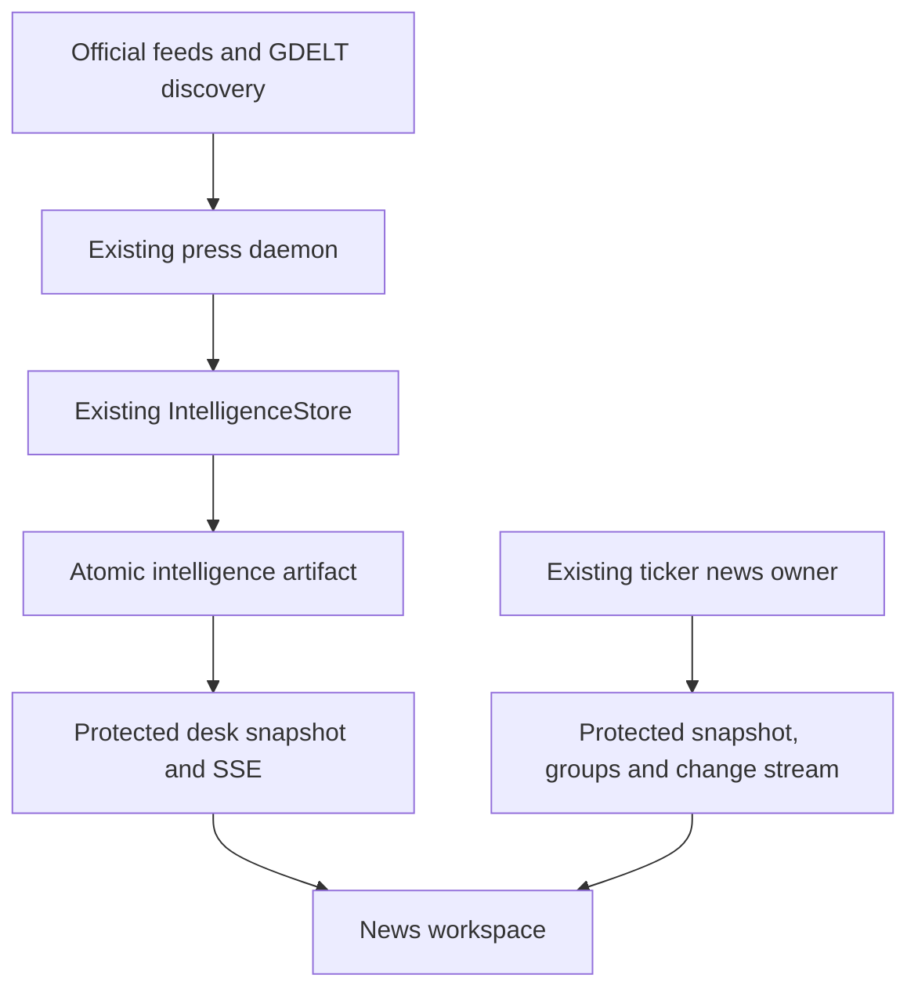

# News Intelligence rebuild

Mission: `news-cockpit-rebuild-20261018-astra-01` · 18 October 2026

## Product intent

The news page should let a reader scan a broad, changing information set, investigate a story without losing their position, and distinguish reporting from interpretation. The previous constrained page and simple ranked list did not provide that workspace. This change rebuilds the page, adds protected delivery from the existing story owner, expands official-source intake, and opens the existing company reporting system from the same desk.

The implementation is a significant product rebuild. Worldwide completeness, publisher-to-screen tick latency, and full Market Ontology parity remain claims that require further source entitlement and live measurement. The coverage panel and connection labels must keep those limits visible.

## Delivery plan and acceptance

| Workstream | Implemented result | Acceptance evidence |
| --- | --- | --- |
| Design and layout | Page-scoped full width; navigation, feed, and story columns; compact and reading densities; desktop and mobile layouts; shared dark/light tokens and English/Chinese controls | Current Paper boards and browser specimens in `evidence/news-cockpit-20261018/` |
| Exploration | Category, time, region mentioned, source, source type, unread, saved, social, and Following filters; quoted phrases, exclusions, structured terms and OR queries | Pure query tests and mounted client tests |
| Reading workflow | New arrivals wait; explicit Follow live; corrections/removals update immediately; preserved row order, scroll anchor, logical focus and open groups; saved views/stories; source and timeline tabs | Mounted aggregate and company lifecycle tests |
| Aggregate delivery | Authenticated snapshot and finite SSE stream from the incumbent atomic artifact; heartbeat, renewal, reconnect, bounded fallback and shared read cache | API tests and wire receipt; production proof recorded separately |
| Company reporting | Existing bearer-authenticated ticker API, story groups, members, cursor paging, source health, 24h/7d activity and 28-day owner-supplied counts | Protocol/mounted tests; no change to ticker API entitlements |
| Research intake | Official RSS/Atom and bounded GDELT discovery through the existing press daemon and IntelligenceStore; source revisions and health | Intake/recovery tests and isolated live intake receipt |
| Release | Canonical template output, exact-head CI and normal repository/deployment lane | `NEWS_DESK_RELEASE.md` |

## User workflow

The desktop desk uses a narrow coverage rail, a flexible feed, and a dedicated story column. At 1440 CSS pixels the measured content width is approximately 1380 pixels. Its CSS only removes the inherited width restriction for the News page; it does not replace the shared navigation or global theme.

Latest sorts by the best available reporting clock. Important uses available importance metadata. Following applies saved company/topic terms. World & economy provides a topic-oriented starting view. Filters then operate on the currently retained collection; “All loaded” is a finite local window, not a search of every historical publication. Categories and region mentions are aids to discovery, not claims of complete geographic coverage.

Examples:

```text
"central bank" -crypto
ticker:NVDA OR ticker:TSM
source:Reuters energy
topic:geopolitics region:middle_east
```

OR (or `|`) separates alternatives; terms within an alternative are combined; exclusions apply across the query. A quoted “OR” is literal text. Source names, known topic aliases, and region identifiers are normalized by the client. Social statements are off by default. A statement attributed to an official or a direct quote is not automatically independent confirmation of its contents.

Selecting a story opens its brief, source evidence and retained change timeline. Where the source provides no summary, the interface says so and links to the original. Desk context is labelled analysis. Related reporting is a small reading list based on common companies and headline terms; it does not infer causality or corroboration. Original-language material is retained when a translation is unavailable.

On mobile the story workspace becomes a full-screen dialog, with a working close action, focus containment and correct nested-dialog ownership. Company News can be opened from the workspace or a mentioned ticker. Its source-group details can remain open while the authoritative report is corrected.

Saved IDs, read markers, query preferences and views are browser-local. Protected story bodies, licensed company payloads and access tokens are not persisted to browser storage. These preferences are not account-synchronized research memory.

## Architecture and existing owners



There is no second aggregate database, source scheduler, durable queue, rights ledger or marketing publisher in this feature. `app/news_desk.py` is a read adapter. It reads `MM_NEWS_DESK_SNAPSHOT`, defaulting to `/var/lib/macro-live/public/live/intelligence.json`. The existing `IntelligenceStore`, press-state document and `marketing_fastlane_daemon` remain the ingestion, revision and scheduling owners. The existing ticker news service remains the company data and display-rights owner.

### Research acceptance

The daemon collects eligible due feeds, records the observed network attempt, creates research packets, commits them to the existing SQLite owner, atomically publishes the snapshot, and only then advances applied validators and source revisions. If publication fails after the database commit, the next attempt replays the same revisions idempotently. A 304 updates fetch health without inventing a new story or publication time. Absence from an RSS response is not a retraction.

A source item retains its upstream ID (or the existing canonical URL key) separately from its meaningful content revision. Amendments keep story identity, preserve first-seen time, replace changed fields including newly empty values, and retain bounded earlier versions. Older declared revisions cannot overwrite newer ones. Ambiguous same-clock changes and identity/purpose collisions fail acceptance.

Research packets stay `reported`, have one source observation, and have no marketing drafts or publishing routes. The marketing approval and late-LLM paths reject these research packets. The aggregate projection reserves space for research (360 of a 600-item projection), while retaining the existing consequence and legacy story owners.

RSS requests use the configured HTTPS host boundary, bounded redirects, a five-second absolute deadline and a one-megabyte body cap. The owned subprocess can be terminated even during DNS, TLS or a trickling body. Entity/doctype documents are rejected. The parser examines the complete bounded feed; more than 150 eligible unique items fails the batch instead of silently acknowledging a truncated tail. GDELT discovery reuses the existing client, cross-process throttle and circuit breaker inside a bounded subprocess. Only one due GDELT source runs per daemon tick, chosen fairly by last attempt.

### Aggregate stream protocol

`GET /api/news-desk/snapshot` returns `intelligence.desk/v1`. `GET /api/news-desk/stream` starts with a full snapshot, including when the client supplies Last-Event-ID. Subsequent meaningful changes deliver full replacements. Export-clock-only changes do not create a news revision; corrections, removals and source-health changes do.

The adapter observes file identity on a one-second interval. A per-process locked cache shares one validated read and hash across readers of the same atomic file revision. Authentication occurs before cache access. Missing, oversized, malformed, duplicate-ID or non-JSON-number artifacts fail closed; the cache does not serve the previous file as if it were current. Atomic replacement during a read cannot bind old bytes to the new file identity.

Heartbeat is connection evidence only. Streams emit a heartbeat at five seconds and renew after 60 seconds through canonical authentication. The five-second interval follows the accepted company-news edge-idle repair in Macro #9893; it is not publisher-to-screen latency or proof of deployed aggregate-stream behavior. Client generation fences ignore late responses from obsolete sessions. A missing first frame or repeated connection failures enters bounded 10-second polling, visibly labelled; a quiet source does not acquire a new publication time because a heartbeat arrived.

### Company protocol

The company workspace obtains an access token through the existing `MDXAuth.client()` session helper and sends it only in the Authorization header. `app/ticker_news.py` retains its always-on full-site entitlement and source-rights decisions. Snapshot cursors and change sequences are different contracts; change notifications invalidate and refresh the authoritative snapshot rather than masquerading as full story rows.

The client starts notifications after the largest visible sequence, accepts harmless replay, coalesces changes into snapshot refreshes, and does not treat that sequence as a guaranteed snapshot watermark. An empty visible snapshot uses labelled polling. Earlier pages pause live following and periodically recheck the protected page. Connections renew at 45 seconds and have a read-idle watchdog. HTTP 429 preserves a 60-second wait; HTTP 404 is terminal until a deliberate user action.

New story groups wait for explicit display. Existing corrections retain the previous visible order and open source groups, while removals apply immediately. Per-group request ownership prevents a detached request from clearing a newer feed. An actual access denial still clears protected content. Close, sign-out, identity change, background suspension and page exit abort owned requests and discard company payloads.

## Freshness and latency budget

| Clock or interval | Meaning |
| --- | --- |
| Publisher publication | Source-supplied original publication time, when available |
| Publisher update | Source-supplied amendment time, kept distinct from publication |
| Provider indexed | Discovery/indexing observation, never relabelled publication |
| First seen / accepted revision | This desk's receipt and acceptance clocks |
| Connection heartbeat | Delivery connection remains responsive |
| One-second aggregate observation | Artifact-to-transport polling interval; not publisher-to-screen latency |
| Approximately 75-second collector loop | Existing press service cadence |
| 120/180/300-second source schedule | Eligibility intervals; rounded up by actual daemon turns and affected by runtime/backoff |
| 10-second fallback | Client recovery mode, explicitly labelled |

A nominal 120-second source schedule commonly becomes about 150 seconds with the existing 75-second daemon loop; 180 seconds becomes about 225 seconds. Network time and retry/backoff add to that. This release does not turn an RSS source into a publisher-push feed. Source timestamps more than five minutes into the future are not displayed as current reporting, including under All loaded.

Before a publisher-to-screen performance claim, measure publication/arrival, owner acceptance, snapshot publication, transport receipt and client paint for the same source revision. Report p50/p95/p99, clock quality, failures, concurrency and source coverage. No production latency percentile or concurrent-reader capacity result is inferred from the local wire test.

## Sources, rights and remaining scope

See [NEWS_DESK_SOURCES.md](NEWS_DESK_SOURCES.md) for configured source scope and primary references. Free-source notices, attribution and original links are part of the interface. The existing pre-purchase ECB notice is extended to news releases. Institutional ECB paths are admitted; authored speeches, interviews, blogs and research are outside this added intake.

The existing holds associated with #8697, #7982 and #8057 remain in place. This work does not activate a commercial publisher subscription or purchase redistribution rights. BBC business-feed permission is not established. GDELT metadata is discovery of reporting and does not provide third-party article-body rights.

The following north-star capabilities remain outside the evidence for this release: complete worldwide wire coverage; guaranteed publisher-push tick latency; fully validated entity/event clustering across all publishers; automatic second-order exposure graphs and portfolio impact; cross-device research memory and alert delivery; translated full text for every source; large-scale concurrency and production latency percentiles. Existing Event impact and economic calendar integrations are preserved, with source-bound semantics, rather than presenting unsupported new analytics.

Legacy R20 ingestion issues remain separately owned: seen/cursor advancement before acceptance in older paths, destructive legacy spool draining, late LLM overwrite, and sticky legacy verification counts. The new research path avoids those failure modes. This release does not certify all legacy intake as repaired.

## Verification and reproduction

From the repository root, with its existing Python environment and Node available:

```bash
python3 -m pytest -q \
  tests/test_research_news_intake.py tests/test_news_page_render.py \
  tests/test_marketing_intelligence_desk.py tests/test_news_desk_api.py \
  tests/test_gdelt_client.py tests/test_news_desk_js.py

npm --prefix tests/news-desk ci --ignore-scripts --no-audit --no-fund
npm --prefix tests/news-desk test
```

The isolated DOM harness pins jsdom 26.1.0 and its lockfile. It introduces no application runtime dependency. It reads canonical `site/news.html` by default and loads the source client modules with deterministic auth, requests and timers; no browser/network is used. `NEWS_DESK_TEST_HTML` can select an alternative rendered page; use an absolute path because npm changes the working directory.

The Python wrapper executes the 19 pure JavaScript query/protocol assertions as two CI tests. The mounted suites separately exercise 14 aggregate and 12 company scenarios. Do not sum the wrapper and its child assertions as independent tests. Browser specimens are separate visual evidence, using illustrative reporting. The local fixture server is a development harness and is not imported by the production app.

`scripts/build_site.py` owns `site/news.html`; preserve its generated counterpart in the PR. `scripts/build_public_pages.py` is the existing fast builder for the pricing notice. Restore unrelated generated data/site changes from a local full build before publication; never restore task-owned sources or another writer's work.

## Operating and recovery notes

Use source-health clocks to distinguish an unavailable collector from a successfully checked but quiet source. The UI reports loaded-source counts separately from observed source health. A source's presence in the retained story collection does not establish that it is currently online. Review the existing press service, press-state and atomic artifact before changing schedules or replaying anything.

On an invalid artifact the API returns 503 or terminates an existing stream with an unavailable event. Restore through the existing owner and normal atomic publication path. Do not replace it with browser fixtures or a stale cache. On access loss, both client workspaces discard protected live state. A saved ID may remain in preferences; it conveys no entitlement to retrieve the corresponding content.

Release through the existing exact-head publisher and `merge-on-green` lane. Main is unprotected; never use `gh pr merge --auto`. Require the actual scheduled packs, fence and authority proof. After merge, verify the covering render, API process commit, collector PID/start, served HTML and authenticated behavior. A new checkout is not proof that the API process restarted.
