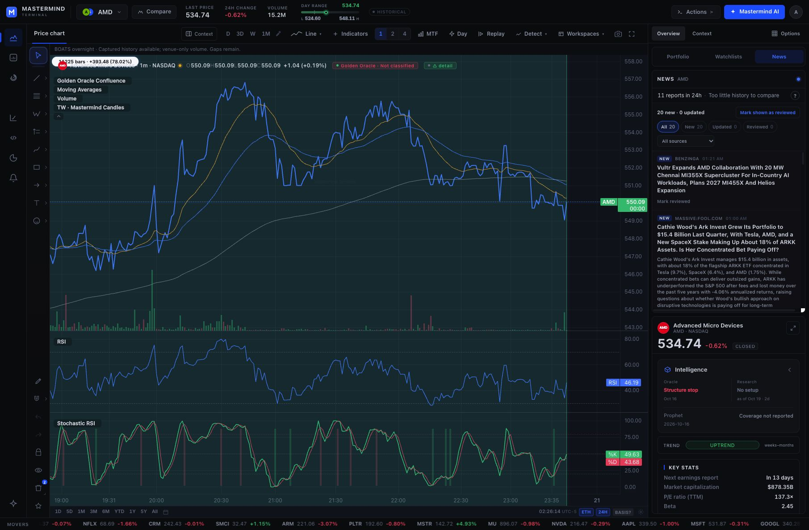

# Tiingo 24H consumer and continuous-delivery activation

## Acceptance boundary

Terminal consumer repair [PR #1093](https://github.com/mastermindx-market-intelligence/mastermind-terminal/pull/1093) merged as `ea7b20286ffeda9194597245b147719d6ed515fd` at `2026-10-21T06:54:53Z`. All sixteen jobs in original pull-request CI run `39553727716` passed on reviewed head `19d75a2fac0f623b9eee239ceb58310a35bd363d`; CodeQL also passed. The merged and reviewed trees both equal `04e74b641f53a6b34e683a71af2507036f4b6255`. Independent source review, 205 targeted tests, responsive overnight checks, TypeScript and the required refreshed chart evidence passed locally. The canonical production builder completed with exit 0; the installed marker and canonical source are `ea7b20286ffeda9194597245b147719d6ed515fd`, with build ID `build-TfctsWXpff2fKS`. At `2026-10-21T07:20:48Z`, the build lock was released and Terminal, beta and Quote Hub were active. The three checked installed consumer files match the reviewed source hashes; beta and Quote Hub retained their original process IDs. Signed-in API and chart checks passed below. This record retains the evidence and the subsequent explicit user approval below; actual runtime admission and observed effects remain separate.

At the `2026-10-21T09:41:49Z` preflight, the installed producer release was `21ff4afc1e87de2e6832e2ad1d84548aebdcb2e3` under `/Volumes/Mastermind/market-data/tiingo-runtime/current`. Its manifest names merged Macro PRs #9692, #9704 and #9805 and records `schedules_loaded: false`. Parent rehashed every listed file with no mismatch. On 2026-10-21, `launchctl print gui/501/<label>` returned 113 for each label below; the matching files were absent from `/Users/chriswong/Library/LaunchAgents`.

The prior workstream and handoff retain claims of an automatic approval rejection and an original public-relay HTTP 403/Cloudflare frontier. The bounded same-carrier review on 2026-10-21 retrieved those historical descriptions, but no originating rejection receipt, HTTP request/response identity or current provider denial. It also did not retrieve successful later PUT or final-invalidation evidence. These are unverified historical access claims, not proof of a current platform-wide prohibition or an additional blanket approval requirement. Preserve the original operation and any actual denial or unknown-effect receipt subsequently found; do not replay it or route around a current denial. The user's direct approval below authorizes the new bounded qualification attempt and conditional activation.

Later merged [Macro #9805](https://github.com/mastermindx-market-intelligence/macro/pull/9805), independently read during this review, records separate settled 600-second quote and history captures on October 20, followed by the quote-frame and latest-session source repairs in the installed release. Its replay of 100 retained receipts / 100,000 messages made no provider calls or publications. It explicitly withholds positive current-night consumer acceptance and persistent-publication authority. This proves neither successful live PUTs nor final clearing; it also prevents treating the older handoff as proof that no later finite capture occurred.

## Production consumer verification

The original production builder completed once with exit 0 after 1,440.37 seconds. It passed its source preflight, built the protected revision, activated the bundle, verified health and identity, synchronized the git-gated source/runtime paths and released its lock. The previous build remains in the builder's normal rollback location. The preflight receipt and installed source hashes are retained in [production-acceptance.json](production-acceptance.json).

Four signed-in SPY requests used the same `1m`, extended-hours, `session=24h` key and returned 20,000 bars. Both the cold and expired-cache paths returned pending metadata and later settled successfully:

| Read | Browser request start, UTC | Cache state | Pending | Baseline assembled, UTC | Refresh checked, UTC |
| --- | --- | --- | --- | --- | --- |
| R1 | 07:21:10.128 | new_assembly | true | 07:21:18.665 | null |
| R2 | 07:21:38.377 | cache | false | 07:21:21.518 | 07:21:21.518 |
| R3 | 07:22:41.282 | stale_cache | true | 07:21:21.518 | 07:21:21.518 |
| R4 | 07:22:56.808 | cache | false | 07:22:43.859 | 07:22:43.859 |

All four reads reported `refresh_error: null` and applied the same original SPY overnight snapshot without advancing its capture clock. These are successful production cache transitions, not market-freshness claims. The refresh settlement times precede the recorded DOM-read completion times in R1 and R3, so these observations do not independently prove settlement after HTTP response completion or the precise execution of the `after()` callback. Browser control/navigation timings are not a network-latency benchmark.

After loading the deployed client, the signed-in AMD chart was checked at 1m with ETH and 24H enabled. It reported “Captured history available; venue-only volume. Gaps remain.” The existing two drawings and six visible studies remained present. The header separately labels its regular-session quote Historical; this is not acceptance of a fresh live overnight quote.



The screenshot is an actual production capture, not a fixture. Its SHA-256 is `d08870f624830a04c79cc3d43390745918614f105ca018ba5083f33cf9ce3290`. Two transient browser focus timeouts were resolved by reacquiring the same observed tab; no alternate browser or account was used.

## Three existing owners

| Existing label | Source | Prepared bound | Destination |
| --- | --- | --- | --- |
| `com.macro.extquotes` | `scripts/run_boats_session.py` through `run_ext_quotes_loop.sh` and the incumbent `build_ext_quotes` publisher | 80,000,000 messages, at most eight hours and 32 sequential segments per session; each segment retains its existing bound | Existing `live_flow/ext_quotes.json` key, then installed Quote Hub |
| `com.macro.boats-live-history` | `scripts/refresh_boats_live_history.py` | 12,000 requests, 1 GiB raw bytes, 28,800 seconds, 1,500 requests/hour; existing current-interest demand | Existing SSH bridge and `/mnt/terminal_storage/boats-live-history` |
| `com.macro.boats-history` | `scripts/run_boats_history_cycle.py` | 20,000 requests and 1 GiB raw bytes per admitted completed session | Existing completed-history selector and private VPS store |

The exact prepared plists are in the sealed release's `ops/launchd/`. All set `RunAtLoad=false` and `KeepAlive=false`. Quote/current-history candidates are Sunday–Thursday at 17:00 and 18:00 Vancouver host time; source verifies the real host zone and admits only the first fifteen minutes after 20:00 New York on an eligible session. Completed-history candidates are Monday–Friday at 01:10 and 02:10 Vancouver, with the owner's New York close-window and calendar guards. Two host-clock candidates accommodate the accepted timezone policy; they do not authorize duplicate sessions. Permanent start receipts and existing single-writer locks remain in force.

Tiingo documents BOATS coverage from 20:00 through 03:59 Eastern. Terminal composes that window with its incumbent daytime source. This does not promise weekend/holiday trading, every ticker trading every minute, full-venue coverage or a common split-adjustment basis. Existing source and adjustment warnings remain intact.

## Current-night private history proof

Parent observed an independently running existing native owner and left it undisturbed. This ChatGPT turn did not start it. Original receipts:

- `/Volumes/Mastermind/market-data/tiingo/run-receipts/boats-live-history-start-2026-10-21.json`
- `/Volumes/Mastermind/market-data/tiingo/run-receipts/boats-live-history-final-2026-10-21.json`
- Adjacent `boats-live-history-2026-10-21/` per-attempt snapshots and acknowledgements.

Start: `2026-10-21T05:45:26.735969+00:00`. Finish: `2026-10-21T05:55:26.731224+00:00`. Original bounds: twelve requests, 3 MiB and 600 seconds. The final receipt records eight requests, 172,921 raw bytes, eight successful deliveries, no held symbols and `reason=seconds_budget`; `complete_history=false` remains explicit. No replay, extension, rename or deletion is admitted here.

The signed-in Terminal API applied AMD's current-session snapshot, capture `2026-10-21T05:45:28.528124Z`, SHA-256 `3127530b4efc4438aee21bacacb89a5207c73a2d23b5632bb57b4c3022f685ad`. SPY's delivered snapshot is `d1011cedd78c18f1439da501241286b153a2dfd7d9bc6738bc16942130ff14a7`. Both latest source minutes were `2026-10-21T03:46:00Z`, roughly two hours before the fetches. Successful transport does not establish current completeness or fresh trade delivery. Unchanged raw data retains its original capture clock; later checks have their own fetch receipts.

The historical API selects the latest overnight window when dates are omitted. The reviewed documentation specifies neither a two-hour delay nor a bar publication cadence. Do not describe this source age as a documented entitlement delay. A qualifying retained execution in a later minute for the same symbol/session would distinguish incomplete history from no later eligible trading; a later bid/ask update alone would not.

## Finite quote command boundary

The old sealed release `21ff4afc1e87de2e6832e2ad1d84548aebdcb2e3` does not expose the runner's existing `total_max_seconds` setting through its CLI. Its eight-hour default rejects a single sixty-second segment. The source repair adds `--total-max-seconds`, defaulting to the unchanged 28,800-second limit, and passes it to the existing validated `SessionConfig`. Existing session/calendar guards, kernel lock, permanent start receipt, final receipt and publisher remain the only owners. Install and rehash a new sealed release from the accepted merged revision before invoking this option; never hot-patch the old sealed release.

After the provenance reconciliation above and current identity/writer/receipt preflight, the approved command is the existing environment loader and runner, using the existing coverage file and archive:

```sh
cd /Volumes/Mastermind/market-data/tiingo-runtime/current
/bin/sh ops/launchd/run_with_env.sh \
  '/Users/chriswong/Documents/Cluade/Macro Dashboard/.env' \
  /usr/bin/env PYTHONPATH=/Volumes/Mastermind/market-data/tiingo-runtime/current \
  /usr/bin/caffeinate -i -s /opt/homebrew/Caskroom/miniconda/base/bin/python \
  -m scripts.run_boats_session --publish --scheduled \
  --symbols-file /Volumes/Mastermind/market-data/tiingo-runtime/config/symbols.txt \
  --archive-root /Volumes/Mastermind/market-data/tiingo \
  --total-max-seconds 60 --total-max-messages 20000 \
  --max-segments 1 --segment-max-seconds 60
```

Sixty seconds is the capture budget; connection teardown, archive flush and publication cleanup can finish later. The 20,000-message cap counts all received provider frames and may stop capture sooner. A capped result exits 5 and retains its structured terminal reason; that is an expected bounded partial, not full-night success or a retry request. Exit 0 outside the admitted window does not prove publication. A true `publication_ok` alone can describe empty publication and does not establish a qualifying trade.

The canary consumes the trading session's permanent start receipt. Never delete, rename or replay it, extend the finished capture, or start the full quote schedule in that same session. The next eligible opening after this approval is `2026-10-22T00:00:00Z` (October 21, 19:00 Chicago / 20:00 New York), targeting trading session `2026-10-22`. If that canary passes, the full recurring quote owner first becomes eligible on the next unused session, normally the following evening. Installing `RunAtLoad=false` jobs after the canary does not authorize a kickstart.

The direct `build_ext_quotes.py --boats` segment bypasses the runner's lock and start receipt, so it is not the selected canary interface. The original finite operation `tiingo-boats-publish-20261012-01a12ab6` remains preserved and is never adopted or resumed by this work. No new canary was executed in this source-verification step.

Regression proof: the new CLI tests first failed against the old unrecognized option; `python3 -m pytest -q tests/test_boats_session_runner.py --tb=short` then passed all 46 tests and four invalid-budget subtests. They exercise the real runner with a stubbed provider segment, real temporary kernel locks and permanent receipts, same-session replay refusal, pre-effect budget validation, unchanged defaults and effect-free dry runs. These offline results do not substitute for live trade-path qualification.

## Approved conditional activation

On 2026-10-21 the Chairman replied **“Yes approved, continue”** to the concrete proposal for one existing-publisher canary capped at sixty seconds and 20,000 messages, after publication-access reconciliation, followed by conditional activation of these three existing jobs only after real-trade, final expiry/clearing, writer-exclusion and activation checks pass. This is current approval; do not ask for it again. It does not authorize bypassing an actual provider denial, human-only authentication, a live writer or an unresolved effect. Protected Mastermind `ACTIVE_EXECUTION.md` at `1b240d2fcbd576a31cca080950cac4fb3b0af044` requires distinguishing an originating tool/provider receipt from historical handoff prose before deciding what remains denied.


1. Retain the completed consumer CI/merge/deploy and live API/chart acceptance above. Preserve the recorded timing limitation: pending-to-successful-cache transitions are proven, while precise post-HTTP callback timing is not. The 1,200 ms daytime foreground budget bounds that wait, not complete-history or vendor-to-screen latency; a cold response may contain only overnight bars before the next existing five-second refresh.
2. Use the refusal-provenance reconciliation above, then recheck the existing configured identity in place, the original carrier, current writer exclusion and immutable session receipts. No current access denial has been verified by this review; successful publication remains unproved until the approved canary. Stop through the incumbent owner's denial handling if the provider actually refuses. Private SSH delivery is not R2 publication proof. Do not change account, route, key or credentials to avoid a denial.
3. Once that exact action is admitted, qualify one attended finite invocation of the existing quote owner in a real BOATS session. Use explicit small message, segment and time caps; preserve immutable raw/start/final receipts. Prove a qualifying trade through the existing relay, Quote Hub, API and visible chart, keeping trade, receipt and display clocks distinct; verify final empty/expiry. Do not overlap an actual writer or replay a same-session start receipt.
4. Only after the quote canary and consumer qualification pass under the explicit approval above, recheck release hashes, private permissions, provisioned identities in place, host zone, actual session/calendar, at least 40 GiB archive reserve, actual writer exclusion, owner locks/start receipts and current runtime selectors. After those checks pass, install the exact three prepared plist files into the existing user's LaunchAgents directory and bootstrap their existing labels. Read back the loaded configuration and process state. Do not kickstart, enable crash relaunch or replay the settled current-night operation. With `RunAtLoad=false`, installation schedules only the next eligible calendar event.
5. Consume each first scheduled run's actual final receipt and acknowledgements. Verify session boundaries, exclusion of overlapping writers, source/trade age, corrected and unchanged snapshots, empty responses and expiry. A loaded label alone does not establish successful recurring delivery.

## Recovery

Use the existing labels and owners. Rollback unloads the affected launchd label and reconciles any active operation through its original owner. Preserve immutable receipts, raw archive, held-symbol set, snapshots and delivery acknowledgements. Unknown publication is not automatically retried; deleting a start receipt or lock to permit another writer is forbidden. Producer rollback does not require restarting Quote Hub or replacing Terminal; consumer rollback uses its existing deployment owner if independently needed.

No new collector, relay key, queue, service, preference owner or secret file is introduced. Credentials and licensed market rows remain private.

## Verification provenance

- Resolve `current`, read `release.json` and SHA-256 every declared producer file.
- `launchctl print gui/501/com.macro.extquotes`, `launchctl print gui/501/com.macro.boats-live-history`, `launchctl print gui/501/com.macro.boats-history`; inspect prepared plists and absent installed target files.
- Read original start/final receipts and per-attempt snapshot/acknowledgement files, without replaying capture.
- Authenticated browser navigation to `/api/intraday?sym=AMD&tf=1m&ext=1&session=24h`; inspect visible JSON and BOATS provenance.
- Official contracts: https://www.tiingo.com/documentation/boats and https://www.tiingo.com/documentation/websockets/boats. Documentation establishes interface semantics, not freshness of these observations.
