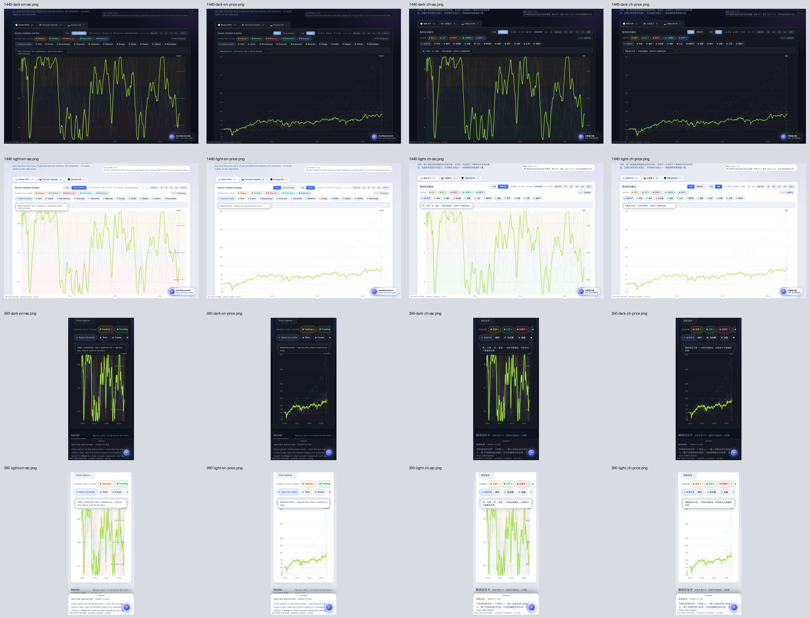
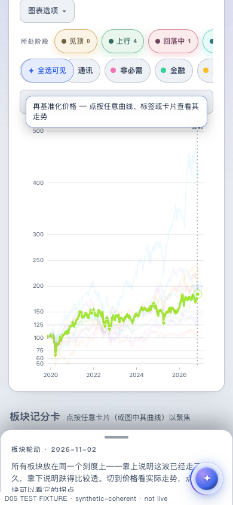

# D05 — mode-correct first-use chart guidance

**SELF_REVIEWED.** Parent `e09f7c4667a5dfbf0b209ad826b4692c15c3ca10`; original Draft/HOLD [Macro #10703](https://github.com/mastermindx-market-intelligence/macro/pull/10703), branch `claude/d05-native-cycles-20261104`. Protected source-law pin: Mastermind `f4e418163882211c9f0e56ae3d93851543eda2bf`.

## User-visible result

A fresh Price deep link describes rebased prices instead of calling high prices stretched and low prices washed out. The first real mode, scale, or restored-view synchronization clears the existing one-shot hint. Returning to an earlier mode does not recreate it. Initial Cycle position guidance remains available in English and Chinese.

The change stays in the existing `syncHeroControls`, `showFirstHint`, and `clearFirstHint` lifecycle. It adds no timer, dismissal owner, history owner, or state schema. The initial hint uses text content. The source and generated renderer are byte-identical: Git blob `13d359b8d299bc55b725e8710b84343cc1b37d73`, SHA-256 `4f719b75d47c8b5e407942e847e6adb1d146e21d8c010dd227e74bb83f709a7e`.

Five existing generated pages receive the renderer's actual content stamp `4f719b75`: Country Cycles, Sector Central, China Central, Sector Cycles, and China Sector Cycles. Only their script URL stamps change; their existing body and market data are retained. Country consumes the shared renderer but no Country-specific template or product contract is changed.

## Executed verification

| Check | Observed result |
| --- | --- |
| Focused source suites | **118 passed, 3 skipped in 24.83 s** |
| Actual Chrome presentation matrix | **16/16 pass**: 1440×1000 and 390×844 × dark/light × EN/ZH × initial Cycle/Price |
| Initial Price guidance | Correct localized price copy; no oscillator-only copy; oscillator caption hidden |
| Keyboard mode changes | Actual SVG geometry changes, then matches the original geometry on return; hint stays dismissed |
| Reload | Actual mode, scale, chart geometry, and initial guidance match the selected presentation |
| Same-URL strict restoration | **2/2 pass**, desktop dark/EN and phone light/ZH, through the existing `SectorCyclesApply` owner |
| Restored Price/Linear chart | Actual SVG geometry equals the corresponding fresh Price deep-link geometry |
| Keyboard scale and timer | Existing mobile Chart options opened before keyboard use; Log applies; hint remains absent after 11.5 seconds |
| Browser errors, missing fixture assets, outer document overflow | **0** in the passing cases |
| Captures | **16 initial-view PNGs + 2 restored-view PNGs**, source-file hashes retained |

The focused command was:

```sh
python3 -m pytest -q tests/test_sector_cycles.py tests/test_cycles_entry_state.py tests/test_cycles_publication.py tests/test_sector_paper_copy_deck.py
```

The first restore-driver attempt passed the restoration itself on both widths but tried to focus the phone's hidden Log control before opening Chart options. Its scale assertion failed. The corrected driver uses the existing visible toggle and verifies focus before pressing Enter. Both cases then passed without another production source change. [The original attempt](restore_attempt1.json) is retained.

[Presentation result](result.json) · [Restoration result](restore_result.json) · [Executed presentation driver](verify_guidance.py) · [Executed restore driver](verify_restore.py) · [Unit output](unit_result.txt) · [Source manifest](source_manifest.json) · [Fixture provenance](fixture_provenance.json) · [Artifact hashes](artifact_manifest.json).





## Qualification and continuity

The browser used actual Chrome, the existing producer/verifier and renderer, and a coherent synthetic publication built from the retained archive. It asserts actual DOM theme/language, verified publication state, rendered SVG geometry, and error/overflow state. It is fixture proof, not a current market-engine run, authenticated account/tier proof, production deployment, or full D05 acceptance.

The bounded native reasoning child checked the existing initialization/restore ordering; it did not implement this change, run the browser evidence, supply a formal GitHub approval, or act as an admitted paid Fabric worker. No eligible admitted D05 Fabric root/grant was recovered; original programme identity was not treated as execution authority.

Publication uses only the original expected-head, non-force Git Database carrier. Terminal #1244, unpublished compact Dossier #10707, uncertain Paper effects, F01/F02, regional source/account/correction gaps and release holds remain in their original custody. No merge, Ready/un-draft, enqueue, hold weakening, or deployment occurs.

Next safe implementation phase: finish localized and mode-truthful chart descriptions in the existing standalone and native Central US/China template owners, including the generated pages. The initial accessibility milestone covered the US standalone template; it does not claim those other template owners were already corrected. Observe final-head CI after the source milestone, and repair only concrete failures.
