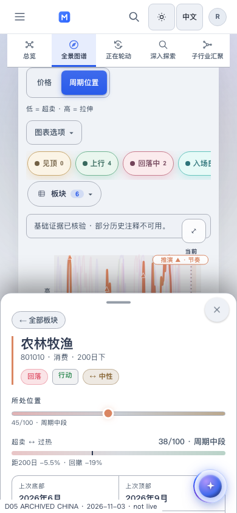
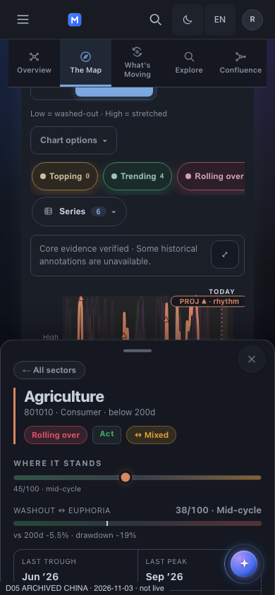

# D05 — archived China navigation, mobile surface and accessibility repair

Recorded 2026-11-05 08:21 UTC. Classification: **SELF_REVIEWED; bounded archived-China proof, full D05 still open**.

## Follow-up

The later [standalone presentation receipt](../china_history_20261105/README.md) closes the specific Price/Linear reset recorded below. The rest of this document preserves the earlier phase's observations and limits.

## Outcome

Returning from a selected Shenwan sector to China Sector Central now opens the visible Map with that exact native selection. The phone detail sheet and sticky view tabs remain legible over the chart in both themes. The sheet close control is exposed to assistive technology, localized in English/Chinese, and operable with Enter. Missing archived engine text is described as unavailable in the source.

The functional proof uses the actual retained Next application and existing legacy iframe bridge. It does not certify a deployed authenticated product.

## Source and custody

- Source-law pin: `mastermindx-market-intelligence/Mastermind@f374289eb74587eaa755f5bc8e5a3252d00850e0`.
- Original implementation carrier: [Macro #10703](https://github.com/mastermindx-market-intelligence/macro/pull/10703), branch `claude/d05-native-cycles-20261104`.
- Candidate parent: `5344e0e19b4032c831e8cff0cd6f67d9f473d50a`, tree `a9b7e0c7099a31692ad0bff8fca978402e9a06a4`.
- Archive: `2e6c45899a9aeb7f90f03f85272aaff3ca42f4eb:site/chinasectordata/sector_cycles.json`.
- Archive SHA-256: `e5fd4fa4fbe8329e4707e6d6e75168976dfc8b325c84c6b1f2499f61d1329da7`.
- Source identity: **China / 2026-11-03 / SHCOMP / 31 Shenwan sectors / 22 thematic baskets**.
- Publication: `cycp1-50deb45af82026a1f6d27d9ff7b8a09e20703100dd99af67098f0246255fff2a`.
- Sector spine: `china:sectors`, SHA-256 `1b750fd57fbfc4213420f4635aad4c5cacb7f79505f6d0e32906db18cc3a3716`.

The exact source/assets/helpers were read from the preceding qualified commit `82c377fb` and are equivalent at parent `5344e0e`; the latter only added Dossier evidence, quote capacity and receipts. Candidate source and generated-copy digests are in [source_manifest.json](source_manifest.json). The original tracked verification worktree, its 131 pre-existing dirty paths, index and branch were not rewritten.

Publication uses the original Git Database expected-head, non-force branch update. The unpublished compact Dossier layout from #10707 and its refused publisher effect were not adopted. This patch is a distinct China Map/sheet repair discovered by the current browser proof.

## Why the changes are needed

1. **Selected chart hidden after return.** The China router understood named views and basket/theme anchors, but a native sector hash fell back to Overview. It now selects Map only when that exact ID is a member of the current China sector payload. It reuses the existing `sc:cycles-data` event for delayed payload arrival. Unknown IDs, foreign regions and malformed cohorts do not acquire China membership.
2. **False “generating” message.** An immutable archive with no `now.read` did not establish an active generation process. The English and Chinese fallback now says the engine read is unavailable in this source.
3. **Transparent phone sheet.** China desktop rules flattened both the chart and detail into one island at every width. At phone widths the detail is a fixed sheet, so those rules removed its background, rounding, shadow and padding. Flattening the detail now applies only at desktop widths; the existing mobile sheet recipe supplies the opaque surface and readable inset.
4. **Transparent sticky tabs.** The desktop transparent rail rule also affected the mobile sticky overlay. Desktop-only padding/transparency now stops below 768 px, preserving the existing mobile panel fill and compact five-tab layout.
5. **Hidden close control.** The China sheet injected a real button into an `aria-hidden` handle. The interactive handle is now exposed, and the button’s accessible name follows the existing locale/rerender owner.

The three plain JS/CSS template/site pairs are byte-identical. The changed template style block is also emitted verbatim as `site/assets/css/e6650a73.css`; the existing production China HTML changes only four asset-reference lines. Its market data/body is preserved. No archive-labelled fixture page is published under `site/`.

## Verification

| Case | Result | Meaning |
| --- | --- | --- |
| Existing China workspace suite plus native-hash regression | **58 passed** | Actual router executes with delayed/missing/foreign/malformed cohorts; existing named, basket and theme routes remain valid |
| Desktop 1440 × 1000, dark, EN | **PASS** | Native archived chart, real controls, selected return, Back/Forward identity |
| Phone 390 × 844, light, ZH | **PASS** | Same journey; opaque sheet/rail; localized accessible close and Enter dismissal |
| Phone 390 × 844, dark, EN | **PASS** | Same mobile behavior and contrast separation in dark theme |
| Browser JavaScript errors | **0 in all three cases** | No uncaught page errors in the exercised path |
| Horizontal layout | **No outer or inner document overflow** | The returned 390 px view and 1216 px desktop iframe stay within their viewports |
| Reduced motion | **0 s sheet transition in both phone probes** | Existing reduced-motion styling remains effective |
| Captures | **9 PNGs** | Three screens per case; all upload Git blob IDs match the original captured bytes |
| Desktop visual preservation | **3/3 byte-identical to the preceding routing-only candidate** | The mobile surface refinement did not alter those captured desktop screens |

[Full browser result](result.json) · [fixture provenance](fixture_provenance.json) · [image hashes](image_manifest.json) · [unit result](unit_result.txt) · [negative observations](regression_observations.json).

Screenshot SELF-QA inspected the final desktop return and both mobile return screens. The selected name, source ID, state chips, cycle position and readings are readable against an opaque sheet; the chart remains visible above the half-height sheet. Sticky five-view navigation is readable. Lower detail content scrolls inside the sheet. The horizontal phase-chip rail remains intentional.

## Exact journey and limits

The first entry opens China Central Map. The next entry deliberately navigates to the existing canonical standalone China Cycles deep link `#801010`; it is **not** falsely counted as a Central → Dossier transition. The selected Agriculture / 农林牧渔 sector supports real Price and Linear controls. The actual visible “Open in Sector Central / 在板块中枢查看” link returns to a visible Map with the same native sector, region, benchmark and source date. Browser Back and Forward preserve that selection and dated identity.

**Advanced chart settings are still a gap on this China history path:** after choosing Price/Linear, browser Back restores the default Cycle position/Log state. This evidence does not claim mode, scale, range, filter or leg restoration for China.

The current Dossier and Members integration is explicitly US-only. The China Members hook correctly returns null, and no native China constituent-to-Company journey is claimed. Core/series evidence is verified; narrative and DNA are explicitly `source_unavailable`. No missing annotation, holdings, model read or regional Company identity was synthesized.

This is an **archived fixture** with explicit fixture-only identity/cookies, not a real signed-in account. External requests are aborted. Four optional endpoints were not staged and returned 404: `chinastatedata/participation.json`, `chinabasketdata/narrative_emergence.json`, `chinasectordata/desk.json`, and `basketdata/pulse.json`. That limits the claim to the chart/navigation path, not full China Overview/Confluence or live-data acceptance.

The recorded [preparation](prepare_archive.py), [candidate preparation](prepare_candidate.py) and [browser driver](verify_candidate.py) are the scripts as executed in the retained original host layout. They reference the original paths, pinned Git objects and existing servers on 3100/8765. Reproduction needs that qualified source layout and a candidate overlay assembled from the five changed source files; these are not a newly installed runner or a claim of portable CI execution.

## Programme boundary and exact next actions

D05 remains **13 routes, 174 capability rows, 12 editable Paper candidates, 119 planned full acceptance cases**. These three cases are not substituted for that matrix or summed with overlapping historical counts.

The earlier repair at parent `5344e0e` has passing fences and passing ci-pack-4 (quote capacity), ci-pack-1 and ci-pack-9 at the last relevant read; other full-CI packs were still running. The commit containing this receipt requires its own hosted CI result. Existing CI owns the new router test through its existing module.

Fresh Paper reads still show all 12 boards / 1,448 nodes on `01M6FAXA774QT1VRDMAG7DFQ2W`, page `p-3-0`. Catalog `16e6b93f…` is not write-qualified against adapter `ac18857d…`; no Paper mutation or uncertain-effect replay occurred.

Distinct remaining work includes exact-current-head CI, China advanced history state, regional Dossier/Members/Company semantics, real account/tier/save/reopen and natural refresh/correction/history proof, Terminal #1244 source publication, Macro #10639’s genuinely merged route base, SC-066/SC-092/B12, and final F01/F02 acceptance. The fresh public beta probe remains an anonymous HTTP predeployment baseline, not browser/auth acceptance.

Continue through independent safe lanes. Preserve accepted Paper work and earlier verified source/evidence. Reconcile original refused/uncertain effects only with their original owner/carrier. **Draft/HOLD, no Ready/un-draft, merge, enqueue, held-label change, deploy or purchase remain in force.**
