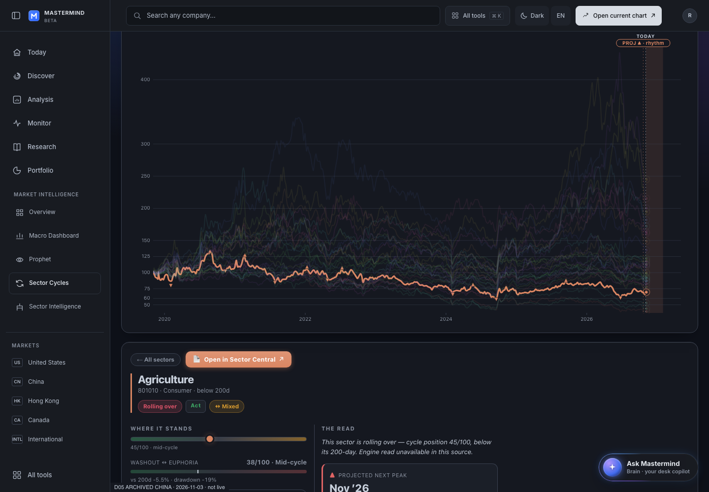
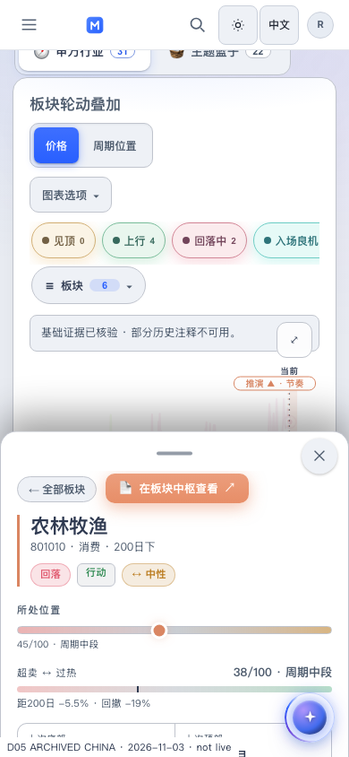

# D05 — standalone chart presentation survives history and reload

Recorded 2026-11-05 08:36 UTC. **SELF_REVIEWED.** This bounded follow-up closes the Price/Linear reset observed in the [preceding China browser receipt](../china_archive_20261105/README.md).

## Result

A selected China sector can use Price / Linear, open Sector Central, then use browser Back to recover the same rendered Price / Linear chart. Reload also recovers the presentation. Forward returns to the embedded China Map with its own default presentation and the exact selected sector.

The actual SVG paths after Back and reload match the previously rendered price chart in both qualified cases. This verifies the plotted chart, not just stored settings or pressed buttons.

## Implementation and ownership

Parent: `1f050a234311a8c2a90d325b048159ebf2fe2386`, tree `1f3f99e610fdd0b94d5e502c717a7322de7471c2`, original [Macro #10703](https://github.com/mastermindx-market-intelligence/macro/pull/10703) branch `claude/d05-native-cycles-20261104`.

The existing `sector_cycles.js` standalone owner reads/writes two bounded presentation parameters: `sc_mode=price` and `sc_scale=linear`. The existing defaults remain `osc` and `log`. Each parameter accepts only its known enum; invalid or duplicate owned values fall back to that parameter's default. Values are read before initial rendering and by the existing Back/Forward/hash reader.

Changes use the existing wrapped `history.replaceState`. The selected hash, foreign `history.state` object and unrelated query bytes/order/duplicate keys are preserved. Re-selecting unchanged settings does not write again. Returning to defaults removes only the two owned parameters. No storage registry, listener loop, bridge payload type, authentication rule or source identity was added.

All three existing embedding guards remain authoritative: explicit `SectorCyclesHost`, `SC_LAZY_EXTRAS`, and a `.si-view` host. Embedded charts ignore these standalone parameters, write no presentation URL, and keep their existing host notifications. This does not extend Terminal's typed D05 view-state contract or replay its refused publication.

The template/site renderer copies are byte-identical. All five existing generated pages referencing that renderer receive its actual content stamp `b5558157`; only those asset URLs change in the generated HTML. Their market data/body is retained. Existing EW-P4 receipt inputs do not include the renderer, China router or changed China-only surface files; its accepted source/render evidence was not re-run or relabeled.

## Evidence

| Check | Result |
| --- | --- |
| Publication/renderer suite + China workspace suite | **73 passed in 2.10 s** |
| Actual receiver behavior | Valid/default/invalid/duplicate/encoded parameters; exact unrelated-query preservation; existing foreign history object; no redundant checkpoint; traversal/reload; all three embedding guards |
| 1440 × 1000, dark, EN | **PASS**, including actual Price/Linear geometry after reload and Back |
| 390 × 844, light, ZH | **PASS**, including geometry, visible return Map and localized Enter close |
| Selected chart SVG paths | **32 paths per case; exact equality before departure, after reload and after Back** |
| Browser errors | **0 in both cases** |
| Screenshots | **8 captured PNGs**, with exact host SHA-256 and Git blob identities |
| Raw report/provenance | Uploaded bytes match the original host files, including their final newline |

[Raw result](result.json) · [source manifest](source_manifest.json) · [fixture provenance](fixture_provenance.json) · [image manifest](image_manifest.json) · [executed driver](verify_history.py) · [unit result](unit_result.txt).

Screenshot SELF-QA inspected the returned desktop price chart and the phone Price view with its opaque selected-sector sheet. The native controls and source context remain readable. Both source-qualification banners and the archive marker remain visible.

The previous receipt's raw result/provenance files also regain their original final newline in this commit. Their uploaded Git blobs now match the original host artifacts exactly; no result fields or original images changed.

## Source qualification and remaining scope

This reuses the actual **China / 2026-11-03 / SHCOMP / 31 sectors / 22 baskets** archive and verified core/series publication from the preceding receipt. Narrative and DNA are explicitly unavailable. The environment uses the existing retained Next host and bridge with explicit fixture-only identity. Optional unstaged endpoints still return the four documented 404s. It is not a current market-engine run, real account test or production deployment.

The two settings are presentation preferences. They do not claim historical source identity, membership, account authorization, saved research or a complete standalone view snapshot. Standalone range, phase filters, basket selections and selected leg are not promoted to full history acceptance by this receipt. The China Dossier/Members/Company chain remains outside the current US-only contract.

Original Draft/HOLD and publication controls remain. The commit containing this receipt needs its own exact-head hosted CI result; a predecessor run or local suite does not substitute for that result.
