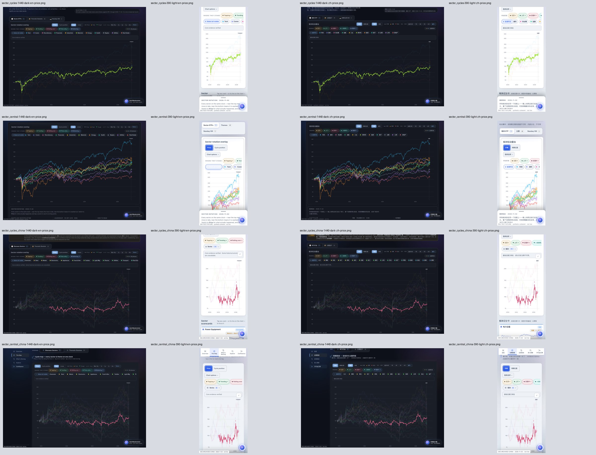
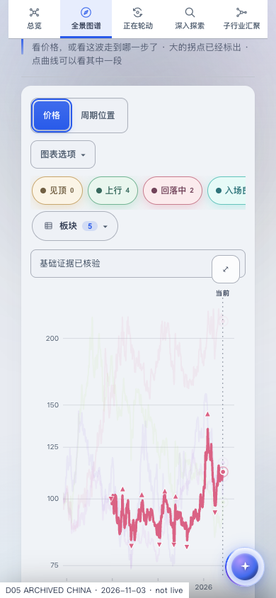

# D05 — localized chart semantics across US and China

**SELF_REVIEWED.** Source parent `f0f7aa176e600c5d21a656ae483ce3693b8c9151`; original Draft/HOLD [Macro #10703](https://github.com/mastermindx-market-intelligence/macro/pull/10703). Protected Mastermind source-law pin: `f4e418163882211c9f0e56ae3d93851543eda2bf`.

## User-facing result

The standalone US/China charts and the embedded Central US/China charts expose localized accessible names and descriptions. The descriptions explain both rebased price series and the 0–100 cycle oscillator. They no longer describe every mode as an oscillator or every regional/thematic series as a sector ETF.

| Surface | Existing owner | Accessible name |
| --- | --- | --- |
| US standalone | `sector_cycles.html.j2` | Existing dynamic `sc-hero-title` |
| China standalone | `sector_cycles_china.html.j2` | Existing dynamic `sc-hero-title` |
| US Central / Cycles | `sector_central.html.j2` | Existing visible, focusable `sc-cycle-heading` |
| China Central / Map | `sector_central_china.html.j2` | Existing visible map heading, now identified by `sc-cyclemap-heading` |

The three surfaces that contain scorecards describe those as summaries. China Central deliberately has no scorecard section, so its description makes no such claim. None claims a table of plotted points.

Only four template owners and their four corresponding generated HTML pages change. The existing language text-node convention, status region, controls, routes, renderer, CSS, and source data remain intact. This slice does not alter Country markup. The renderer remains the exact `4f719b75…` source published in the preceding guidance milestone.

## Actual browser evidence

**16 accepted cases / 64 actual Chromium accessibility-tree readbacks**:

- Four surfaces: standalone US, standalone China, US Central `#cycles`, and China Central `#map`.
- English and Chinese on desktop 1440×1000 dark and phone 390×844 light.
- Each case reads the actual image role, single-language name and description in Cycle position, Price, thematic baskets, and returned Cycle position.
- Keyboard activation and focus are verified. Mode buttons report the active choice through `aria-pressed`.
- Actual SVG geometry changes between Cycle position and Price. Basket views retain rendered paths.
- Zero JavaScript page errors and zero outer-document overflow in all accepted cases.
- Sixteen exact-hash PNGs, a contact sheet, and full-size Central samples were visually inspected.

[Accepted browser report](result.json) · [First execution](attempt1.json) · [Corrected US execution](us_result.json) · [Executed driver](verify_semantics.py) · [Fixture preparation](prepare_markup_fixture.py) · [Fixture provenance](fixture_provenance.json) · [Source manifest](source_manifest.json).

The first execution accepted all eight China cases. Its eight US cases stopped at a harness assertion against nullable raw archive metadata. The existing verified publication receipt correctly identifies the US region. The driver was corrected to assert that receipt; only the eight US cases were rerun, and all passed. No production source changed between those executions.

## Citation integrity

All **86 existing copy-deck citations referencing changed templates pass** the repository's unchanged `row_gaps` helper from test blob `df39073f927e40c3e5649676b7a4f178d2b97b60`. This is a focused citation check, not a new claim that the complete pytest suite was rerun after these markup edits.

[Citation result](citation_result.json) · [Exact existing validator](copydeck_contract.py) · [Executed citation check](verify_citations.py) · [Selected citation rows](citation_rows.json).

The preceding renderer milestone's four focused suites passed **118 tests, with 3 skips**. Its renderer remains byte-identical here. The new markup is covered by the actual browser and citation checks above; counts from overlapping phases are not summed.

## Fixture and product boundaries

Before copying the retained fixtures, all **57 US and 46 China emitted-file hashes** matched their saved manifests. The exact template-owned markup delta was then applied to those sealed copies in a temporary, non-repository test directory. The corresponding template and generated-source fragments were checked for exact equality.

US uses the existing coherent synthetic publication dated 2026-11-02. China uses the retained 2026-11-03 / SHCOMP / 31-sector / 22-basket archive, with unavailable narrative/DNA kept explicit. The full Central pages request 14 distinct optional unstaged JSON endpoints across the matrix; their 404s are recorded in the raw results. Required chart core/series evidence is verified. These checks do not establish current market data, real account/tier authorization, a deployed Terminal journey, or regional Dossier/Members acceptance.

## Source custody interruption

During this phase the connected Studio reported all three managed repository bindings unavailable. The existing workspace-status read returned `REFUSED / NOT_APPLIED / TYPED_GIT_PRECHECK_REFUSED / INVALID_ARGUMENT`. That read was not retried through another interface. No managed worktree file, Git metadata, binding, installation, or publisher was repaired or changed.

The independent source lane continued from the exact GitHub parent and already sealed fixture artifacts. Publication remains the **same original expected-head, non-force Git Database carrier** used before the interruption. No alternative publisher was used for Terminal #1244 or Dossier #10707.

[Exact workspace interruption receipt](workspace_status.json) · [Artifact byte hashes](artifact_manifest.json).

Managed-workspace recovery, exact final-head hosted CI, the original Terminal/Dossier/Paper effects, F01/F02, real account/save/reopen and regional/correction acceptance remain gates. The canonical continuation receipt is [RESUME_RECEIPT_20261105.md](../RESUME_RECEIPT_20261105.md). No merge, Ready/un-draft, enqueue, hold change, or deployment occurred.
