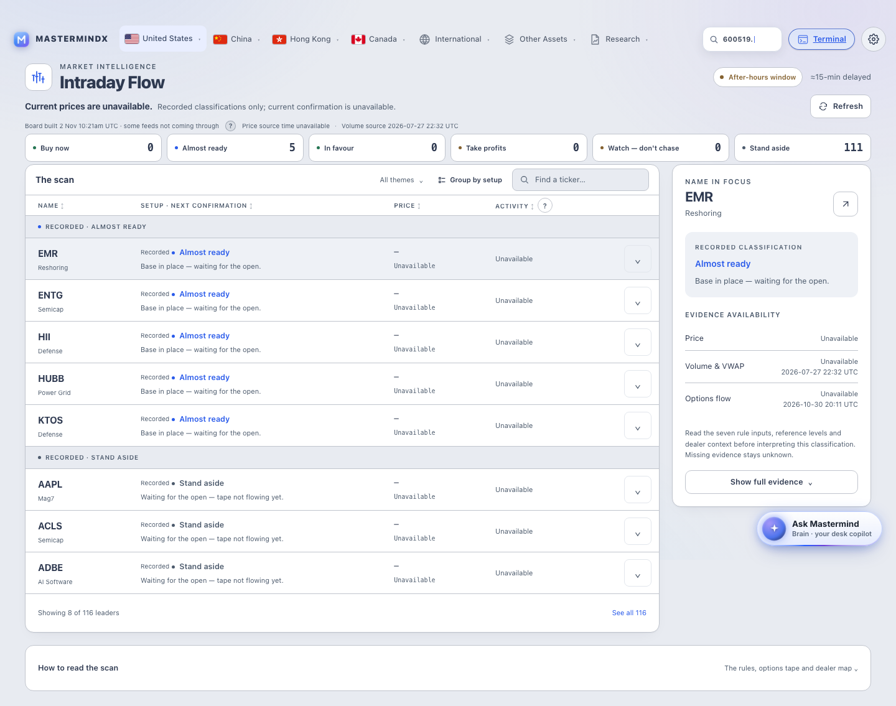
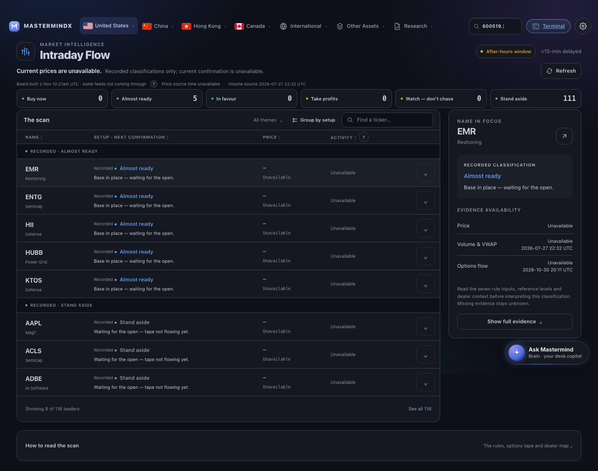

# Intraday Flow — current R3 visual evidence

Capture source: `dcda26d6d58bce0cbbe798d659eb7cdb8f755f9c`, product-identical to
material R3 `74afb2b538f4df4851214c242274a07c3b6f98f2`. HTML SHA256:
`c47d76bb22886c74dbf65f9d0a885a1d88359ad5261f3a213a24a237d4b45b96`.

[Fresh canonical matrix](source-r3-canonical/manifest.json): **24/24** captures,
all image hashes verified, zero console errors, zero failed responses and no
page-wide horizontal overflow. Captured 2026-11-03 at 07:41 UTC with the existing
canonical driver, including real hover and keyboard focus.

| Viewport | Theme | Locale | Actual screenshot |
|---|---|---|---|
| desktop | light | en | [Open](source-r3-canonical/6404f849ee9a3c33.png) |
| desktop | dark | en | [Open](source-r3-canonical/605fb3b48b5f7686.png) |
| desktop | light | zh | [Open](source-r3-canonical/ae7c3c9c310a1e42.png) |
| desktop | dark | zh | [Open](source-r3-canonical/23e2700acd8786ab.png) |
| mobile | light | en | [Open](source-r3-canonical/699973e8901ebc22.png) |
| mobile | dark | en | [Open](source-r3-canonical/96985ddaec5f3110.png) |
| mobile | light | zh | [Open](source-r3-canonical/1e098536344d9b71.png) |
| mobile | dark | zh | [Open](source-r3-canonical/695fda1afadf83e4.png) |

Principal inspection covers all eight resting layouts and the live Paper R3 boards
`6ZVB-0` / `6ZYE-0` in exact file `01M2WGNCX9475G79JRKJTCM08P`.
It is not independent qualified visual approval. Existing current-HTML source-detail
fixtures and recovery proof remain in `source-details-r3/` and `recovery-r3-compat/`.

The existing main integration brought the committed board snapshot with SHA256
`76f8f28816e347866a59b90e3d8c2ee1654786e9dbec13eddcdc750e0bf3fe18`; it matches
both R3 and this checkpoint. Older R2 references to `a8b0f3...` are historical.
No feed/producer/model ran or changed for this capture.

Resting lab CLS: desktop **0.67893–0.88082**, phone **0.00994–0.02440**.
Shared-navigation stability remains open. The generic source/as-of detector did
not recognize the visibly rendered labels; its raw false values remain in the
manifest. These anonymous local renders do not prove authenticated data, field
performance or served production behavior. Draft/HOLD remains.

[Verification and source hashes](source-r3-canonical/verification.json) ·
[Capture observations](source-r3-canonical/smells.json) · [Receipt](EVIDENCE.yml)

---

## Historical evidence retained below

## R2 historical recovery-state implementation

Material source: `55b651320d79f5a4ebf530eeb0175803b981baaa`.
Canonical [24-state matrix](recovery-r2-canonical/manifest.json) captures this source
in desktop/mobile, EN/ZH and light/dark with resting, hover and keyboard-focus views.
All24 images and hashes verified; zero console/response errors and horizontal overflow.

[Recovery-specific browser proof](recovery-r2/verification.json) exercises244 checks
and16 actual state captures. The empty-watchlist cells are explicit isolated TEST
FIXTURES, never producer observations or authenticated feed proof. The filtered-empty
cells use the committed board plus a user query.

- [Phone dark / filtered recovery](recovery-r2/filtered-390-dark-en.png)
- [Phone light / unavailable watchlist](recovery-r2/unavailable-390-light-en.png)
- [Desktop dark / filtered recovery](recovery-r2/filtered-1440-dark-en.png)
- [Desktop light / unavailable watchlist](recovery-r2/unavailable-1440-light-en.png)

These proofs do not close independent visual review, current-base integration, shared
navigation performance or served-production acceptance. Previous captures below retain
their original identities; none has been relabeled as current.

---

## Earlier normalized visual evidence

Historical capture source: `d927f82d4efab6f19104f196dfab1cf4e05d34d5`.
Generated page SHA256: `3c54090283722829c42dd6068ce4e5362c6d58bc47ee098b97268acb4e1f3fdc`.
Historical matrix: `normalized-r5/manifest.json`.

This capture follows the canonical publication correction: current asset hashes,
normal script deferral and matching CSS preloads. The Intraday template and both
page CSS copies remain byte-identical to the independently source-reviewed
`99b6151530160f1fb432277e48274040f2581660`. The normal upstream base snapshot is
2026-11-02T10:21:00.246892+00:00. No fixture or fabricated market value is used in
these screenshots.

The canonical driver captured **24/24 states**: eight resting cells plus actual
hover and focus variants of each. Every image digest was checked against its
manifest. There were zero console errors, zero failed responses, and no
document-wide horizontal overflow at 1440×900 or 390×844. These are anonymous
local-render captures, not Paper effects, authenticated production proof or an
independent visual verdict.

| Viewport | Theme | English | Chinese |
|---|---|---|---|
| Desktop · 1440×900 | Light | [Open](normalized-r5/09f2500ffb48bd2a.png) | [Open](normalized-r5/c1c664128801a703.png) |
| Desktop · 1440×900 | Dark | [Open](normalized-r5/1e3aa208ece34870.png) | [Open](normalized-r5/2d49d4652d82c5b0.png) |
| Phone · 390×844 | Light | [Open](normalized-r5/39a16743ea2647a5.png) | [Open](normalized-r5/0406cb09e4c1ec08.png) |
| Phone · 390×844 | Dark | [Open](normalized-r5/175798b80fe08f2d.png) | [Open](normalized-r5/417d6dde6a346e7a.png) |

Images show the full scrollable document. Viewport sizes describe the browser
window used for composition and above-the-fold checks, not a claim that the whole
phone page fits in one screen.

## Light workspace

## Dark workspace

## Expanded evidence

The retained supplemental captures open CW's real evidence control with the
keyboard on repaired implementation `660136436850d1ad5ff38ffc611525c7c10dc573`.
They are historical detail-layout evidence, not newly captured current data.
The corresponding evidence markup/styles remain unchanged; the refreshed browser
harness independently checks open-evidence overflow in all eight canonical cells.

| View | Light / English | Dark / Chinese |
|---|---|---|
| Desktop | [Open](expanded/desktop-light-en-evidence.png) | [Open](expanded/desktop-dark-zh-evidence.png) |
| Phone | [Open](expanded/phone-light-en-evidence.png) | [Open](expanded/phone-dark-zh-evidence.png) |

Reproduction: `research/intraday_flow_design_upgrade/capture_expanded.py` against
the owned anonymous loopback preview.

## Functional proof and source preservation

The normalized artifact passed 515/515 browser assertions, including keyboard
and focus continuity, sorting, filtering, evidence expansion, short/empty menus,
locale changes, and missing/partial/stale states. Synthetic transport fixtures
exist only in the isolated regression harness, never in site feeds. All 280
Intraday pytest cases plus three workflow-size contracts passed (283 total).
The seven prior independent code-review findings remain repaired; no model,
producer, data, shared-navigation or auth source changed in the publication fix.

## Performance evidence and limits

The new resting phone captures report laboratory CLS 0.00994–0.01105. This is
materially lower than the intermediate unnormalized capture, but is not field
Core Web Vitals, a controlled causal estimate, or a guarantee across devices.
Desktop laboratory CLS remains 0.67893–0.69153. The retained normalized geometry
trace identifies the shared navigation/search adaptive single-row transition:
the navigation bottom and Intraday wrapper move about 49px together while the
page's relative section geometry is stable. No page-specific override of global
navigation was added, and no performance acceptance is claimed.

`final-r3/` retains the earlier reviewed visual matrix at its real capture SHA.
`resume-r4/` is the intermediate 0886fff control before asset normalization, not
current candidate evidence. Their manifests must not be relabeled as r5.

The canonical capture driver correctly retains authenticated and synthetic-data
state gaps. Paper write qualification, qualified human/Opus visual acceptance,
final-head CI, normal release and served desktop/phone proof remain open.

See [historical manifest](normalized-r5/manifest.json),
[capture observations](normalized-r5/smells.json), [receipt](EVIDENCE.yml),
[main integration proof](../../../research/intraday_flow_design_upgrade/MAIN_INTEGRATION.md),
and [verification record](../../../research/intraday_flow_design_upgrade/VERIFICATION.md).
