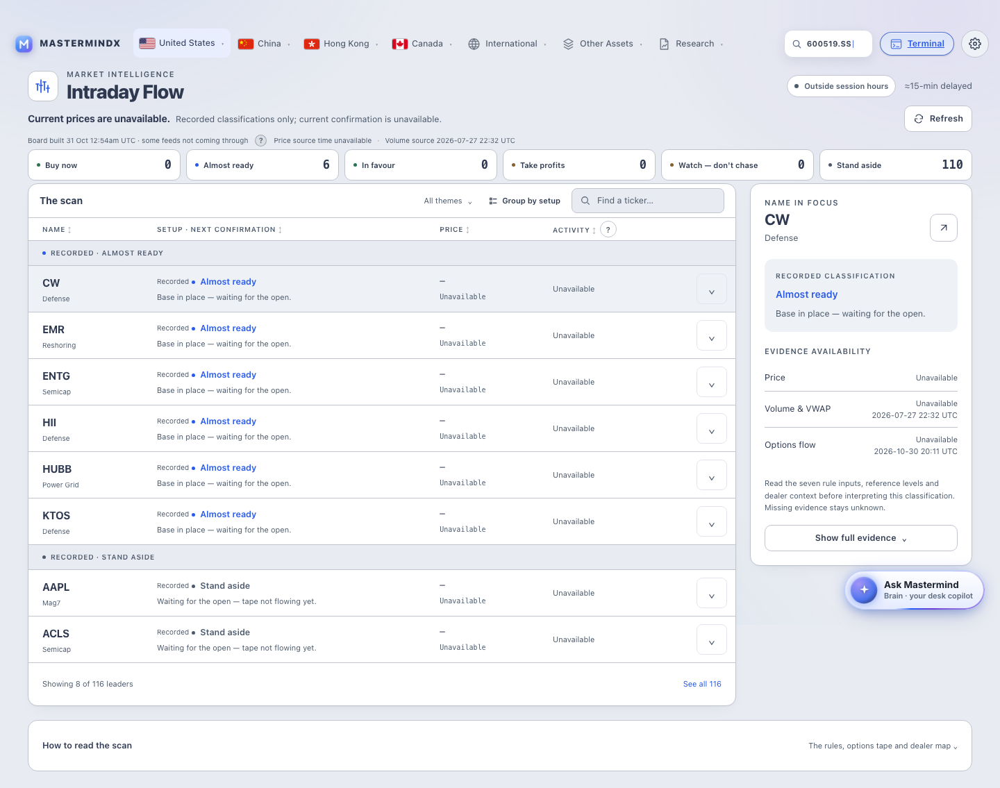

# Intraday Flow — visual evidence

Source candidate: `9e1af791c76f1694f07ed82f44e9e8f49a99e0d6`.

The canonical capture produced **24 of 24 states**: eight resting cells and actual
hover/focus variants of each. It records zero console errors, zero failed responses
and no document-wide horizontal overflow at either viewport. Every observed theme
and locale matches the requested state. These are anonymous local-render captures
of the committed source with real base data and available feed responses. They are not Paper canvas effects, live deployment
proof or independent review acceptance.

| Viewport | Theme | English | Chinese |
|---|---|---|---|
| Desktop · 1440×900 | Light | [Open](final-r2/d506da08474381b6.png) | [Open](final-r2/b746a4d9ae9271c0.png) |
| Desktop · 1440×900 | Dark | [Open](final-r2/1c2066fe82d806d5.png) | [Open](final-r2/3542d9e69fe93e25.png) |
| Phone · 390×844 | Light | [Open](final-r2/51fdae29272c592d.png) | [Open](final-r2/33f9176a2f0a8c08.png) |
| Phone · 390×844 | Dark | [Open](final-r2/4450898f39c2c4ed.png) | [Open](final-r2/aceb501ea5e2591e.png) |

The screenshot files include the full scrollable page. The viewport values above
describe the browser window used for composition and above-the-fold checks.

## Light workspace

## Dark workspace

## Expanded evidence

These supplemental captures open CW's real evidence control with the keyboard and
capture the actual detail region. They use the same implementation candidate and
real base/feed paths, with no test fixture substitution. They supplement the
canonical matrix without introducing a second receipt schema.

| View | Light / English | Dark / Chinese |
|---|---|---|
| Desktop | [Open](expanded/desktop-light-en-evidence.png) | [Open](expanded/desktop-dark-zh-evidence.png) |
| Phone | [Open](expanded/phone-light-en-evidence.png) | [Open](expanded/phone-dark-zh-evidence.png) |

Reproduction: `research/intraday_flow_design_upgrade/capture_expanded.py` against
the anonymous loopback preview. The browser harness checks open-evidence overflow
in all eight canonical cells.

## What the proof covers

The header separates session window, delayed prices, availability and source times.
The page has one eight-row scan with counted expansion, six setup filters, theme
selection, search, sorting and progressive evidence. The phone refinement keeps
prices, activity and evidence actions clear of the existing floating assistant.
The canonical feed-status help button remains beside its status phrase.

The source's 403-check browser harness separately exercises keyboard/focus
continuity, sorting, filtering, expanded evidence, empty/short menus, and explicit
synthetic test-only empty/loading/missing/partial/stale/populated responses. Those
fixtures were never written to site data or used in these screenshots.

## Known limits

- Paper write qualification is still blocked; no design is represented as applied
  to Paper.
- The canonical driver only captured anonymous static states. It correctly records
  authenticated and synthesized-data states as gaps; the isolated regression
  harness supplies functional scenario evidence, not authenticated evidence.
- Initial-load layout shifts remain substantial in the shared navigation/search
  startup. Baseline and candidate traces are retained in
  [layout_stability.json](../../../research/intraday_flow_design_upgrade/layout_stability.json).
  This is not a performance acceptance.
- Independent human/Opus visual review, exact-head CI, release and live proof remain
  separate gates.

See [manifest](final-r2/manifest.json), [capture observations](final-r2/smells.json),
[receipt](EVIDENCE.yml) and the
[verification record](../../../research/intraday_flow_design_upgrade/VERIFICATION.md).
