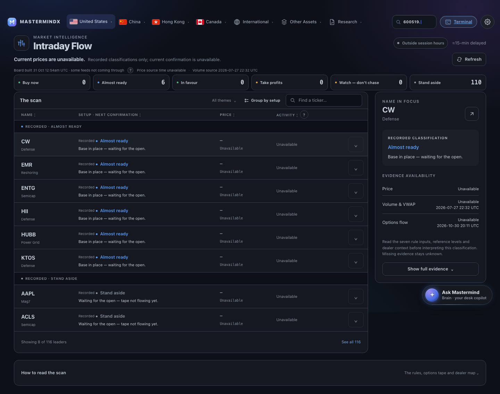

# Intraday Flow — visual evidence

Capture source: `aeff31db0803d75e41881fd566e13f6222d4ca05`.
Latest integrated candidate: `d0201df47d889fb50cef04b5aa2fcda251b1a034`.

The later integration changes this page only by its shared theme cache tag and adds
unused upstream GMI custom properties. The template, page stylesheet and embedded
base are unchanged. The matrix is carried forward with an exact source comparison
and another successful 515 browser / 280 regression checks; it is not represented
as a fresh capture. See [main integration proof](../../../research/intraday_flow_design_upgrade/MAIN_INTEGRATION.md).

The canonical capture produced **24 of 24 states**: eight resting cells and actual
hover/focus variants of each. It records zero console errors, zero failed responses
and no document-wide horizontal overflow at either viewport. Every observed theme
and locale matches the requested state. These are anonymous local-render captures
of the committed source with real base data and available feed responses. They are not Paper canvas effects, live deployment
proof or independent review acceptance.

| Viewport | Theme | English | Chinese |
|---|---|---|---|
| Desktop · 1440×900 | Light | [Open](final-r3/49417aae7749469f.png) | [Open](final-r3/aa58f04a7810a5fe.png) |
| Desktop · 1440×900 | Dark | [Open](final-r3/df5188ff045549c1.png) | [Open](final-r3/200bdb600762047a.png) |
| Phone · 390×844 | Light | [Open](final-r3/1ce1731c02bc2254.png) | [Open](final-r3/3e98b89b4b7bcee7.png) |
| Phone · 390×844 | Dark | [Open](final-r3/af649a0b4b0c7a0b.png) | [Open](final-r3/6015ef3f8b357cbc.png) |

The screenshot files include the full scrollable page. The viewport values above
describe the browser window used for composition and above-the-fold checks.

## Light workspace

## Dark workspace

## Expanded evidence

These supplemental captures open CW's real evidence control with the keyboard and
capture the actual detail region. They capture repaired implementation `660136436850d1ad5ff38ffc611525c7c10dc573`
with real base/feed paths and no fixture substitution. Their evidence markup and
styles are unchanged by the subsequent shared-shell integration. They supplement the
canonical matrix without introducing a second receipt schema.

| View | Light / English | Dark / Chinese |
|---|---|---|
| Desktop | [Open](expanded/desktop-light-en-evidence.png) | [Open](expanded/desktop-dark-zh-evidence.png) |
| Phone | [Open](expanded/phone-light-en-evidence.png) | [Open](expanded/phone-dark-zh-evidence.png) |

Reproduction: `research/intraday_flow_design_upgrade/capture_expanded.py` against
the anonymous loopback preview. The browser harness checks open-evidence overflow
in all eight canonical cells.

## What the proof covers

The header separates session window, delayed prices, availability and source times.
The page has one eight-row scan with counted expansion, six setup filters, theme
selection, search, sorting and progressive evidence. The phone refinement keeps
prices, activity and evidence actions clear of the existing floating assistant.
The canonical feed-status help button remains beside its status phrase.

The source's 515-check browser harness separately exercises keyboard/focus
continuity, sorting, filtering, expanded evidence, empty/short menus, and explicit
synthetic test-only empty/loading/missing/partial/stale/populated responses. Those
fixtures were never written to site data or used in these screenshots.

## Review refinements

The independent code review's seven findings are repaired: locale-correct rising
colors, unavailable-input states, phone stock navigation, quiet count announcements,
localized feed help, native-sort focus and exact theme matching. The expanded panel
also carries source context, and no-read counts remain separate from the six stages.
Dealer-strength labels are readable in both languages. The 515-check browser record
exercises these paths; independent repair verification remains a separate gate.

## Known limits

- Paper write qualification is still blocked; no design is represented as applied
  to Paper.
- The canonical driver only captured anonymous static states. It correctly records
  authenticated and synthesized-data states as gaps; the isolated regression
  harness supplies functional scenario evidence, not authenticated evidence.
- Initial-load layout shifts remain substantial in the shared navigation/search
  startup. Baseline and candidate traces are retained in
  [layout_stability.json](../../../research/intraday_flow_design_upgrade/layout_stability.json).
  This is not a performance acceptance.
- Independent human/Opus visual review, exact-head CI, release and live proof remain
  separate gates.

See [manifest](final-r3/manifest.json), [capture observations](final-r3/smells.json),
[receipt](EVIDENCE.yml) and the
[verification record](../../../research/intraday_flow_design_upgrade/VERIFICATION.md).
