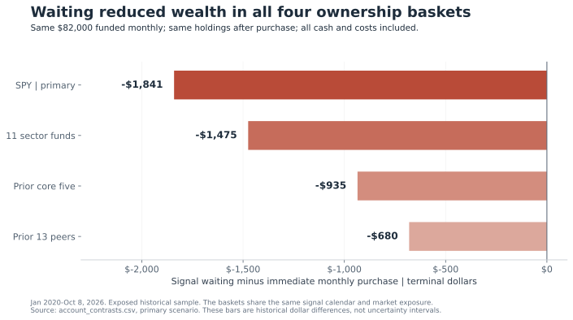
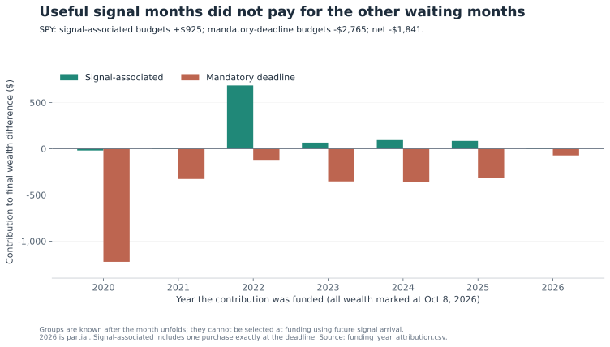
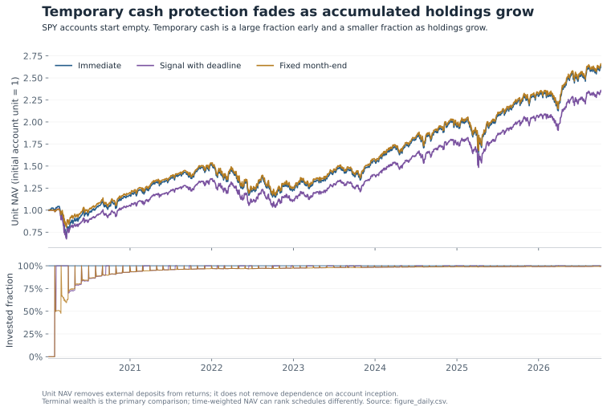

# Durable Pivot Signals: the cost of waiting for an entry

## Decision reached in this continuation

The tested recovery calendar did **not** justify delaying routine monthly contributions. In the primary SPY comparison, waiting for a signal until a fixed month-end deadline produced $1,841 less terminal wealth than investing the same money immediately. It also finished $369 behind a fixed month-end purchase schedule. The three secondary ownership baskets likewise finished behind immediate investment. The primary signal policy delivered essentially no maximum-drawdown improvement.

This is a completed test of a specific funded decision, not a rejection of every recovery signal. Some signal-funded contributions obtained better acquisitions. The rule failed because those benefits did not pay for waiting in months when a usable signal never arrived. This distinction is the most useful new result: an attractive alert subset can coexist with an unattractive policy for the investor's entire contribution budget.

A separate 12-release source pilot strengthened the proposed business-information filter. Annual guidance headlines cannot reliably stand in for changes in the remaining-period operating outlook. Disclosure timing, fiscal horizon, accounting basis, business scope and explicit unknown states must precede a directional label.

**Research status:** exploratory continuation on exposed history. The original calendar was selected from earlier work, and the defensive-stock baskets remain retrospectively selected survivors. These results do not qualify a live signal or establish a universal bottom/top system. The accepted prior checkpoint is [Macro PR #9989](https://github.com/mastermindx-market-intelligence/macro/pull/9989); its merge and completed CI were recovered before this new work began.

## 1. The capital question that event win rates leave unanswered

Earlier work separated stock ownership, recovery timing, fixed-low survival and stops. It showed that profitable forward outcomes need not imply that the candidate low survives, and that attractive event statistics can deteriorate under real capital constraints. This continuation asks a narrower unresolved question: when a new monthly contribution actually becomes available, does waiting for the recovery calendar improve its use?

The experiment gives each account $1,000 immediately before the first exchange-session open of each month, January 2020 through October 2026. There are **82 contributions, $82,000 total, and 1,701 priced sessions**, ending October 8, 2026. Accounts start empty. Future contributions are unavailable before their funding dates. Previously purchased holdings remain invested; there are no tactical sales, stops, six-month exits or occupancy exclusions.

| Policy | Treatment of each monthly budget |
|---|---|
| Immediate | Purchase at the funding-date open. |
| Signal with deadline | Purchase at the first eligible next-open signal execution; otherwise purchase at that month's genuine last exchange-session open. |
| Fixed month-end | Purchase at that same month-end open regardless of signals. |

The last observed date is not made into a deadline. The fixed month-end account still has October's $1,000 in cash at the cutoff. The signal account has already deployed October's budget. Both amounts remain in terminal wealth and in the contribution denominator.

The primary exposure is SPY. Secondary exposures are all 11 ordinary Select Sector SPDR funds, the earlier core five names, and the earlier 13 peers. Every basket uses **the same signal calendar**, so the within-basket timing comparison does not change the ownership choice. Each purchase allocates equal dollars among that basket's names; existing holdings are not rebalanced.

The calendar is the full 108-row sector RSI30-recovery roster from the accepted study, including rows previously rejected solely because a holding sleeve was occupied and rows without a mature forward endpoint. It has 12 source instruments, including SOXX. The ordinary sector purchase basket has 11 and excludes SOXX. These separate source and purchase universes are intentional. Simultaneous nominations collapse into one execution-date opportunity.

SPY represents US large-cap equities. The sector family and defensive baskets are overlapping equity exposures, not independent asset-class replications. Actual fund histories incorporate changing constituents and sector/index rules; this study does not backfill current holdings into the past. Official issuer and index-methodology sources are listed below.

Primary costs are 10bp per purchase and 10bp on terminal liquidation. Cash earns zero. All prices use the retained current-vintage adjusted-OHLC proxy, with no duplicate cash dividends. It is a total-return-like reconstruction, not a dividend pay-date ledger or original historical corporate-action vintage. The protocol was committed and pushed before the new outcome calculation; the audit preserves the two mechanical corrections and the failed path-resolution attempt that preceded the first successful run.

## 2. Main results: identical contributions, different deployment times

| Ownership basket | Immediate wealth | Signal wealth | Month-end wealth | Signal minus immediate |
|---|---:|---:|---:|---:|
| SPY - primary | $146,743 | $144,902 | $145,271 | -$1,841 |
| All 11 sector funds | $128,954 | $127,479 | $127,900 | -$1,475 |
| Prior core five | $120,852 | $119,917 | $119,700 | -$935 |
| Prior 13 peers | $102,980 | $102,300 | $102,202 | -$680 |

Source: `results/account_summary.csv` and `results/account_contrasts.csv`. Values include all contributions, open holdings, cash and the stated costs. The four baskets must not be counted as four independent confirmations.

For SPY, signal waiting's shortfall equals **2.245% of contributed capital** or about **1.25% of the immediate account's ending wealth**. It does not mean a 2.245-percentage-point annual return penalty. The money-weighted annualized return was 17.055% for immediate purchases, 16.685% for signal waiting and 16.760% for month-end purchases. The signal-versus-immediate XIRR difference was approximately -0.370 percentage points per year in this particular dated-contribution history.

The small core/peer advantages over month-end buying are narrower results: +$218 and +$98 respectively. Neither reverses their shortfall against immediate buying. Choosing the weaker comparator after seeing the table would overstate the evidence for the signal.

## 3. Why useful signals did not pay for the waiting policy

The 108 source nominations produced **60 distinct execution dates**. Only 34 monthly budgets were deployed on a signal-associated date: 33 before the deadline and one exactly at it. Another 48 months reached the mandatory deadline. There were 26 signal dates with no remaining monthly contribution budget to spend. Average delay in the signal account was **14.77 sessions**.

The complete SPY contribution accounting is:

| Eventual deployment category | Monthly budgets | Terminal difference versus immediate purchase |
|---|---:|---:|
| Signal before deadline | 33 | +$907.89 |
| Signal exactly at deadline | 1 | +$16.82 |
| Mandatory deadline without earlier signal | 48 | -$2,765.42 |
| All budgets | 82 | **-$1,840.72** |

Source: `results/waiting_attribution.csv`, primary SPY signal policy. The terminal differences include subsequent compounding through the common cutoff. The signal-at-deadline row has no timing advantage over the blind month-end control.

Across the 34 signal-associated budgets, 19 acquired more adjusted SPY units than immediate purchase, 10 acquired fewer and five were identical. The deadline group had seven acquisition improvements and 41 deteriorations. This is an explanation of the observed policy outcome, not an implementable rule that selects the favorable months: the eventual arrival of a signal was unknown when each contribution was funded.

The waiting identity is simple. For a completed single-asset purchase, after common proportional costs, the terminal difference is the difference in acquired units multiplied by the common terminal price. A delayed purchase obtains more units if waiting cash grows faster than the asset's price during that exact open-to-open interval. The subsequent holding path compounds the quantity difference; it does not retroactively make a poor acquisition cheaper. For a basket, the calculation is performed for every constituent and then summed, preserving the different acquired share vectors.

A concrete missed-opportunity example is April 2020. The SPY adjusted open rose **17.63%** between that month's funding and its mandatory purchase. By the final cutoff, that $1,000 contribution was **$510.52 behind** the immediate counterpart. This is one contribution, not the entire account. The loss is not a claim that an investor could have known the subsequent rally; it shows why the policy must pay for every waiting month, including months without a favorable alert.

Only the 2022 funding cohort had a positive aggregate signal-minus-immediate difference. The contributions funded in 2020 lost $1,242.74 relative to immediate buying; 2021 lost $318.65; 2022 gained $565.00; 2023 lost $287.09; 2024 lost $263.21; 2025 lost $226.72; and 2026 through the cutoff lost $67.31. The full shortfall therefore is not solely a 2020 effect, although 2020 is influential. These are funding-year contributions to terminal wealth, not those years' portfolio returns.

## 4. High absolute win rates can conceal weak timing

Each contribution also has a common marked endpoint 126 observed sessions after funding. The delayed policy does not get a later endpoint. **76 monthly cohorts are mature; six remain immature and stay in account wealth.** These are overlapping marked contributions, not independent completed trades.

| Basket | Immediate positive cohorts | Signal positive cohorts | Signal minus immediate mean outcome |
|---|---:|---:|---:|
| SPY | 62 / 76 (81.6%) | 59 / 76 (77.6%) | -1.275 pp |
| Sector funds | 62 / 76 (81.6%) | 62 / 76 (81.6%) | -0.968 pp |
| Prior core five | 61 / 76 (80.3%) | 61 / 76 (80.3%) | -0.790 pp |
| Prior 13 peers | 58 / 76 (76.3%) | 57 / 76 (75.0%) | -0.393 pp |

Source: `results/cohort_absolute_summary.csv` and `results/cohort_contrasts.csv`. A positive absolute outcome is not the same as beating immediate investment. It also says nothing by itself about whether the earlier low was later broken.

For SPY, signal waiting beat immediate purchase in 24 mature cohorts, lost in 47 and tied in five. Its mean paired difference was -1.275 percentage points of the contribution budget. The prespecified 12-month circular-block interval was **[-2.534, +0.062] pp**. This interval crosses zero. It is exploratory, based on fewer than seven years of overlapping contribution histories, and does not correct for prior signal selection. It is neither a confidence interval for portfolio CAGR nor proof of equivalence.

Against blind month-end buying, SPY's mature-cohort mean difference was only -0.075 pp, with interval [-0.984, +0.531] pp. Forty-five of 76 cohorts were tied because the policies frequently made the same purchase. These data provide no robust case that the signal adds enough information within the waiting window to justify withholding routine contributions.

## 5. Risk: correct accounting does not remove economic dependence on inception

| SPY policy | Unitized maximum drawdown | Average invested fraction | Worst drawdown period |
|---|---:|---:|---|
| Immediate | -33.741% | 100.00% | Feb 19-Mar 23, 2020 |
| Signal with deadline | -33.741% | 95.99% | Feb 19-Mar 23, 2020 |
| Fixed month-end | -23.911% | 94.67% | Jan 3-Oct 12, 2022 |

Source: `results/account_summary.csv`. Drawdowns use unit NAV, not an account balance rising because of new deposits. Existing shares are valued at the funding-date open before units are issued; arriving capital does not receive the preceding overnight return.

The month-end policy's shallower drawdown is real for this account contract, but its interpretation is limited. The account began empty shortly before the 2020 crash. On February 19, 2020, immediate and signal accounts were fully invested, while the month-end account was only **50.83% invested**. Its 2020 drawdown was approximately 20.10%, versus 33.74% for the other two. Temporary cash was a large fraction of a very young account.

As accumulated holdings grow, the same new $1,000 becomes a much smaller fraction of account wealth. Delaying it cannot protect the existing book. Unitization removes deposit-induced arithmetic distortion; it cannot make a young contribution-driven account economically equivalent to an established portfolio. A future exit or risk-reduction system needs its own evidence.

Metric selection also matters. Time-weighted annualized SPY returns were 15.275% immediate, 13.400% signal and 15.432% month-end, while terminal wealth favored immediate over month-end. The measures weight the contribution history differently. The protocol chose terminal wealth under identical flows as primary before outcomes; the slightly favorable month-end time-weighted ranking cannot replace that decision criterion afterward.

## 6. Prespecified sensitivities did not rescue signal waiting

| Basket | Primary shortfall | With constant 3% cash yield | With 25bp each-side costs |
|---|---:|---:|---:|
| SPY | -$1,841 | -$1,593 | -$1,835 |
| Sector funds | -$1,475 | -$1,257 | -$1,470 |
| Prior core five | -$935 | -$730 | -$932 |
| Prior 13 peers | -$680 | -$506 | -$678 |

Source: `results/account_contrasts.csv`, signal minus immediate. The 3% cash rate is a declared hypothetical scenario, not historical Treasury performance. Higher costs lower both accounts; the slightly smaller dollar difference under higher common friction is not a benefit of trading costs.

All four signal waiting policies remained behind immediate purchase under both sensitivities. The small core/peer advantage over month-end weakened with cash interest, because the blind schedule spent longer earning that interest. No result in this table establishes an optimal cash rate or cost tolerance.

## 7. What this teaches us about multi-timeframe confluence

The research should keep separate the state that makes an asset worth watching, the event that suggests recovery, and the funded action the investor can actually take. This wave tests the last link using an inherited recovery calendar; it does not rerank 1W/1D versus 2W/3D pairs or finish the original price-MACD/top question.

Stochastic RSI normalizes RSI within its own recent range. A very low value therefore describes the location of a momentum measure, not a valuation estimate, a solvency assessment or proof that no lower price can occur. Its normalization can change as old RSI extremes leave the lookback window. MACD's histogram measures the difference between MACD and its smoothed signal. A rising histogram can describe diminishing downside momentum before the underlying price trend turns. Indicator definitions come from TradingView's official documentation; the implications here follow from those formulas.

Changing the bar frequency changes both observations and effective horizons. An EMA with the same bar-count length on weekly and daily data does not have the same time span. RSI and its range normalization are nonlinear, so aggregating first and calculating afterward need not reproduce a sampled daily calculation. A weekly bullish event and a shorter-timeframe bearish event can describe different parts of the same rebound/pullback sequence. Simultaneous agreement is therefore a hypothesis to test, not a logical requirement of a durable pivot.

The earlier defensive study specifically used **RSI-MACD on RSI**, together with weekly/two-week Stoch RSI context; it was not ordinary price MACD. The new capital experiment uses the accepted sector RSI recovery calendar. Combining those labels under an unspecified generic MACD would erase a material distinction in the research.

The most defensible next timing hypothesis is narrower than another indicator search: permit bounded waiting only when the original qualifying washout watch is already active at the funding timestamp, and invest immediately otherwise. A watch observed after funding cannot justify the earlier decision to wait. Even within an active watch, immediate purchase remains the essential comparator; the attractive price may already be available before confirmation. This hypothesis is specified separately in `NEXT_HYPOTHESIS.md` and **has not been run**.

## 8. New source evidence: an annual headline is an unreliable operating-repair label

The fixed pilot covers Microsoft, Caterpillar and Duke Energy, with all four quarterly earnings releases published during calendar 2022 for each. That is 12 current-event packets and 34 primary-source records. The sample is purposive, chosen for different guidance formats. No market outcomes were joined to the labels. Search engines incidentally exposed some off-scope market snippets, so the achieved design is described as outcome-unjoined provisional classification, not pristine blinding.

| Issuer | What the original release bodies establish | Why the remaining-period operating revision stays unresolved |
|---|---|---|
| Microsoft | Guidance is deferred to the later call in all four releases. | Later-call facts cannot be backdated into a release-time decision. |
| Caterpillar | Completed operating results and annual tax-estimate information are present. | A tax revision or long-term margin target does not establish the comparable remaining-period operating outlook. |
| Duke Energy | A new annual outlook is initiated, later maintained, and then revised with a changed business scope. | Annual maintenance does not identify the old expectation for the remaining horizon; a scope change requires a comparable bridge. |

All 12 primary remaining-period labels remain unresolved or unavailable **within the release-body scope**. This is not a statement that these issuers supplied no useful outlook elsewhere. The pilot deliberately preserves later-call context separately.

Three examples sharpen the measurement requirements:

**Microsoft, July and October 2022.** The July release points to the call for guidance. On that later call, extending the depreciable life of cloud server/network equipment from four to six years was expected to add about $3.7 billion to FY2023 operating income, including about $1.1 billion in Q1. That accounting timing effect must not automatically become improved demand. October's call explicitly lowers the remaining-year Windows OEM expectation and identifies additional energy costs. The call places most of the greater-than-$800-million annual energy increment in Q2-Q4, roughly $250 million per remaining quarter, but does not isolate one comparable aggregate remaining-profit revision. Its conditional margin exclusions also change. Original Microsoft sources are linked below and in the packets.

**Caterpillar, October 2022.** The estimated annual global tax rate falls from about 24% to 23%. The release records a $20 million benefit from that estimate change and a separate $41 million IRS-settlement benefit. These are different from an identified improvement in remaining-quarter operating demand or profit. The reviewed packet explicitly says that the annual *operating* outlook was not located, rather than claiming no annual estimate of any kind existed.

**Duke Energy, November 2022.** The new $5.20-$5.30 adjusted-EPS range excludes Commercial Renewables. The preceding $5.30-$5.60 range therefore cannot be compared mechanically as if business scope were unchanged. Its historical reported/adjusted EPS reconciliation also concerns a separate International Disposal Group item. A raw headline decrease is observable; a same-scope remaining-period operating cut needs additional evidence.

For an additive metric, subtracting newly completed actuals from a new annual forecast may identify a new remainder forecast. It does **not** identify the revision to that remainder unless the old expectation for the same remaining horizon is also known. EPS and margins add denominator and weighting complications. Unknown is the correct output when the bridge is not identifiable.

None of the 12 packets establishes the earliest public-release timestamp. SEC acceptance records, printed dates, scheduled call times and current historical pages are separately recorded. The complete communication chain is not proven. An independent source review accepted four pivotal packets with two clarifications; this is not independent double annotation of all 12 or a measured inter-rater agreement study. These fields remain research measurements, not qualified historical trading features.

## 9. Decisions for the research system

**Retain:** identical-funding comparators; full-budget accounting; mature and immature cohort separation; exact waiting attribution; explicit business-information unknowns; completed-bar chronology; and distinct low-survival, profitability and account-risk outcomes.

**Do not promote from this evidence:** a requirement to wait every month for the selected recovery calendar; a bullish business label derived merely from an annual raise; aggressive exit logic obtained by reversing a bottom rule; or a stable-win-rate claim inferred from selected surviving stocks.

**Develop next:** a funding-time watch hypothesis using the exact original admitted watch definition, and a separate call-stage information pilot with explicit publication availability and comparable operating horizons. Both need frozen rules before outcome joins. The proposed Mastermind/Macro research record in `SYSTEM_DESIGN.md` separates ownership eligibility, washout state, recovery trigger, capital availability, candidate-low invalidation and information uncertainty. It is a research specification, not a production change.

## 10. Verification, reproducibility and practical limits

The original price-file hashes matched for all 31 files. Ten synthetic checks cover funding order, true month ends, partial cutoffs, duplicate nominations, cash yield, fee arithmetic, known money-weighted return, overnight-gap unitization and prefix stability. A separate lot reconstruction checked cash and invested wealth on every day of all 36 accounts; maximum dollar error was $1.46e-10. All terminal attribution identities reconciled. The run manifest records executed source hashes, the unchanged config hash and input hashes.

Two source-review fixes are preserved in `AUDIT.md`: fixed calendar versus priced-prefix handling, and separating unincurred fees from avoided price movement for pending cash. The initial execution failed before outcomes because some verified prices live in older retained directories; preparation now makes ignored symlinks to the authoritative paths. No price was substituted and no rule was retuned.

The repository contains all daily paths, monthly contribution/attribution ledgers, common-endpoint cohorts, summaries, protocol, code and source packets. The portable review package contains the complete monthly evidence and primary SPY figure paths; the larger all-scenario daily path file remains in GitHub. Raw price bytes remain in the retained source workspace, with hashes published. Reproduction requires those archived bytes or a separately disclosed reconstruction; downloading today's history is not byte-identical replication.

This wave covers selected US equity vehicles from 2020 through the retained cutoff. It does not establish a survivorship-free stock universe, futures or FX behavior, a universal timeframe ratio, or a validated sell-at-the-top policy. It also does not measure taxes, portfolio-wide concentration constraints, liquidity at scale or personalized account suitability. The concrete conclusion is that the tested unconditional waiting contract has not earned a place ahead of ordinary scheduled additions in this history.

## Evidence map

| Evidence | File |
|---|---|
| Frozen rules and original registration | `PROTOCOL.md`, `config.json`, `REGISTRATION.json` |
| All capital outcomes and comparisons | `results/account_summary.csv`, `results/account_contrasts.csv` |
| Individual budgets, including immature contributions | `results/contribution_ledger.csv` |
| Exact per-asset acquisition and waiting decomposition | `results/waiting_attribution.csv` |
| Common-endpoint outcomes and block intervals | `results/completed_cohorts.csv`, `results/cohort_contrasts.csv` |
| Funding-year influence and chronological summaries | `results/funding_year_attribution.csv`, `results/cohort_year_summary.csv`, `results/cohort_half_summary.csv` |
| Accounting verification and source custody | `results/mechanical_verification.json`, `results/run_manifest.json`, `inputs/source_manifest.json`, `AUDIT.md` |
| Original-release evidence and independent review | `guidance_packets.json`, `GUIDANCE_PILOT.md`, `guidance_review.md` |
| Research design and untested next hypothesis | `SYSTEM_DESIGN.md`, `NEXT_HYPOTHESIS.md` |

## Primary external references

- [SPY issuer identity and objective](https://www.ssga.com/us/en/intermediary/etfs/state-street-spdr-sp-500-etf-trust-spy).
- [Ordinary Select Sector fund family](https://www.ssga.com/us/en/intermediary/capabilities/equities/sector-investing/select-sector-etfs).
- [S&P overview of evolving sector and index methodology](https://www.spglobal.com/spdji/en/documents/education/education-an-overview-of-gics-and-sp-500-sector-industry-indices.pdf).
- [TradingView Stochastic RSI definition](https://www.tradingview.com/support/solutions/43000502333-stochastic-rsi-stoch-rsi/); [MACD definition](https://www.tradingview.com/support/solutions/43000502344-moving-average-convergence-divergence-macd-indicator/).
- [Microsoft July 2022 release](https://www.microsoft.com/en-us/investor/earnings/fy-2022-q4/press-release-webcast), [July call](https://www.microsoft.com/en-us/investor/events/FY-2022/earnings-fy-2022-q4), and [October call](https://www.microsoft.com/en-us/investor/events/fy-2023/earnings-fy-2023-q1).
- [Caterpillar October 2022 original SEC exhibit](https://www.sec.gov/Archives/edgar/data/18230/000001823022000216/ex991toformcat3q2022earnin.htm).
- [Duke Energy November 2022 original SEC exhibit](https://www.sec.gov/Archives/edgar/data/1326160/000132616022000277/er-20220930xearningsreleas.htm).
- [SEC Form 8-K instructions](https://www.sec.gov/files/form8-k.pdf), for the distinction between an announcement and its filing/furnishing process.

All external references were inspected on October 21, 2026. Full event-specific source chains and retrieval limitations are retained in the guidance packet file.
