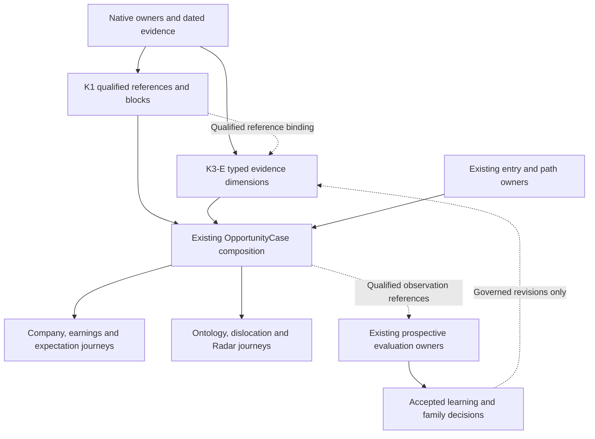

# Alpha Intelligence Integration — maintained masterplan

**Prepared:** 31 October 2026. **Accountable programme owner:** Fable, under `WS:ALPHA-INTELLIGENCE-INTEGRATION`. **Document role:** proposed maintained task tree, product design and execution reference. **Programme completion:** not established. **Publication status:** source proposal until accepted through the existing owner.

This plan equips Fable to finish the Alpha Intelligence Integration programme through the existing owners, admitted Subagent Fabric and qualified Opus suborchestrators. It specifies the outcome, known estate, unresolved questions and evidence of completion. Fable controls the implementation method, sequencing, decomposition, staffing and design choices within current authority. A stronger solution supported by evidence should replace a recommendation here without requiring a new masterplan ceremony.

This document is the proposed current task tree. Workstream waves and the latest dated handoff remain the programme's organizational recovery frontier; existing execution owners retain live jobs, leases, effects and admission. The August PASS-0 remains an unchanged historical snapshot. Existing accepted contracts, decisions, source carriers and scientific freezes retain their scope. The masterplan does not itself launch a team or transfer source custody.

## 1. Fable: start here

The highest-value initial move is to choose one coherent research journey that can use the existing `OpportunityCase` implementation, close its actual remaining gaps, and verify it through the real product. In parallel, reconcile the specific institutional semantics and propagation-carrier work that cannot be solved by interface polish. Use the evidence already collected below; refresh only facts that can change the next decision.

### Minimal recovery packet

Read these first, then load only the chosen domain's sources:

1. [The workstream](../../agentos/workstreams/WS-ALPHA-INTELLIGENCE-INTEGRATION.md), its accepted K1–K7 waves and permanent runtime-authority boundary.
2. [31 October cumulative handoff](../../agentos/handoffs/ALPHA-INTELLIGENCE-INTEGRATION-2026-10-31.md), for current continuation, source custody, unresolved effects and do-not-redo facts.
3. This plan, especially §§2–4, §8 and the domain packet you choose.
4. [Dated census and audit](censuses/INTEGRATION_CENSUS_2026-10-31.md), which separates inspected source, accepted historical receipts, public serving evidence and unverified claims.
5. [Machine-readable source index](censuses/INTEGRATION_CENSUS_2026-10-31.json), for exact repository pins, relevant paths, PR heads and observed checks.

Apply the existing compatible Mastermind procedure pin once. Read the existing Fabric orchestration core and only the assigned role playbook. The current `fable-mode` entrypoint explicitly favors recovering the next useful action over repeatedly loading every doctrine. The commissioning environment must establish actual role/tool loading and admission; a file path or model name is not that proof. [G1][G2][G3]

### Six facts that prevent the largest repeat work

- **K1 is accepted as a contract foundation.** Its AAPL four-owner golden recipe still deliberately refuses the combined result because identity is unresolved. A second evidence warehouse does not solve that join.
- **K2-B is accepted; K2-C is semantically unresolved.** Native 13F reading and filing-backed identifiers do not establish dated manager/vehicle intent.
- **K3-E Opportunity Evidence Vector already exists.** The similarly named K3E Expectation–Market-Dynamics / Information-to-Price programme is a different body of work with its own accepted evaluation constraints.
- **OpportunityCase and real consumer integrations already landed.** Macro #9639 added or integrated important K5 research paths. Do not commission another case composer from the old `k5: todo` label.
- **K3-D has both landed code and an open original carrier.** PR #6514's latest native disclosed-supplier extension remains separate from the v1/v2 integration already on main. Preserve that carrier and reconcile its current writer, review and effects before touching it.
- **The ITP experiment has a consumed trial and a real time boundary.** The October 17 receipt places it in a 63-session purge ending January 15, 2027; read the actual fresh clock before any future label action. No new plan resets the trial or makes the future arrive early. [S1][S2][S3][S4][S5][S6]

## 2. The product outcome

Alpha Intelligence should let a user investigate an opportunity from original evidence through economic interpretation, market expectations, path constraints and later evaluation. Across the existing company, earnings, expectation, ontology, dislocation and Radar surfaces, the user should be able to answer:

1. What changed in the company, industry or economy?
2. Which evidence supports that interpretation, and what was actually knowable at the relevant time?
3. What appears to be expected or reflected by the market, with what limitations?
4. Which disagreement, contradiction or missing fact matters most?
5. What does the existing entry/path owner permit us to say now?
6. What subsequent observation would strengthen, weaken or falsify the thesis?

The original programme distinguishes a **Reality Model**, **Market-Belief Model**, and **Tradeability/Path Model**. Preserve that separation in the product. A useful business thesis may coexist with unavailable entry, missing historical consensus, unresolved identity or insufficient predictive evidence. The product should make that situation understandable. [S1]

### What successful completion means

There are four related acceptance obligations:

| Obligation | Required result | Evidence of completion |
|---|---|---|
| Research product | Users can complete the agreed representative journeys with source, identity, clocks, uncertainty, counterevidence and existing path context intact. | Integrated source review, real machine-consumer results, actual entitled browser journeys and applicable adverse states. |
| Scientific programme | Each proposed expert/family claim has an appropriate prospective test, a documented result or a genuinely accruing window, and an explicit decision under the existing evaluation owner. | Existing trial/partition/grade receipts, baseline comparisons, uncertainty, negative results and promotion disposition. |
| Product operation | The selected capability stays truthful through ordinary source refresh, publication, freshness expiry and recoverable owner failure. | A real new owner generation or ordinary refresh through the incumbent pipeline; freshness transition and approved correction/outage replay; consistent consumer source identity; the existing monitoring and recovery owner. |
| Operational continuity | A new assigned Fable or domain owner can resume without recreating the census or guessing at effects. | Accepted source, current workstream/handoff links, exact release receipts, original carriers, unresolveds and reachable next owner. |

Shipping a useful research product need not await every scientific horizon. Conversely, a polished research interface does not complete a predictive experiment. Final programme acceptance must describe the status of each obligation; a calendar-bound experiment remains accruing until its actual evidence exists. A well-supported negative scientific result is legitimate completion of that investigation.

Fable should refine representative cases and usability standards early, using the existing product design owner. This plan intentionally avoids fixed screen layouts, arbitrary numerical success thresholds, fixed model counts and a mandated new top-level page. Existing acceptance laws still apply.

## 3. Current estate: all A–J responsibilities

The detailed census is the dated evidence attachment. This table is a reading map, not a second status database.

| Responsibility | Existing foundation to reuse | Consequential completion question |
|---|---|---|
| **A — Evidence Mesh** | K1 Ref/Block/Recipe contracts; 14 owner-store vocabulary rows in the inspected current source, including the later price-pressure event integration; `lib/evidence_foundation.py`; existing direct owner readers. | Which intended multi-owner compositions have actual owner-backed subject joins and useful consumer proof? |
| **B — Institutional Intelligence** | Manager/intent contract, 13F raw receipts/catalog, institutional census, descriptive manager history/quality/lag modules. | Can a dated manager/vehicle claim and exact security binding be proven, or should the product remain descriptive? |
| **C — Specialist Adapters** | Existing FIF, Fundamental Forensics and specialist packs; owner projections; Earnings, Defense and other domain readers. | Does each selected adapter contribute a distinct qualified observation to a real case without duplicating native facts or promoting a specialist's prose to truth? |
| **D — Economic Propagation** | K3-D v1/v2 contracts and compiler; Theme Graph native disclosure path; PR #6514 native supplier-carrier continuation. | Can a disclosed relationship support a bounded conditional mechanism, with exact identities, direction, source event, alternatives and falsifiers? |
| **E — Relative Opportunity** | K3-E typed opportunity dimensions and family bindings; existing conditional fusion/Prophet owners. | Can a user compare economically relevant evidence while missingness, denominator, family dependence and unavailable entry remain visible? |
| **F — Path Survival** | Existing grader and forward ledgers; competing terminal outcomes, cushion events, as-of panels and existing Radar path evidence. | Which missing measurement changes a real decision, and can it be added to the canonical owner with correct censoring, direction and price-path basis? |
| **G — Post-Event Reinterpretation** | Earnings event workspaces, native source revisions, current clock repairs, existing expectation boundary. | Can the consumer distinguish pre-event information, later interpretation and corrections without manufacturing prior consensus or repricing? |
| **H — OpportunityCase** | `lib/opportunity_case.py`, earnings context, native DRL/Radar research and authenticated ontology routes, integrated on main through #9639. | Are the composed cases coherent and useful across the actual product journeys, including refusal and partial-evidence states? |
| **I — Prophet V4 Integration** | Existing structured families, conditional-fusion arena, candidate lifecycle, board/entry owners. | Does any genuinely incremental structured family qualify under existing evaluation and promotion law? Case prose remains outside ranking. |
| **J — Evaluation / Expert Learning** | Existing track/trial/grade/QLedger owners; ITP forward evaluator and partition clock; manager descriptive history. | Does a family or expert add information prospectively beyond appropriate baselines, and under which context, horizon and coverage? |

The separate China Alpha and Options Alpha programmes are dependencies or consumers where their accepted owners say so. Their entire roadmaps are not silently absorbed into this assignment. MarketOntology, Catalyst, OLI and ITP also retain their own accepted scope and custody. [S1][S7][S8]

## 4. Recommended architecture

The design should compose existing native evidence into an intelligible case, preserve the owner of every fact, and expose the same meaning through existing product entry points.



This diagram describes logical relationships. It does not prescribe a new service, persisted case store, event bus or runtime pipeline. The current composer is a bounded composition function. Fable may improve its implementation or choose a different presentation if the native ownership and evidence semantics remain correct.

### 4.1 Preserve native identity at the right grain

An issuer, security, listing, manager, vehicle, filing, event, evidence occurrence and derived generation are different things. A CIK does not prove a particular tradable security. A valid event ID does not prove every field can join to a historical price. A reporting manager does not prove a discretionary strategy or vehicle.

For each required join, demand the native binding object at the intended time and grain. Preserve the original source identifiers even after resolution. If the existing recipe cannot carry the needed proof, solve that bounded contract/owner gap; do not replace it with a caller assertion, ticker string, URL query parameter or model inference. Retain the current narrow native DRL and earnings-event composition paths while broader joins are being qualified. [S2][S3][S9]

### 4.2 Preserve time as information

The consumer must distinguish the event/effective time, source publication or availability, actual observation, owner recording, and derived generation. Use each owner's exact schema and grain. A source-publication timestamp is not necessarily when this system acquired the fact; a build timestamp cannot prove earlier availability.

A case selected at a cutoff should remain anchored to that cutoff. A later correction should be inspectable as a correction, with its lineage and observation time, without silently rewriting what the earlier investigator could have known. Existing revision/generation owners should implement this; the integration layer should not create a second history store.

The original K4-G clock complaint has already received relevant repairs. Verify the current builder and acquisition provenance before proposing another clock fix. Preserve `source_available_at`; inspect real `observed_at` and `generated_at` behavior and per-source projection independently. [S10]

### 4.3 Distinguish evidence roles

Use the existing object classes and vocabulary. Observed facts, derived calculations, system beliefs, forward claims and instrument state must remain recognizable to the user and to downstream machines.

For economic networks, keep separate the disclosed economic relationship, narrative association and residual co-movement. Similarity is useful for discovery; it does not establish a supplier contract, input share or causal effect. A disclosed supplier relationship may support a qualitative hypothesis while leaving magnitude and timing unknown. Neither repeated mentions nor agreement among model agents proves independent support. [S2][S11]

### 4.4 Keep rights, historical suitability and quality separate

Apply the accepted October 23 commercial-rights attestation for the named Research Factory Yahoo/yfinance route, Massive/Polygon, Tiingo and ThetaData options. Do not spend another round requesting contract uploads or re-proving public terms for that scope. Historical point-in-time suitability, source enrollment, actual access, quality, budget and scientific eligibility remain separate evidence questions. New providers or materially different uses need their own existing-owner disposition. [G4]

### 4.5 Preserve exact value semantics

Every displayed comparison should retain metric, unit, currency, fiscal/observation period, reported/adjusted basis, consolidation/security grain, and the denominator that makes it meaningful. Zero, missing, excluded, incomparable and not admitted are distinct states. Source-basis changes should not become growth or surprise. A reported actual is not a beat/miss without a comparable, admitted prior estimate vintage.

When a consumer merely displays an owner's metric, it should validate and present that metric rather than recompute an apparently equivalent number from another feed. Current Terminal intraday comparison work provides a useful example: matched coverage, source endpoints, retained observations and unknown/zero coverage are preserved independently. This is a pattern to reuse, not a proposal to copy that feature into every case. [S12][S13]

### 4.6 Keep interpretation downstream of qualified evidence

If Fable uses a model for synthesis, the model should consume a validated case and cite the qualified inputs. Its output may propose mechanisms, alternatives and discriminating observations. It must not fill missing numerical facts, resolve identifiers, certify independence, remove failed gates or supply trading authority.

The product needs a sharp boundary between an observed change and a suggested explanation. Where a model-generated explanation is valuable, make the factual support and the unresolved causal step inspectable. Do not require an LLM where a deterministic comparison or concise owner explanation suffices.

### 4.7 Maintain the existing authority separation

Research composition can explain, compare and identify uncertainty. Prophet/LER continue to own candidate admission and entry, conditional fusion owns structured family interaction, and existing evaluation/promotion owners decide whether a result becomes financially influential. The workstream's runtime authority remains `NONE`; OpportunityCase prose never feeds ranking. Current unavailable score/confidence/probability/impact fields must remain unavailable until an accepted owner actually establishes them. [S1][S9]

## 5. Detailed experience design

### 5.1 A common reading structure

Fable's design team should make the following information easy to follow across existing destinations:

| Layer | User's question | Content and design intent |
|---|---|---|
| Opening synthesis | Why am I looking at this? | The material change, its dated context, and the most consequential unresolved question. Prefer one clear thesis with scoped uncertainty over a wall of scores. |
| Reality | What happened? | Qualified business/economic facts, the comparison basis and meaningful changes. Separate observations from interpretations. |
| Market beliefs / recognition | What might already be expected? | Admitted expectations, contextual positioning/attention and actual owner-measured reaction; clearly scoped missingness where no comparison is qualified. |
| Conditional interpretation | How could this matter? | Mechanism, affected parties, assumptions, direction, alternatives and reasons the hypothesis could fail. |
| Entry and path | What can the existing system say about acting now? | The unchanged entry availability and path owner result, its time basis and limitations. |
| Next observation | What should resolve uncertainty? | A concrete observable event or measurement, an owner/source and the interpretation that would change. |
| Evidence detail | Can I inspect the claim? | Native source, identity binding, cutoff, generation, rights, exclusions, dependencies and correction lineage, one interaction away. |

Do not force every case to fill every layer. An institutional holding can be useful while intent is unresolved. A company disclosure can be useful without admitted consensus. A path may be unavailable without invalidating the research. Missing evidence should produce a clear boundary, not a fabricated substitute.

Where the existing event, watch, alert or research-history owner supports it, connect the next observable to that owner's existing revisit mechanism while preserving case and source identity. Otherwise provide a stable continuation link and an honest manual revisit path. This does not create a new watcher or saved-state plane.

### 5.2 Representative journeys and falsifiers

| Journey | Coherent user task | Acceptance evidence | Most important falsifier |
|---|---|---|---|
| **J1 — Changed expectation** | Open a dated expectation change, inspect its metric/basis, source capture, company context and market-reflection limit, then continue to the company. | Same identity/cutoff survive navigation; UI values match owner projection; EN/ZH and desktop/mobile paths; real served and entitled path where required. | A basis change, undated alias or missing consensus is presented as economic improvement or surprise. |
| **J2 — Earnings reinterpretation** | Reconstruct a native event's known facts, subsequent observations and corrections, and examine the interpretation that changed. | Native generation and byte/source receipts; pre/post-cutoff cases; corrected source; existing expectation-boundary behavior. | Later evidence enters an earlier case, company guidance becomes analyst consensus, or a CIK is treated as price/security proof. |
| **J3 — Economic read-through** | Follow a disclosed relationship into a conditional effect on a target, inspect the mechanism, then open the target with context preserved. | Actual relationship/event identities, direction, admission, alternatives and falsifier; path context remains transient; negative source examples. | Narrative similarity or a generic agreement becomes a supplier edge, or qualitative evidence manufactures an impact percentage. |
| **J4 — Institutional interpretation** | Compare reported holdings periods, inspect reporting lineage and understand what can be said about a manager's behavior. | Actual native catalog/row reads and corrections; exact security binding; independently dated manager/vehicle facts for any intent claim. | A CIK, CUSIP text, reporting discretion or a successful reader is laundered into discretionary intent. |
| **J5 — Dislocation / Radar investigation** | Open a native episode, compare dislocation and impairment explanations, inspect evidence and the existing path/entry decision. | Selected episode/capture preserved; current native reader; existing publication freeze; actual case UI and failure states. | Research prose creates/re-ranks a candidate, silently substitutes later data, or styles an unavailable entry as actionable. |
| **J6 — Prospective thesis review** | Revisit a registered hypothesis and learn what happened, relative to the agreed baseline and original scope. | Existing registration/trial/partition/grade objects and exact cutoff; proper outcome maturity; unchanged budget and locked partitions. | The best expert, horizon or subgroup is selected after outcomes, or a protected label is opened early. |
| **J7 — Relative opportunity comparison** | Compare user-selected companies or cases on qualified economic change, market recognition, evidence quality and existing path availability; identify the uncertainty that most changes the comparison. | Each case retains identity, cutoff, horizon, basis and coverage. Common exposure and shared-origin evidence are visible. Comparable dimensions are compared and incomparable dimensions remain separate. | Unequal coverage appears to be superior opportunity, incompatible bases/horizons are equated, common evidence counts twice, or comparison becomes an unauthorized ranked recommendation. |

These journeys are outcome tests. Fable may combine them, select a stronger first example, or improve the interaction model. Preserve their semantic falsifiers even if the screens change.

### 5.3 First vertical recommendation

Start with a current native DRL/Radar or native earnings event that the existing composer can qualify. Add the existing company or ontology path, counterevidence and a concrete next observation. Choose a real case that exercises meaningful uncertainty rather than a purely happy fixture. Include a related identity-refusal or correction example so the user can see both useful synthesis and honest limits.

This first vertical should answer whether the existing foundation makes a materially better investigation possible. It should also reveal the smallest real integration gap. Do not start by expanding source coverage, inventing an omnibus score, or rebuilding all A–J modules before demonstrating a coherent user task.

The first case establishes the delivery pattern. Final acceptance still assesses every required A–J responsibility and the agreed representative coverage. Fable may defer a weak or dependent lane, but its capability disposition must remain explicit. Relative comparison can use an existing destination or linked case pair; it does not require a new screener or ranking system.

### 5.4 Failure and partial-evidence experience

| State | Required behavior |
|---|---|
| Unresolved identity | Keep native evidence usable separately; state which combined conclusion is unavailable and the binding needed. |
| Source unavailable | Preserve the user's question and selected context; display the typed failure. A cached prior answer must not appear current. |
| Generation changed during the read | Reject mixed generations; offer an explicit fresh read with the new as-of context. |
| Stale evidence | Show source/capture time and what remains historically useful; withdraw present-tense claims whose freshness requirement is no longer met. |
| Correction or conflicting facts | Expose the competing/revised source and its clock; preserve lineage and avoid silently choosing the convenient fact. |
| Incomparable basis | Present the facts with their bases; withhold the invalid difference or surprise. |
| Partial coverage | Show included/excluded scope and denominator; do not turn repeated sources into independent support. |
| Rights-limited use | Respect the actual owner restriction and explain the relevant unavailable evidence without inventing a replacement equivalence. |
| Research-only or uncalibrated | Keep useful interpretation visible; leave numerical probability, impact or conviction unavailable where not established. |
| Entry unavailable | State the existing entry result independently of the research thesis. |
| Session/entitlement denied | Follow the current access owner's clearing and cache semantics; prove private data cannot survive an invalidated generation. |

Use progressive disclosure. The consequential limitation belongs in the primary reading; full transport and implementation receipts belong in evidence detail, not ordinary product copy.

## 6. Intelligence design beyond aggregation

The programme should produce better questions and explanations, not just more connected fields. Fable should test the following reasoning capabilities where the underlying evidence supports them.

### 6.1 Change detection with a valid comparison

Ask whether a change is economically meaningful after accounting for unit, fiscal period, consolidation, business mix, reporting basis, corporate action and observation clock. Separate change in the world from change in the source, methodology or coverage. Use the native owner's comparison logic whenever available.

### 6.2 Novelty and dependence

Classify repeated manifestations of the same originating disclosure separately from additional independent information. At minimum, retain shared upstream references and common event lineage. Avoid a support counter that rewards syndication or several agents paraphrasing the same filing. The existing `declarative_unverified` independence state is a limitation to expose, not permission to assert independence.

A future stronger dependence method needs a bounded use case, an owner and discriminating tests. It should prove that it changes a relevant decision more reliably than a simple shared-origin baseline. Do not build a universal knowledge graph merely to measure apparent agreement.

### 6.3 Conditional economic mechanisms

For each propagation hypothesis, identify the originating event, actual relationship, proposed transmission channel, affected grain, assumptions, potential offsets, time horizon and falsifier. Distinguish an accounting exposure from economic capture: a supplier relationship alone does not prove incremental revenue, margin benefit, procurement volume or shareholder value.

Qualitative mechanisms are useful even when no magnitude is supportable. Fable should prefer an honest conditional explanation with a strong disconfirming observation to an unsupported numerical forecast.

### 6.4 Alternative explanations and counterevidence

For a material case, identify the strongest plausible competing explanation and the fact that best distinguishes it. Examples include broad market exposure versus company-specific change, inventory timing versus durable demand, dilution/financing pressure versus a transient dislocation, and reporting mechanics versus manager conviction.

An adversarial agent's job is to improve the case's evidence and uncertainty, not to produce a ritual opposing paragraph. Require a concrete observation that could make the preferred thesis wrong. If both interpretations fit the evidence, preserve the uncertainty and identify the next discriminating observation.

### 6.5 Expert learning as marginal contribution

An expert can be a specialist pack, source family, model-assisted analyst or domain process. Judge it on qualified incremental information in context, after comparing relevant baselines and correlated inputs. Descriptive historical grades do not by themselves demonstrate prospective complementarity.

Useful analysis dimensions include coverage, abstention, novelty, stability by horizon/regime, error type, calibration where probabilities are legitimately produced, and incremental value after the existing family set. The evaluation owner should choose the appropriate estimand and method before outcomes are exposed. There is no requirement that every specialist survive evaluation or become a ranked signal.

## 7. Research basis and design implications

The external research was used to challenge assumptions and identify measurement requirements. It is not evidence that any proposed strategy currently has alpha.

| Primary source | What it supports | Consequence for this programme |
|---|---|---|
| SEC Form 13F staff FAQ | Reporting is delayed, includes specific reportable long holdings, and does not reveal all exposures; reporting discretion is a defined filing concept. | Keep reported holdings separate from real-time flow, portfolio completeness and discretionary intent. A manager-intent positive needs additional dated owner facts. [R1] |
| Federal Reserve Bank of St. Louis ALFRED / FRED real-time documentation | Historical vintages and real-time periods differ from the latest revised series; availability and ingestion require attention. | Preserve source vintage and system observation. Validate historical usability rather than assuming a current API response is point-in-time. [R2][R3] |
| Cohen & Frazzini, *Economic Links and Predictable Returns* | Historical research provides a testable customer/supplier information-transmission hypothesis. | Use actual economic links and prospective tests; do not import historical return magnitudes as product forecasts. [R4] |
| Acemoglu et al., *The Network Origins of Aggregate Fluctuations* | Network structure can affect how shocks propagate through economic links. | Preserve direction and mechanism; similarity and co-movement cannot establish economic causality or impact size. [R5] |
| Bailey & López de Prado, *The Deflated Sharpe Ratio* | Selection, multiple trials and return distribution assumptions can distort performance claims. | Preserve the actual trial ledger and budgets; use methods appropriate to the evaluated return claim, not an unearned Sharpe badge for narrative quality. [R6] |
| McLean & Pontiff, *Does Academic Research Destroy Stock Return Predictability?* | Published return predictors can weaken out of sample and after publication. | Demand prospective incremental value and ongoing scope-specific evaluation rather than promoting a historically attractive backtest. [R7] |

Further research should be driven by a specific decision that current evidence cannot settle. Examples: whether an available expectation source has the exact vintage and metric basis required; whether manager/vehicle semantics exist at the needed date; whether a path metric adds decision value; or which baseline falsifies a propagation hypothesis. Broad repeated literature sweeps should not become a substitute for those concrete questions.

## 8. The maintained task tree

The K1–K7 identifiers are preserved. IDs below are **editorial task-tree nodes**, not new workstream waves, runtime jobs, leases or admission gates. Their ordering is a recommended dependency model. Fable may split, combine or resequence nodes when the actual owner contracts and accepted dependencies permit, preserving traceability in the existing plan and handoff.

### K1 — Evidence foundation and useful joins

| Node | Proposed outcome | Reuse / dependency | Acceptance |
|---|---|---|---|
| **K1.1** | Preserve the accepted Ref/Block/Recipe foundation and document its exact consumer limitations. | #6319; K1 README, vocabulary, combined validator and hostile fixtures. | No re-freeze or duplicate validation path; current scope is intelligible to all dependent builders. |
| **K1.2** | Qualify the specific identity joins required by selected journeys. | Native identity owner and actual source/cutoff; no blanket “resolve everything” mandate. | Owner-backed binding accepted at the correct grain and time; valid-different subjects and post-cutoff bindings are rejected. |
| **K1.3** | Carry corrections, exclusions, rights and dependence honestly into the selected case. | Existing relation/lineage semantics and owner revisions. | Mutation witnesses distinguish source correction, rights restriction and repeated upstream evidence from independent support. |
| **K1.4** | Establish the smallest necessary reader or projection seam for an actual consumer. | Direct-reader baseline; pointer index only if the accepted funded-consumer flip condition is met. | Useful case through native owners; no copied source truth or unnecessary persistence. |

### K2 — Institutional intelligence and specialist evidence

| Node | Proposed outcome | Reuse / dependency | Acceptance |
|---|---|---|---|
| **K2.1** | Reconcile accepted K2-B, native-read pilot and the later semantic quarantine. | #6370, #6533, #6547, #6789; current institutional adapter. | Distinct descriptive/read/semantic capabilities are reported accurately. |
| **K2.2** | Resolve or explicitly close the exact manager/vehicle semantic gap for a bounded pilot. | Dated canonical manager/vehicle facts plus security binding; existing owner, not caller proof. | A real source-backed positive only if every required primitive exists; otherwise an accepted useful descriptive result with explicit intent refusal. |
| **K2.3** | Deliver an institutional investigation in the current holding/company path. | Current 13F catalog and authenticated holding readers; no new store. | Two qualified periods, correction lineage, coverage/exclusions and honest lag/intent wording in the real consumer. |
| **K2.4** | Select specialist projections that improve the chosen case. | FIF/FF and existing domain packs, each with its native contract. | One distinct qualified contribution per adopted specialist, measured against its simpler baseline; no redundant restatement counted as new evidence. |

A source-backed descriptive result can complete the bounded investigation or descriptive product slice. It does not complete a still-required manager-intent capability merely because the refusal is correct. If required primitives do not exist, preserve the exact missing capability and its owner; change the programme obligation only through the designated owner's explicit scope decision. Apply this distinction to other no-build, unavailable and insufficient-evidence returns.

### K3 — Opportunity semantics and economic propagation

| Node | Proposed outcome | Reuse / dependency | Acceptance |
|---|---|---|---|
| **K3.1** | Preserve the accepted K3-E typed vector and current family bindings. | #6417; slot registry; existing entry/board/Radar distinctions. | No composite opportunity score, illicit family double counting, or admission-to-entry substitution. |
| **K3.2** | Reconcile and finish the existing #6514 native supplier-carrier scope. | Original operation, current writer/effects, exact head and existing review findings. | Same-carrier source/review/release evidence; no assumption that current main integration closes this extension. |
| **K3.3** | Prove a useful conditional economic read-through in an existing consumer. | Theme Graph/native disclosure, propagation v1/v2 and case composition. | Actual event and relationship; clear mechanism, direction, alternatives and falsifier; unsupported magnitude remains unavailable. |
| **K3.4** | Compare opportunities at the appropriate typed dimensions. | Qualified K3-E dimensions and canonical owner comparisons. | Coverage, comparability, missingness and family context survive comparison; any predictive ranking remains a separate governed decision. |

The ITP child is connected here but retains its own masterplan, seat decisions, source/alias boundaries and prospective experiment. Its work is not renamed into K3.1–K3.4.

### K4 — Path survival and post-event interpretation

| Node | Proposed outcome | Reuse / dependency | Acceptance |
|---|---|---|---|
| **K4.1** | Determine the actual missing path measurement needed by the selected journey. | Existing grader, grading statistics, track scoring, Radar evidence and F0 proposal. | Current-source gap demonstrated; no second grader and no reimplementation of already present competing terminal outcomes. |
| **K4.2** | Implement any justified measurement in the existing owner. | Owner-admitted prices, direction, cutoff, censoring and horizon contract. | Exact path basis, long/short symmetry where applicable, gaps/censoring/missing data witnesses; no optimistic OHLC ordering assumption. |
| **K4.3** | Verify the current earnings clock/revision behavior and close the remaining frontier projection. | Current event workspace builder and acquisition provenance; original G0 ruling. | Independent source/observation/build clocks, per-source chronology and correction proof; no lifecycle enum expansion to fake a frontier. |
| **K4.4** | Deliver post-event reinterpretation through the accepted owner boundary. | Earnings/FIF boundary adjudication where required; current Terminal expectation boundary. | Reported results, company guidance, consensus and market reaction remain separate; later evidence is visibly later. |

### K5 — Integrated OpportunityCase and governed family seams

| Node | Proposed outcome | Reuse / dependency | Acceptance |
|---|---|---|---|
| **K5.1** | Adopt the existing composer and enumerate its actual consumer contract. | #9639, `lib/opportunity_case.py`, current native DRL and earnings paths. | Existing implementation and limitations understood; no duplicate case lifecycle or composer. |
| **K5.2** | Complete the first coherent vertical investigation. | Selected feasible K1/K3/K4 sub-outcomes and existing product destinations. | One real user task from observation to interpretation/counterevidence/path/next observation, with material negative states. |
| **K5.3** | Extend the proven experience to representative additional entry points. | Shared semantics and existing navigation/access owners. | Identity, cutoff and reason-for-arrival preserved; no privately cached cross-user state or invented permissions. |
| **K5.4** | Route any promising structured family through the existing fusion/evaluation process. | Canonical family registry, trial owner, existing conditional fusion arena. | Incremental prospective evidence and explicit promotion disposition; case prose never enters ranking. |

### K6 — Prospective evaluation and expert learning

| Node | Proposed outcome | Reuse / dependency | Acceptance |
|---|---|---|---|
| **K6.1** | Recover existing experiment boundaries and preserve consumed budgets. | ITP EVAL-1 preregistration, challenger identity, partition clock and current handoff. | No reset, early label read, new challenger or unlock by planning document. |
| **K6.2** | Define the measurement for each new material capability before outcome access. | Existing Eval OS / trial / QLedger / track owners. | Clear estimand, baseline, horizon, unit/cluster, coverage, costs and abstention treatment appropriate to the claim. |
| **K6.3** | Evaluate families and experts for incremental information. | Qualified post-boundary evidence, existing evaluator and approved partitions. | Dependence-aware comparisons; negative and insufficient-evidence outcomes retained; no post hoc winner selection. |
| **K6.4** | Translate accepted learning into bounded owner changes. | Existing promotion/kill/family law; original task tree and source custody. | A clear keep/revise/retire/continue disposition with source evidence, without automatic rank or trading authority. |

### K7 — Whole-product acceptance and durable handoff

| Node | Proposed outcome | Reuse / dependency | Acceptance |
|---|---|---|---|
| **K7.1** | Establish representative journeys and design review early. | Existing product/design doctrine and the seven journeys above. | User questions and failure states are testable before broad build fanout. |
| **K7.2** | Verify integrated source, actual delivery and ordinary product operation. | Exact source review, current integration, required CI, incumbent deployment/refresh/monitoring owner. | Source and production identities bound; actual entitled path; one ordinary refresh or new generation; freshness expiry and approved correction/outage/recovery evidence; existing surface performance budget; fixtures clearly separated. |
| **K7.3** | Review intelligence quality against the original thesis. | Cases, counterevidence, scientific decisions and surviving limitations. | No infrastructure-only completion; no unsupported economic certainty, identity, independence or predictive claim. |
| **K7.4** | Close accepted outcomes and preserve genuinely unfinished obligations. | Workstream, dated handoff, existing runtime/effect owners, selective Linear projection. | Recoverable accepted state, explicit scientific accrual or external gate, terminal child handling, Fable's integrated acceptance recommendation and the existing Chairman final experience acceptance. |

### Suggested execution order

Begin with K7.1 and bounded reconciliation of K1.1, K2.1, K3.1, K5.1 and K6.1. These should consume the supplied evidence rather than repeat a repository-wide census. Select the first vertical and identify its smallest real gaps. Continue the disjoint institutional semantic and existing propagation-carrier work under their owners. Let the integrated journey expose the next highest-value improvement. Expand coverage only after proving that a new source, specialist or surface contributes to a concrete outcome.

The accepted K4/K5 predecessor relationships remain organizational law until changed by their authorized owner. Readiness of a narrower existing consumer can support a proposed bounded continuation; it does not silently remove those relationships. Fable should resolve a genuine conflict in the existing carrier with the smallest necessary ruling.

Operational proof should be proportionate. A rare natural correction need not occur before every release: an ordinary real refresh can establish pipeline integration, while the owner's approved replay/test facility can establish correction and outage behavior. Reuse existing schedulers, publication, monitoring and rollback mechanisms.

## 9. Fable, Opus and Fabric operating design

### 9.1 Responsibilities, not a fixed org chart

Fable retains the original product outcome, cross-domain architecture, dependency arbitration, important contradictions and final integrated acceptance. Qualified **Opus suborchestrators** should own meaningful judgment-heavy domains. Each may use an admitted economical Fabric operator for ordinary decomposition, worker commissions, review/repair coordination and integration. Omit a layer that contributes only relay overhead. [G2]

Fable owns integrated technical acceptance, ordinary delivery decisions and preparation of the complete final evidence. K7 remains **Chairman final experience acceptance** under the existing workstream. This creates no additional approval requirement for ordinary research, implementation, review or source repair.

Suggested domains are:

| Domain supervision | Principal responsibility | Natural work packets |
|---|---|---|
| **Evidence and owner semantics** | Identity, chronology, rights, corrections, specialist and institutional truth. | K1, K2, relevant K4 chronology; actual native owner boundary decisions. |
| **Economic reasoning and opportunity** | Conditional mechanisms, K3 vector/propagation integration, counterevidence and case coherence. | K3 and K5 composition; coordination with existing ITP and MarketOntology owners. |
| **Product and delivery** | Complete journeys, information hierarchy, existing UI/navigation/access integration and real-path proof. | K5 consumer delivery and K7; Macro/Terminal source ownership kept distinct. |
| **Measurement and challenge** | Prospective evaluation design, independent review and final claim scrutiny. | K4 measurement and K6; independent reviewers separated from authors where required. |

Fable can combine compatible domains or use fewer simultaneous supervisors. It should not create extra Opus seats to satisfy this table. The user requested Opus suborchestration; actual launches still use the currently admitted route, grant, capacity and model identity. An Opus supervisor who authors a change is not that change's independent reviewer.

### 9.2 Route by the actual environment

The current protected Fabric guidance permits CEO→operator→workers and other shorter meaningful hierarchies, with original-root continuity, true parents, attenuated grants, conserved budgets and explicit return acceptance. Worker and reviewer leaves do not gain arbitrary child spawning rights. Reserve reviewer and repair capacity before widening builder fanout. [G2]

The attended Web facade exposed during this census can request bounded workers and read/accept results. Its root/parent values are correlation metadata on the enrolled machine-owner channel; it does not prove native wake, background execution or a general recursive Opus launch API. Native/local routes have their own binding and capability requirements. Use the installed owner interfaces, not copied credentials, SSH shortcuts, nested provider CLIs or invented JSON parameters. [G3]

The Macro routing guide describes an Opus orchestrator route loading `fable-mode`; current protected native-model/Fabric policy and the actual assignment govern whether that route is available. Older routing prose does not override a newer explicit no-native-worker instruction for the ITP seat. The commissioning principal should resolve that environment-specific choice once and retain the evidence; the product plan should not invent another universal identity system.

### 9.3 Partition by artifacts

Two agents may reason about the same problem; two modifying lanes should not independently own the same file, schema, fixture, shared configuration or generated asset. Freeze the interface needed by a dependent lane before it builds against that interface. Keep one modifying carrier for each exclusive source scope. Shared CSS/navigation and cross-repository DTOs are particularly likely collision points.

Preserve existing #6514, #10077, #8333 and Terminal #1038 carriers where their scope overlaps. Refresh actual writer/lease/effect state; an old author's name is neither proof of an active writer nor permission to take one over. Historical custody must not force waiting for an archived conversation, and uncertain live effects must not be replayed through a new root.

### 9.4 Autonomous execution loop

For each meaningful domain:

1. Recover its accepted outcome, current source/custody and nearest unresolved claim.
2. Choose the smallest action that could settle that claim or deliver a coherent capability.
3. Commission a bounded worker with exact source inputs, owned paths, non-goals, falsifiers and required evidence.
4. Continue independent principal work while the worker runs; do not shadow-execute its source lane.
5. Consume the actual returned artifact, verify the facts needed for the next decision, and classify gaps by consequence.
6. Repair within the existing carrier and lawful budget. Obtain independent review when required, then prove integration and real delivery.
7. Record a compact material delta and immediately continue the next ready in-scope outcome.

Two equivalent no-progress cycles call for a changed diagnosis or tactic. A successful child, test, PR or checkpoint is not the end of the parent mission. A real time/permission/effect boundary applies only to work that depends on it; independent useful work should proceed.

### 9.5 A compact worker packet

Use the existing accepted packet format. The following is a content checklist, not a new dispatch schema:

```text
Outcome and original user task:
Existing owner / task-tree node:
Original operation root / actual parent / stable child:
Exact source revision and current carrier:
Smallest required source files and relevant prior evidence:
Exclusive modifying paths, or read-only scope:
Input/output contract and native consumer:
Acceptance obligations and concrete falsifiers:
Preserved decisions, holds, budgets and scientific boundaries:
Required tests / independent review / real-path evidence:
Stop or escalate only for these actual boundaries:
Return: artifact revision, claim/evidence/gaps, deviations, exact next action:
```

Do not copy this entire masterplan into every worker. Give each worker its relevant section and a small source set. The supervisor owns cross-domain context and consumes one integrated result, rather than forwarding raw transcripts to Fable.

## 10. Ready-to-adapt first commissions

These are proposed bounded outcomes, not launched jobs or automatic authority grants. Fable should choose the useful subset and amend them for current custody.

### Packet A — First case journey

**Outcome:** demonstrate one useful native DRL/Radar or earnings investigation through existing OpportunityCase and the real consumer. **Start files:** `lib/opportunity_case.py`, `engine/entry_radar/research_read.py`, `engine/company_intelligence/opportunity_context.py`, `app/ontology_explorer.py`, and the selected product surface. **Key question:** what prevents a real user from moving from the original observation to a justified interpretation and next observation? **Falsifiers:** later evidence substituted, unresolved identity hidden, entry invented, counterevidence omitted, or case cannot be reached. **Return:** exact case/source identity, integrated source, tests, browser evidence, consequential limitations and the smallest remaining gap.

### Packet B — Qualified join

**Outcome:** qualify exactly the owner-to-owner join the selected case needs, or prove why it must remain unavailable. **Start files:** K1 README/vocabulary/recipe, native identity owner and existing hostile fixtures. **Do not redo:** general K1 contract acceptance. **Falsifiers:** valid-different subjects pass, caller prose unlocks identity, a current alias backdates historical availability. **Return:** actual binding object/grain/cutoff, code/contract delta only if justified, discriminating negatives and consumer consequence.

### Packet C — Institutional semantic closure

**Outcome:** settle the specific dated manager/vehicle and security-binding primitives required for a bounded intent pilot. **Start files:** current institutional adapter, K2-B contract, #6789 disposition, F09 holding research and filing-backed CUSIP helper. **Do not redo:** native-read success as if it proves intent. **Return:** either an owner-qualified real positive or an accepted descriptive investigation with the intent capability explicitly unresolved; include evidence for each primitive, corrections, the useful consumer result and the exact remaining owner decision. A correct refusal is a successful safeguard, not proof of the missing semantic capability.

### Packet D — Propagation continuation

**Outcome:** advance #6514's existing native disclosed-supplier carrier through its actual remaining source/review/integration gates, then verify a real conditional read-through. **First action:** reconcile current writer, lease, exact head and effect state on the original operation. **Do not redo:** code already integrated through #9639 or historical blockers already closed on their actual repaired source. **Falsifiers:** role/construct laundering, alias-based identity, unsupported source event, invented direction/magnitude or fresh parallel carrier.

### Packet E — Earnings frontier

**Outcome:** expose what was known when for a native event, using current clock repairs and owner revisions. **Start files:** `event_workspace_build.py`, current source acquisition provenance, `opportunity_context.py`, Terminal `earningsExpectationBoundary.ts`. **First question:** which part of the old G0 gap remains in current source and actual payloads? **Return:** pre-event/post-event/correction cases, any remaining bounded projection change, owner-boundary disposition and actual user interpretation proof.

### Packet F — Path metric decision

**Outcome:** select the missing path metric that materially improves the selected user's decision and add it only if justified. **Start files:** canonical grading/statistics/track modules, Radar path evidence and F0 measurement draft. **Falsifiers:** duplicate grader, premature outcome label, wrong short direction, uncensored missing future, or invented intrabar order. **Return:** current gap evidence, native-owner implementation or reasoned no-build result, exact estimand and meaningful regression.

### Packet G — Expectation journey completion

**Outcome:** complete discoverability and company continuity for the current expectation surface. **Start:** #9969, #10075, existing #10077 carrier and current ITP handoff. **Known:** public page is served; source and current navigation release are distinct. **Return:** current source/CI/review custody, actual appropriate user path, source-session metadata, basis/identity limitations and EN/ZH/responsive proof. Do not repeat the whole ITP architecture census.

### Packet H — Scientific continuity

**Outcome:** maintain the actual prospective experiment and define measurement for new capability claims. **Start:** the frozen EVAL-1 preregistration/challenger identity, partition clock and current evaluator; read the latest date-only handoff. **Do not do:** read F_DEV labels before maturity, reset the spent challenger, tune on validation or unlock holdout. **Return:** admitted current clock when an action needs it, what can be measured now, what must accrue, and the next owner action at the real boundary.

### Packet I — Independent integrated challenge

**Outcome:** challenge the first completed vertical against original intent, actual user behavior and adversarial evidence. **Reviewer independence:** separate qualified actor from the source author. **Required challenge:** wrong subject, source correction, shared upstream evidence, changed generation, missing coverage, stale data, access denial, unavailable entry and unsupported economic inference. **Return:** exact-source verdict, material findings, real-path proof reviewed and residual scope. A source PASS is not automatically a production PASS.

## 11. Verification and acceptance strategy

Use tests that could fail for the specific forbidden behavior. Existing focused suites are a better starting point than a new test framework. The census source index provides exact names and fixture locations.

| Layer | Required distinction | Suitable proof |
|---|---|---|
| Contract | Well-formed versus semantically qualified | Existing schema plus semantic validator; wrong-subject, wrong-clock, rights and provenance mutations. |
| Native adapter | Reader works versus claimed semantics exist | Actual owner object and dated real example; independent primitive checks and honest abstention. |
| Composition | Inputs accepted versus useful integrated conclusion | Selected real case, exact included/excluded evidence and correction/dependence behavior. |
| Consumer | API response versus complete user task | Actual machine read and browser journey with consistent identity, cutoff and source order. |
| Access/delivery | Fixture success versus entitled live behavior | Existing approved principal, private headers, invalidation/denial and approved outage facility; no induced customer harm. |
| Scientific | Attractive retrospective story versus prospective incremental value | Existing frozen trial, actual outcome maturity, correct partitions, baselines and uncertainty. |
| Release | Green head versus accepted current delivery | Exact source review, current integration, required checks, proper release owner and deployed-source evidence. |

For Macro UI changes, consume the current design doctrine, theme token rules, render ownership, visual-evidence gate and any applicable paired-asset/P0B requirements. The expectation-surface history already documents these expensive traps. Do not treat them as optional because a local screenshot looks correct. For Terminal, preserve existing BFF/access owners and current production/browser requirements. [S6][S12]

Avoid an unbounded regression campaign for a small, reversible change. Broaden verification only for a concrete risk, changed dependency, required gate or strengthened capability claim. Reuse a qualified immutable semantic review when current source law permits and current integration is proven; do not rewrite source merely to refresh timestamps. [G1]

## 12. Decisions Fable can make autonomously

Fable should choose ordinary reversible implementation details, first-case selection, domain grouping, work-package size, UI arrangement, compatible tooling, research tactics and hypothesis rejection within the accepted mission. No additional approval form or plan signoff is created here. It can replace a proposed mechanism or screen when the evidence favors a better solution, recording only the material change needed for continuity.

Escalate only a real reserved decision or demonstrated boundary: changed financial/promotion authority, a new source-rights/use decision outside the standing attestation, unresolved live writer/effect custody, unavailable admitted capability, exhausted lawful spend/attempt budget, an actual owner conflict or a substantive change to scientific freezes. Resolve routine source/ref/schema/CI problems through the current owner instead of sending administrative work back to the Chairman.

Keep the next action concrete. A real wait for future outcomes should name the existing evaluator/clock and what independent product work can continue. A missing worker return should preserve its original identity and be reconciled; it is not permission to relaunch a duplicate. A missing production proof should name the user path and actual access owner, not merely say “needs testing.”

## 13. Resources and reading economy

### Source locations by decision

| Need | Read first | Then, only if needed |
|---|---|---|
| Programme objective / boundaries | WS, current dated handoff, this plan | Historical PASS-0; C0/G0 adjudications; relevant DEC/DNR entries. |
| K1 semantics / joins | `contracts/evidence_foundation/README.md`, vocabulary, `lib/evidence_foundation.py` | Exact recipe/block schema and relevant hostile fixture. |
| K2 intent | `lib/institutional_13f_adapter.py`, K2-C semantic-owner DEC, #6789 | K2-B freeze, native institutional owner/census, F09 source-qualification receipt. |
| K3 propagation | Current #6514 body/head/custody, `lib/economic_propagation_v2.py` | Source-grain/semantic tests; native disclosure adapter; exact current open diff. |
| K3-E vector | Slot registry and `lib/opportunity_evidence.py` | Contract freeze, family registry and the relevant construct tests. |
| Existing case integration | `lib/opportunity_case.py`, #9639 and the selected native consumer | Qualification helpers, router and exact real-path tests. |
| ITP continuation | `research/INFORMATION_TO_PRICE_CONTINUATION_HANDOFF_2026-10-06.md`, latest date-only Alpha handoff | Child masterplan, exact decision or frozen receipt needed; old capability ledger is historically stale. |
| Path | `engine/grading.py`, `grading_stats.py`, selected Radar path | F0 proposal and exact outcome/measurement tests. |
| Earnings | Current workspace builder, `opportunity_context.py` | G0 ruling, source acquisition provenance, Terminal expectation boundary. |
| UI / navigation | Current existing destination, access owner and design doctrine | Shared navigation/theme/render gates and narrowly affected journeys. |
| Fabric / Opus supervision | Protected Fabric orchestration core + assigned role; `fable-mode` entrypoint | Actual provider adapter/grant and return mechanism required by this launch. |

The machine index includes path/blob identities so Fable can jump directly to the relevant sources. Blob presence is navigation evidence; inspect behavior before accepting a capability. Refresh mutable PR heads/checks, actual source custody, current publication identity, budget/capacity and evaluation clock only when they matter to the contemplated action.

## 14. Programme closeout

Before final acceptance, Fable should be able to show an integrated set of representative cases, the qualified source chain for each, the actual user journeys, the current source and production identities, and the scientific disposition of every material predictive claim. Review the original A–J thesis, not just the count of completed workers or merged PRs.

The durable final account should distinguish accepted product capability, accepted negative research results, still-accruing experiments and actual external gates. It should retain the task-tree changes, accepted/rejected approaches, exact remaining owner actions and original effect carriers. Repair stale Linear projection only after canonical source is accepted; do not use a project-status toggle to declare scientific or production completion.

The immediate continuation after this source proposal is accepted is **for the currently assigned Fable principal to refresh custody for the chosen first vertical and commission its integrated outcome through the admitted Fabric, with a qualified Opus domain supervisor and independent review capacity**. The institutional semantic investigation and existing K3-D continuation can proceed in parallel where their actual ownership and dependencies permit.

## Source references

All repository facts in this revision were inspected against Macro `1c85878983323f9ab38fff56a15771166d0f8aeb`, Terminal `69e8e9f0eaad94180a83b108d05f16ad48c48950`, and protected Mastermind `bb85b429f2ffffd38408080ce4df7d6378c34100`, except separately dated mutable PR and public-HTTP observations recorded in the census. Later accepted source takes precedence within its scope.

[S1]: https://github.com/mastermindx-market-intelligence/macro/blob/1c85878983323f9ab38fff56a15771166d0f8aeb/research/alpha_intelligence/MASTERMIND_ALPHA_INTELLIGENCE_EXPANSION_PASS0_2026-08-18.md
[S2]: https://github.com/mastermindx-market-intelligence/macro/blob/1c85878983323f9ab38fff56a15771166d0f8aeb/contracts/evidence_foundation/README.md
[S3]: https://github.com/mastermindx-market-intelligence/macro/pull/6789
[S4]: https://github.com/mastermindx-market-intelligence/macro/pull/9639
[S5]: https://github.com/mastermindx-market-intelligence/macro/pull/6514
[S6]: https://github.com/mastermindx-market-intelligence/macro/blob/1c85878983323f9ab38fff56a15771166d0f8aeb/research/INFORMATION_TO_PRICE_CONTINUATION_HANDOFF_2026-10-06.md
[S7]: https://github.com/mastermindx-market-intelligence/macro/blob/1c85878983323f9ab38fff56a15771166d0f8aeb/agentos/workstreams/WS-ALPHA-INTELLIGENCE-INTEGRATION.md
[S8]: https://github.com/mastermindx-market-intelligence/macro/blob/1c85878983323f9ab38fff56a15771166d0f8aeb/research/DO_NOT_REBUILD.md
[S9]: https://github.com/mastermindx-market-intelligence/macro/blob/1c85878983323f9ab38fff56a15771166d0f8aeb/lib/opportunity_case.py
[S10]: https://github.com/mastermindx-market-intelligence/macro/blob/1c85878983323f9ab38fff56a15771166d0f8aeb/engine/company_intelligence/event_workspace_build.py
[S11]: https://github.com/mastermindx-market-intelligence/macro/blob/1c85878983323f9ab38fff56a15771166d0f8aeb/lib/economic_propagation_v2.py
[S12]: https://github.com/mastermindx-market-intelligence/mastermind-terminal/blob/69e8e9f0eaad94180a83b108d05f16ad48c48950/terminal/docs/catalyst-intraday/README.md
[S13]: https://github.com/mastermindx-market-intelligence/mastermind-terminal/blob/69e8e9f0eaad94180a83b108d05f16ad48c48950/terminal/lib/earningsExpectationBoundary.ts
[G1]: https://github.com/mastermindx-market-intelligence/Mastermind/blob/bb85b429f2ffffd38408080ce4df7d6378c34100/docs/sol_skills/INDEX.md
[G2]: https://github.com/mastermindx-market-intelligence/Mastermind/blob/bb85b429f2ffffd38408080ce4df7d6378c34100/skills/mastermind-fabric-orchestration/SKILL.md
[G3]: https://github.com/mastermindx-market-intelligence/Mastermind/blob/bb85b429f2ffffd38408080ce4df7d6378c34100/integrations/studio_direct_mcp/FABRIC.md
[G4]: https://github.com/mastermindx-market-intelligence/Mastermind/blob/bb85b429f2ffffd38408080ce4df7d6378c34100/docs/COMMERCIAL_DATA_RIGHTS.md
[R1]: https://www.sec.gov/rules-regulations/staff-guidance/frequently-asked-questions-about-form-13f
[R2]: https://alfred.stlouisfed.org/help
[R3]: https://fred.stlouisfed.org/docs/api/fred/realtime_period.html
[R4]: https://doi.org/10.1111/j.1540-6261.2008.01379.x
[R5]: https://economics.mit.edu/sites/default/files/publications/The%20Network%20Origins%20of%20Aggregate%20Fluctuations.pdf
[R6]: https://www.davidhbailey.com/dhbpapers/deflated-sharpe.pdf
[R7]: https://onlinelibrary.wiley.com/doi/abs/10.1111/jofi.12365
