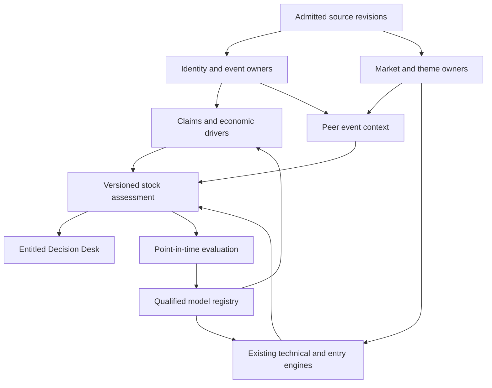
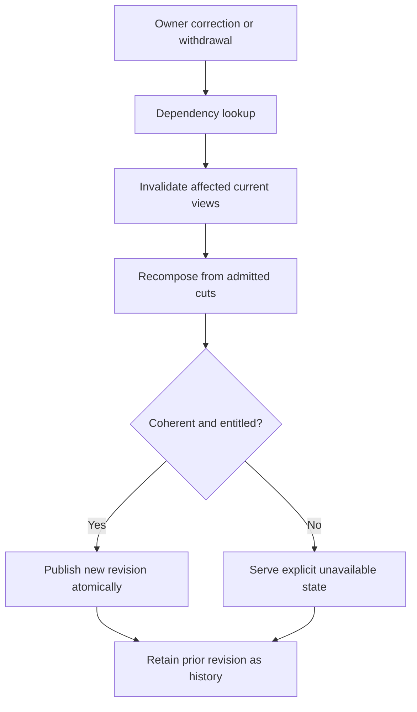

# Catalyst Intelligence: backend architecture and research program

Date: 2026-10-19. Accountable integration principal: root session acting on the user's expanded backend mandate. Source baseline: Macro `97261c2a319e62faec05690c04e6fae180540235`; governing Mastermind pin: `bcf4a2f72538682f2fbe4902f6417e59cd038678`.

This is an implementation and research design, not an assertion that the proposed models have been qualified. R1 code and replay evidence are described in `README.md` and `verification.json`. The remaining program below has explicit source, research and serving completion conditions.

## 1. Product objective and scientific decomposition

Catalyst Intelligence should help a user decide what deserves attention, what changed, what that change could mean, and what condition would make an entry worth considering. The default surface should answer those questions in a few sentences. Advanced research remains available through the same case, including contradictory evidence and unmeasured assumptions.

The system needs four separate targets. Event truth asks what happened and what changed relative to the previously knowable state. Economic consequence asks which company assumptions changed. Market context asks how price, liquidity, the sector and economically relevant peers behaved. Entry policy asks which executable decision is supported at the current price under the applicable strategy and horizon. A favorable event can coexist with unattractive entry availability after repricing.

"Best entry" must mean the best supported choice among a finite set of feasible policies under a stated objective and information cutoff. It cannot mean the cheapest historical print selected after observing the path. Waiting, entering under an already permitted condition and taking no entry all belong in the evaluation universe. A good explanation does not itself establish an entry advantage.

The initial stock-oriented product is an investment research decision desk. Bio and Gov Revenue are sector implementations of shared case, evidence, change, relationship and assessment contracts. Their scientific and commercial models remain sector-specific. Later sectors should reuse the common mechanism without inheriting clinical assumptions or procurement semantics.

## 2. Implementation state

| Capability | Current evidence | Remaining condition |
| --- | --- | --- |
| Peer participation and relative performance | Implemented supplied-cohort engine; synchronized endpoints, issuer exclusion, missing-data coverage | Native, purpose-qualified membership and price acquisition |
| Shared and comparable catalysts | Implemented qualified owner keys, revision reconciliation and observed-history retention | Event-owner coverage and relationship mapping from admitted sources |
| News and driver changes | Actual NewsImpact projector called with separate current and historical owner bundles | Authenticated acquisition, additional driver/sector integration fixtures and correction delivery |
| Entry context | Original Prophet B4 projection validated and attached unchanged | Native receipt acquisition; current strategy remains CONTROL_ONLY / SHADOW_ONLY and horizon-specific |
| End-to-end research replay | Actual CLI, frozen synthetic owner request and output, 43 focused tests | Source publication checks and admitted-data replay |
| User interface | Decision Desk component and synthetic contract replay in draft PR #9611 | Incumbent WMN provenance repair, publication/entitlement integration and existing display holds |
| Residuals, predictive leadership, causal spillover and optimized entry policy | Targets and qualification protocol specified here | New research evidence; no numerical estimate published by R1 |

R1 does not acquire data, publish a live API, authenticate users, discover every competitor or send trading instructions. These facts define what the current implementation proves; they are not a permanent reduction of the user's mandate.

## 3. Shared architecture

The assessment is a derived view over existing owners. It is not a second authoritative news store, identity database, theme graph or order engine. Each facet carries its own owner, source revision, decision cut, horizon, coverage and admission state. The user receives one coherent case without the backend pretending those facets have identical evidentiary strength.

Use the existing source stores, publication mechanisms, scheduling and observability where they already meet these requirements. Add a new store or service only for a demonstrated missing responsibility. Logical separation does not require a microservice for every box. Start with bounded Python modules and existing publication seams; isolate expensive model inference and research replay jobs when their resource profiles justify it.

The rendering API should serve a precomputed, source-bound assessment. A browser request must not initiate a multi-minute research agent chain. Acquisition and recomposition run in the background; the user can see what is current, incomplete or changed. Expensive research can improve the next revision without blocking a readable current case.

## 4. Source, identity and time infrastructure

Every material fact needs an immutable source revision, owner-qualified fact/event identifier, source-use purpose, evidence location and applicable entitlement. Store earliest established public availability separately from source-stated publication time and system-observation time. An article's displayed timestamp is not automatically proof that its complete content was available then.

Identity must bind company, security, listing and identity epoch. Economic ownership is a separate relation: a sponsor, listed parent, regional licensee and royalty recipient can have different exposures to the same asset. A ticker string is a presentation attribute, not the join key. Preserve historical listings, corporate actions, acquisition boundaries, delistings and rights changes.

Historical features require both effective time and knowledge time. An assertion effective last year but first discovered today cannot enter yesterday's decision. Each assessment needs a reproducible cut manifest: source revisions, owner generations, identity epoch, membership formation, market observations, model version and composition version. Event labels also need a maturity time before they can enter training.

Return observations need exact start/end instants, market session and calendar version, adjustment basis, currency, quote/bar availability, stale/halt state and price provenance. Align only to a resolution supported by the admitted data. R1 checks supplied endpoint consistency; it does not independently establish exchange-calendar correctness. Its positive-only endpoint contract also refuses zero terminal values. Extend the owner-qualified terminal/delisting representation before any historical return or loss study; keep those issuers in the sample and never turn refusal into survivorship filtering.

Rights are evaluated by purpose: research, derived display, historical training and redistribution can differ. An internal receipt or a valid checksum is not permission to display its source content. Existing GMI finalized-cohort readers enforce their own rights/generation contract and must be used; reading raw files is not an alternate admission route.

## 5. News, event novelty and changing drivers

The fundamental unit is a changed claim within an event revision. Track the old proposition, current proposition, changed field or qualifier, supporting and contrary evidence, information availability, correction lineage and owner conclusion. Numeric changes, altered eligibility, revised dates, commitments versus intentions, execution versus authorization, and changing exposure are all potentially meaningful even when most wording repeats.

Preserve document families and source independence. Syndicated copies of one release remain one underlying announcement. An independent confirmation may improve evidence without being a second economic event. A recently published recap may contain no new claim. Tetlock's stale-news study motivates separating novelty from attention; its historical result is not an adopted contemporary trading rule [1].

NewsImpact already owns fact-log folding, thesis projections and material-delta triggers. Extend its accepted event/claim vocabularies and owner adapters when a driver is missing. Do not create a parallel sentiment stream that competes with its correction semantics. Model extraction can propose claims and relationship changes; admission requires source-linked checks. A text model should not assign a probability because a sentence sounds confident.

The proposed driver record includes affected entity or asset, driver type, prior/current value or proposition, units, horizon, directional economic channel, scenario assumptions, evidence refs and uncertainty. The same announcement can affect several drivers with different signs. For example, an encouraging Bio result might improve confidence in a shared mechanism while increasing commercial competition for a rival. Preserve both implications until evidence resolves them.

Sector and macro changes enter through explicit exposures. A policy revision, reimbursement change, budget allocation, financing environment, supply constraint or demand revision matters only through a supported link to the company. A positive sector headline is not automatically positive for every member. Existing sector attention, market state and relationship outputs remain context inputs, with their original publication and authority restrictions.

Change priority should initially use transparent categories: the case was invalidated; a material claim changed; a timing window changed; entry-owner state changed; observed peer participation changed; or new evidence became available. Do not rank users' attention through an unqualified weighted return score. Repeated reporting should not generate repeated alerts unless the source owner records a material change.

## 6. Sector evidence and economic consequence engines

### BioCatalyst

The Bio evidence adapter must preserve the actual trial, asset, indication, mechanism, modality, patient population, treatment setting, comparator, endpoint, development stage, geography and commercial rights. Trial-record changes, sponsor statements, results, regulatory decisions and commercial developments have different meanings. A trial calendar entry is an expectation with uncertainty, not confirmation that the event will occur on a particular day.

Keep at least four future estimates separate: timing/outcome of the scientific or regulatory event; commercial consequences conditional on that outcome; shareholder value under financing and competitive scenarios; and the distribution of tradable market reactions. Clinical success is not interchangeable with commercial success or positive stock return. Negative evidence, failed programs, changed endpoints and discontinued assets must remain in the research population.

The first advanced models should answer a narrow question with adjudicated labels. Examples include a competing-risk timing model for an announced milestone, or a calibrated outcome model within a sufficiently comparable event family. Hierarchical partial pooling may help sparse groups, but only after the grouping and validation design are justified. Sensitivity to indication, stage and source coverage belongs in the result. No universal clinical likelihood appears on a card until that specific target is calibrated and qualified.

Economic scenarios need rights-adjusted asset exposure, development/commercial assumptions, competitive displacement, financing needs and dilution. A price reaction alone cannot identify the fundamental surprise or the percentage already priced in. Show observed repricing now; estimate valuation ranges only when their assumptions and uncertainty are defensible.

### Gov Revenue

Gov Revenue should retain the distinctions between authorization, appropriation, solicitation, award, obligation, performance, payment and recognized company revenue where its incumbent sources support them. The economic adapter traces the company's actual role, execution conditions, timing, margins, concentration and competing opportunities. It should not convert a headline contract ceiling into realized revenue.

### Later sectors

Sector packs contribute event ontologies, material driver definitions, exposure relationships, evidence rules and target-specific research labels. The common kernel contributes identity/time, revisions, rights, peer measurement, evaluation, serving and user actions. This allows Catalyst Intelligence to expand without forcing every sector through a Bio probability model or procurement lifecycle.

## 7. Same-subtheme competitors and related companies

Maintain two representations. Comparison membership determines which securities belong in a historically knowable peer cohort. Economic relationships explain why a particular event could affect a particular peer. A theme path is not proof of direct competition, and direct competitors can experience opposite effects from the same announcement.

GMI's `ontology.RepositoryStore`, `compose_neighborhood` and `structural_navigation.hierarchy_paths` are the existing relation/navigation seams. A finalized board cohort must be consumed through `selection_cohort_publication.read_finalized_cohort` or `consume_us_source`. That selected board is not an all-market subtheme universe. The next admission work must establish the intended purpose and coverage through the incumbent GMI/Data OS contract rather than rename the existing board as every competitor.

Formation needs independently chosen membership, source evidence, known/effective times, reviewed listing bindings and exclusions. Do not add a peer because it subsequently rallied. Remove the focal issuer entirely, including its other listings. Deduplicate multiple graph paths; do not arbitrarily select one share class for a peer issuer. TNIC's documentation illustrates why this matters: its distributed data include self-pairs and fiscal-year labels are not already lagged to public availability; it also separates horizontal product similarity from vertical relationships [2].

The implemented equal-weight comparator uses observed eligible peer issuers and reports the frozen denominator. It exposes focal return, observed peer mean, complete-cohort mean only when complete, median, dispersion, breadth and the focal-minus-peer difference. Missing or stale observations reduce coverage. These descriptors answer a useful question without a prediction model.

Later comparison modes can add owner-defined fixed weights, concentration and named basket contribution. Mechanical contribution to a weighted basket is arithmetic; it does not establish that other constituents responded to the focal company. Preserve a target-excluded comparator and, for pairwise forecasts, exclude both the focal and predicted issuer from shared peer controls.

## 8. Answering whether a stock is lifting its theme

| Evidence level | Appropriate claim | Additional requirement |
| --- | --- | --- |
| Synchronized peer returns | Peers participated, lagged, diverged or had mixed performance during a stated window | Admitted membership, prices and visible coverage |
| Basket contribution | The stock contributed a stated amount to a named weighted basket | Known weights, membership and return convention |
| Event comparison | Peers had the same announcement, distinct comparable catalysts, other observed events or unknown coverage | Owner-qualified event identity/comparison semantics and revision history |
| Observed ordering | The focal movement was observed earlier than certain peers | Nonoverlapping onset uncertainty intervals and sufficient market resolution |
| Factor decomposition | The movement exceeded a specified historical model's estimate | Pre-window fit, justified controls and sensitivity analysis |
| Predictive leadership | Focal information improved subsequent peer forecasts in the qualified population | New held-out evidence beyond own-return, volatility, market and sector baselines |
| Economic read-through | A documented relationship supports a conditional positive, negative or mixed hypothesis | Pre-existing exposure evidence and event-specific economic reasoning |
| Causal spillover | An identified announcement changed exposed peers relative to a credible counterfactual | A defensible causal design, exposure mapping and dependence-aware inference |

R1 covers the first and third rows for supplied research inputs. It does not emit the stronger claims. A stock outperforming peers is not proof of independence. Peers moving later is not proof the focal stock caused them to move. Lo and MacKinlay explain why infrequent trading can distort cross-autocorrelation, making time and liquidity discipline necessary before a leadership interpretation [3].

The later leadership study should define onset as an interval between the last unaffected observation and the first qualifying change. Overlapping intervals yield unresolved ordering. A halted peer's delayed print is not a measured delayed response. Distinct peer announcements and common sector events are competing explanations, not nuisance details to omit.

For causality, define the information shock and pre-event economic exposure, then choose a credible counterfactual. The total effect of an announcement on peers is different from the effect of the focal price movement itself. Controlling for contemporaneous peer/sector returns can remove the transmission being studied. Aronow and Samii's interference framework motivates explicit exposure mapping; an observed graph alone does not supply its identification assumptions [4].

## 9. Technicals, trends and entry timing

Consume the existing Prophet and Radar owners. The current B4 projection provides strategy-specific availability, zone, invalidation, extension, chase state, quotes, receipt references and the 2–15-session horizon. R1 validates and preserves that projection and exposes its CONTROL_ONLY / SHADOW_ONLY status. It does not upgrade it to a qualified universal Bio entry rule.

Future technical context should preserve independent horizons and measurements: current trend/structure, extension from the anchor, realized volatility, liquidity/spread, event gap, participation, pre-event run-up and existing market/sector state. Use the incumbent feature definitions and versioned bars. Adding many highly correlated indicators does not create independent confirmations.

Research pre-event and post-confirmation policies separately. Scheduled binary risk, unscheduled information and gradual thesis changes have different execution conditions. Start entry-policy qualification after a confirmed event because it reduces dependence on an unqualified scientific-outcome model. This is a sequencing decision, not abandonment of advanced pre-event research.

Candidate policies must be executable at known information times: an existing permitted entry, waiting for a defined incumbent pullback/confirmation condition, or no entry. Fix horizon, exits, order assumptions and latency before evaluation. Do not tune one policy's exit more favorably than its comparator. Include non-fills, missed continuations and capital occupancy. Preregister the executable price convention, information-to-order delay, spread, fees, participation-dependent impact, capacity, partial fills, rejected orders, and overnight/halt/reopening behavior. Report the intended liquidity populations separately and stress plausible deterioration. Add borrow and financing assumptions only when the admitted action set requires them.

Event gaps require their own loss treatment. A stop trigger does not guarantee the execution price; a stop-limit can fail to fill [5]. Therefore a structural invalidation level cannot be presented as a guaranteed loss boundary around binary announcements. The model should distinguish continuous path risk from discontinuous overnight or halt risk.

## 10. Correction propagation and live infrastructure

R1 deterministically changes its content identity when a supplied input changes. Live operation requires a dependency index connecting each assessment to source revisions, identity epochs, membership generations, market bars, model versions and entry receipts. An owner correction should identify affected cases and recompute only those cases.

The coordinator needs idempotent change processing, per-owner sequence/generation checks, bounded retries, dead-letter inspection and replay from immutable inputs. No assumed global arrival order. Out-of-order correction is normal. Missing historical owner cuts cannot be replaced with current state; unresolved revision conflicts cannot be silently won by the latest arrival.

The first live case already requires a publication transaction that checks the consumed dependency generations against all relevant corrections locally admitted by that publication owner. A stale recomposition must not become current after a newer admitted correction, even if it finishes last. This is a local publication fence, not a claimed distributed transaction across independent upstream stores. Wave 3 depends on this correctness slice of Wave 4; broader scaling and SLO work can follow.

Serving should bind the assessment revision to the current identity, account entitlement and source-policy generation. Revoked or corrected material must not remain in a browser cache as an actionable current case. Atomically replace the card, counts and open detail. Keep historical evidence accessible only under its permitted historical semantics. PR #9611 already exercises analogous withdrawal, conflict and account-context clearing behavior in its component replay.

Adopt existing storage and job infrastructure for immutable artifacts, transactional publication pointers and derived read indexes. Persist only permitted evidence content; otherwise retain the approved reference and derived fields. Cache keys must include account/entitlement, identity, source generation and model/composition version where they affect the response. Background research and live serving need separate concurrency and resource budgets so a backfill cannot starve current updates.

Measure source-to-detection, detection-to-admission, admission-to-assessment and publication-to-client latency separately, with distribution and source coverage. Set freshness expectations by source and user job; do not promise uniform real-time delivery from daily or delayed sources. Track correction propagation, stale-view removal, missing coverage, unexplained identity refusals, recomposition backlog and cost per useful case. Establish numeric SLOs from pilot workload and admitted vendor delivery characteristics, then qualify them through load and failure tests.

## 11. Research program and advanced engines

| Study | Target and initial method | Necessary falsifier or benchmark |
| --- | --- | --- |
| R-A event truth and novelty | Adjudicated claim/revision labels; deterministic deltas plus evidence-linked extraction proposals | Reprints and source-count changes must not masquerade as new economic information |
| R-B economic consequence | Explicit driver/scenario models before learned impact ranges | Economic direction independently labeled, not inferred from realized returns |
| R-C market decomposition | Pre-window factor baselines with own-return/volatility controls | Sensitivity to controls; residual does not become causal independence |
| R-D dynamic peer information | New formation dates, finite distributed-lag hypothesis family | Incremental value beyond own history, sector and target-excluded peers; shuffled memberships/placebo times |
| R-E entry policy | Post-confirmation feasible choices, realistic execution and matched horizons | Improvement over unchanged incumbent and simple liquidity-aware baselines after costs and non-fills |
| R-F outcome/timing probabilities | Narrow event families, calibrated target-specific models | Later-period calibration, adverse/missing cases and coverage-aware abstention |
| R-G causal read-through | Identified information shock and pre-event exposure design | Pre-trends, common-shock alternatives, simultaneous catalysts and alternative controls |

Biopharma news research provides a useful taxonomy motivation: Cho, Singh and Lo deduplicate news and align event timing to sessions, but their retrospective category associations are not an entry strategy for this program [6]. Build labels across successes, failures, quiet events, adverse events, missing observations and discontinued companies. Selecting only large movers would bias both interpretation and entry research.

Use chronological outer evaluation with tuning inside earlier data. Purge overlapping outcome windows, respect label maturity and group related issuer/event/date observations. Correlated peer responses are not independent confirmations. Report uncertainty using an inference design appropriate to the dependence. Record every attempted variant and the full search family; repeated model selection creates backtest overfitting risk [7].

Historical LLM extraction introduces an additional leakage path: the model may know a later outcome even if shown an earlier article. Document the leakage mitigation, blind adjudication and prospective comparison. An "as of" prompt is not sufficient evidence. Store model/provider/version, prompt/extraction schema, source revision and adjudication provenance where allowed.

Qualification should evaluate target accuracy, probability calibration, economic utility, tail outcomes, coverage and stability separately. A probability can be calibrated yet useless for entry; a return forecast can be statistically useful yet disappear after execution cost. Choose minimum sample size from power and dependence for the intended event population, not a universal arbitrary trade count.

Complexity earns a place through incremental results. Compare regularized linear and constrained tree baselines before graph neural networks or sequential learned policies. Options-derived information, if admitted later, needs its risk-neutral interpretation, liquidity and execution limitations preserved. A model registry should record intended target, population, horizon, exclusions, training cut, qualification evidence, approved authority and invalidation conditions.

## 12. Existing research constraints

The current Macro DO_NOT_REBUILD constraints remain part of experiment design. Do not revive the killed fused composite, Stage2/EC win-rate gate or ranking bonus, Phase3 first-post catalyst scoring, Prophet POP merge, or the rejected SR2/SR3 peer-entry constructions. Permitted descriptive context remains available through its existing owners.

The rejected 11-GICS sector/group-persistence construction and its used 2022–2026 interval cannot be repackaged as this program's positive result. Dynamic subtheme information requires a genuinely new preregistration and new formation dates after merge, with own-return/volatility comparisons and a full attempt ledger. Scientific disagreement is resolved by an authorized new hypothesis and evidence, not by renaming an old score.

## 13. User-first delivery contract

The default case should show: why this deserves attention; the material change; observed price/peer context where admitted; the applicable entry-owner state; the principal uncertainty; and one useful next action. Every statement must be traceable to the same assessment revision. A reader should not need to understand source-generation IDs to use the product.

An illustrative future card might say: "The result strengthens the asset case. The stock moved more than the observed competitors. Entry remains unavailable after the move. Watch for the owner's next eligible condition." Such wording is conditional on actual admitted evidence and a applicable owner state. The R1 synthetic replay is a contract demonstration, not this live investment conclusion.

Advanced detail should expose an event/driver change timeline, competitor table with coverage and separate catalysts, price windows and technical horizons, economic scenarios, model/research evidence, and original sources/corrections. Material uncertainty and missing entry qualification remain visible on the card; the complexity of the methodology can sit beneath it.

Personalization should initially use explicit watchlists, sector/holding horizon and user research tasks. A relevant-to-user ordering is different from a forecasted-return ranking. Feedback should distinguish usefulness, clarity, missed events and factual errors. Do not train the system to reward clicks on dramatic news while ignoring decision outcomes.

## 14. Delivery sequence and concrete completion criteria

The root integration principal owns moving these seams to completion. Existing module boundaries identify where changes belong; they are not a reason to wait indefinitely for historical owners. Before touching an incumbent dirty or active workspace, reconcile its actual custody and preserve its changes. Use disjoint managed workspaces for independent work.

| Wave | Concrete work | Done means |
| --- | --- | --- |
| 1: research composition | Publish R1 source, synthetic replay, review and CI registration; repair #9611 introduced CI defects | Exact-head source checks are understood; research scope remains explicit |
| 2: native source admission | Connect GMI/Data OS purpose-qualified cohort, identity, market/calendar, NewsImpact current/prior cuts and B4 receipts | Admitted owner replay preserves rights, coverage and refusal states; selected-board scope is never inflated |
| 3: useful live case | Reconcile #6712 custody; close WMN provenance/identity gaps; connect existing #9552 sector context; attach through Radar/entitled API | Real source-to-user case, source links, correction/account clearing and consumer generation coherency proved |
| 4: change operations | Add dependency invalidation, durable recomposition, publication fencing, observability and workload isolation | Corrections and revoked inputs reliably remove or replace every affected current case |
| 5: research qualification | Register new hypotheses, datasets and attempts; run event/driver validation and post-confirmation entry study | Preregistered evidence meets practical/uncertainty criteria on later data with realistic execution |
| 6: advanced expansion | Add only supported outcome, residual, lead/lag and economic models; expand sector adapters | Each model has its own target, qualification, coverage and rollback contract |

Waves 2–4 can proceed in parallel where custody and contracts are disjoint. Wave 5 can prepare datasets and annotations during integration, but prospective test formation begins only under the new preregistered conditions. Advanced estimates stay unavailable until their own qualification; that does not prevent shipping useful admitted descriptive cases.

Current live dependencies are concrete: #6712's provenance/display path and preserved dirty tests; #9552's sector/opportunity publication contract and paired consumer; GMI's purpose/rights/formation semantics; and B4's limited scientific status. This R1 does not silently supersede them. Neither draft publication nor passing unit tests clears an existing merge or activation hold.

## 15. Acceptance ledger

Source acceptance requires a current code review, meaningful tests, CI registration and current-head check disposition. Data acceptance requires native identity, source-use rights, formation, timing and coverage evidence. Serving acceptance requires entitlement-aware publication, correction propagation and real consumer proof. Scientific acceptance requires a target-specific research result. A single green badge cannot stand for all four.

R1's independent C3 review accepted the repaired source and synthetic owner fixture for NONACTIVATED_RESEARCH_CONSUMER scope. The source review verified all-visible revision conflict detection, retained withdrawn history, qualified event namespaces, unchanged B4 state and explicit historical NewsImpact cuts. It did not rerun tests or admit production data. The root's 43-pass M2 execution is separate test evidence.

## 16. Primary research references

These sources motivate design and research requirements. None is treated as proof that Catalyst's proposed trading policies work.

1. Tetlock, *All the News That's Fit to Reprint: Do Investors React to Stale Information?* Authoritative Columbia abstract and citation: https://business.columbia.edu/faculty/research/all-news-thats-fit-reprint-do-investors-react-stale-information
2. Hoberg–Phillips, TNIC documentation, especially self-pairs, fiscal-year timing and vertical relationship exclusion: https://hobergphillips.tuck.dartmouth.edu/idata/Readme_tnic3.txt
3. Lo–MacKinlay, *An Econometric Analysis of Nonsynchronous Trading*, author's MIT abstract: https://web.mit.edu/~alo/www/Papers/lo-mackinlay-90a.html
4. Aronow–Samii, *Estimating Average Causal Effects Under General Interference*, exposure mapping and identification framework: https://arxiv.org/html/1305.6156v4
5. SEC Investor Bulletin, *Stop, Stop-Limit, and Trailing Stop Orders*: https://www.investor.gov/introduction-investing/general-resources/news-alerts/alerts-bulletins/investor-bulletins-15
6. Cho–Singh–Lo, biopharma news study, PLOS ONE, 2024: https://journals.plos.org/plosone/article?id=10.1371/journal.pone.0296927
7. Bailey et al., *The Probability of Backtest Overfitting*, author manuscript: https://www.davidhbailey.com/dhbpapers/backtest-prob.pdf
