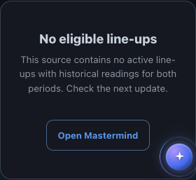
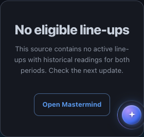

# Confluence qualified-zero primary heading

## User-visible change

A valid source with no eligible line-ups is a complete page outcome. Its title previously rendered as an 18px H3, leaving that page branch without an H1. It now uses `h1.hero-state` and the existing 32px desktop /26px narrow primary-heading scale.

The visible English title remains **No eligible line-ups** and the Chinese title remains **暂无符合条件的组合**. The explanation, source-built clock, qualified count and **Open Mastermind** destination are unchanged. A zero result still requires a qualified source; unavailable input does not become zero.

## Existing source contract

Only two template substitutions are needed:

1. Promote the existing empty-branch H3 to `<h1 class="hero-state">`, retaining both language spans exactly.
2. Replace its old `.empty h3` rule with `.empty .hero-state { margin:0 0 var(--sp-3,12px); line-height:1.2; overflow-wrap:anywhere; }`.

The existing hero-state weight, tracking and responsive font size remain the single type-scale owner. No new JavaScript, data, availability, rendering or motion owner is introduced. The local margin overrides the existing primary-heading margin only inside the empty card.

The saved current-source page contains three positive cards, so its only changed region is the local CSS rule. Its body and scripts are exact. The unavailable branch also retains its exact body and primary heading. Reversing the two template substitutions, or the one saved-page CSS substitution, restores parent `1c868e55b99fe52d5f90310bcbd4a7546fdb2c22` byte-for-byte.

Builder, existing page tests and protected JSON are byte-identical to that parent. Protected JSON still matches the actual producer. The current positive source remains 2026-11-08T11:31:29Z with receipt `4f8c3dcd8508a55978f4b27d7c4d34828bc1044881ed404120cb353b1d4dc7c1`.

## Focused proof

**92 existing page tests pass**, 10.96 seconds pytest /11.90 seconds process. No new permanent test or harness was added for this local heading change.

A bounded native visual/semantic inspection used four fresh contexts, comparing before and after in EN dark /ZH light at 320px and 1440px: eight page observations, zero page errors, Chrome 157.0.8103.39, 7.83 seconds process. These observations are not eight new functional browser cases.

| Observation | 320px, both languages | 1440px, both languages |
|---|---:|---:|
| Primary title font | 26px | 32px |
| Measured title height | 31.1875px | 38.390625px |
| Card height change | +10.1875px | +17.390625px |
| Page-content H1 count | 0 → 1 | 0 → 1 |
| Action minimum height | 44px preserved | 44px preserved |

Both narrow titles fit on one line. All inspected headings and documents remain contained. Title text, explanation, action label/href and footer stay exact in each pair. All eight original PNGs were visually inspected and their original byte length, SHA256 and Git blob verified.

The fixture is the existing page-test `_make_raw()` deep copy with `combos.long=[]`, rendered by the actual builder/template. It qualifies as available with zero eligible combinations, source time **2026-07-19T04:00:00Z**, receipt `2a6b527d7b44cad06372e6f4700f21ccc0c7fd8e560b2c01ec934cc13c6153b6`. This is explicitly synthetic qualified-source evidence, not a current market result. The exact existing tagged CTA was retained; the page-generation clock alone was fixed for before/after comparison.

- [Source, fixture, process and reproduction receipts](EMPTY_HEADING_VALIDATION.json)
- [All four paired observations and capture identities](EMPTY_HEADING_INSPECTION.json)

### English, 320px





### Chinese, 320px


The 1440px before/after captures are retained beside these files. A shared floating assistant is visible at the edge of some crops; this increment does not change that shared component.

## Build and adoption

Keep this H1 in the existing qualified-zero branch. Do not add a hidden duplicate heading or reclassify unavailable source as empty. The Paper zero-state example already uses a 26px title; its builder contract must name the semantic H1 and preserve the real fixture source time. Paper exports are editable anatomy, not browser accessibility proof.

Run the existing focused page suite from a complete checkout:

```bash
python3 -B -m pytest -q tests/test_confluence_screener_page.py --disable-warnings
```

The bounded inspection command and exact source-projection command are retained in the validation JSON for reproduction. Earlier recovery, method/motion, comparison and responsive proofs keep their original source identities; unchanged body/scripts do not become a newly run recovery suite.

Draft PR10893 remains unarmed and dependent on incumbent PR10705. Existing admission/calendar, source/model, programme and release holds remain. No deployed source, live entitlement, full shared shell/font or spoken assistive-technology acceptance is claimed.
