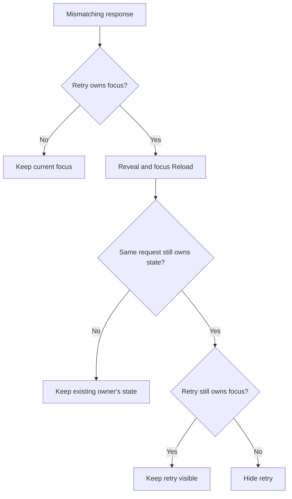
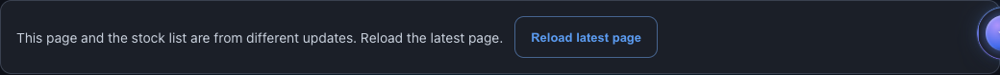
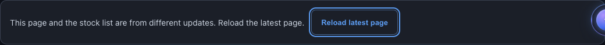
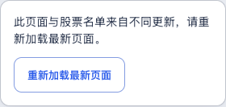
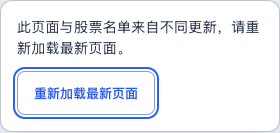

# Confluence focus-safe reload recovery

## Fixed user workflow

A keyboard user could activate **Check access**, receive a response from a different source generation, and lose focus to the page body when that button disappeared. **Reload latest page** was visible but did not receive focus. The baseline reproduced this on the actual saved page in English desktop and Chinese mobile.

The existing status renderer now describes and reveals the reload action before moving focus to it. It hides the retry only after confirming that the same request still owns the transition and the retry no longer owns focus. A user who moved elsewhere while waiting keeps that newer focus.

No new reload behavior is introduced: Enter activates the existing reload handler and preserves the full page URL, including repeated query parameters and the fragment. A subsequent matching protected response still hydrates through the existing controller.

## Existing-owner implementation

The change is confined to `showState()` in `templates/confluence_screener.html.j2`.

1. Derive the existing retry visibility rule without immediately hiding the control.
2. Update status, bilingual message, busy state and reload visibility.
3. Only when a mismatch would hide the currently focused retry, capture the existing `inFlight` ticket and focus the revealed reload with `preventScroll:true`.
4. After synchronous focus callbacks return, require that ticket to remain current and satisfy the existing `sameRequest()` epoch/user check.
5. If focus remains on or returns to the retry, keep it visible. If focus moved to another public control, respect that destination. Otherwise hide the old retry.

There is no new render counter, request owner, auth store or focus service. The existing ticket identity and epoch/user predicate resolve ownership. Message/busy writes happen before focus; only the guarded retry visibility write remains afterward.



The status message and two existing action labels stay unchanged. A rejected response never paints protected names, changes the public counts or changes historical evidence.

## Focus and recovery proof

The focused verifier runs **10 cases in 10 fresh contexts**, five behaviors in EN 1440 dark and ZH 320 light:

| Behavior | Observed result |
|---|---|
| Retry stays focused while the response is pending | Reload receives visible keyboard focus before the retry hides. Its focus event sees the correct message and both controls still visible. |
| User moves to a public method summary while waiting | That exact summary node keeps focus; the reload receives no focus event. |
| Reload focus synchronously dispatches sign-out through the existing auth fixture | Invalidation wins: status stays locked/hidden, controls hidden, message empty and protected walls intact. The outer mismatch render performs no stale visibility write. |
| A synchronous focus callback returns focus to Check access | The focused retry remains visible alongside Reload. No focused control is hidden. |
| A synchronous focus callback moves to another public method summary | That node retains focus and the now-unfocused retry can hide. |

Both ordinary recovery cases continue through **native Enter on Reload**, exact URL preservation, a matching valid response, hydration of both protected cards and sign-out restoration. The local HTTP sequence is a 503, a deliberately held current-schema response with only its source hash changed, then the actual matching saved protected payload. The same schema and source clock are retained in the mismatch fixture.

The existing AUTH helper is imported from its current verifier owner. It simulates user/session state; it is not live account or production entitlement evidence. External network requests are blocked. Public card markup is compared exactly within each case and recorded as canonical UTF-8 JSON SHA256 values, avoiding repeated page markup in the report.

**Results:** 10/10 focused cases, zero page errors, Chrome 157.0.8103.39, 16.58 seconds process. The existing compatibility suite also passes **14/14 cases in 14 contexts**, zero errors, 20.65 seconds. It checks version rejection, existing valid retry/hydration/sign-out and native public actions on the changed controller. The 10 recovery cases use the actual saved input pair; the 14 compatibility cases use explicit synthetic inputs rendered by the actual template/controller. These are two separate suites: **24 total cases /24 contexts**, not 24 added tests.

**92 existing page tests pass**, 13.23 seconds pytest /14.64 seconds process. The page-test file is unchanged. No string-mirroring test was added for the copy correction.

- [Focused recovery report](RECOVERY_BROWSER.json)
- [Current compatibility regression report](RECOVERY_COMPATIBILITY_BROWSER.json)
- [Source and process receipts](RECOVERY_VALIDATION.json)

## Before and after

### English desktop





### Chinese mobile





All four recovery status crops were visually inspected. The final actions remain at least 44px high and within their checked viewport. The screenshot focus outline supports the DOM/focus-event observations; a screenshot alone is not the proof of keyboard state.

### Baseline qualification

The original six-case baseline passed the two moved-focus cases and failed four expectations. The two normal recovery cases establish one focus-loss defect in two layouts. The two sign-out callback cases failed because no focus handoff occurred to trigger their callback; they are not two additional independent product defects.

The original baseline report contains very long repeated markup/assertion data. [RECOVERY_BASELINE.json](RECOVERY_BASELINE.json) is an explicitly labeled projection: public-markup arrays become canonical SHA256/region counts and long assertion strings are excerpted. [RECOVERY_BASELINE_FULL.json.gz](RECOVERY_BASELINE_FULL.json.gz) preserves the complete original 769,505 bytes, SHA256 `3b639bb11e7cb887f7e86afcadad1434ef61ce0bb5d951b21bd0e95d079851c6`. Decompression restores the original report; it is not a rerun. The four additional final cases specifically challenge focus callbacks that return to retry or move to another public control.

## Neutral Chinese survivorship description

The existing explanation used **都是活下来的赢家**. Calling every surviving company a winner adds a performance implication that the explanation does not establish. It now says **都是留存下来的公司**.

Coverage, surrounding survivorship caveat and English copy are unchanged. Current Paper anatomy already uses neutral survivor-bias terminology, so no corresponding customer-frame replacement is needed.

## Exact source boundaries

Parent: `a981425d32d9a26c520d2d4c267080178c477931`.

Two exact replacements—one status function and one Chinese phrase—reverse the template and saved HTML byte-for-byte. The rendered controller and honesty block match their saved counterparts. All styles, all three complete card markups, method figures, hero, hrefs and other scripts remain exact. Builder, page-test file and protected JSON are unchanged; the protected payload still matches the actual producer.

Source generation remains 2026-11-08T11:31:29Z with full receipt `4f8c3dcd8508a55978f4b27d7c4d34828bc1044881ed404120cb353b1d4dc7c1`. The exact existing tagged trial destination is retained. The source input, ranking, counts, payload protocol, authorization checks and current disclosure/motion code do not change.

## Reproduce and adopt

```bash
python3 -B -m pytest -q tests/test_confluence_screener_page.py --disable-warnings
python3 -B scripts/verify_confluence_recovery_browser.py \
  --out /absolute/path/to/owned/recovery-proof \
  --browser-executable /absolute/path/to/chromium
python3 -B scripts/verify_confluence_compatibility_browser.py \
  --out /absolute/path/to/owned/compatibility-proof \
  --browser-executable /absolute/path/to/chromium
```

The recovery verifier defaults to the actual saved HTML and protected JSON in this checkout. Its optional `--page` argument selects a retained baseline HTML. It serves those bytes locally and changes only its controlled HTTP response, not the product controller.

Method/motion proof at a981425d, responsive proof at 27d50dc0 and comparison proof at 22fa830d retain their original source identities. The current recovery phase does not relabel those earlier runs. The known shared-navigation issue at 960px remains outside this work.

Draft PR10893 remains unarmed and dependent on incumbent 10705. Existing admission/calendar, source/model, programme and release holds remain. No live account, deployed cache rollout, spoken assistive-technology or production acceptance is claimed.
