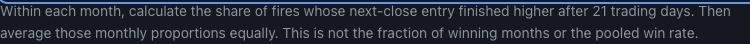
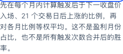
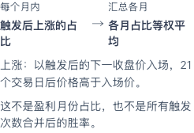

# Confluence method figure and narrow locked grouping

## Visible result

The existing card method disclosure now opens with two steps: **within each month, calculate the share of winning fires; across months, average those shares equally**. The win definition still uses the next-close entry price and a 21-trading-day horizon. The caption explicitly distinguishes this result from the fraction of winning months and from a pooled win rate.

This replaces the first paragraph rather than repeating it. The four remaining method paragraphs, public readings, source ordering, baseline values and protected access behavior remain unchanged. No example observations, dates, probabilities or generated market values appear in the figure.

At narrow phone widths, the locked icon and explanation stay together. The existing trial action follows on its own row. At 320px, the two locked cards each become **46px shorter in English** and **29.90625px shorter in Chinese**, with the action moving upward by the same amount. Text, destination and the 44px action remain intact.

## Content and layout contract

| Element | English | Chinese |
|---|---|---|
| First step label | Within each month | 每个月内 |
| First calculation | Share of winning fires | 触发后上涨的占比 |
| Second step label | Across months | 汇总各月 |
| Second calculation | Average shares equally | 各月占比等权平均 |
| Win definition | Win: price is above the next-close entry price after 21 trading days. | 上涨：以触发后的下一收盘价入场，21 个交易日后价格高于入场价。 |
| Aggregation distinction | This is not the fraction of winning months or the pooled win rate. | 这不是盈利月份占比，也不是所有触发次数合并后的胜率。 |

Use the existing native `details/summary`. The figure contains a semantic two-item ordered list and a single final `figcaption`; the distinction paragraph belongs inside that caption. Both labels align above their stronger calculation text. A decorative arrow occupies the 28px column gap; it introduces no third step or data encoding.

The figure has two equal shrinkable columns and a maximum width of 560px. Its 8px top gap keeps the existing summary focus outline clear of the labels. Body text remains 14px and step labels 12.5px; long content wraps. The expanded method is approximately **40.5–67.8px taller** in the checked cases because the calculation is separated into readable stages. The disclosure remains collapsed by default, so this explanation adds no persistent card reading burden.

For `max-width:400px` only, use a 32px icon column and a shrinkable explanation column. The CTA spans the next row and starts at the icon's left edge. Preserve the separate 640px hero/padding and 768px card-layout rules. At 390/400/401/1440px the checked locked groups retain their prior heights and relative action positions. No new access state or entitlement inference is introduced.

## Motion and native behavior

Opening the method immediately reveals complete static content. With ordinary motion preference, the figure has one **120ms ease-out opacity animation from 0.85 to 1**, no delay, loop or movement. It runs on native opening; there is no animation controller or new page script. Closing remains native.

The existing reduced-motion rule computes to `animation-name:none` and `animation-duration:0s`, with full opacity. The figure works with page JavaScript disabled. The existing hero illustration remains static and byte-exact.

The browser verifier uses real Enter/Space input and checks that the summary keeps focus after opening, closing and reopening. Its observer records the actual animation and waits for its finished promise. The page-JavaScript-disabled case observes native DOM and computed CSS directly; it does not depend on an injected event listener.

## Before and after

### Method — English, 1440px




### Method — Chinese, 320px





### Locked group — English, 320px


### Locked group — Chinese, 320px


All twelve native before/after method and locked crops were visually inspected. The report records their original PNG identities.

## Source boundaries and implementation

The parent is `d752f398271dd444697e662a4dab29529dcb8a45` in dependent Draft PR10893. This increment changes the Confluence template, its saved HTML projection and a focused browser verifier. The page-test file, builder and protected JSON remain byte-exact.

Three exact template replacements account for the entire change: the first method paragraph, local method CSS, and the narrow locked-group CSS. Reversing those replacements restores the parent template exactly. Restoring the first paragraph in each rendered card restores that card's complete markup; the other four method paragraphs remain exact. The saved HTML changes only its page-style and ledger regions, and reversing those two regions restores every parent byte, including outside line endings. All scripts and the hero SVG remain exact.

The bound current source retains its full receipt, source-generation time, 256-stock coverage, 11 eligible combinations and three displayed rows. Protected JSON still equals the actual producer. The existing tagged trial URL is reused exactly from the parent; the sparse verification checkout does not synthesize a different marketing destination. This is component projection against the bound input pair, not a claim that a complete website was freshly rebuilt.

## Focused proof

- **92 existing page tests pass** on the final source, 5.29 seconds pytest / 5.77 seconds process.
- **13 browser cases in 13 fresh contexts pass**, with 26 actual before/after saved-page observations and zero page errors; Chrome 157.0.8103.39, 11.54 seconds process.
- Ten reduced-motion EN/ZH cases cover 320, 390, 400, 401 and 1440px. Two ordinary-motion cases cover EN320 and ZH1440. One EN320 case disables page JavaScript.
- Visible bilingual steps, valid caption placement, unchanged remaining paragraphs/readings, containment, focus clearance, native keyboard disclosure and 44px primary actions.
- Actual 120ms single opacity animation, reduced-motion computed CSS, and static hero.
- Two locked cards per page preserve exact text and destinations. Both checked sides of the 400px boundary retain containment. The verifier rejects an unnecessary height increase.
- The existing trial link is activated with Enter and its exact destination is intercepted locally. This proves native link behavior in the controlled page, not live registration or entitlement.

The final full report is [METHOD_BROWSER.json](METHOD_BROWSER.json); source conservation and run receipts are in [METHOD_VALIDATION.json](METHOD_VALIDATION.json).

### Diagnosis retained

The initial attempt passed 12/13 contexts. Its JavaScript-disabled case opened the native disclosure, then timed out waiting for an injected toggle listener that could not run under that setting. That was a verifier error, not evidence of a broken native disclosure. The initial report's `page_observations:26` is an overcount: it retained **25 completed snapshots**. The final verifier counts stored snapshots directly.

Visual inspection also found the first figure labels touching the focus outline and a 640px layout that needlessly put the CTA on another row, increasing the locked group by about 50px. The final source adds the 8px figure gap and limits regrouping to 400px. Caption placement and timing-independent reduced-motion assertions were corrected before the final run. The original failed report is retained as [METHOD_BROWSER_INITIAL.json](METHOD_BROWSER_INITIAL.json), with these qualifications; it is not relabeled as passing evidence.

## Reproduction and adoption

From a complete checkout of this source, preserve a parent saved page at d752f398 and run:

```bash
python3 -B -m pytest -q tests/test_confluence_screener_page.py --disable-warnings
python3 -B scripts/verify_confluence_method_browser.py \
  --baseline-page /absolute/path/to/d752f398/confluence_screener.html \
  --out /absolute/path/to/owned/method-proof \
  --browser-executable /absolute/path/to/chromium
```

The existing builder, source receipt, auth/session controller, protected endpoint and publication owner remain authoritative. There is no new state service, calculation engine, data producer or release path.

The 20-case responsive proof at 27d50dc0, 16-case comparison proof at 22fa830d and 14-case compatibility proof at f51b60de keep their own source identities. They are not restamped as this increment. The previously documented hidden shared-navigation overflow at 960px is outside this method/narrow grouping proof and remains unresolved. Live entitlement, deployment, full shared-shell/font completeness and spoken assistive-technology behavior are not claimed.

The candidate remains Draft/unarmed. Incumbent PR10705 admission/calendar holds and wider programme acceptance are unchanged.
