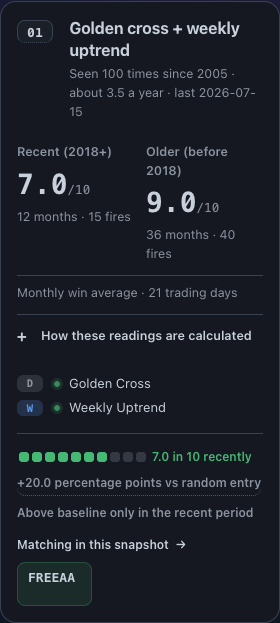
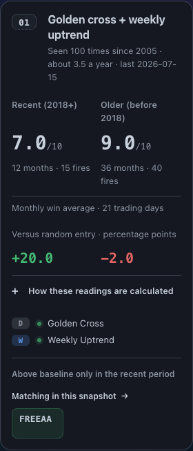

# Paired Confluence baseline comparisons

## User outcome

Readers can now compare both historical periods against random entry without opening a disclosure or interpreting the recent rate twice. Each card retains its recent/older monthly win averages and sample counts, then shows the **supplied comparison for each period** on matching columns. A higher older win rate can still sit beside a negative older baseline difference; the page exposes both facts.

The former ten-block recent-rate meter and one-sided comparison chip are removed. Their useful baseline definition moves into the existing method disclosure. The categorical period summary, source rank, D/W legs, company navigation, source clocks and entitlement rules remain.

## Existing data and display contract

| Item | Existing source/context | Display rule |
|---|---|---|
| Recent monthly win average | `wr_test_pct` | Existing /10 value, sample months and fires |
| Older monthly win average | `wr_train_pct` | Same weight, scale and sample treatment |
| Recent baseline difference | `edge_test_pp` from supplied `edge_wr_test` | Signed percentage points |
| Older baseline difference | `edge_train_pp` from supplied `edge_wr_train` | Independently signed percentage points |
| Exact zero | Existing numeric zero | Neutral `0.0` |
| Missing/invalid optional difference | Existing `None` | **Unavailable / 暂无数据** in only that period |
| Small nonzero difference | Absolute magnitude below 0.1 percentage points | Signed two-significant-digit display, e.g. `+0.004` or `-1e-10`; never rounded into apparent zero |

The builder already validates and scales these supplied deltas. The template does **not** reconstruct them from displayed rates or detailed baseline levels. A missing delta remains missing even when rate and baseline are available. A supplied delta remains available when the detailed baseline level is absent.

The shared unit is **Versus random entry · percentage points / 较随机入场 · 个百分点**. It describes win-rate differences, not investment returns or statistical significance.

## Composition and accessibility

The existing two-column rate block now carries both comparison values. Shared grid rows keep labels, rates and samples aligned when one locale or period label wraps; the comparison values also align. Units remain visible at 320 px. No type-size reduction or new tab stop is introduced for static numbers.

A semantic definition list supplies independent Recent/Older terms. Its shared heading uses the **displayed rank**, a presentation-only ID. The accepted source identity can contain spaces; it is never repurposed as an HTML ID-reference token or altered for this UI. The browser proof resolves the label to its actual heading, including a source fixture containing `L 0001`.

The existing native method disclosure retains keyboard/touch operation and the monthly weighting, historical test/training, horizon, random-entry and rank qualifications. Its baseline definition now explicitly states that random dates are selected for the same stocks over the same period.

## Missingness and conclusions

- Known recent and older values render independently.
- Missing recent with known older becomes **Recent-period comparison unavailable / 近年时期比较暂无数据**, preserving the visible older comparison.
- Both missing retain **Random-entry comparison unavailable**.
- Existing positive/negative/zero summary rules remain based on the supplied deltas, not the optional consistency flag.
- Unknown comparisons never erase valid rates or samples, become zero, or imply a negative result.

## Implementation scope

Changed source: `templates/confluence_screener.html.j2`, its focused page tests, new `scripts/verify_confluence_comparisons_browser.py`, and the style/ledger regions of `site/confluence_screener.html`.

The complete builder and protected JSON are byte-exact. The full-source receipt remains `4f8c3dcd8508a55978f4b27d7c4d34828bc1044881ed404120cb353b1d4dc7c1`. Source-built time remains 2026-11-08T11:31:29Z. Neither is a new market observation or producer run.

The served page conserves every byte outside its renderer-derived style and ledger regions, including its current shared navigation, metadata, links and auth/protocol script. The sparse verification copy lacks the marketing package's state module, so both old/new component renders reuse the exact tagged CTA already present in the parent saved page. This is explicit context preservation, not a repaired marketing environment or a claim of a complete production build.

## Focused proof

Final reviewed files pass **92 page tests** (11.17 seconds pytest) and **16 browser workflows /16 fresh contexts** (22.30 seconds process), with zero page errors in Chrome 157.0.8103.39.

Fourteen cases render synthetic sources through the real template. Two cases serve the **actual saved current-input HTML and protected JSON**, hydrate through controlled existing auth, verify exact protected destinations, sign out without changing public comparisons, and follow the free company link into an intercepted local destination. There is no claim of live entitlement or deployment.

Across 48 card observations, the verifier checks both signs/values, true zero, missingness, labels, unit visibility, rate/sample alignment, available widths, absence of repeated meters,44px method controls and native keyboard activation. Six first-card captures were visually inspected. Synthetic cases include a higher older headline rate with a negative older delta, one/both missing comparisons, sub-rounding values and a space-bearing source identity.

An earlier 14-case compatibility regression also passed before the final display-only alignment and accessible-label correction. Its report retains its exact source hashes; it is not restamped as a final-head run. The existing protocol/auth script is unchanged, and the final saved-input cases exercise matching hydration/sign-out.

The parent fails the 16 new paired-comparison acceptance cases because it has no paired cells. This is a presentation baseline, not sixteen separate data failures. Full reports, pre-correction harnesses and exact identities are in [PAIRED_COMPARISONS_VALIDATION.json](PAIRED_COMPARISONS_VALIDATION.json).

## Paper and adoption

The current eight R2 anatomy variants retain their source-not-loaded status. Each of 24 cards has independently labeled recent/older baseline placeholders; existing rate/sample content, actions, card identity and geometry remain. Numeric source fixtures are not copied into these anatomy frames. Older governed references, retained studies and the complete R4 proposal remain unchanged.

This work continues on dependent Draft PR10893. It does not inherit incumbent PR10705's source admission, repair its unrelated calendar proof refusal, or authorize merge/deployment. Use the existing build and publication owners when actual release controls are satisfied. Keep the compatibility contract in [README.md](README.md) and the current Paper Build map together.

## Native visual comparison

Both images use the same 320 px English fixture. The older headline rate is higher, while its supplied baseline delta is negative. These are synthetic test values.

| Before | Current |
|---|---|
|  |  |

[Chinese signed comparison](captures/comparison-mixed-320-zh.png) · [Chinese missing recent value](captures/comparison-missing-320-zh.png) · [Exact zero](captures/comparison-small-320-en.png) · [Saved-input desktop](captures/comparison-served-1440-en.png) · [Saved-input Chinese phone](captures/comparison-served-320-zh.png)
