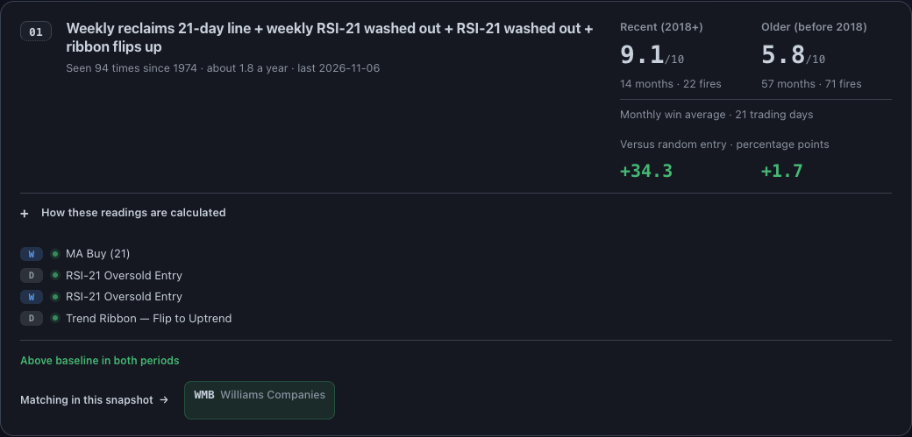
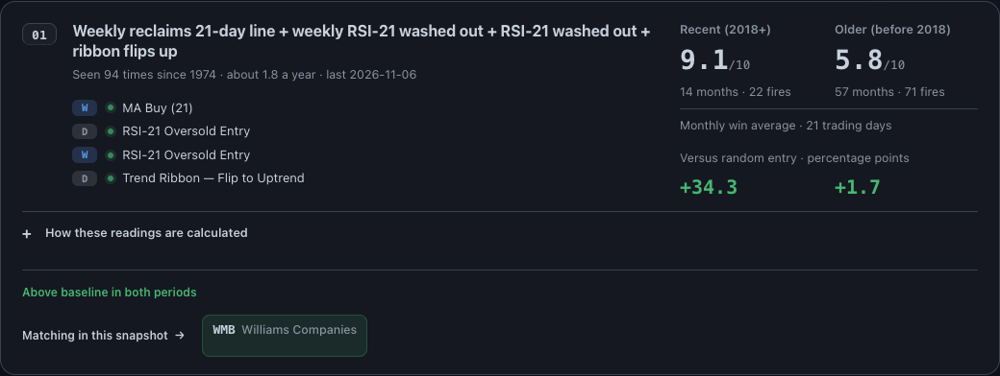
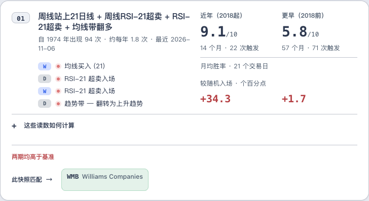
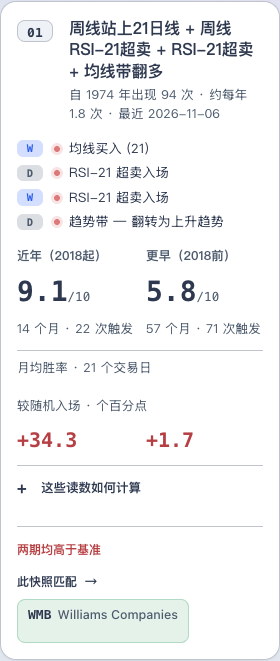

# Confluence responsive card reading path

## Outcome

The existing signal criteria now sit below title/history, beside the paired historical readings on desktop. Below 768px, the same nodes stack in the order **identity → criteria → comparisons → method → summary/company action**. The card-specific breakpoint keeps the fixed 310px comparison rail from squeezing the criteria immediately above the page's existing 640px mobile breakpoint.

On the current saved source, all three cards at 960px and1440px bring the company action upward by **107.1875px** and reduce card height by the same amount. At 768px the measured reduction is80.015625px in English and101.609375px in Chinese. These are finite measurements in the recorded browser/font environment, not a promise for every future recipe.

The change does not remove text, reduce type, shorten tooltips, replace controls or change a destination.

## Exact implementation

Only `templates/confluence_screener.html.j2` and the corresponding saved page change product behavior. The existing `.legs` wrapper and complete Jinja loop move once, byte-for-byte, into `.lc-top` after `.lc-title-wrap` and before `.lc-wr`.

At 768px and above, the header grid uses:
- Columns: `auto minmax(0,1fr) auto`; the existing evidence rail retains 310px.
- First row: rank, title/history, comparisons.
- Second row: empty rank column, criteria, comparisons.
- Natural rows `auto 1fr` keep the title-to-criteria gap at 16px.

Below 768px, explicit areas are rank/title, full-width criteria, then full-width comparisons. The old 640px card-area override is removed, while that breakpoint's hero and padding rules remain exact. The criterion row uses `26px minmax(0,1fr)`; shrinkable text and `overflow-wrap:anywhere` prevent an exceptionally long token from widening the grid. There is no fixed-height clipping, truncation, order override, duplicated list or new JavaScript.

The keyboard sequence follows the actual DOM: rank explanation, history explanation, the ordered D/W badges, native method summary, then company anchors. Rates and baseline comparisons remain static content.

## Conservation

The source receipt reverses the exact leg move and local CSS edits and requires equality with parent `22fa830d`. The saved HTML inverse restores the parent after replacing only the style and ledger regions. All card text, attributes, methods, footer content, links, source-generation identity and inline scripts are exact.

The builder, 92-test file and protected JSON are byte-exact. The protected artifact still equals its actual producer. Source-built time remains 2026-11-08T11:31:29Z and full-source hash remains 4f8c3dcd8508a55978f4b27d7c4d34828bc1044881ed404120cb353b1d4dc7c1.

Both old/new render contexts explicitly reuse the exact tagged CTA from parent saved HTML because the sparse marketing initializer lacks its state dependency. The source-bound style and ledger match before replacement. This is the same bounded component projection used for the prior paired-comparison increment, followed by actual saved-page browser proof.

## Browser and page proof

**92 page tests pass. 20 browser cases in 20 contexts pass**, with 40 before/after page observations and 120 card observations, zero page errors, Chrome 157.0.8103.39.

| Cases | Inputs and purpose |
|---|---|
| 16 actual saved-page pairs|EN/ZH at 320,390,640,641,767,768,960,1440px. Original and candidate HTML share exact surrounding bytes and local assets.|
| 4 synthetic label-stress pairs|EN/ZH at 320/768px. An explicitly injected long criterion is identical in before/after pages; it is not captured market data.|
| All 20 |One criteria list, unchanged source order/content/links/fonts/target sizes, aligned paired readings, full card-descendant containment, native Tab/Enter path, disclosure expansion, intercepted company destination.|
| Four 767/768px cases|Focus stays on the same D/W node and an open disclosure remains open while resizing across the breakpoint.|

The initial 18/20 report exposed an **existing shared-navigation overflow at 960px**. Before and after both have document scroll widths 1288px EN / 1004px ZH, produced by hidden `.site-nav` menus. The final verifier requires the same offending element identities/classes/geometry, hidden visibility and exact extent. Independently, every card and its rendered descendants must remain contained. Any new offender or card overflow fails. No overflow-hiding style or navigation patch is added.

Accordingly, the result is **20 card-layout cases passing with unchanged pre-existing navigation overflow in two cases**, not zero document overflow.

[Validation and exact run receipts](LAYOUT_VALIDATION.json) link the complete case objects, partitioned into [EN](LAYOUT_BROWSER_EN.json) and [ZH](LAYOUT_BROWSER_ZH.json) files with original case-order indices. The initial 18/20 report is retained as an explicit projection with its original full report hash; the final case objects are complete.

## Before and after

### Desktop English

Before:

After:

### Tablet Chinese and narrow mobile

The other native captures include641pxEnglish,320pxEnglish, the desktopChinese pair and the synthetic long-token stress case. All nine are inspected and bound to original PNG blobs.

## Paper alignment and build handoff

The same criteria-first reading order is applied to the 24 R2 anatomy cards in eight variants. Existing layers are reparented/reordered, retaining their IDs, text and styles; the two first Chinese desktop rank badges gain small alignment frames so their borders do not stretch with the expanded title column. Not-loaded placeholders, comparisons, source qualifications and company actions remain intact.

Paper's desktop anatomy retains its compact inline criterion treatment. It is not a pixel-identical rendering of the production four-row list. The existing Build map carries the exact source grid/breakpoint/keyboard contract and native measurements; no runtime behavior is inferred from a static Paper frame.

## Custody and limits

This increment continues dependent Draft PR10893 on top of `22fa830d`. It does not inherit incumbent PR10705 admission or alter its branch, calendar semantic-proof refusal, protected hydration controller, public/protected publication lifecycle or wider D04/F01/F02 acceptance.

The earlier paired-comparison 16-case and compatibility 14-case browser runs retain their own heads and are not restamped as this layout run. Existing affected page tests and exact source conservation are supplemented by the focused changed-layout proof.

No production deployment, live account, complete shared-shell/fonts, spoken assistive technology or animated interaction is claimed.
