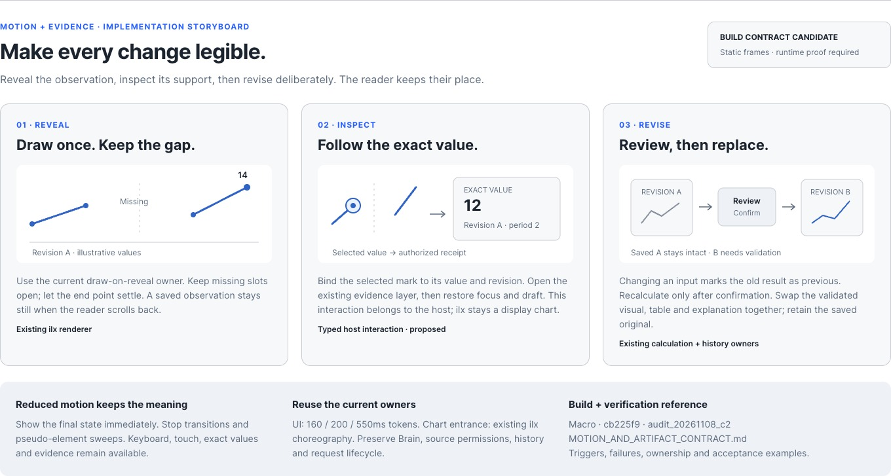
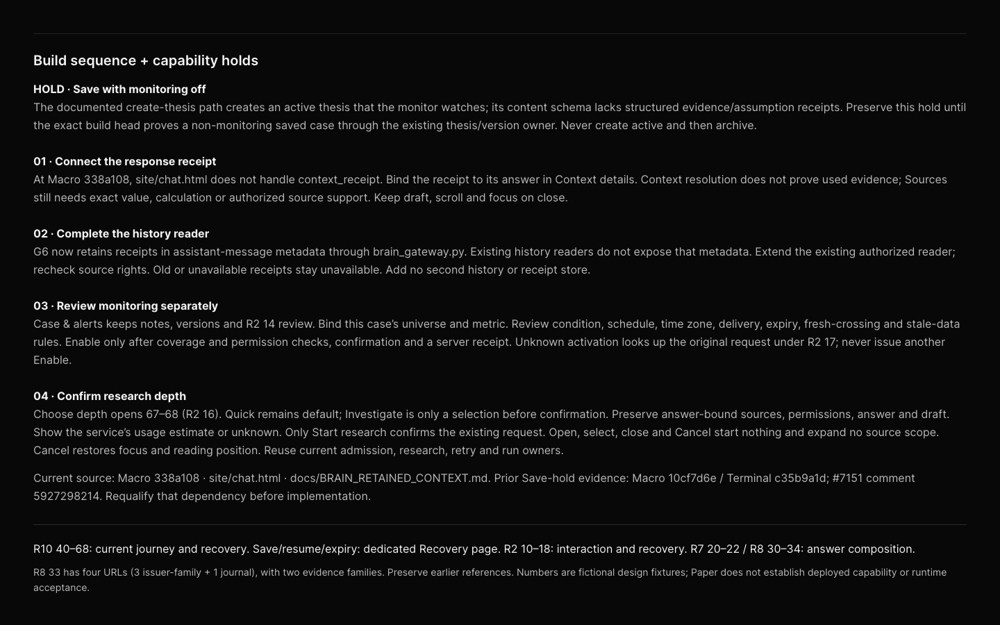

# Paper portfolio audit and applied improvements
2026-11-08 · WS:MARKET-OS · Chairman-directed design audit
Status: **Verified Paper changes and source-backed build guidance. Production implementation remains separately owned.**

## Outcome
Inspected the eleven known product files from the existing Shared Shell programme, reviewed representative rendered boards in every file, compared public International and Intelligence Hub pages with their Paper references, and applied bounded improvements in four files.

The strongest existing designs should be kept: AI's conversation-first reading column, the Terminal company brief, Ontology's same-page comparison refinement, the OS Today workspace and Prophet's rich opportunity cards. The priority is clearer product behavior, exact capability states and focused visual consistency. Replacing these with a uniform dashboard would discard useful product distinctions.

This is a portfolio-level audit with an explicit sample ledger, not an exhaustive audit of every artboard or an account-wide resource discovery. The existing F03 directory itself reports 1,837 artboard identities in an earlier structural census; that earlier census is not this session's visual coverage.

## Applied changes

### 1. Intelligence Hub — a clean entry page
[Paper entry](https://app.paper.design/file/01M2VWK62FA5S4VVF6G7SBPE5J/p-1-0) · [Retained adapter QA](https://app.paper.design/file/01M2VWK62FA5S4VVF6G7SBPE5J/p-A-0)

Moved three adapter canary boards from the product entry page to **98 · Adapter QA · Retained canaries**, ordered after source references. The entry page now contains only directory board `5E9-0`.
Preserved node IDs `6V4-0`, `6VO-0`, `6W1-1`, their content and geometry. Nothing was deleted. Existing held-transfer page `p-7-0` was preserved.
Any page-qualified QA link should now use `p-A-0`; stable node IDs alone do not imply an old page-qualified link remains valid. The retained mapping is in EFFECTS.json; no product navigation depended on these adapter scratch boards in the inspected directory.

### 2. MarketOntology — illustrated motion and evidence behavior
[Paper implementation / visual-engine page](https://app.paper.design/file/01M3P1X4FR6BRTB13KA736Y1HT/p-6-0)

Added section `A9R-0` to existing Visual Engine board `9T-0`, preserving the adjacent R12 implementation map `13J-0`.
Three editable native SVG illustrations specify:
- reveal once, preserve a missing-data gap, settle without implying liveness;
- inspect a supported exact value and return to the answer without losing focus or draft;
- confirm a recalculation, validate a new revision, retain the saved original.

The board separates the existing ilx display renderer from **proposed typed-host inspection**, names current lifecycle owners, and specifies reduced-motion equivalence. It is a **storyboard and implementation contract**, not implemented animation.
See [MOTION_AND_ARTIFACT_CONTRACT.md](MOTION_AND_ARTIFACT_CONTRACT.md) for triggers, interruption, revision consistency, source permissions, timing ownership and acceptance examples.

### 3. Market Guide — consistent Risk Radar teaching variants
[Paper Risk Radar teaching page](https://app.paper.design/file/01M32XYWDYSFTNDZVJKQ5QHT33/p-6-0)

Updated all eight desktop/mobile, English/Chinese, light/dark variants:
`3CJ-0`, `3IS-0`, `3KW-0`, `3N0-0`, `3P4-0`, `3RI-0`, `3TW-0`, `3CK-0`.

The introduction now says **“Read the index, odds and evidence separately.”** with **“US model · Teaching example”**, and equivalent Chinese text. This removes duplicated explanation while retaining the distinction that matters.
Removed the warning-colored container-edge stripe from the advisory row. The advisory text and its emphasis remain. Index points, probability, calibration requirements, partial coverage, dated readings and engine-defined posture remain unchanged.
All eight JSX readbacks passed the copy/preservation checks. English desktop and Chinese dark mobile were visually checked after the edit.

### 4. Mastermind AI — a build sequence grounded in current source
[Paper build page](https://app.paper.design/file/01M3P1QEHS5XXQY85BJT6QR2E1/p-9-0) · board `5M0-0`

Reorganized the builder note into a documented Save hold and four numbered implementation steps:
1. Connect the response receipt.
2. Complete the existing history reader.
3. Review monitoring separately.
4. Confirm research depth.

Corrected a substantive outdated statement. At the inspected Macro pin, G6 retains **context-resolution metadata** in assistant-message metadata, while the documented existing history readers do not expose it. The inspected `site/chat.html` event handling has no `context_receipt` handler. That is a reader/presentation gap; it is not evidence that retention is absent, nor a claim that every possible consumer lacks support.
Context resolution does not establish the evidence the model used. The updated board directs Context details and source evidence to their appropriate meanings.
The non-monitoring Save hold remains explicitly tied to its prior evidence and requires requalification at the actual build head. Improved context retention does not establish saved-case or monitoring capability.

## Findings and decisions

| Priority | Finding | Decision / consequence |
|---|---|---|
| P0 | Paper warned that MASTERMIND PAGES is too large and further changes will result in data loss. | Keep the whole file read-only. Preserve existing F03 directory and history. Capacity/preservation recovery precedes any restructuring of that file. |
| P1 | AI producer capability and reader capability are out of step in the inspected source. | Corrected Paper now; the existing reader/host owns implementation. Reuse message metadata rather than introducing a new persistence plane. |
| P1 | Polished Paper states can appear more capable than the live International view. | Build capability UI from actual admitted sources and rights. Preserve disabled/unavailable states until their consumer proof exists. |
| P1 | Saved research, monitoring intent and active monitoring have different effects. | Retain separate review/confirmation/receipt states; preserve the documented Save hold. Never infer activation from a design or save label. |
| P2 | International's first viewport carries many navigation and contract explanations. | Record a presentation amendment candidate: one dominant investigation action and progressive disclosure, while retaining the frozen six-question meaning. Do not rewrite frozen R14 boards in this audit. |
| P2 | The shared visual language still has inconsistent accent edges and repeated introduction text. | Fixed the complete eight-variant Guide family; broader migrations must follow current design-system owners. |
| P2 | Builder references describe rich illustrations without a complete transition contract. | Added exact reveal/inspect/revise behavior, interruption and reduced-motion rules with source ownership. |
| P2 | QA artefacts are mixed with product onboarding. | Retained them on a named QA page; do not delete, silently merge, or treat them as product pages. |
| P3 | Prophet mobile full-page specimen is about 5.2k px tall. | Preserve the useful rich cards. Proposed improvement is a compact discovery entry with explicit deeper sections, to be evaluated in its existing D03 lane. Height alone is not a usability failure. |

## Coverage ledger

Every row below includes an exact-file structural read. “Visual” means the listed sample was rendered and inspected, not every board in that file.

| File / ID | Visual sample and source assessment | Disposition | Next proof |
|---|---|---|---|
| MASTERMIND PAGES · `01M2WGNCX9475G79JRKJTCM08P` | F03 directory `5G0X-2`, entry page `p-1P-0`; current directory contains 27 product families and links to existing assignments. | **Read-only: capacity warning.** No edits, moves, copies or new directory. | Verified preservation/recovery method, complete link/identity inventory, then safe family-level operations under F03. |
| Mastermind AI · `01M3P1QEHS5XXQY85BJT6QR2E1` | Desktop answer `1O7-0`, mobile answer `1VE-0`, build map `1MO-0`, boundaries `5M0-0`; chat source and retained-context contract. | **Changed builder guidance.** Preserve strong answer composition and current recovery examples. | Exact-head response receipt, authorized history reader, genuine model/Stop/chart acknowledgment/private-history journeys. |
| Mastermind OS · `01M3NRCX55B452A12819WNE1RH` | Today `LNV-0`; Atelier page and project/inbox/conversation/knowledge inventory. | **Preserved.** Executive operational workflow remains distinct from investor navigation. | Each operational action needs its existing owner, status, authority and return path; visual shell does not establish execution. |
| PROPHET · `01M3NT5Y3G5HTJHVR0K5W2MDJM` | R8 full desktop `YW1-0`; mobile geometry `ZRL-0`; R7/R8 and D03 inventory. | **Preserved rich-card direction.** Do not flatten into generic rows or compete with PR9495. | Current signal/quote clocks, setup/compare/save flow, compact mobile hierarchy; test card evidence without sample claims. |
| Terminal · `01M3NSZGE8JWN2EZCSF0DT05RM` | Company brief `94K-0`; D06/D07/D08 inventories and Shared Shell source programme. | **Preserved.** Native chart and instrument analysis owners remain. | Terminal1244 current-head consumer proof; native chart acknowledgment and return context; existing release constraints remain. |
| MarketOntology · `01M3P1X4FR6BRTB13KA736Y1HT` | Refine comparison `7TT-0`; implementation `13J-0`; Visual Engine `9T-0`. | **Added motion/evidence storyboard.** Original reference content and R12 map retained. | Typed artifact admission, exact claim/value/revision mapping, same table/visual/prose, permitted inspection and reduced motion. |
| Design System · `01M312VSDSZFVT45674GDVJVZN` | Interaction/degraded states `2S4-0`; F02 directory/pattern inventory and binding source design system. | **Preserved current candidate.** Do not fork tokens or modify F02 review targets. | Real consumer reflow, focus, contrast, theme/locale and source-state preservation at affected migrations. |
| International · `01M3P1TW5Y3XWQC37ADDS8K5AG` | R14 scanner `G9J-0`; directory `3RW-0`; R14 freeze and workstream; public overview/scanner. | **Frozen R14 preserved.** Core research and surveillance coexist; an older file-name observation is not evidence of a new writer. | Per-market capability/rights matrix and existing IM13–IM18 owner proof; density amendment requires the actual freeze process. |
| Intelligence Hub · `01M2VWK62FA5S4VVF6G7SBPE5J` | US command `86-0`, directory `5E9-0`, QA nodes; current public Hub. | **Moved three QA boards, preserved IDs.** Keep research priority distinct from entry readiness. | Current ranking/quote/source meaning, evidence return, existing alert-draft owner; no new score or portfolio sizing. |
| Market Guide · `01M32XYWDYSFTNDZVJKQ5QHT33` | Directory `37N-0`; full Risk guide `3CJ-0`; all eight variants read, two post-edit screenshots. | **Patched eight variants.** Teaching remains separate from current market data. | Contextual help returns to the invoking surface with filters, focus and scroll; maintain concept precision across EN/ZH. |
| Risk popups · `01M38EVF74SJWG1GANN5VP380Z` | Primary Risk Radar `1-0`; family/locale/evidence inventory; existing current Risk delivery lane. | **Preserved incumbent work.** Dense risk details require staged disclosure, not numerical reinterpretation. | Index versus event/horizon probability, matching calibration evidence, partial inputs, current assessment/quote clocks; reuse PR10739 lane. |

## Live-page comparison — observation, not acceptance
Observed read-only on 2026-11-08. No account writes, provider calls, watch activation, saved research, trade or production change was performed.

### International
Exact observed route:
`https://www.mastermind-x.com/intl.html?view=scanner&market=&pins=&horizon=1m&basis=usd_unhedged&return_basis=price&group=`

The page served an overview and scanner with 7 configured markets, 6 qualified returns, one abstaining configured market and 57 markets listed as no data. It rendered four clocks. Transmission, Scenario Lab and Replay controls were disabled. Common-factor, credit/funding, session-calendar, attention-ranking, transmission, corroboration and thesis sections reported unavailable/admission states.
These are observations in this public session and basis/horizon, not a universal capability census.

The visible hierarchy has thirteen Research context controls above the scanner, repeated unavailable/rights labels and two H1 headings in the accessibility tree. The future simplification proposal retains all material limitations and the frozen investigation model; it reduces the reading burden before the first meaningful action.
Do not compare a hypothetical Paper specimen's values with this dated live sample as if they were the same dataset.

### Intelligence Hub
Exact observed route: `https://www.mastermind-x.com/intelligence_hub.html`.

The public Hub showed a November 8 snapshot, then a **Delayed prices · 36/44 names** status after the initial current-price check. It exposes Emerging Edge, Discovery, Exhausted names, Dated Catalysts, Command, Track Record and Sector Heat.
Preserve these useful distinctions and negative track-record results. The existing “room left” percentage needs a precise source-owned meaning; design must not turn it into expected return or success probability.
The live page still uses legacy edge accents and a different global navigation composition from the newer Paper shell. Integrate through the current Shared Shell programme rather than treating this as permission for another navigation system.

## Architecture ruling
Share **presentation and interaction primitives**, while preserving domain-specific workflows and authority:
- Reuse Terminal's existing AppShell, identity/settings providers, current route registry and protected export.
- Keep investor orientation/discovery/analysis/monitoring/research/portfolio paths distinct from executive Projects/Inbox/Conversations/Knowledge.
- Share typography, spacing, evidence disclosure, drawer/sheet mechanics, focus return, state copy, accessibility and visual grammar.
- Keep persistence, permissions, source rights, calculation, watch/alert, portfolio and runtime execution ownership in their current systems.
- A context chip, receipt, Paper label or animated completion never grants access or establishes a saved/active effect.

See [BUILD_PLAN.md](BUILD_PLAN.md) for action-by-action ownership, dependencies, failure behavior and release proof.

## Preserved constraints
- MASTERMIND PAGES: direct Paper warning of potential data loss on further edits. No write attempted. Do not use a copy/move/export workaround without a verified preservation and recovery path.
- International R14: freeze under DEC-INTL-GS-R14-DESIGN-FREEZE for IM13–IM18; its six-question scaffold and four-clock semantics remain authoritative with the written amendments.
- Terminal1244: open draft at observed head `ec9879de689e4e383126e7a6f79296a331ad5462`; preserve its existing source and scoped stage/publication constraints. An open PR is an overlap surface, not proof of a live writer.
- Macro10639: merged producer at `e39ec45902c1a2bb28507beb851593be6e422167`; that does not establish a deployed or authenticated Terminal consumer.
- F01/F02/F03 review/acceptance remains owned by the existing programme. No approval, freeze or release hold was cleared.

## Verification and durability
- Every design mutation returned **APPLIED_RESPONSE_OBSERVED** through one carrier; no uncertain effects or blind replay.
- Re-read moved-board identities/destination and the clean Hub entry.
- Re-read all eight Guide variants; advisory and calibration language preserved, shortened intro correct, warning edge absent.
- Re-read AI's changed text; retained-context correction and Save hold present.
- Re-read and visually inspected the new storyboard and AI builder map. No clipping observed in the inspected captures.
- Released working indicators only for the changed boards.
- Saved exact operation receipts, IDs and observed boundaries in [EFFECTS.json](EFFECTS.json).
- Saved four post-edit screenshots under [evidence/](evidence/), with Git blob identities verified.
- This change contains design documentation and image evidence. No production implementation or deployment tests are claimed.

## Source anchors
Protected law pin: Mastermind `5c3d3885234358aefb97ecdbc59be0864df14f8b`.
Macro source pin: `338a10852dcefa5d2bd07e5c6be0955c2b1e83fd`.

- [User-first doctrine](https://github.com/mastermindx-market-intelligence/macro/blob/338a10852dcefa5d2bd07e5c6be0955c2b1e83fd/docs/DESIGN_DOCTRINE.md)
- [Master Product Design System](https://github.com/mastermindx-market-intelligence/macro/blob/338a10852dcefa5d2bd07e5c6be0955c2b1e83fd/research/MASTER_PRODUCT_DESIGN_SYSTEM_V1.md)
- [Shared Shell production plan and programme](https://github.com/mastermindx-market-intelligence/macro/blob/338a10852dcefa5d2bd07e5c6be0955c2b1e83fd/research/market_os/SHARED_SHELL_WEBAPP_PRODUCTION_PLAN_2026-10-18.md)
- [Current inspected chat page](https://github.com/mastermindx-market-intelligence/macro/blob/338a10852dcefa5d2bd07e5c6be0955c2b1e83fd/site/chat.html)
- [Retained-context contract](https://github.com/mastermindx-market-intelligence/macro/blob/338a10852dcefa5d2bd07e5c6be0955c2b1e83fd/docs/BRAIN_RETAINED_CONTEXT.md)
- [R14 freeze and amendments](https://github.com/mastermindx-market-intelligence/macro/blob/338a10852dcefa5d2bd07e5c6be0955c2b1e83fd/agentos/decisions/DEC-INTL-GS-R14-DESIGN-FREEZE.md)
- [International workstream](https://github.com/mastermindx-market-intelligence/macro/blob/338a10852dcefa5d2bd07e5c6be0955c2b1e83fd/agentos/workstreams/WS-INTL-GLOBAL-SURVEILLANCE.md)
- [Macro10639](https://github.com/mastermindx-market-intelligence/macro/pull/10639) · [Terminal1244](https://github.com/mastermindx-market-intelligence/mastermind-terminal/pull/1244)
