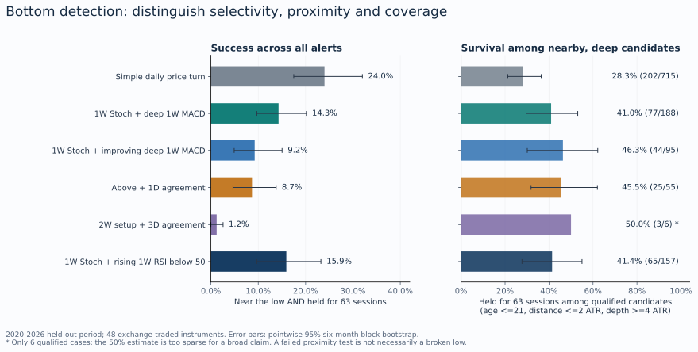
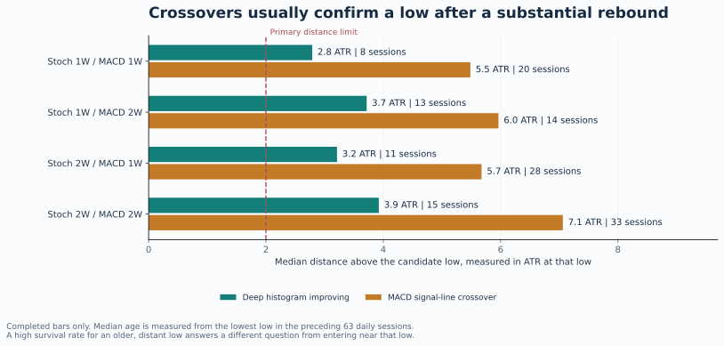
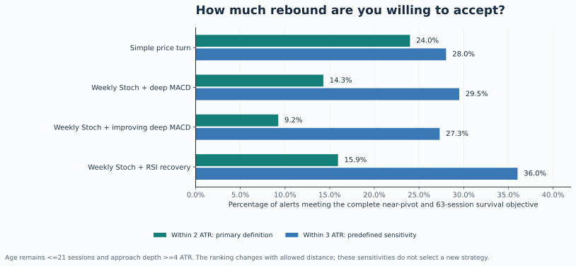
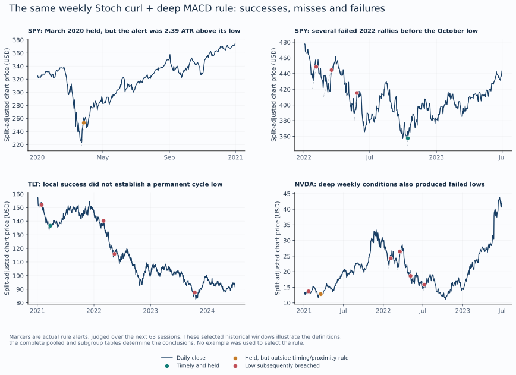

# Durable bottoms and tops

## Historical research on weekly, two-week and shorter-timeframe confluence

Research date: 21 October 2026. Price snapshot ends 8 October 2026. Main held-out evaluation: 2020-2026, using only fully observable outcome windows. A 63-session signal near the end of the snapshot is not evaluated until all 63 future sessions exist; the latest qualifying weekly signal dates in the main tables are in July 2026.

## 1. Findings and decision

This study did not establish a broadly reliable technical combination that permits treating a low or high as definitively formed and acting aggressively on that conclusion. It did identify a useful timing hierarchy and a material tradeoff between entering close to an extreme and waiting for stronger confirmation.

- For early bottoms, weekly Stoch RSI washout plus a curl and a deeply negative weekly MACD histogram was more useful than requiring the weekly histogram to have crossed above zero. The crossover generally arrived after a substantial rebound.
- Weekly signals selected more durable nearby candidates than a very simple early price turn in this sample, but arrived farther from the low and detected fewer major pivots. Conditional survival and coverage must be reported together.
- The proposed 1W + 1D and 2W + 3D pairings did not establish a universal advantage. Some shorter-timeframe conditions were redundant, some delayed confirmation, and a few positive associations were based on sparse comparison groups.
- Allowing entry 3 ATR from the low, instead of 2 ATR, materially changed the ranking. Weekly rules often identify a more selective reversal after part of the bounce has already happened. This is a central result, not a footnote.
- Top detection was considerably less reliable in this cohort. An oscillator rolling down from an overbought reading frequently preceded another higher high.

These are pivot-detection results, not trade win rates. A breached low can coexist with a profitable trade, and an unbroken low can coexist with poor subsequent reward or an unattractive entry. Neither position sizing nor an aggressive liquidation policy was validated.

## 2. What was actually tested

The fixed cohort contains 50 instruments and 388,247 daily OHLCV observations. The primary pool is 48 exchange-traded instruments. BTC and ETH are separate because their daily bars and horizons use calendar days. Histories begin as early as 1980, supply indicator warmup, and enter evaluated development results from 1995 where adequate data exist.

| Group | Instruments |
| --- | --- |
| US index ETFs, 4 | SPY, QQQ, IWM, DIA |
| Sector and industry ETFs, 12 | XLK, XLF, XLE, XLI, XLY, XLP, XLU, XLV, XLB, XLRE, XLC, SOXX |
| Individual US equities, 22 | AAPL, MSFT, NVDA, AMD, INTC, MU, AMZN, GOOGL, META, TSLA, JPM, XOM, CVX, CAT, FCX, NEM, KO, PEP, WMT, WM, JNJ, PFE |
| Commodity proxies, 3 | GLD, SLV, USO |
| Rates and credit ETFs, 3 | TLT, IEF, HYG |
| International equity ETFs, 4 | EEM, EFA, EWJ, FXI |
| Crypto, 2 | BTC-USD, ETH-USD |

The development period was 1995-2013, the selection period 2014-2019, and the final chronological test 2020 onward. Events whose future label crossed a split boundary were purged. The complete initial grid contained 2,434 literal configurations, including both sides, oscillator triggers, independent high-timeframe pairings, lower filters, auxiliary filters and simple baselines. Thirty-four rule identities were frozen before final outcome summaries were examined. Fixed hypotheses and simple baselines were retained regardless of ranking. An additional 922 named anchor, price-basis, waiting and standardized-comparison configurations were registered before those diagnostics were examined.

Selection used a descriptive harmonic balance of timely durable precision and major-pivot coverage, with at least 100 validation events across at least 12 assets where feasible. This balance score combines two related but distinct targets; it is not a formal single-target classification F1. The simple price-turn baseline won the overall selection score on both sides. The early oscillator and auxiliary finalists were kept to answer the user's specific hypotheses and expose the tradeoff.

The final primary reference catalogue contains 382 major bottoms and 395 major tops. Development and validation contain additional reference pivots. These are distinct per instrument, but are not independent economic events: many assets turn during the same market episode.

## 3. Exact definitions: indicators, bars and signal availability

RSI uses Wilder smoothing with 14 periods. Stoch RSI uses RSI14, a 14-period range, 3-period K and 3-period D smoothing. Values are expressed on a 0-100 scale. Stoch RSI is the position of RSI within its own recent range; a low reading alone does not establish a large price decline or fundamental cheapness. The price-washout qualification below supplies a separate price-based requirement. [1]

For a bottom curl, K must have been at or below 20 within the last three completed high-timeframe bars, must now be rising, and must remain below 60. The top mirror requires a recent K of at least 80, a falling K, and current K above 40. An alternative K/D crossover trigger was also tested, with a recent cross over two completed bars and the current direction retained.

MACD is EMA12 minus EMA26, with EMA9 of that difference as the signal line. The histogram is MACD minus the signal line. In this report a MACD crossover means the histogram crossing zero, or equivalently MACD crossing its signal line. It does not mean the MACD line crossing its own zero line. [2]

The histogram is normalized by ATR14 on its own timeframe. A deep bottom histogram is negative and at or below the 20th percentile of its prior three years of normalized values. A deep top histogram is positive and at or above the 80th percentile. The quantile excludes the current bar and requires all 156 weekly or 78 two-week observations.

| MACD branch | Bottom meaning | Top mirror |
| --- | --- | --- |
| Deep | Negative, historically extreme histogram | Positive, historically extreme histogram |
| Deep and improving | Deep negative histogram rising toward zero | High positive histogram falling toward zero |
| Deep and deteriorating | Deep negative histogram becoming more negative | High positive histogram becoming more positive |
| Crossover | Recent bullish signal-line cross, current sign positive | Recent bearish signal-line cross, current sign negative |
| Deep then crossover | Recent cross after a deep observation within six preceding bars | Corresponding upper-extreme condition |
| Deep OR crossover | Either branch qualifies | Either mirrored branch qualifies |

Stoch timeframe and MACD timeframe were chosen independently from 1W and 2W. This includes 1W/1W, 1W/2W, 2W/1W and 2W/2W. Lower filters used 1D, 2D and 3D; 1W was also available beneath an all-2W setup. The tested lower conditions were histogram slope, histogram sign, recent signal-line cross, Stoch K slope, and simultaneous histogram/K direction.

Only completed bars are available to a signal. US weeks end at the final session in the Friday-ending week, and two-week bars use fixed alternating-week anchors. Two-day and three-day bars mean consecutive exchange sessions on a shared reference calendar, not elapsed calendar days. Crypto uses UTC daily bars and Sunday-ending weeks. All 12 combinations of 2D, 3D and 2W phase offsets were checked. These custom bars were not asserted to match every charting platform's native bars.

This matters because an unfinished higher-timeframe bar can change before it closes. Historical use of a finished weekly value on an earlier daily date would falsely improve timing. The implementation projects high-timeframe values forward only after their actual completion, consistent with the need to avoid higher-timeframe repainting and lookahead. [3]

The first false-to-true activation defines a high-timeframe alert, with at least 21 sessions between alerts for that rule. Same-time lower filters retain that exact base timestamp. Waiting for a later lower signal is a separate policy, described in section 8.

## 4. What qualifies as a durable pivot

At the signal close, the candidate bottom is the most recent occurrence of the lowest low in the preceding 63 daily sessions, including that session. The candidate top is the corresponding highest high. Its price, date and ATR14 are frozen at the signal. The rule cannot later replace a failed candidate with a nicer-looking low.

For the primary near-pivot objective, the signal must satisfy all of the following:

- Candidate age at most 21 daily sessions.
- Signal close at most 2 ATR above the low, or below the high, using ATR known at that candidate extreme.
- Approach depth at least 4 ATR from the opposite price extreme in the 63 sessions preceding the candidate.
- The original pivot is not breached by more than 0.25 ATR over the next 63 sessions after the signal.

The last condition is tested on daily lows or highs, not just closes. Strict zero-tolerance survival and 21- and 126-session horizons are reported separately. Distance limits of 1 and 3 ATR, age limits of 10 and 42 sessions, and depth limits of 3 and 5 ATR are predefined sensitivities.

Three denominators answer different questions. **All-alert success** is the fraction of every rule alert that is close, timely, deep and subsequently holds. **Qualified hold** is the survival rate only among alerts already meeting the age, distance and depth conditions. **Pivot coverage** is the fraction of a separate major-pivot catalogue detected promptly and close to its extreme. These percentages must not be interchanged.

The major-pivot catalogue requires a 63-session left and right extreme, a preceding approach of at least 4 ATR, and a subsequent rejection of at least 4 ATR. Future observations create outcome labels only. Detection requires an alert from the pivot through 21 sessions later and within 2 ATR. The denominator requires sufficient future observation, including the possible detection delay. A pre-pivot alert is not credited as proof that the low had already formed.

This defines durable local pivots, not permanent or ultimate cycle extremes. A low can hold for three months and break a year later. Four ATR of approach is a volatility-normalized local washout; it is not a claim of multiyear capitulation.

## 5. Bottom results: early information versus late confirmation

| Bottom rule | Alerts | Qualified | Qualified hold | All-alert success | Pivot coverage |
| --- | --- | --- | --- | --- | --- |
| Simple price turn | 842 | 715 | 28.3% | 24.0% | 38.7% |
| Daily RSI recovery through 30 | 483 | 325 | 30.5% | 20.5% | 19.6% |
| 1W Stoch curl alone | 849 | 219 | 39.3% | 10.1% | 17.0% |
| 1W Stoch + deep 1W MACD | 539 | 188 | 41.0% | 14.3% | 14.9% |
| 1W Stoch + improving deep 1W MACD | 476 | 95 | 46.3% | 9.2% | 8.9% |
| Above + 1D agreement | 288 | 55 | 45.5% | 8.7% | 5.0% |
| 2W Stoch + improving deep 2W MACD | 264 | 6 | 50.0% | 1.1% | 0.8% |
| Above + 3D agreement | 248 | 6 | 50.0% | 1.2% | 0.8% |
| 1W Stoch + rising 1W RSI below 50 | 408 | 157 | 41.4% | 15.9% | 13.4% |

All figures in this and subsequent result tables are calculated from the saved study output, unless explicitly labeled validation. The qualified columns retain their own sample sizes. For example, the 50% result for the 2W/3D pair is only 3 successes out of 6 qualified cases.

The weekly Stoch/deep-MACD rule produced 539 alerts. Only 188 were close enough, timely enough and sufficiently deep; 77 of those held, giving 41.0% qualified survival and 14.3% all-alert success. It detected 57 of 382 reference bottoms. Requiring the weekly histogram also to improve reduced qualified cases to 95. Forty-four held: a higher 46.3% conditional rate, but lower 9.2% all-alert success and 8.9% coverage.

The simple daily price-turn baseline is a close in the reversal direction while the trailing 63-session extreme is no more than five sessions old, followed by the same activation/cooldown machinery. It is deliberately simple. It produced a 24.0% all-alert success rate and detected 38.7% of the reference bottoms, but only 28.3% of its qualified candidates held. Its higher coverage came with many more false nearby-low alerts.

The weekly rule's observed selectivity is meaningful as a description of this cohort. It does not isolate an independent causal contribution of MACD: the signals occur on different episodes and at different stages of a rebound. The six-month block interval for the weekly deep rule's qualified survival is approximately 29.6%-53.1%; for the improving-histogram variant it is 30.1%-62.2%. These intervals are pointwise, approximate and not adjusted for the full exploratory family.

### The four high-timeframe combinations

| Stoch / MACD | MACD condition | Alerts | Age, sessions | Distance, ATR | All-alert hold | All-alert success |
| --- | --- | --- | --- | --- | --- | --- |
| 1W / 1W | Deep / improving | 476 | 8 | 2.79 | 54.2% | 9.2% |
| 1W / 1W | Signal-line cross | 73 | 20 | 5.49 | 79.5% | 0.0% |
| 1W / 2W | Deep / improving | 201 | 13 | 3.72 | 53.7% | 2.0% |
| 1W / 2W | Signal-line cross | 17 | 14 | 5.96 | 70.6% | 0.0% |
| 2W / 1W | Deep / improving | 220 | 11 | 3.21 | 61.8% | 5.9% |
| 2W / 1W | Signal-line cross | 323 | 28 | 5.68 | 77.1% | 0.0% |
| 2W / 2W | Deep / improving | 264 | 15 | 3.92 | 56.1% | 1.1% |
| 2W / 2W | Signal-line cross | 53 | 33 | 7.06 | 92.5% | 0.0% |

The clearest crossover result is not a lack of later survival. Weekly Stoch plus a weekly signal-line cross had 79.5% unqualified pivot survival, but a median distance of 5.49 ATR and median candidate age of 20 sessions. Only one event met the primary near-pivot qualification. The all-two-week crossover had 92.5% unqualified survival, but its median alert arrived 7.06 ATR above a 33-session-old low, with no qualified cases.

Those crossover rules often confirmed that an older low was holding. They did not discover that low near its formation under the stated objective. Their subsequent trade expectancy, entry risk and position size were not tested. An observed zero in the strict near-pivot column is not a claim of a literal zero probability under all future conditions.

## 6. The proximity threshold changes the ranking

Keeping the age cap at 21 sessions but widening distance from 2 to 3 ATR gives the following predefined sensitivity:

| Bottom rule | Success at 2 ATR | Success at 3 ATR | Qualified at 3 ATR | Qualified hold at 3 ATR |
| --- | --- | --- | --- | --- |
| Simple price turn | 24.0% | 28.0% | 802 | 29.4% |
| 1W Stoch + deep 1W MACD | 14.3% | 29.5% | 352 | 45.2% |
| 1W Stoch + improving deep 1W MACD | 9.2% | 27.3% | 263 | 49.4% |
| 1W Stoch + rising 1W RSI below 50 | 15.9% | 36.0% | 312 | 47.1% |

The simple price turn leads the primary 2-ATR objective, but does not dominate these weekly rules at 3 ATR. The weekly Stoch plus rising weekly RSI filter reaches 36.0% all-alert success and 47.1% qualified survival under that looser distance condition. This does not retroactively make it a newly selected, validated strategy. It shows that the user's meaning of an acceptable entry distance materially affects the answer.

Extending the age cap while keeping the tight 2-ATR distance changes the leading weekly examples much less. Price distance, rather than calendar delay alone, is the more consequential constraint here.

SPY illustrates the issue clearly. The weekly Stoch/deep-MACD rule fired on 27 March 2020 after the 23 March low. That low held for the next 63 sessions, but the signal close was already 2.39 ATR above it. It therefore failed the primary 2-ATR definition while succeeding under the 3-ATR sensitivity. Calling that a simply 'wrong bottom' would misrepresent what happened.

## 7. Do 1W and 1D, or 2W and 3D, align usefully?

For the weekly deep-and-improving bottom setup, adding same-time daily agreement changed all-alert success from 9.24% to 8.68%, qualified hold from 46.3% to 45.5%, and major-bottom coverage from 8.90% to 4.97%. The pointwise six-month interval for the all-alert difference versus its high-timeframe parent was about -2.1 to +0.9 percentage points. There is no persuasive broad improvement in that fixed comparison.

For the two-week deep-and-improving setup, three-day agreement was already present on 248 of 264 alerts, or 93.9%. The filter retained the same three primary successes. It supplied little discrimination in this form. Its six qualified cases are inadequate for a broad conditional-success estimate, and there were no qualified nonaligned cases with which to construct a meaningful matched comparison.

Same-time comparisons can still be confounded by candidate maturity. To examine that, survival among already-qualified candidates was standardized over age bins of 0-5, 6-10 and 11-21 sessions; distance bins of up to 1 and 1-2 ATR; and depth bins of 4-6 and more than 6 ATR. Each retained stratum required at least five observations in each comparison arm. Weights came from the unfiltered qualified base population within common support. Neutral/mixed observations were kept distinct from explicit opposition.

For the weekly improving-MACD setup, daily simultaneous agreement had a standardized survival difference of about -11.7 percentage points versus not aligned, with a wide interval of approximately -32.2 to +12.6 points. The comparison retained 84 of 95 qualified observations. It does not establish incremental improvement. Some other comparisons showed positive descriptive associations, including certain explicitly opposed daily states and top-side three-day agreement. Those pockets had limited support, small opposing arms, or boundary outcomes, and do not establish a universal best pairing.

### Why timeframe disagreement occurs

The same MACD settings do not represent the same economic lookback at different bar sizes. A nominal 12/26 MACD spans 12/26 daily sessions on 1D, 36/78 sessions on 3D, 12/26 weeks on 1W, and 24/52 weeks on 2W. Exponential averages retain older information beyond those nominal spans. Stoch RSI also applies a nonlinear rolling-range transformation to RSI, so it does not simply scale between bar sizes.

A short pullback can weaken daily momentum while a longer recovery still lifts weekly momentum. Bar completion dates and phase offsets alter which closes enter the calculation. Moreover, histogram sign, histogram slope, and a fresh signal-line crossover are different facts: a histogram can be negative while rising, or positive while falling.

In the exact 73-event weekly Stoch/weekly bullish-crossover subset, the completed 3D histogram was negative on 29 alerts, or 39.7%. It was falling on only two, and none had a fresh opposite 3D crossover within the study's two-bar window. Thus disagreement in sign was common in that subset, while a fresh opposite crossover was not. These counts are conditional on the complete Stoch-plus-MACD setup; they do not measure every weekly MACD crossover in the market.

Two or three indicators derived from the same price series are not independent votes. A timeframe pair should earn its role through measured incremental detection quality, timing and coverage; a pleasing ratio between bar lengths is not sufficient evidence.

## 8. Waiting up to ten sessions for confirmation

This separate policy freezes the original candidate price, date, ATR and approach depth, then waits from zero through ten sessions for the first completed lower-timeframe condition. It cancels if the original candidate is breached by more than 0.25 ATR before or on the confirmation bar. A small tolerated breach does not replace the candidate. A failed candidate is never revived with a new low under the same setup.

The policy retains the original higher-timeframe setup while waiting; it does not silently require a short-lived crossover flag to remain active. Age and distance are reassessed against the original pivot at confirmation. Every base setup has the full ten-plus-63-session follow-up window available. The immediate baseline uses that same cohort. The waiting recall catalogue uses a conservative 94-session follow-up convention.

| Policy on the weekly improving-MACD bottom setup | Eligible setups | Confirmed alerts | Timely durable successes | Success per original setup |
| --- | --- | --- | --- | --- |
| Immediate high-timeframe alert | 469 | 469 | 41 | 8.7% |
| Wait for 1D histogram and Stoch agreement | 469 | 427 | 30 | 6.4% |
| Wait for 1D MACD cross | 469 | 153 | 13 | 2.8% |

For daily simultaneous agreement, 21 setups invalidated before confirmation and 21 timed out. Among 71 qualified confirmations, 30 held, or 42.3%. Waiting did not raise the original-opportunity yield. For the 2W/3D simultaneous-agreement policy, three successes remained among 261 original setups: effectively the same sparse 1.15% yield as the immediate comparison.

These results describe the whole waiting policy. Any higher survival among confirmations would partly reflect surviving the waiting period and excluding invalidated candidates, not necessarily unique information supplied by the lower indicator. The operational horizon extends 63 sessions after confirmation; a secondary fixed-endpoint comparison is also retained in the tables. The field named missed_original_successes includes original successes not preserved because of later distance, qualification or extended-horizon failure; it is not a pure missed-detection count.

## 9. Tops are not a symmetric copy of bottoms

| Top rule | Alerts | Qualified | Qualified hold | All-alert success | Pivot coverage |
| --- | --- | --- | --- | --- | --- |
| Simple price turn | 1405 | 1269 | 12.2% | 11.0% | 27.3% |
| 1W Stoch curl down alone | 954 | 439 | 17.8% | 8.2% | 18.2% |
| 1W Stoch down + high positive MACD still rising | 279 | 217 | 22.6% | 17.6% | 11.4% |
| 1W Stoch down + high positive MACD falling | 486 | 201 | 13.4% | 5.6% | 6.3% |
| Above + 1D bearish agreement | 304 | 136 | 12.5% | 5.6% | 4.3% |
| 2W setup + 3D bearish agreement | 237 | 30 | 23.3% | 3.0% | 1.5% |

The selected early top oscillator rule had 49 successes among 217 qualified cases, or 22.6% qualified hold; its all-alert success was 17.6% and its reference-top coverage 11.4%. Its pointwise qualified-survival interval was approximately 13.9%-31.9%.

This particular rule needs careful wording. Stoch RSI was curling down while the high positive weekly histogram was still growing. It was an early disagreement hypothesis, not confirmation that both indicators had rolled over. In the code it is the directional deep_falling branch, because the histogram was deteriorating relative to the desired bearish direction. It is not a separately tested classical price/oscillator divergence pattern.

Requiring the positive weekly histogram also to fall produced only 13.4% qualified hold and 5.6% all-alert success. Waiting for still slower crossovers generally gave up proximity again. A strong advance can repeatedly create overbought oscillators, temporary curls down and then new highs. This surviving equity-heavy cohort makes it particularly unsafe to infer 'exit everything' from a mirrored oversold rule.

Market regime mattered descriptively. For the selected early top rule, qualified hold was 16.1% in the SPY up-regime subset, based on 174 qualified events, versus 50.0% in the SPY down-regime subset, based on only 30. The latter is too small and conditional to be promoted into a broad exit rule. It can also represent lower rally tops inside an existing downtrend, rather than the original market-cycle high.

## 10. Additional technicals and cross-asset behavior

Six extra filters were tested one at a time: price versus EMA10, daily RSI recovery, weekly RSI direction and level, daily ADX easing, relative volume of at least 1.5 with a reversing close, and price versus SMA200. They were not a combinatorial stack on top of every lower-timeframe condition.

The best auxiliary selection under the validation balance criterion was weekly RSI. For bottoms this meant weekly RSI rising while below 50, combined with the weekly Stoch curl; it did not require MACD as a third condition. In the final period it produced 408 alerts, 157 qualified candidates and 65 held lows: 41.4% qualified hold, 15.9% all-alert success and 13.4% coverage. Relative to weekly Stoch alone, the all-alert rate rose from 10.1% to 15.9%, while coverage fell from 17.0% to 13.4%. Qualified survival changed much less, from 39.3% to 41.4%, indicating that much of the benefit involved selecting better-positioned/deeper setups.

ADX easing and daily RSI produced validation candidates but did not beat the selected weekly-RSI auxiliary under that criterion. No bottom relative-volume candidate met the 100-event validation floor. The top volume candidate that did meet the floor had weak validation detection results. These statements are selection-period evidence; the study did not promote and independently validate every auxiliary-family winner in the final period.

The weekly Stoch/deep-MACD bottom rule also behaved differently across groups:

| Instrument group | Alerts | Qualified candidates | Qualified hold | All-alert success |
| --- | --- | --- | --- | --- |
| Commodity proxies | 31 | 11 | 45.5% | 16.1% |
| International equity ETFs | 39 | 8 | 50.0% | 10.3% |
| Rates / credit ETFs | 35 | 16 | 18.8% | 8.6% |
| US index ETFs | 44 | 12 | 33.3% | 9.1% |
| US sector / industry ETFs | 132 | 36 | 52.8% | 14.4% |
| US individual equities | 258 | 105 | 40.0% | 16.3% |

The rates/credit subset held only 3 of 16 qualified candidates. The sector/industry subset held 19 of 36. These counts, and the concentration of simultaneous market shocks, prevent a universal cross-asset claim. Pooling the groups would conceal economically important differences.

The crypto version of the same weekly rule produced 26 final-period alerts, seven qualified cases and two successes. BTC and ETH supplied only 17 final-period reference bottoms and 20 tops together. Their usable indicator history is much shorter, especially after the multi-year warmup. That is insufficient evidence for a general crypto pivot rule or a meaningful comparison with decades of equity history.

Untested families include breadth, anchored VWAP, options positioning, market structure from intraday data, order flow, volume profiles, fundamental valuation and a full divergence taxonomy. This was a broad predefined oscillator/confluence test, not an exhaustive search over every technical method.

## 11. Robustness, examples and uncertainty

All twelve combinations of two-session, three-session and alternating two-week bar phase were evaluated without selecting a preferred phase. The two-week improving-MACD bottom rule's primary rate ranged from about 1.1% to 2.3%; the 2W/3D agreement variant ranged from 0.8% to 2.1%. The qualified counts remained sparse. Changing the anchor did not rescue the near-low hypothesis. Some top-side two-week conditional estimates changed substantially by phase, further weakening a precise universal pairing claim.

Dividend-adjusted OHLC did not reverse the main conclusion. The weekly deep bottom rule moved from 14.3% to 15.2% all-alert success and from 41.0% to 42.1% qualified hold. This sensitivity applies the daily adjusted-close/close factor to all four price fields consistently; it is not an executable total-return strategy.

Excluding 2020 left the weekly deep bottom rate at 14.2%, versus 14.3% in the complete final period. Excluding NVDA, AMD, INTC, MU and SOXX left it at 14.4%. Thus the pooled result was not solely a COVID-rebound or semiconductor story. These exclusions do not remove survivorship bias or all shared market dependence.

Longer durability is harder. The weekly deep bottom rule's all-alert success was 20.9% at 21 sessions, 14.3% at 63, and 12.5% at 126. The early top rule fell from 26.0% at 21 sessions to 17.6% at 63 and 10.7% at 126. Horizon samples differ slightly because each requires full future observation. Strict zero-tolerance bottom survival also reduced the weekly deep rule's qualified rate from 41.0% to 36.7%.

The SPY chart includes failed alerts on 4 February, 18 March and 27 May 2022, followed by a successful nearby alert on 14 October after the 13 October low. TLT includes a local March 2021 success followed by much lower prices in later years. NVDA includes failed nearby washouts in May and July 2022. These examples illustrate why a retrospective chart can look convincing while the prospective alert stream contains both failures and missed ultimate lows.

Uncertainty is estimated by resampling whole-cross-section six-month calendar blocks, with asset-cluster and yearly-block sensitivities. The primary final period contains only fourteen half-year blocks and seven calendar years. These are approximate pointwise intervals; they are not simultaneous, selection-adjusted confidence guarantees. Correlation can extend across block boundaries. A resampling interval with all-zero successes, or a tiny zero-success comparison arm, can be degenerate and must not be read as certainty about the underlying probability.

The research examined many correlated configurations. Chronological separation, a frozen finalist list, and explicit trial accounting reduce some forms of hindsight, but they do not make a retrospective study equivalent to prospective validation. No probability-of-backtest-overfitting, deflated Sharpe ratio, or formal family-wide significance claim was fabricated for this non-return target. The multiple-testing concern is consistent with the general backtest-overfitting literature. [4]

## 12. Data quality and methodological verification

The research retained uniform daily Yahoo chart OHLCV snapshots, raw response hashes and normalized-file hashes. Primary prices are split-adjusted and dividend-unadjusted; adjusted close is retained separately. The existing stored ETF history lacked complete OHLC in some files, so highs/lows were not manufactured from closes.

All 50 acquisitions succeeded. There were no excluded invalid OHLC rows or gaps longer than fourteen calendar days. A separate audit found no missing or unexpected sessions against the common SPY calendar within post-inception overlap, and no missing crypto UTC days. Pre-SPY history uses a union calendar rather than a separately certified exchange calendar. Large price moves were retained and flagged, not silently winsorized.

An independent feed comparison covered SPY, QQQ, GLD, SLV, TLT and SOXX over the available overlapping period. Five agreed at essentially floating-point precision. SOXX initially showed a split-basis mismatch before its March 2024 3-for-1 split. Dividing the older reference prices by three for the audit resolved it; production source files were not modified. This cross-check is useful but does not certify every field of every instrument.

The implementation passed thirteen core checks: completed-bar prefix invariance across all five timeframes, future-price perturbation invariance, exact forward-window boundaries, Wilder seed arithmetic, explicit frozen-candidate near/far breach labels on both sides, split-boundary purging, activation/cooldown behavior, and unique rule identities. Additional waiting-policy checks covered first confirmation, failure before confirmation, same-bar invalidation priority, tolerated undercuts, post-confirmation failure, retest detection credit and unavailable one-block bootstrap uncertainty.

Independent methodological review identified and repaired subgroup recall denominators, waiting recall credit for an initially distant candidate that later retested, and a single-block bootstrap edge case. These were implementation corrections to the stated estimands, not outcome-driven threshold changes. The final tables and report use the repaired diagnostics. The protected selection lock and main signal parameters were unchanged.

The data are current-vintage history, not a point-in-time corporate-action database. The cohort contains surviving liquid instruments and excludes delisted failures. Stocks, sector ETFs and index ETFs overlap economically. The study does not establish robustness for illiquid stocks, failed firms, single-country local markets, futures rolls or arbitrary intraday chart settings.

## 13. What the findings support in practice

For a research watchlist seeking comparatively early bottoms, the defensible candidate is weekly Stoch RSI washout/curl together with a deeply negative weekly histogram, or the separately tested weekly-RSI recovery filter. These are alternatives supported by the observed tradeoff; stacking all of them into a new rule has not been validated here.

Every alert should be accompanied by the actual candidate price, its age, its frozen ATR, the distance already traveled, the size of the preceding decline, and a clear invalidation level. A candidate 1.5 ATR from its low is a different decision from an older low confirmed 6 ATR away. The latter may be useful recovery confirmation, but the study did not assess whether buying it offers an attractive trade.

Shorter-timeframe agreement can describe the stage of the rebound and expose immediate conflict. It should not be treated as an automatic independent vote or a universal veto on the basis of this study. Repeated curls during a sustained decline or advance remain possible. For tops especially, the observed survival rates do not support aggressive complete exit based solely on the mirrored oscillator pattern.

The conclusion is bounded and specific: weekly washout conditions contained useful conditional information in this sample, but sacrificed proximity and coverage; two-week and crossover conditions usually confirmed later; and the proposed shorter-timeframe pairings did not establish a generally superior durable-pivot detector. No aggressive sizing rule follows from those results.

## Appendix A. All 34 frozen final-period rules

The compact codes follow the source files. S is Stoch RSI timeframe; M is MACD timeframe. The directional deep_rising branch means movement in the intended reversal direction; deep_falling means movement against it. For tops, deep_falling therefore means a positive histogram still rising. Filters have their literal stored names. Rows with very small qualified counts must not be ranked by their conditional percentages.

| Side | Frozen rule | N | Qualified N | Success | Qualified hold | Coverage |
| --- | --- | --- | --- | --- | --- | --- |
| bottom | price_turn | 842 | 715 | 24.0% | 28.3% | 38.7% |
| bottom | S1W curl; M1W deep | 539 | 188 | 14.3% | 41.0% | 14.9% |
| bottom | S2W curl; M1W cross | 323 | 0 | 0.0% | - | 0.0% |
| bottom | S1W curl; Mnone none; weekly_rsi | 408 | 157 | 15.9% | 41.4% | 13.4% |
| bottom | S1W curl; M1W deep_rising | 476 | 95 | 9.2% | 46.3% | 8.9% |
| bottom | S1W curl; M1W cross | 73 | 1 | 0.0% | 0.0% | 0.0% |
| bottom | S1W curl; M2W deep_rising | 201 | 10 | 2.0% | 40.0% | 0.8% |
| bottom | S1W curl; M2W cross | 17 | 0 | 0.0% | - | 0.0% |
| bottom | S2W curl; M1W deep_rising | 220 | 26 | 5.9% | 50.0% | 2.6% |
| bottom | S2W curl; M2W deep_rising | 264 | 6 | 1.1% | 50.0% | 0.8% |
| bottom | S2W curl; M2W cross | 53 | 0 | 0.0% | - | 0.0% |
| bottom | S1W curl; M1W deep_rising; 1D_both_rising | 288 | 55 | 8.7% | 45.5% | 5.0% |
| bottom | S1W curl; Mnone none | 849 | 219 | 10.1% | 39.3% | 17.0% |
| bottom | S2W curl; M2W deep_rising; 3D_both_rising | 248 | 6 | 1.2% | 50.0% | 0.8% |
| bottom | S2W curl; Mnone none | 498 | 36 | 3.6% | 50.0% | 3.7% |
| bottom | rsi_recovery | 483 | 325 | 20.5% | 30.5% | 19.6% |
| bottom | stoch_daily | 2317 | 449 | 5.5% | 28.5% | 25.9% |
| top | price_turn | 1405 | 1269 | 11.0% | 12.2% | 27.3% |
| top | S1W curl; M1W deep_falling | 279 | 217 | 17.6% | 22.6% | 11.4% |
| top | S2W curl; M1W cross | 342 | 15 | 0.9% | 20.0% | 0.5% |
| top | S1W curl; Mnone none; weekly_rsi | 710 | 351 | 9.2% | 18.5% | 15.4% |
| top | S1W curl; M1W deep_rising | 486 | 201 | 5.6% | 13.4% | 6.3% |
| top | S1W curl; M1W cross | 103 | 7 | 1.0% | 14.3% | 0.0% |
| top | S1W curl; M2W deep_rising | 226 | 56 | 3.5% | 14.3% | 1.5% |
| top | S1W curl; M2W cross | 24 | 2 | 4.2% | 50.0% | 0.3% |
| top | S2W curl; M1W deep_rising | 175 | 54 | 6.3% | 20.4% | 2.3% |
| top | S2W curl; M2W deep_rising | 266 | 38 | 3.4% | 23.7% | 2.0% |
| top | S2W curl; M2W cross | 38 | 1 | 0.0% | 0.0% | 0.0% |
| top | S1W curl; M1W deep_rising; 1D_both_rising | 304 | 136 | 5.6% | 12.5% | 4.3% |
| top | S1W curl; Mnone none | 954 | 439 | 8.2% | 17.8% | 18.2% |
| top | S2W curl; M2W deep_rising; 3D_both_rising | 237 | 30 | 3.0% | 23.3% | 1.5% |
| top | S2W curl; Mnone none | 553 | 109 | 4.0% | 20.2% | 4.8% |
| top | rsi_recovery | 820 | 606 | 10.5% | 14.2% | 16.5% |
| top | stoch_daily | 2372 | 848 | 5.1% | 14.4% | 24.3% |

## Appendix B. Files, reproducibility and evidence boundaries

The companion package contains the full development/validation grid, all frozen final results, group/regime/year tables, anchor/basis results, waiting and standardized comparisons, example price slices, source audits, protocols, selection lock, code and a data dictionary. Tables preserve counts alongside percentages. The report can be regenerated from those saved tables.

The complete raw OHLCV snapshot and event caches are retained in the dedicated research workspace on the connected computer. They are not embedded in the downloadable report package. Its source acquisition script and original manifest identify the inputs; a later public-provider download can differ after historical revisions. Exact reproduction should use the retained snapshot and recorded hashes. The core runner reuses the existing Macro repository's engine.trial_ledger owner and therefore expects that repository context; a duplicate standalone ledger was not introduced.

Selection lock SHA-256: 6744d7b85f78dac077bfddfe75537f263d80ee5c070f6d81b23dc7eb89d3b075.

Core study code SHA-256 at selection: 278792fb1c40ea2dd916c9959a458dc95453f2808d88e15f79e3c0f7c647fd75.

The optional external audit worker did not run because its admission check failed before task execution. No worker research output was relied on. The direct data checks, calculations, independent methodological review and completed verification described above are the evidence actually available.

## References

[1] TradingView, Stochastic RSI indicator definition. https://www.tradingview.com/support/solutions/43000502333-stochastic-rsi-stoch-rsi/

[2] TradingView, Moving Average Convergence Divergence indicator definition. https://www.tradingview.com/support/solutions/43000502344-moving-average-convergence-divergence-macd-indicator/

[3] TradingView Pine Script documentation, Repainting and higher-timeframe data. https://www.tradingview.com/pine-script-docs/concepts/repainting/

[4] Bailey, Borwein, Lopez de Prado and Zhu, The Probability of Backtest Overfitting. https://www.davidhbailey.com/dhbpapers/backtest-prob.pdf

All numerical study findings are original calculations from the retained snapshot and the supplied result tables. External references explain indicator definitions and methodological risks; they are not the source of this study's measured rates.
