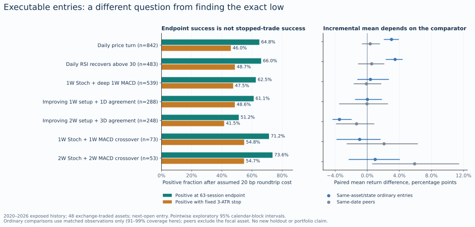
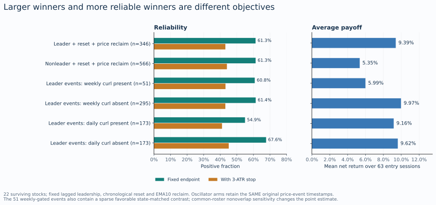
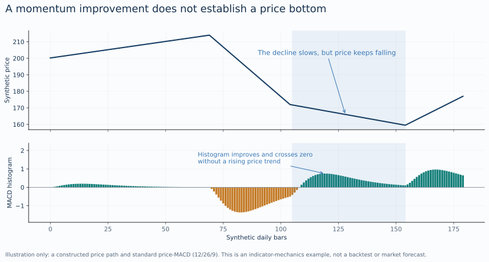

# From durable pivots to dependable entries

## Decision and what this research establishes

**The useful system is a set of explicit investment and entry policies, with oscillators serving defined roles inside them. The evidence does not establish a universal Stoch RSI–MACD combination that reliably identifies an aggressively buyable low or an aggressively sellable top.** The strongest development path is to distinguish the reason to own an asset, the kind of decline it is experiencing, the evidence that permits entry, and the loss and holding policy that makes the trade usable.

This continuation combines a source-level census of prior Macro research, primary financial research, and two new, bounded historical analyses. The original durable-pivot study remains unchanged. Its 34 previously frozen finalists were audited for executable outcomes; one fixed leadership/reset construction was then used to separate stock selection, price recovery and incremental oscillator information. No new parameter grid was searched. The full protocol and code were committed before the new outcome tables were calculated.

Several findings are constructive. Late crossovers can be useful recovery context even when they are poor near-bottom detectors. Selected leaders can produce larger winning trades without producing a higher fraction of winners. Defensive-stock washout context has a stronger prior reliability lead than generic bottom fishing, but that result depends on the holding and risk policy. Simple sector-level recovery is another candidate worth qualifying. None of those statements establishes a production-ready high-win-rate strategy.

The user's objective does not require beating the market. Benchmark comparisons here answer a narrower, necessary question: **what is doing the useful work, and does the added timing complexity improve the intended decision?** A simple ownership policy with positive expected returns can be valuable. It should not be attributed to oscillator skill if comparable ownership already supplies the result.

## 1. What the prior research actually supports

The census inspected the following studies at Macro commit `d18dbe338fda75691d2f548efcd3a54242ea5978`. This is a focused census of the relevant research families, not a claim to have independently reproduced every historical project or reviewed the entire repository.

| Research family | Verified conclusion | Consequence for this programme |
|---|---|---|
| Earlier bottom-signal combination reports | Explicitly marked test-leaked and unsuitable for inference; tuned combinations were selected from many candidates without adequate calendar controls [I1]. | Do not recycle their impressive point estimates as proof. |
| S7 relative-strength repair and triple lock | Cohort-relative repair passed development but failed its holdout promotion condition; remained phase0. RS-versus-SPY repair was worse in holdout. Triple lock was worse than cohort-only in holdout [I2]. | Retain the distinction between market-relative and within-cohort information. Extra conjunctions must earn their place. |
| Residual momentum | The point-in-time rerun retained a modest relative ranking/context signal, but failed the standalone net-return case [I3]. | Reuse the existing context engine; do not claim it is an independently validated entry strategy. |
| Trend quality and momentum crash controls | Nine trend-quality measures added no reliable information after residual momentum. Acceleration remained negative. Exposure management was a lead, below promotion standards and without that study's PIT rerun [I4]. | Complexity can describe a trend without improving prediction. Risk policy deserves separate investigation. |
| Blocked-entry conditional research | Some washout cohorts had positive mean expectancy with poor median and stop behavior. Requiring a two-week floor turn harmed the registered systemic-bear construction [I5]. | A profitable average can be a right-tail strategy rather than a reliable-entry strategy. More waiting is not automatically safer. |
| Defensive nested washouts V11 | Favorable six-month context association in five core names; weaker peers; waiting and protective-stop policies materially changed outcomes [I6]. | This is the most relevant prior reliability lead, but the exact indicator species, population and risk contract matter. |
| Leader recovery and lineage | Useful chronological descriptions already exist; the corrected recovery census did not establish incremental return alpha [I7]. | Preserve the existing lifecycle and uncertainty fields rather than building another recovery score. |

### The defensive result is useful, but its denominators matter

V11 Study A used **RSI-MACD on RSI**, not the ordinary price-MACD in the new pivot study. At a daily crossover, recent weekly and two-week Stoch RSI washouts identified 74 core observations in MCD, WMT, WM, COST and PG. Of these, 67 were positive after 126 entry sessions: **90.54%**, with **+10.68%** mean return. The neither-context group was 214/308 positive, **69.48%**, with **+6.79%** mean return. These are overlapping, selected historical observations, not a future probability. The 13 peer names were weaker: joint context was **69.27%** positive versus **65.37%** for neither [I6].

V11 Study B asked a different question on fixed watches. Its 50 filled core daily entries were **86%** positive, mean **+10.06%**, without a stop. Applying the specified initial 3-ATR stop to those same entries reduced the positive fraction to **50%**, with mean **+5.66%**. The 50% is a positive-trade fraction, not the fraction stopped. It must not be compared to 67/74 as if the samples were identical [I6].

The useful inference is that a longer holding thesis and a short protective-stop trade are different products. Widening a stop after seeing these numbers would not establish a better system; it would change the risk contract. Smaller size, a different entry, a thesis-based exit, staged purchases and a longer holding mandate are distinct hypotheses requiring their own joint accounting.

### Some earlier research narratives exceed their own evidence

S7's introductory development story is more favorable than its final holdout ruling. The final ruling is the one carried forward here. Similarly, relative comparisons between gated and ungated portfolios are not automatically free of survivorship bias merely because they use the same selected names. Selection can interact with which losses a gate avoids. The prior crash-control work remains an interesting risk lead, not a cured estimate of live performance.

The time-confound audit is also material: many correlated ticker events in one market month do not become independent evidence by resampling tickers or event identifiers [I8]. This continuation therefore retains whole calendar blocks in its exploratory uncertainty calculations.

## 2. The new executable-entry audit

### Design

The retained snapshot contains 50 assets: 48 exchange-traded instruments across US indices, sectors, individual stocks, international equities, rates/credit and commodity proxies; BTC and ETH are reported separately. Prices end on October 8, 2026. The original survivor selection and current-vintage data limitations remain.

The audit reuses all 34 frozen bottom/top finalists, their completed-bar rules and their original event cooldown. A close-confirmed decision enters at the following open. The primary endpoint is the close 63 entry sessions later; 21 sessions is secondary. Both decision and endpoint must fit inside one inherited period: 1995–2013, 2014–2019 or 2020–2026. The last period is already exposed historical data, not a new holdout.

Returns use the provider's adjclose/close factor as a dividend-return proxy, with 20 basis points of assumed roundtrip friction and a fixed 50-basis-point sensitivity. This is not exact dividend cash-flow or historical spread accounting. The paired stop diagnostic uses the next entry open minus three signal-date daily ATRs; an opening gap through the stop fills at the open. No target, trailing-stop optimization, or replacement trade is introduced.

Two main comparators are retained. The ordinary-entry comparator uses other dates in the same asset, signal half-year, own trend state and SPY trend state, requiring at least ten other dates. The contemporaneous peer comparator uses the same date and asset class, excluding the focal asset. These are descriptive controls with imperfect common support, not randomized counterfactuals. Calendar-block intervals are exploratory and not adjusted for the prior selection history.

### Recent 63-session results

All rows below are the 48-asset exchange-traded pool in 2020–2026. The same entries appear in the endpoint and stopped columns. Means are net of the assumed 20-basis-point friction. “Ordinary excess” is the paired mean difference on matched observations, so it is not necessarily the subtraction of two whole-sample means.

| Previously frozen rule | Events | Positive at endpoint | Mean net return | Positive with stop | Ordinary excess |
|---|---:|---:|---:|---:|---:|
| Daily price turn | 842 | 64.85% | +5.73% | 45.96% | +3.02 pp |
| Daily RSI recovers above 30 | 483 | 66.05% | +5.98% | 48.65% | +3.47 pp |
| Weekly Stoch curl + deep weekly MACD | 539 | 62.52% | +4.99% | 47.50% | +0.40 pp |
| Weekly Stoch + improving deep weekly MACD | 476 | 61.76% | +4.96% | 48.53% | -0.21 pp |
| Above + daily agreement | 288 | 61.11% | +5.34% | 48.61% | +0.02 pp |
| Two-week improving setup + 3D agreement | 248 | 51.21% | +1.59% | 41.53% | -3.46 pp |
| Weekly Stoch + weekly MACD crossover | 73 | 71.23% | +8.15% | 54.79% | -0.95 pp |
| Two-week Stoch + two-week MACD crossover | 53 | 73.58% | +10.71% | 54.72% | +0.99 pp |

Source: `results/frozen_rule_audit.csv`; all other frozen rules, periods, pools and the 21-session endpoint remain in that file.

### Four implications

**First, a bad near-bottom detector can still identify a favorable recovery period.** The two-week crossover family failed the original tight proximity objective, but 39/53 recent executable entries were positive at 63 sessions. That is a meaningful distinction. It is not evidence of a stable 73.6% future probability: the corresponding historical positive fractions were **54.43%** in 1995–2013 and **80.00%** in 2014–2019. Its recent matched ordinary-entry positive fraction was **72.92%**, and its paired ordinary mean excess interval spanned approximately **-2.27 to +4.01 percentage points**.

**Second, the apparent value of a signal depends on what it is compared with.** Daily RSI recovery had a +3.47-point mean advantage over same-asset/state ordinary dates, but only **+0.56 points** versus same-date peers, with an exploratory interval of approximately **-1.10 to +2.07 points**. The price-turn result similarly fell from +3.02 points versus ordinary dates to +0.37 points versus peers. This is consistent with broad rebound timing contributing materially to the result; it does not prove that explanation or establish stock-specific selection skill. Broad rebound timing could still be useful for the user's absolute-return goal.

**Third, multiple timeframes did not supply a general reliability improvement.** The weekly deep/improving family and its daily-aligned subset had similar stopped positive fractions around 49%. The two-week/3D improving family was weaker. The weekly deep rule's ordinary excess interval was approximately **-1.18 to +2.65 points**, and its same-date peer excess was approximately **-0.10 points**. These results do not justify elevating more agreement into a compulsory gate.

**Fourth, fixed-horizon recovery can conceal an unusable path.** About **24.0%** of the weekly-deep rule's positive endpoints became stopped losses under this one specified risk policy. The corresponding share was **26.3%** for daily RSI recovery. The experiment does not prove that three ATRs is the right stop. It proves that endpoint success cannot be substituted for the success rate of a stopped strategy.

Costs of 50 basis points did not erase the main qualitative findings, but that does not validate the assumed costs during historical stress or in less liquid securities. Nonoverlap sensitivities preserve the main endpoint-versus-stop distinction. They reduce same-name overlap, not shared market exposure across names.

## 3. Does selecting leaders and buying their pullbacks solve the problem?

### One fixed construction

The second experiment used the 22 retained US stocks. “Leader” was a **price-based description** evaluated 21 sessions before the decision, preceding the reset search window. The stock had to be above a rising 200-day average, and its 252-to-21-session total return at that earlier snapshot had to exceed both SPY and a fixed sector ETF. Unavailable sector history was UNKNOWN, not nonleadership. The map and its limitations are recorded in the protocol and input coverage table.

The reset has explicit chronology: a peak in the preceding 20 sessions, then a trough after that peak and before the signal, at least two peak-date ATRs of decline, a trough within the preceding ten sessions, and a current close zero to three peak-date ATRs below the peak. The entry trigger is a genuine upward crossing of the daily EMA10. These fixed choices are research conventions, not fitted optima.

Weekly and daily Stoch gates partition **the same original price-event timestamps**. A rejected event is retained as a rejected observation; the gate does not wait for a later entry and receive credit for a different price.

### What selection changed

| Original price-event cohort, 2020–2026 | Events | Positive at 63 sessions | Mean net return | Positive with 3-ATR stop |
|---|---:|---:|---:|---:|
| All reset/reclaim events | 912 | 61.29% | +6.88% | 43.64% |
| Lagged leaders | 346 | 61.27% | +9.39% | 43.06% |
| Nonleaders | 566 | 61.31% | +5.35% | 43.99% |
| Leader events with weekly curl | 51 | 60.78% | +5.99% | 43.14% |
| Leader events without weekly curl | 295 | 61.36% | +9.97% | 43.05% |
| Leader events with daily curl | 173 | 54.91% | +9.16% | 41.04% |
| Leader events without daily curl | 173 | 67.63% | +9.62% | 45.09% |

Source: `results/mechanism_summary.csv`, original roster, 63-session endpoint. The event ledger preserves all observations.

**Leadership increased the size of winners in this selected recent sample, without increasing how often a trade won.** The leader/nonleader mean difference was +4.03 percentage points, while the positive-fraction difference was essentially zero. Leader winners averaged +22.14%; nonleader winners averaged +14.99%. These are not proof that the companies had superior fundamentals.

Concentration matters. Excluding the four semiconductor stocks reduced the leader mean from **+9.39% to +6.83%**, and its same-date stock-peer excess became **-0.37 points**. In the complete leader cohort, the state-matched ordinary-entry mean difference was **-0.87 points**, with an interval of approximately **-2.80 to +0.83 points**. The reclaim entry has not demonstrated incremental timing value over comparable leader/reset states.

The daily gate illustrates why mean return and reliability cannot be combined casually. Its accepted events won less often, but their winners averaged **+25.45%**, compared with **+19.46%** among rejected events. The average returns remained similar. A feature can tilt a portfolio toward a payoff shape rather than improve the probability of a successful entry. The recent accepted-minus-rejected positive-fraction difference was **-12.72 points**, with an exploratory calendar interval of approximately **-25.87 to -1.06 points**. Earlier periods did not support a universal same-sign rule, so this is not a new permanent inverse-Stoch strategy.

### Preserve the favorable qualifications too

The weekly gate is not proved useless. On the **36 of 51** accepted events with adequate state-matched support, its mean excess was **+4.47 points**, interval approximately **+0.71 to +6.68 points**. Its matched ordinary baseline was much weaker than the rejected group's baseline. This is a coverage-dependent, conditional indication, not a whole-opportunity-set improvement.

A common price-roster nonoverlap sensitivity retained only **24** weekly-gated leader events, of which **70.83%** were positive, versus **58.27%** for 139 rejected events. The smaller roster changes the estimate materially. The appropriate conclusion is uncertainty about a possible cycle-timing role, not a compulsory gate. One future hypothesis is that the first qualifying repair within an episode differs from repeated reclaims; the existing lifecycle should supply that identity. No new episode filter was fitted here.

The full daily state census also failed to show that a reset automatically makes leaders more reliable. Recent leader/reset state-days were **59.80%** positive, versus **63.01%** for leader/no-reset state-days. These heavily overlapping state-days are descriptive observations, not independent trades. They prevent the favorable narrative from being assumed before testing.

## 4. Tops and exit decisions

The top audit asks what would happen if the position were sold at the following open and held in zero-yield cash until the fixed 63-session endpoint, with the specified exit/re-entry friction. It is an avoided-long-return diagnostic, not a short strategy or a complete allocation policy.

**All 17 frozen top finalists had negative average avoided return in the recent primary pool.** For example, the weekly Stoch rollover with an elevated, still-rising positive histogram had 279 observations: cash was better on **43.01%**, but average avoided return was **-4.28%**. The weekly bearish crossover variant had 103 observations: **39.81%** positive avoided return and **-2.56%** mean. Some rules look better than ordinary exit dates, but still surrender positive subsequent returns on average. The supplement preserves those comparator differences rather than conflating them with an absolute benefit.

This does not mean exits are unnecessary. It means a symmetric “oversold buy / overbought sell everything” policy is not supported by these tests. Buying requires a reason to acquire the asset at the present price. Exiting an existing position can respond to thesis failure, unacceptable exposure, a broken risk contract, expiry of a short-lived opportunity, or a consciously chosen profit-protection policy. Those objectives do not require forecasting the exact high.

For a durable compounder, a hot oscillator may describe persistent demand. For a short rebound trade, the same state may mark expiry of the original opportunity. A useful system therefore needs strategy-specific exits and a specified re-entry policy. Otherwise a successful sale is credited for the avoided decline while the later missed recovery disappears from the scorecard.

## 5. What the indicators are actually saying

### Stoch RSI is relative momentum position

Stoch RSI places RSI inside its own recent range. A low reading does not mean a security is intrinsically cheap, nor does it identify the cause of selling. A curl means that relative momentum position has improved. It can occur while absolute momentum is poor. When RSI's recent range is narrow, small changes can move its normalized position substantially. The baseline explicitly treats a zero range as unavailable rather than inventing a signal [P1].

### MACD improvement can coexist with falling prices

Price-MACD is a fast EMA minus a slow EMA; its histogram is MACD minus its own signal average. A histogram that becomes less negative describes a change in the recent momentum relationship. It does not logically require prices to rise [P2].

Consider a sustained decline that slows from one unit per day to a quarter unit per day. The fast average adapts before the slow average; MACD can improve and cross its signal while price continues declining. In the limiting case of a steady linear decline, the two EMAs maintain a roughly constant negative separation after their transients settle, while the histogram tends toward zero. The falling price has not become a bottom merely because the histogram stopped deteriorating.

The reverse problem appears in strong advances. The rate of ascent can slow enough to produce a bearish histogram turn while the price and business trend remain favorable. This is one reason an exit rule needs a holding thesis rather than a mechanically mirrored entry oscillator.

### Timeframes describe different portions of the path

With identical MACD settings, a 3D chart uses approximately 36 and 78 trading sessions for its two EMA spans; a weekly chart roughly 60 and 130; a two-week chart roughly 120 and 260. Holidays and bar anchoring prevent exact equivalence. The signal-line smoothing adds another clock. A two-week crossover may become observable after a shorter rebound is already mature.

There is consequently no necessary contradiction when a weekly crossover and a short-timeframe rollover coexist. One describes a slower recovery from the prior decline; the other describes deceleration of the latest rebound. Sign, slope and a fresh crossover are also different facts. In the original study, many “conflicts” were a negative shorter histogram that was already improving, not a fresh opposite crossover.

The useful roles are conditional: longer horizons can describe structural context; intermediate horizons can define an opportunity; shorter horizons can describe executable behavior and invalidation. A short pullback within a strong long trend can be the intended setup. Requiring every clock to be bullish at once can remove that setup and admit a later, more extended price instead. The original study's completed-bar and anchor checks remain essential; an unfinished weekly or two-week bar is not historical information that was already known [P1–P2].

### Correlated transforms do not provide independent evidence

Several oscillators calculated from the same closes may all respond to the same change in the path. That does not make them useless, but agreement is not automatically several independent confirmations. The internal trend-quality null is a concrete example: the extra features described a trend without reliably adding predictive information beyond the existing momentum measure [I4].

A useful extra input should address a missing question: whether expectations have improved, whether a move is industry-wide, whether liquidity pressure is temporary, whether the ownership thesis is still plausible, or whether the portfolio can tolerate the path. Its incremental contribution must then be measured against the appropriate baseline.

## 6. The missing economic distinction: temporary pressure or lasting repricing?

The same oversold chart can arise from at least three mechanisms. A liquid but fundamentally intact asset may face temporary selling. A company may be repricing deteriorating expected cash flows. Or a whole asset class may be adjusting to a changed discount rate or financing environment. Their oscillators can look similar because the indicators observe prices, not the latent reason for the move.

The original volume-return research distinguishes risk-sharing trades that can reverse from information-related trades that can continue [P3]. High volume therefore cannot by itself certify capitulation. Chan's news/no-news evidence also motivates distinguishing information-linked moves from other extremes, while its small-stock and trading-friction limitations prevent a universal large-cap rule [P4]. Missing news coverage must be marked UNKNOWN; absence of a retrieved headline is not absence of information.

Dai and coauthors separate announcement and industry effects when studying reversals and show why volatility and turnover matter for the timing of a liquidity rebound [P5]. The practical inference is that a five-day liquidity mechanism should not be graded solely on whether a low survives for three months. Nor should a short rebound be promoted into a six-month ownership thesis without additional evidence.

The earnings-momentum and quality literature provides plausible selection inputs that price transforms lack. Novy-Marx examines earnings and price momentum [P6]; the quality literature distinguishes profitability, growth, safety and the price paid for them [P7–P8]. These papers motivate tests; they do not validate the proposed combined strategy. A strong business can be expensive, a favorable announcement can already be discounted, and a recovered price does not prove that fundamentals are intact.

The price-based experiment here cannot answer that missing information question. It deliberately does not label price leaders “quality stocks.” Historical earnings surprises require the actual release time and an archived pre-release expectation. A three-day announcement-return feature containing day +1 cannot authorize an entry before that session has completed. Current restated accounts or today's analyst consensus cannot replace those as-of inputs.

## 7. A more useful Mastermind / Macro architecture

The design should reuse existing owners. The residual-alpha engine, basket/index context, Leader Radar recovery/lineage and common validation tools already answer parts of this problem [I3, I4, I7]. The proposed integration is a decision record, not another score service or a replacement lifecycle.

| Decision | Evidence needed | What must remain distinct |
|---|---|---|
| Why consider owning this asset? | Existing selector, timestamped business/information thesis, valuation context where available | Price leadership versus fundamental quality; UNKNOWN versus intact |
| What opportunity is present? | A defined reset, dislocation, event acceptance or systemic repair | Mechanism and expected horizon; current level and episode age |
| What permits entry now? | One executable trigger under a frozen policy | State versus event; confirmation versus actual price paid |
| What makes the decision wrong? | Thesis invalidation, price/risk policy, expiry | Fundamental failure, ordinary noise, liquidity need and opportunity cost |
| Can the portfolio use it? | Existing positions, capital, industry/event overlap, stress loss and execution limits | Predictive evidence versus a real allocation constraint |

The product should present the reason for selection, the setup, contradictory evidence, the next observable event, invalidation and the relevant evidence level. A useful card can say: “long-horizon context favorable in a selected cohort; trigger adds no demonstrated timing benefit; six-month recovery can include a stop-out; industry exposure already concentrated.” A single numerical confidence score would conceal those distinctions unless it has been calibrated to a precise target.

The record should preserve event time, source availability time, completed-bar time, observation time and rule version. It should carry accepted and rejected opportunities, first-seen versus reconstructed evidence, reference levels frozen at setup creation, and explicit missing-source reasons. A later earnings release must not rewrite what was knowable at an earlier low.

### Capital is part of the system

Ten apparently distinct signals in the same sector can be one correlated exposure. A leader selector can raise average payoff by concentrating in a powerful industry while leaving the typical trade's reliability unchanged. This continuation's semiconductor result makes that issue concrete.

An entry policy must therefore specify concurrent positions, same-name duplicates, industry/event caps, cash treatment, holding time and what happens when several strategies nominate the same asset. A stop is not a guarantee through a gap. Staged entry changes total cash flows and average cost; it cannot be assessed by showing only the first small purchase near the low. A macro field used to change size or permission becomes part of the tested policy, even if it is described informally as discretion.

The user does not need an excess-return contest. The portfolio objective can be positive net returns with a tolerable drawdown and a high fraction of profitable completed positions. It still needs a capital denominator and an acceptable loss distribution. An arithmetic example illustrates the point: nine gains of one unit and one loss of twelve units produce a 90% win rate and a negative total payoff.

## 8. Research priorities after this pass

### Priority 1: defensive recovery with an explicit ownership and risk mandate

**Why pursue it:** V11 is the closest prior result to the user's reliability goal, with exact indicator definitions and a documented core-versus-peer qualification. The economic hypothesis is recovery in businesses selected for durable operating characteristics, not a universal oscillator floor.

**What must be decided:** is this a multi-month ownership/rebalance policy or a short stopped trade? Its entry, allowed adverse path, thesis failure and capital budget must be coherent. The existing evidence does not justify optimizing a wider stop until the historical hit rate looks attractive.

**Discriminating comparison:** retain the exact V11 opportunity roster and compare a simple executable baseline with one proposed timing or risk change. Preserve rejected/unfilled opportunities and common endpoints. Confirmation must improve the stated risk-return objective, not merely accepted-event precision. Use unexamined as-of history or future matured observations for confirmation.

### Priority 2: sector recovery as a simpler allocation candidate

**New descriptive lead, explicitly post hoc:** daily RSI recovery above 30 in the sector ETF group produced **84/104 positive** recent 63-session outcomes, **80.77%**, mean **+6.66%**. The fixed-stop positive fraction was **60.58%**. The observations covered 12 ETFs and 56 dates; they are correlated sector opportunities, not 104 independent trials. Its same-date peer mean advantage was only **+1.17 points**.

This suggests a question about participating in a broad recovery without requiring successful single-company selection. It does not prove that the sector subgroup is a winner: it was noticed after the audit, and no fresh confirmation is claimed. It needs the simplest same-date sector allocation baseline, cash and concentration accounting, earlier-era examination under one frozen policy, and a prospective record. Rates/credit did not share the apparent result: the same daily RSI rule was only **45.24%** positive across 42 recent rate/credit events, with negative mean return. One universal asset-class policy is not supported.

### Priority 3: favorable information revision followed by price acceptance

**Why pursue it:** it addresses information that the price-only study cannot observe. A credible improvement in expected operating results could support continuation; price behavior then addresses execution rather than supplying the entire thesis [P6–P8].

**Data gate:** audited release timestamps, as-reported values, archived expectations, historically valid membership and event coverage. If those inputs are absent, this branch is untested. No new provider acquisition or assumption of point-in-time completeness was made in this pass.

**Discriminating comparison:** within one fixed information-event cohort, compare event-only entry, price-only acceptance and their combination, using the same executable clock. Ask whether the technical gate improves the event baseline. It must survive known-event timing and next-open gaps, rather than receiving credit for returns before its information existed.

### Separate research sleeve: systemic repair and liquidity reversals

These may be profitable without matching the high-reliability objective. The blocked-entry evidence contains right-tail payoff and poor typical-trade behavior; the new broad-audit results also show common-date rebound exposure. Keep short liquidity rebounds and longer systemic recovery as different mechanisms with different expiry and risk rules.

Momentum-crash research motivates caution about leadership changes after stressed rebounds, but much of its original mechanism involves the short loser leg of a long-short portfolio [P9]. It cannot simply be transferred to a long-only leader-pullback strategy. Breadth, credit and rates are candidate context, not proven universal vetoes. The prior V11 strata and blocked-entry result specifically caution against automatic “only buy calm/uptrend conditions” rules.

### What should stop expanding

Do not add oscillator votes merely because they agree visually. Do not reintroduce residual acceleration or renamed trend-quality weights after their negative results. Do not promote the old test-leaked triple lock. Do not fit separate parameters for each stock or regime until one useful mechanism and a credible confirmation sample exist. Do not make an exact top detector a prerequisite for a disciplined exit policy.

## 9. What has been completed, and what remains unproved

Completed: publication of the original baseline; focused source census; primary-literature mechanism review; pre-outcome protocol and code commit; the 34-rule executable audit across all inherited periods; one leadership/reset factorial and event ablation; paired gap-aware stop diagnostics; ordinary and contemporaneous peer comparators; top exit comparisons; calendar-block uncertainty; concentration and nonoverlap diagnostics; reproducible tables, event ledgers and publication figures.

The new run produced 578,144 ordinary asset/date/horizon records, 127,067 frozen-rule event/horizon records and 6,557 mechanism event/horizon records. These counts include overlapping horizons, repeated dates and shared signals; they are **not independent sample sizes**. The original input, core code and selection-lock hashes remained fixed. Eight new mechanical tests passed, in addition to the original study's recorded verification. An independent static method review found no consequential lookahead or execution-order fault in the original-roster results.

Review identified two reporting gaps, repaired without changing signals or original CSV results: top-side comparators were completed; and a common price-event nonoverlap roster was added before splitting oscillator arms. Accepted/rejected calendar contrasts report usable bootstrap draws. The original arm-specific nonoverlap rows remain separate policy-roster sensitivities. The supplement also documents that the compact top event ledger's `net20`, stop and MAE columns are counterfactual underlying-long outcomes; top avoided returns are in their dedicated summary.

Unproved: a broad population of delisted and surviving equities under the new rules; historical corporate classifications and fundamentals; exact chart parity; historical bid/ask and liquidity costs; portfolio drawdown and capital usage; calibrated future probabilities; prospective confirmation; automatic trade, size or exit authority. The 2020–2026 history is exposed. More resampling cannot make it unexamined.

**The resulting research decision is to keep price and oscillator context, narrow the strategy mandate, and put the missing information and risk contract at the center of the next confirmation.** The most valuable simplification may be that a strong ownership policy and explicit risk treatment do more useful work than another layer of technical agreement. A successful future system must demonstrate that claim under its actual execution and portfolio constraints.

## Sources and reproduction

### Internal evidence, inspected at the pinned revision

- I1. [Earlier bottom-signal report, including its test-leakage banner](https://github.com/mastermindx-market-intelligence/macro/blob/d18dbe338fda75691d2f548efcd3a54242ea5978/research/bottom_signal_backtest/results/final_report.md).
- I2. [S7 specification and final results](https://github.com/mastermindx-market-intelligence/macro/blob/d18dbe338fda75691d2f548efcd3a54242ea5978/research/species/s7_rs_repair_phase0/REPORT.md).
- I3. [Residual Alpha Momentum, including the PIT rerun](https://github.com/mastermindx-market-intelligence/macro/blob/d18dbe338fda75691d2f548efcd3a54242ea5978/research/RESIDUAL_ALPHA_MOMENTUM.md).
- I4. [Residual Momentum, Trend Quality and Crash Gating](https://github.com/mastermindx-market-intelligence/macro/blob/d18dbe338fda75691d2f548efcd3a54242ea5978/research/RESIDUAL_MOMENTUM_TREND_QUALITY.md).
- I5. [Blocked-entry conditional results and adjudication](https://github.com/mastermindx-market-intelligence/macro/blob/d18dbe338fda75691d2f548efcd3a54242ea5978/research/BLOCKED_ENTRY_CONDITIONAL_RESULTS_2026-08-10.md).
- I6. [Defensive nested washouts V11, corrected empirical assessment](https://github.com/mastermindx-market-intelligence/macro/blob/d18dbe338fda75691d2f548efcd3a54242ea5978/research/DEFENSIVE_NESTED_V11_EMPIRICAL_2026-10-11.md).
- I7. [Leader recovery research and implementation contract](https://github.com/mastermindx-market-intelligence/macro/blob/d18dbe338fda75691d2f548efcd3a54242ea5978/research/leader_recovery/RESEARCH_AND_IMPLEMENTATION.md), interpreted with the [later delivery handoff](https://github.com/mastermindx-market-intelligence/macro/blob/d18dbe338fda75691d2f548efcd3a54242ea5978/agentos/handoffs/LIVE-ENTRY-RADAR-2026-10-11-rs-leader.md). Older UI-status prose is not used as current deployment evidence.
- I8. [Time-confound exposure audit](https://github.com/mastermindx-market-intelligence/macro/blob/d18dbe338fda75691d2f548efcd3a54242ea5978/research/TIME_CONFOUND_EXPOSURE_AUDIT.md).

### Primary explanatory research

- P1. [TradingView: Stochastic RSI](https://www.tradingview.com/support/solutions/43000502333-stochastic-rsi-stoch-rsi/).
- P2. [TradingView: MACD](https://www.tradingview.com/support/solutions/43000502344-macd-moving-average-convergence-divergence/).
- P3. Llorente, Michaely, Saar and Wang (2002), [Dynamic Volume–Return Relation of Individual Stocks](https://web.mit.edu/~wangj/www/pap/LlorenteMichaelySaarWang02.pdf), abstract and introduction.
- P4. Chan (May 2001 working draft), [Stock Price Reaction to News and No-News](https://users.nber.org/~confer/2001/bfs01/chan.pdf), abstract and introduction. The version consulted is identified rather than silently treated as the final publication.
- P5. Dai, Medhat, Novy-Marx and Rizova (January 2023), [Reversals and the Returns to Liquidity Provision](https://mysimon.rochester.edu/novy-marx/research/RRLP.pdf), introduction and liquidity/announcement analysis.
- P6. Novy-Marx (2015 working paper), [Fundamentally, Momentum Is Fundamental Momentum](https://mysimon.rochester.edu/novy-marx/research/FMFM.pdf), introduction and event definitions.
- P7. Novy-Marx (June 2012 version), [The Other Side of Value: The Gross Profitability Premium](https://mysimon.rochester.edu/novy-marx/research/OSoV.pdf), introduction and profitability construction.
- P8. Asness, Frazzini and Pedersen (2019; online 2018), [Quality Minus Junk](https://link.springer.com/article/10.1007/s11142-018-9470-2), introduction and quality definitions.
- P9. Daniel and Moskowitz (2016), [Momentum Crashes](https://kentdaniel.net/papers/published/jfe_16.pdf), introduction and rebound mechanism.

The public papers explain plausible mechanisms and input requirements. They do not supply the numerical strategy results in this report. Those results are original calculations in the accompanying files; the prior internal numerical claims are explicitly attributed to their respective studies.
