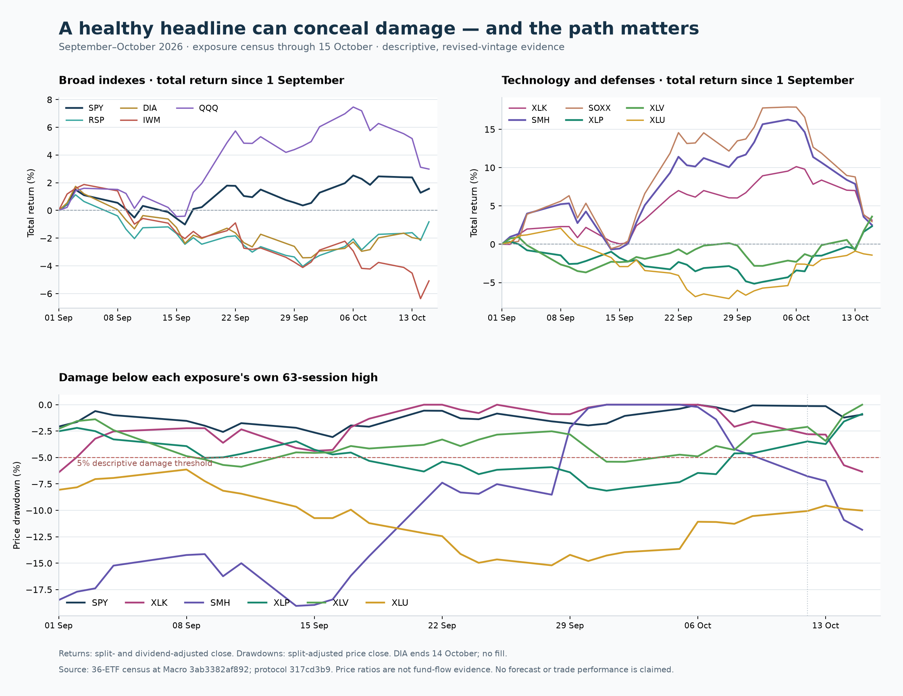

# Risk Radar / Risk On–Risk Off / Grey Deer — Meta-CEO findings and action map

**Prepared 2026-10-17 for Chairman Chris Wong.** This is a continuation of WS:GREY-DEER-RISK-INTELLIGENCE / MAS-258.

**Disposition: the new descriptive census is accepted within its declared scope; no predictive claim or new policy authority is promoted. The programme has not reached final backend-to-user acceptance.** Useful market evidence exists. Source clocks, warning translation, exact forecast qualification and some consumer semantics prevent the programme from consistently delivering that evidence as an executable, correctly scoped decision.

The existing [continuation masterplan](GREY_DEER_CONTINUATION_HANDOFF_2026-10-11.md) carries the revised sequence. This findings document does not replace the architecture freeze, active carriers, accepted GD-3 evidence or established Portfolio/Prophet policy owners.

## Current continuation — 20 October 2026 UTC

**Qualified release for the reserved decision — October 20:** actual full-archive Linux startup/restore was executed at **a7553e0a18339c910eef9687c730b06605dd710e**. Its first audit-harness file-descriptor failure is retained; the corrected run completed actual registered startup, 18 jobs, readable-history first-run guards, no blocked network/process attempt, unchanged established cohort and zero-difference eligible-code restoration. The live PID **1627652** and installed **732cf7be** release were unchanged. Protected master subsequently advanced to **8bce27bb731f475885352add0be7f885e0862714** through #1647/#1228. The new archive is **102,789,120 bytes / 5,152 members**, SHA256 **28e87cd1c942ed2c10c64cf39e0e26f21821ff60f18b7368cfbee10861140a92**; actual non-writing receiver comparison returned 0. Its application, portfolio, brain, control-plane, dependency, wrapper and helper identities match the rehearsed version. Independent principal review accepts bounded successor compatibility, not a relabeled successor startup run. [Qualification and next action](consumer_comparison_20261017/release_integrity_20261018/recovery_oct20/QUALIFIED_RELEASE_DECISION_2026-10-20.json). Live deployment remains unapproved and full programme acceptance remains open.

**The most useful new result is the [October 16 ranked exposure/action map](action_snapshot_20261020/DATED_ACTION_MAP_2026-10-16.md), accepted as a dated descriptive diagnostic.** A relatively healthy S&P proxy coexists with severe semiconductor damage: SPY drawdown is 2.03%, versus 14.85% for SMH and 16.31% for SOXX. XLP and XLV have positive five-session absolute returns of 5.02% and 3.45%. These facts support earlier exposure-specific protection review while retaining contained rotation as a competing pathway. They do not establish flows, systemic contagion, forward loss or a numerical allocation. The 32-current-proxy and eleven-sector counts are overlapping diagnostics, not constituent breadth or independent episodes.

The map declares its price basis, observation date, stale rows, relative/absolute distinction, invalidation and re-entry limits. DIA, ARKK, BIL and SGOV are still October 14; QQQ is Nasdaq-100 exposure, not the literal Composite. It contains no October 19 close or October 20 executable quote. An official issuer cross-check matches one October 16 SPY close at $763.25; it does not authenticate all other series or first-known clocks. An [independent review](action_snapshot_20261020/review/INDEPENDENT_REVIEW_2026-10-20.md) verifies 36 rows and all 180 numerical cells. Its optional systemic-gate clarification is adopted with the exact reviewed version retained. Numerical decisions remain with Portfolio/Prophet.

**First natural W5 issuance is now operationally accepted.** [Exact acceptance](w5_natural_issuance_20261018/oct20_lineage/ROOT_OPERATIONAL_ACCEPTANCE_2026-10-20.md) binds one scheduled SPY batch, all 30 recipe/preregistration matches, approved writer ancestry and both complete-log and reported-annotation warning checks. All outcomes remain immature. Thirty configuration/horizon records are not thirty independent warnings. Sunday October 18 issuance cannot establish a Friday October 16 close execution; input availability, first user display and implementable action price remain unknown. The failed/cancelled remainder of that nightly stays failed/cancelled. This closes an issuance gate, not forecast calibration or policy effectiveness.

**Mastermind source #1610 is merged and separately verified.** Candidate **7b5ccfffef4e90b89496751dd7bc0f55b711ed25** landed as protected master **a7553e0a18339c910eef9687c730b06605dd710e**. The completed original observer receipt is dated **04:06:15 UTC on October 20**; the separate master fetch and five-file blob comparison completed at **04:23:34.958762 UTC**. All five owned paths and startup-source identity matched. The helper remains SHA256 **1ebfd44db982d73f7f9d507109fa3983ba65cc948e8afe9fe697589d712728a8**. PR-head CI **39359674398**, CodeQL **39359671270**, and the recorded native queue stages remain bound to their original heads. Observer PID **80374** is terminal; no new queue watcher is needed. Source acceptance does not establish runtime installation. [Landing receipt](consumer_comparison_20261017/release_integrity_20261018/native_oct20/SOURCE_LANDING_READBACK_2026-10-20.json) and [recovered current readback](consumer_comparison_20261017/release_integrity_20261018/recovery_oct20/SESSION_RECOVERY_READBACK_2026-10-20.json) establish this superseding frontier. Earlier failed CI/native cases, the 113 unchanged passes plus separately corrected case, and #1586/#642/#124 custody/HOLDs remain intact.

**Current runtime observation — October 20:** the installed marker and later local /health response identify **732cf7be88e7159b4995a8885fbd381cd1484e3e**. The **07:19:05 UTC** six-second health request timed out; bounded process/resource/listener checks found no measured saturation, and a direct request at **07:26:31 UTC** returned **HTTP 200 / status:ok**, with scheduled runtime reported healthy. The cause of the earlier timeout remains unresolved; this is subsequent liveness, not continuous-health or product-delivery proof. No service operation was performed. Current effective service settings are authoritative, non-serve-only, with an in-memory jobstore. The later **07:41:31 UTC** service-namespace readback resolves the real bind mount to /opt/mastermind-live-data: autonomous/china/hk NAV histories have 88/86/87 valid rows through October 19, with no pending target, WAL or settlement receipt at that observation. The host /opt/mastermind/data view is stale and is not the service data. The real isolated startup and full eligible-code restoration completed at **07:54:17 UTC**; current-before-execution state still requires a fresh check. [Observation receipt](consumer_comparison_20261017/release_integrity_20261018/recovery_oct20/SESSION_RECOVERY_READBACK_2026-10-20.json).

**Evidence publication — Macro #9595:** the first recovered continuation was committed and pushed as **5a228eb5bd392fa9a047c54bac3f0a4a09f9b3f0** on October 20; native commit/push and remote readback succeeded. Its CI **39388326725** is separately bound. This enclosing qualification update adds actual Linux startup/restore, service-namespace state and successor-release evidence, and must pass its own current integrated gates before normal landing. The earlier ac08 run **39118765804** remains a retained failure; #7100 had already preserved the three base-supplied design documents under design_candidates. No RIG waiver or competing repair was needed. The main authority context passes; inactive ci-authority/codex/merge-queue-pilot is non-binding for a main-target PR under the existing controller. All edits precede arming; a closed carrier must remain read-only.

The [R1 reporting clarification](all_date_census/PRICE_ONLY_B0_B1_R1_ADJUDICATION_2026-10-20.md) is adopted as proposed design. Equal-exposure weights now apply deterministically to paired Brier and calibration reports for the three frozen comparators. Proposed units remain 532; estimation remains **NOT_ADMITTED, zero fits** under the actual Yahoo source-purpose and executable/runtime gaps. FRED UNKNOWN/HOLD, T13's h21 matched refusal, prior zero-passing predictive studies and null independent N remain evidence.

The [current Copilot source comparison](live_delivery_20261017/copilot_failure_trace/current_source_20261020/CURRENT_SOURCE_2026-10-20.md) preserves the original failed real answer and shows that its exclusion-only portfolio classifier and empty-synthesis/caveat mechanism survive in inspected active #8014 head **d63e59bcd4203732fe3b9097002f9451dcf61955**. #9447 **aed92aaa…** and #9548 **bc96a20f…** remain actual writers; no takeover is inferred. Independent review accepts this narrow compatibility result, not a fresh live failure or repaired delivery. Repair must qualify useful content before metadata, preserve separately admitted public visuals and screening/Stop/persistence semantics, then pass the real authenticated original question.

The last retained VPS observation is **October 18**, installed **732cf7be…**. It is not a current October 20 runtime read. After actual source landing, qualify the exact complete archive, registered startup effects and isolated recovery before the reserved production decision. The original Paper write gate, warning publisher HOLDs, missing forecast qualifiers, current Terminal proof and end-to-end action/recovery experience remain open. Whole programme acceptance remains **NO**.

The sections below retain the original October 17 findings and older intermediate receipts. The current dated map above governs the newer descriptive observation; none of these snapshots proves what a user actually received at a past decision time.

The [conditional registered-startup review](consumer_comparison_20261017/release_integrity_20261018/startup_oct20/STARTUP_EFFECT_REVIEW_2026-10-20.md) now verifies seven fixed-source files at 7b and the actual registered handler. Scheduler import and governance/event attempts precede the serve-only branch; non-serve-only startup can initialize its jobstore and quarantine pending targets before resume. First-run fuses do not govern that preflight or normal scheduled work. This is conditional source characterization, not an observed startup or a new regression. Reuse the completed dependency reviews to resolve the named preflight/auth/initialization callees, then bind effective runtime settings and the final merged archive before the isolated experiment.

## 1. Preserved October 17 reading of the then-available dated evidence

The price reconstruction is frozen to Macro **3ab3382af89242c7b7fe8c65360bd883a7dd3504**, with prices through **2026-10-15**. DIA, BIL, SGOV and ARKK end October 14. These are revised current-vintage daily ETF observations, not reconstructed contemporaneous vendor receipts.

At the separately recorded October 16 snapshot, Market State is **40 / RISK_OFF**. The public Macro dashboard inspected October 17 displays that state, “Risk building 83 / Partial read,” and an October 14 sector reading awaiting update. That newer headline does not establish a complete October 16 price, leadership and Envelope bundle. The pinned Envelope remains October 15; its required leadership source is October 14, so hazard is unavailable. Native source dates and the current public display must remain distinguishable. See the [source audit](risk_radar_source_consumer_audit_20261017.md).

At the later main refresh **ab5156a4b2c336181f3c5256e7c0766f04f99598**, the Envelope has advanced to **October 16**, produced October 17 at 04:01:23Z. It still reports **40 / RISK_OFF** with null hazard: leadership remains October 14 and rotation October 15. Its four authority flags remain false. The frozen price/replay evidence above is unchanged; the later source update does not fill its unavailable historical receipt clocks. The [current-source addendum](risk_radar_source_consumer_audit_20261017.md#current-source-compatibility-addendum--october-17) also records another W5 BACKFILL_ASOF refusal.

The current Radar's displayed **22%** 21-session number is accompanied by thin, reconstructed historical evidence: 16 outcomes among 66 overlapping matched origins, with a source-reported 90% interval about **5%–45%** and precision_grade:false. Its separate state-only rate is 16% versus a 17.8% base. Preserve those different targets and qualifications; neither the score nor a copied percentage establishes a precise, executable forecast.

### Dated exposure comparison

Returns are total return; drawdowns use split-adjusted, dividend-unadjusted price. All percentages below are from the pinned census, rounded; trailing drawdown uses 63 reference sessions.

| Exposure | 5-session return | 20-session return | Drawdown | Evidence interpretation at October 15 |
|---|---:|---:|---:|---|
| SPY | −0.28% | +1.46% | −0.94% | Broad capitalization-weighted price damage remains small. |
| RSP | +1.48% | +1.17% | −3.49% | Improving relative participation; incomplete evidence of healthy broadening. |
| DIA — October 14 | +0.90% | +0.31% | −5.01% | Separate stale date; do not fill October 15. |
| IWM | −0.90% | −3.63% | −9.84% | Material small-cap damage; slightly below its own 200-session average. |
| QQQ | −2.62% | +1.65% | −4.17% | Acute deterioration coexists with positive monthly performance. |
| XLK | −4.34% | +0.72% | −6.34% | Technology damage has crossed the descriptive 5% threshold. |
| SMH | −7.98% | −0.32% | −11.84% | Semiconductor damage is substantially greater than SPY damage. |
| SOXX | −8.62% | −0.85% | −12.69% | A second ETF shows the same semiconductor pattern; this is not an independent market episode. |
| XLP | +3.91% | +4.50% | −0.88% | Recent absolute gains and relative defensive strength. |
| XLV | +5.37% | +5.37% | 0.00% | Recent absolute gains; at its 63-session high. |
| XLU | +1.41% | +0.64% | −10.02% | Deep residual damage; the defensive label does not establish preservation. |
| HYG | −0.01% | −1.58% | −3.49% | Credit ETF price context; not a credit-spread or funding-stress measurement. |
| TLT | +2.70% | −1.82% | −5.07% | Recent duration rebound with residual loss and rate sensitivity. |
| GLD | +1.08% | −3.93% | −10.60% | Recent rebound has not repaired substantial prior damage. |

Source: [all case origins](all_date_census/v1/september_october_origins.csv), [relative comparisons](all_date_census/v1/september_october_rotation.csv), [immutable input and output hashes](all_date_census/v1/manifest.json).

The October 13–15 contrast is particularly informative: SPY −0.80%, SMH −4.98%, XLK −3.61%, XLP +2.96% and XLV +4.44%. XLU lost 0.52% while outperforming XLK by 3.20% on the ratio. That utilities comparison is “falling less.” Price ratios establish neither subscriptions/redemptions nor investor transfers.

The most defensible description is **selective defensive divergence alongside acute technology/semiconductor damage and continuing weakness elsewhere**. Healthy broadening is not established while small caps and utilities remain damaged. A concentrated-deleveraging mechanism is unproven without positioning, leverage and transaction evidence. Systemic contagion is unproven without suitably timed cross-exposure, credit/funding and common-factor controls. These alternatives remain testable pathways rather than labels selected from the desired narrative.

### Ranked action map

This ranking is the urgency of an evidence review, not a Prophet score or numerical allocation. It is dated to the sources above. Numerical allocation, trade admission, hedging instruments and execution remain with the existing policy owners. A forecast withheld for lack of evidence cannot be replaced by a guessed allocation.

| Priority / exposure | Horizon | Supported action | Entry or continuation condition | Invalidation / what changes the view |
|---|---|---|---|---|
| 1 — SMH, SOXX, XLK and directly verified holdings exposed to them | Next session to 5 sessions | **Protect; review reductions under the existing concentration and exit rules. Avoid unqualified averaging down.** Damage and short-horizon acceleration are observed. | Fresh member-level and price evidence; an existing owner-authorized entry rule must qualify any new capital. A recovered average or rebound alone is insufficient. | Further closing lows, wider member damage and funding/credit deterioration strengthen the defensive case. Durable price repair, improved internal breadth and a cost-qualified recovery signal would weaken it. |
| 2 — IWM and other damaged cyclical/high-beta exposures | 5–21 sessions | **Reduce or hold cautiously as existing mandates require; watch propagation.** Small-cap damage undermines an indiscriminate broadening thesis. | Verify company, factor and liquidity exposure rather than treating the ETF label as a complete holding map. | Repair across several distinct exposures supports containment; expansion of damage supports escalation. |
| 3 — SPY / QQQ broad exposure | Next session to 21 sessions | **Review broad exposure against the owner's currently admitted policy state. Apply the existing hold/reduce rule only if its exact trigger and freshness qualifications pass; protect concentration under applicable standing rules.** The October 16 measured state and October 15 price structure answer different questions. | Reconcile the current source bundle before applying a fresh broad-market instruction. Do not infer a calibrated crash probability from Radar intensity. | Broad price/breadth breaks plus timely credit/funding stress strengthen systemic escalation. Sector repair without broad deterioration supports containment. |
| 4 — Cash, bills and short-duration parking choices | Immediate to 21 sessions | **Consider the existing liquidity reserve route for risk removed elsewhere.** It does not require an unvalidated claim that a risky defensive asset will rise. | Confirm current quotes, instrument/mandate suitability and the owner's cash policy. BIL/SGOV observations stop October 14; their 20-session returns are approximately +0.30%/+0.29%. | Source staleness, liquidity/vehicle constraints or a qualified re-entry opportunity change the choice; no allocation fraction is inferred here. |
| 5 — XLV and XLP | 5–21 sessions; reassess over 20–63 | **Watch for qualified additions or defensive rotation.** They have both recent positive absolute returns and relative strength. | Fresh absolute trend, exposure concentration and execution-cost checks; the existing entry owner must admit the trade. This case alone does not validate the strategy. | New closing lows, loss of recent repair, earnings impairment or widening credit damage weakens the view. A ratio that rises while price falls loses the preservation interpretation. |
| 6 — RSP / DIA | 5–21 sessions | **Hold/watch as broadening comparators.** RSP improvement is useful; DIA needs a current observation. | Confirm breadth across sectors and small caps with consistent clocks. | Broadening fails if the equal-weight improvement reverses or remains an isolated rebound within damaged exposures. |
| 7 — XLU | 5–21 sessions | **Avoid treating utilities as automatic capital protection.** Relative strength is currently weaker evidence than the sector name implies. | Require absolute repair and rate-sensitive exposure qualification before a defensive addition. | Continued absolute losses invalidate a preservation claim even if XLU continues to beat technology. |
| 8 — TLT, IEF, LQD, HYG | 5–21 sessions; macro context 20–63 | **Use only the existing rate/credit-specific hedge or holding policy.** Separate duration, credit and cash-like instruments. | Verify current real yields, curve, spread/funding and liquidity evidence; ETF prices do not substitute for those series. | Inflation/rate repricing can damage duration; spread/funding deterioration can damage credit. A broad defensive basket is not assumed. |
| 9 — GLD | 5–21 sessions | **Watch; avoid claiming preservation from a rebound.** Its 63-session drawdown is still about 10.60%. | Fresh absolute repair, currency/rate context and existing mandate admission. | A new low or renewed adverse real-yield/currency condition weakens the hedge thesis. |
| 10 — China/HK and other country exposures | Local session to 21 sessions | **Respect native country warnings; reconcile them with the traded vehicle.** FXI/MCHI/EWH can rebound while native local risk remains high. | Local calendars, currency, benchmark, rights and release clocks must match. EWC/EWJ/INDA/EEM are USD-traded proxies, not native country market states. | Broader regional damage, funding/FX stress or failed repair raises concern. Native-source improvement with independent price repair supports a qualified reassessment. |

No company-specific reduction/addition is authorized here without current holdings, member-level source qualification and existing policy admission. Historical country, factor, theme and company coverage beyond this declared ETF census remains incomplete.

### Existing company and theme evidence

The existing Leadership Crack monitor gives finer detail than the ETF census. Its **October 14** snapshot reports **CRACKING**, median drawdown **−20.86%**, and **90.48%** of its 42 tracked AI-hardware members at least 10% below their 63-row highs. Its six deepest native drawdowns are ICHR −50.07%, CBRS −46.01%, UCTT −45.99%, CRWV −38.94%, CRDO −36.63% and WDC −34.76%.

These values use auto-adjusted basket closes and today's tracked cohort, unlike the ETF census's price-only drawdown basis. The loader permits short forward fills before its freshness test; **42 fresh does not establish 42 raw same-session observations**. It does not export per-member raw source dates, and missing drawdown support can dilute its share denominator. These are dated observations that justify checking directly exposed holdings, not remaining-loss forecasts or company-specific trade admission.

The undated subsector state has **269** keys that exactly match the producer's companion payload: declared observation **October 14**, rebuilt **October 16 at 23:23 UTC**. That establishes a recoverable declared date, not original availability. Its return quadrants do not establish flows or historical theme membership. Existing quarantined weekend-derived records and four July ledger gaps remain preserved. Exact formulas, blob pins, qualifications and producer references are in the [company/theme audit addendum](risk_radar_source_consumer_audit_20261017.md#additional-company-and-theme-qualification--october-17).

## 2. September–October reconstruction: what existed and what could have been said

The case contains two different phases. On September 1, semiconductor drawdown was already severe. A strong September rebound followed. October then brought a renewed break, while staples and health care improved. Treating September–October as one uninterrupted warning-success story would erase the rebound and produce hindsight bias.

| Price origin | Revised price facts | Artifact versions selected by Git committer timestamp at or before the next-session 09:30 New York research cutoff | Defensible communication |
|---|---|---|---|
| Sep 1 | SPY drawdown −2.07%; SMH −18.49%; XLK −6.42%; XLU −8.06%. | Market State 74 / Risk On; Radar 56 / watch, ungated watch. | Broad strength coexists with pre-existing exposure damage. This is acute recognition, not evidence of advance warning. |
| Sep 15 | SPY −2.63%; SMH −18.96%; IWM −6.54%; XLU −10.74%. | Market State 61 / Risk On; Radar 51.4 / caution, unclamped. | Damage is uneven and extends beyond technology. Keep broad regime and exposure impairment separate. |
| Sep 30 | SMH 20-session return +11.70%; 63-session drawdown −0.33%. RSP/IWM/XLU drawdowns are −6.62%/−8.92%/−14.80%. | Market State 54 / Mixed; Radar 93 / caution, ungated risk-off, clamped. | A semiconductor rebound does not establish broad repair. The selected artifact exposes high Radar intensity while the selected legacy-banner artifact contains alert:null; publication and subscriber visibility are unverified. |
| Oct 8 | SPY −0.66%; SMH −4.20%; XLK −2.09%; IWM −9.02%; XLU −11.28%. | Market State 51 / Mixed; Radar 72.9 / caution, ungated risk-off, clamped. | Weakness in breadth and damaged exposures deserves scoped observation even without a broad-index break. |
| Oct 12 | SMH crosses the descriptive 5% damage threshold again, at −6.77%. | Radar 70.3 / caution, ungated risk-off, clamped. | A renewed semiconductor rolling-threshold damage reading is observable at the close; the older anchored drawdown remains unresolved. A next-open user warning would recognize existing damage; preemptive credit requires an earlier issued signal. |
| Oct 13 | SMH drawdown −7.22%, five-session return −7.02%, but 20-session return +8.49%; SPY drawdown −0.14%. | Market State 50 / Mixed; Radar 73.9 / caution, ungated risk-off, clamped. | Short-horizon deterioration and positive monthly momentum coexist. Show the horizon explicitly. |
| Oct 14 | SMH −10.91%; XLK crosses 5% damage at −5.73%; SPY −1.22%; IWM −11.05%. | Market State 44 / Mixed; Radar 87.9 / caution, ungated risk-off, clamped. | Escalating sector damage deserves actionable owner review. Systemic spillover remains a separate hypothesis. |
| Oct 15 | SMH −11.84%, XLK −6.34%, SPY −0.94%; XLP/XLV strengthen. | Market State 46 / Mixed; Radar 88.2 / caution, ungated risk-off, clamped. | Describe selective defensive divergence and the competing containment/escalation conditions. Do not infer fund flows or remaining downside. |

The selected legacy banner versions have **alert:null** at all these anchors. The replay contains 128 artifact/date records over 32 case dates and 122 distinct artifact versions. It preserves exact commits, blobs and content hashes. The initial extraction selected the wrong native spelling for ungated state; a dated addendum recovers **state_ungated** from the exact same blobs. The original output is retained.

**Knowledge limit:** a recorded Git committer clock is not a push receipt, data-ingestion receipt, subscriber delivery time or executable price. Those clocks are null in this reconstruction. The next-open cutoff is an analytical convention. Revised prices establish what a properly sourced descriptive system could calculate; they do not prove what Mastermind or a subscriber actually knew then. Current-vintage data also cannot reconstruct historical constituent membership. No claim of executable warning lead time is accepted.

The October 15 window is right-censored for subsequent broad-market damage. “Sector damage appeared before an observed SPY threshold crossing in the available case” cannot become “the model led a subsequent crash by N days.”

### A rolling peak is not an episode recovery

SMH's 63-session drawdown fell from **8.52% on September 28 to 0.33% on September 30**, while price rose approximately 1.50%. Part of that improvement came from older highs leaving the lookback. SMH remained **8.96% below its 252-session high** on September 30. On October 15 the corresponding 252-session drawdowns were **16.46% for SMH and 21.42% for SOXX**.

Retain rolling-lookback damage for its declared purpose, and separately preserve the anchored episode peak, recovery hurdle, underwater duration and failed-recovery history through the existing lifecycle owners. Rolling-window clearance cannot itself authorize re-entry. See the peak-aging records under [all_date_census](all_date_census/).

## 3. The missing historical census now has a reproducible first vertical

The protocol was committed before the new outcome calculation: **ea26bc964314a80badcb29d836acfde06475f8d4**; protocol SHA-256 **317cd3b906438aa30995fb6a7bd24854af4c0cc83d094eb0726be35c045d3153**. The real run used code commit **4a06cd4a6b323312d2a59d6130efdb60997fe149**, executed October 17 at 05:26:04 UTC.

### Scope and denominators

- **36 declared ETFs**, spanning broad US indexes, all 11 SPDR sectors, selected subsectors/themes, rates/credit/bill/gold instruments and country proxies.
- **8,486 SPY-reference sessions**, January 29, 1993 through October 15, 2026.
- **305,496 exposure/date rows**, including 213,005 observed rows, 92,487 pre-source rows and four post-source rows. Pre-inception/unavailable history is retained, not backfilled.
- No within-coverage gap on the declared reference lattice; no common-intersection-only deletion or forward fill. Eligibility requires valid support in both declared price bases.
- The existing rule calendar differs by seven historical dates; the separate calendar qualification memo explains the closure evidence and its custody limits. The original lattice and outcomes are unchanged. This is not an independently certified census of every exchange worldwide.
- One large-return audit observation is retained: XLE on March 9, 2020, approximately −20.14%. The audit threshold is not evidence that the market move was a data error.

Five-, ten- and 21-session outcomes use the existing adverse-excursion implementation and T12 sampling method. The target is at least 5% maximum future total-return-close loss from the origin over the stated future window; recipient-event annotations are known only after their outcome support exists.

| Horizon | Eligible origins | Positive outcome origins | Negative outcome origins | Recipient episodes | Pooled overlap-support groups |
|---|---:|---:|---:|---:|---:|
| 5 sessions | 212,825 | 13,480 | 199,345 | 1,403 | 68 |
| 10 sessions | 212,645 | 27,920 | 184,725 | 1,400 | 19 |
| 21 sessions | 212,249 | 50,100 | 162,149 | 1,018 | 4 |

**None of these columns establishes an independent crisis count.** Recipient episodes cannot be summed as independent market events. Pooled support groups also do not prove independence. Every output explicitly leaves verified independent episodes unavailable.

Across this mixed 36-exposure universe, 74,964 observed exposure/date rows meet the descriptive 5% damage definition. **41,142 damage exposure-days, or 54.9%, occur while the SPY-below-200-session-average component is off.** This is evidence that a broad-price gate can omit existing exposure damage. It is not evidence that removing the full incumbent gate improves trading outcomes: the actual gate also uses a breadth percentile-rank condition, and its live/historical missing-data behavior differs.

The 21-session comparison further exposes the tradeoff. Among 209,880 comparable origins, requiring damage plus the SPY component reduces flagged exposure origins from 74,552 to 33,822 and flagged exposure origins without further 5% loss from 48,385 to 19,498. It also increases unflagged positive-loss origins from 23,399 to 35,242. These are overlapping historical associations, not calibrated warning precision, costed policy results or independent event counts.

The simple stabilization candidate is not a validated entry rule. Its competing-path labels include 16,331 gain-first, 12,715 loss-first, 20,707 neither and 144 immature observations. Repeated daily origins, costs, gaps and path definition prevent interpreting those counts as independent profitable trades.

### What this census still lacks

Every eligible date is covered **within the declared proxy universe and reference history**. The census does not complete historical company membership, native country calendars, factor portfolios, intraday executable prices, macro release vintages, historical options/positioning depth, actual flows or prospectively issued warnings. It does not automatically label a long-lived leadership change. The existing five-episode atlas and historical studies remain explanatory evidence rather than an independent predictive test.

All inspected history is now development/exploratory evidence. There is no untouched historical final holdout left by declaration. Newly fitted models: **zero**. Promoted predictive claims: **zero**. Stage-1 and stage-1b were not rerun; stage-1b's **0/12** passing claims and the previously rejected downside/probability challengers remain intact.

## 4. Real system gaps, ordered by decision consequence

| Capability | Status and consequence | Required next proof |
|---|---|---|
| Independent measured state, Envelope qualifications and authority flags | **Working with explicit limits.** Preserve raw measured blend, caps, null hazard and four false authority flags. There is no V0 competent TRANSMITTING/BREAKDOWN source. | Additive exposure semantics must preserve existing consumers and all independent field qualifications. |
| Source clocks and publication bundle | **Material gap.** October 16 Market State, October 15 Envelope/prices and October 14 leadership can coexist. A build timestamp cannot make them synchronous. | Source session and availability survive every hop; unsupported joint inference is withheld without erasing valid dated facts. |
| Broad confirmation gate | **Working as a gate; exposure adequacy unproven.** The breadth condition is a 40th-percentile rank of percentage-above-200 over a rolling history, not “40% of members.” History/live fallbacks differ. | Compare systemic escalation and exposure alerts separately at matched warning burden, using exact incumbent rules. |
| Warning publisher and long-open Macro banner | **Broken or lossy for the requested scope.** Main is US risk-off only; alert:null conflates calm, suppression, missing data and failure. Held #8132 also has a native projection/client seam. Boot fetch does not refresh an open page. | Original owner repairs one publisher, qualifications, expiry, focus/visibility refresh and authenticated paint; no duplicate publisher. |
| Asia delivery | **Source exists; subscriber delivery unproven.** The inspected source/upload schedules imply a minimum configured wait near 5h57m after an October 13 Git source point. This is not measured delivery latency. | Native region/calendar entitlement, actual artifact availability and browser receipts. No public exposure of premium feeds. |
| Portfolio consumers | **Working advisory Envelope; legacy semantic losses remain.** Family validation is not exact forecast calibration. Intensity becomes a field called confidence; native elevated is omitted in held-risk mapping; some paths lose clocks. | An unchanged-policy comparison receipt, then owner-qualified corrections and prospective parity. Runtime entry-gate activation remains unattested. |
| Terminal | **Working source bridge and refreshing disclosure; incomplete current production proof.** Copilot drops some admitted null-hazard failure/date details. | Preserve reasons through explanation and witness real current production. Existing local-synthetic proof is labelled as such; prior accepted GD-3 natural proof remains accepted. |
| Prophet / GD-9A / GD-10 | **Specified or census-only.** No live board-hash-bound eligibility sidecar or new Portfolio adapter is established. | Build through the existing ownership and cutover gates while preserving raw ranks, numerical outputs and counterfactuals. |
| Forecasting and re-entry | **Unproven for new claims.** Forward log absent at the source pin; refusal records include BACKFILL_ASOF and CLOCK. | Legitimate prospective issuance, maturity, independent evidence, calibrated incremental value and costs. No backfill masquerading as foresight. |
| Paper product | **Existing craft inspected; current writes unavailable.** p1 1-0 and p6 A5I-0 remain the design references. The adapter catalog is not accepted for write. | Restore actual adapter qualification before editing; then use the existing designs and complete live evidence, not a new mockup. |

The [source audit](risk_radar_source_consumer_audit_20261017.md) supplies exact functions, formulas, source links and consumer consequences. The [proposed contract annex](risk_radar_architecture_contract_20261017.md) separates environment, vulnerability, current damage, propagation, future loss, recovery and action eligibility per exposure and horizon. It grants no new authority.

## 5. Research and execution decisions

The [research programme](risk_radar_research_protocol_20261017.md) is a proposed protocol awaiting an immutable execution packet from the existing owners. It is not a claim that unspecified inputs, utility thresholds or trial permissions are already accepted. It preserves the frozen Grey Deer studies, T12, existing T13/T14/T19 drafts and their unspent budgets.

The primary-source review supports a restrained ladder: empirical-frequency and price/volatility baselines; limited, timely breadth/credit additions; then a small number of declared interactions. Change points and connectedness can be useful diagnostic challengers, but do not acquire causal or predictive authority by their sophistication. Proper scoring, calibration, dependent uncertainty, actionable lead time and decision costs remain separate acceptance gates. See the [methods review](risk_radar_turning_point_methods_20261017.md) for primary academic and institutional references and limitations.

The highest-value safe next work has already progressed from the census to exact recorded-version recovery, calendar qualification and the rolling-peak recovery counterexample. The next programme verticals are source-clock/bundle qualification, exposure descriptors, original-owner warning delivery and authenticated Macro/Terminal proof. Predictive data readiness must not indefinitely delay qualified descriptions of existing damage. Conversely, descriptive usefulness cannot be used to promote a predictive or execution claim.

### Preserved custody and refusals

No work was transplanted from the active #9428 branch. Its documented commit, CSS and findings-write refusals remain in force, as do the QLedger/nightly owners of the GH001 publication blockage. #8721 remains a live original writer; #8132 remains the original warning carrier; #9440 and #9457 retain their own scopes. The held incident note and the old China recovery carrier are not overwritten or blindly retried.

The native scientific review found and the parent repaired dual-basis support, invalid-SPY-history handling, outcome-origin naming and imported-method hash binding in the new census. Twelve targeted tests passed. A separate Fabric worker proposed invalid independence and availability interpretations; those recommendations were rejected and its packet was **not accepted**. Test success does not imply scientific promotion or product delivery.

The final source/release receipt is recorded separately after repository checks. Full programme acceptance still requires correctly qualified intelligence reaching entitled users and relevant consumers at measured clocks, plus genuinely prospective evidence for any new predictive or recovery policy.

## T13 admission result — 17 October 2026

The next safe research phase has been executed as a metadata-only intake, with [full result and bindings](all_date_census/T13_METADATA_ADMISSION_2026-10-17.md). The pinned initial-release store contains both H1/H2 series, but STLFSI4 is absent for the first **348 of 1,321 reference sessions**; the first admissible session is November 18, 2022. Term-premium data arrive in multi-observation release batches, so the next executable protocol must select the latest eligible release and latest observation within that batch. Source bytes and the collector are hash-bound; no feature–outcome join or fit occurred.

**Research execution remains unadmitted.** The upstream FRED model-use disposition is unresolved despite a downstream “recorded” label; the actual Massive RAW SPY bytes and T12 canonical sample digest are not reverified; and the daily-origin/estimator/calibration packet is not frozen. Current Sol owns methodological decisions. These are specific source and execution gaps, not an absent external methodology owner. The original T13/T14/T19 drafts and budgets remain unchanged. Historical leave-one-episode-out cannot by itself prove chronological executable lead.

## Completed consumer source reproduction — 17 October 2026

The next safe phase has now executed exact pinned consumer function bodies against captured inputs and declared counterexamples. The [source-only receipt](consumer_comparison_20261017/README.md) preserves the runner, source/input hashes, outputs and vocabulary addendum. On the captured October 16 input, legacy Market View returns risk-off, confidence 0.827 from intensity 82.7 and its existing family-validation status. Its legacy field named `magnitude` carries `drawdown_prob.h21`: the **22% probability of a ≥5% pullback over 21 sessions**, not a predicted 22% decline. That event probability retains the thin/reconstructed qualification above. The qualified Envelope independently retains measured state 40, null hazard and false authority flags.

Two concrete gaps are reproduced. With native elevated and an active alert, the held-risk lane still returns ok when legacy risk_state is risk-on; Market View correctly follows the active alert, so the defect must not be generalized to every consumer. Separately, a risk_radar.asof of 2099-01-01 is actually consumed but becomes age zero, stale:false and future_dated:false in the legacy freshness path. The native helper clamps future dates to zero, defeating the caller's negative-age check. This is a source guard defect, not an observation of production harm.

Working protections are also reproduced: mismatched wrapper/source sessions are rejected, measured state survives unavailable hazard, and adding the descriptive Envelope through the advisory Neural Web path adds no duplicate vote in the fixture. Captured inputs/source snapshots remain unchanged and no live first-party module was imported. **Full book, policy, prompt and ledger parity remains untested; consumer cutover and backend-to-user acceptance remain open.** The source-function result advances the planned comparison without replacing its real-runtime gate.

## Subsequent source repair — future-date qualification

The reproduced clock defect has advanced to a narrow source candidate in [Mastermind PR #1567](https://github.com/mastermindx-market-intelligence/Mastermind/pull/1567), final reviewed head **1e6a8a23fac1153eaef6c5b2f97525f0d960980f**. Market View now checks an explicit source date against the UTC evaluation date before admitting it as fresh; this central path applies to all Market View planes. A future date remains visible but becomes stale/advisory and cannot contribute a validated posture tilt. The existing trading-session age calculation, same-day handling, holiday behavior and numerical policy remain intact.

The native regression first reproduced **two future-date failures with ten controls passing**. After the semantic repair, **184 tests passed** across Market View, Regime Frame and rotation-risk context. An independent source review accepted the implementation and required one obsolete comment to be corrected; the final comment-only change leaves the complete Python AST unchanged. These fixture tests establish the changed source behavior, not live holdings, prompt, ledger or cutover parity. The [source-repair receipt](consumer_comparison_20261017/SOURCE_CLOCK_REPAIR_20261017.json) binds the exact source/test hashes and evidence scope.

Exact-head hosted checks and the native merge queue have now passed. **Mastermind #1567 merged at 10:59:54Z on October 17 as b08223680180dcffdca7de10b03831dee3e1c287.** A separate fetch of master and both owned Git blob comparisons verify that the accepted source and tests landed unchanged; the entire merged tree matches the reviewed candidate. The original defect reproduction remains unchanged as the pre-repair record. This is source acceptance, with no production deployment.

## Source gates and actual runtime preflight — 17 October 2026

The [source/release preflight receipt](consumer_comparison_20261017/SOURCE_RELEASE_PREFLIGHT_20261017.json) binds the exact queue result, merged blobs, streamed archive identity, repository delta and read-only runtime observations.

**The live clock correction is still missing.** The service was active/running. A first six-second health probe timed out without a response; a second bounded probe succeeded with status ok and both reasoning-policy and scheduled-runtime checks true. The deployed marker and health report identify **732cf7be88e7159b4995a8885fbd381cd1484e3e**, the October 9 revision. Installed Market View and Regime Frame hashes match the pre-repair source. This establishes an older running deployment, not observed harm from future-dated inputs or live book/prompt/ledger parity.

The normal deployment wrapper requires the requested commit to be exact current origin/master and releases the full archive. The observed live revision differs from the pre-fix protected base in **1,505 repository files**, or **1,507** including the accepted source/test pair. This is a repository-difference inventory, not an rsync transfer count. The exact merged archive is hash-bound, but broader release qualification remains incomplete. The wrapper also performs service restart and an existing forward-evaluation activation transaction. Canonical strategic state reports `autonomous_production_deploy: prohibited`. Any production decision must cover that concrete full release and its rollback, and be reconciled if master advances.

**Macro evidence PR #9515 has a separate source gate.** Head 8bcd56957d0e9808b7380b37e3e0a2c1d938aa38 concluded with pack 6 and ci-gate failing; the other scheduled packs, contract-delta, active main authority and fences passed. Two weekly-brief tests also fail on the exact base; all four published Chinese watch-item values are null. Native hosted attribution remains unknown because candidate and base failure signatures differ. A bounded hermetic reproduction shows that pytest's CI-environment-dependent summary can produce this mismatch for the same assertion, while a distinct reason remains distinguishable. That mechanism diagnosis is not a gate exemption. No CI source, translation data, test or guard was changed. A later documentation checkpoint needs its own current-head checks. Macro's publication gate is not an additional dependency invented for the independently merged Mastermind fix.

The next product proof still requires authenticated Macro/Radar and relevant Terminal access, actual source-to-publication and user-paint receipts, and the changed installed consumer behavior after a separately authorized release. Existing accepted GD-3 evidence remains accepted; the whole programme remains **not finally accepted**.

## Authenticated delivery addendum — October 17

Authentication is now verified. The [captured incumbent Radar and Copilot result](live_delivery_20261017/README.md) retain six hashed screenshot/text artifacts. Native source dates, stale required inputs, null stage reasons and relative-strength qualifications are visibly delivered. One real default-Fast Copilot question about technology rotation versus broad risk-off, protection, propagation, re-entry, dates and the21-day22% number completed in 175 seconds with only “Evidence caveat — portfolio: not covered (contradiction present).” This fails the requested intelligence job. Its actual backend cause remains under investigation; the source contains a path where an empty answer becomes only a caveat. No policy guard was bypassed.

The existing #9517 workspace merged as 9cfa8918b55a and materially improves SPY/horizon/probability/index semantics and placement of thin-history disclosures. Independent review accepts the bounded source improvement while identifying lost native precision/vintage/interval/prospective qualification. The new workspace was not yet observed in a fresh authenticated page; its existing render and release custody remain controlling. The old popup's three sizing phrases must not all be assumed visible in the new layout because its legacy footer is hidden.

The sibling also supplied the existing shared-test repair needed by #9515. Normal main integration at 15bdaec7351d preserved all frozen census ancestry and passed 90 relevant tests; current enclosing-head native checks still govern source acceptance. None of these results creates a new prediction, changes an allocation or completes the programme. The original GD-3 production proof, failed studies and separate #1567 full-runtime release boundary remain unchanged.

## Verified continuation after source merge — 17 October 2026

**Source landing and bounded desktop delivery are now accepted. The overall programme remains incomplete.** [#9515](https://github.com/mastermindx-market-intelligence/macro/pull/9515) merged normally as eaf418862bdd2b226617f509a1868cecc7887ed4 at 14:01:10Z after exact-head green native gates. A separate fetch and [landing comparison](live_delivery_20261017/9515_source_landing.json) verify all 51 research/source blobs plus the unchanged owned job in the shared CI manifest. Earlier red-head observations above remain historical and do not describe the accepted final head.

The [new authenticated Radar workspace](live_delivery_20261017/delivered_workspace/README.md) is visibly delivered through the existing #9517 render/deploy path. It separates signal index 83/100 from a SPY ≥5% pullback event, supplies 5/10/21 trading-day odds and typical rates, warns about limited/overlapping history, and preserves individual input dates. Its new sources table marks October 14 leadership as older and required; the current relative-leadership input has advanced to October 16. That is a later snapshot, not a correction to the frozen October 15 reconstruction or its unavailable historical clocks. Native hazard/lifecycle null reasons and non-flow qualifications are retained in expanded extracted text. The captured screenshot does not establish visible expansion; its disclosure-state discrepancy remains unresolved.

The odds inspector still omits precision grade, vintage, uncertainty interval, prospective-validation status and independent-N information. Therefore the displayed 22% is not accepted as a precisely calibrated executable forecast. The desktop receipt is not all-state publisher freshness/expiry, current Terminal acceptance, a recovery policy or an exposure action-map implementation. A screenshot/text disclosure-state discrepancy is preserved without inventing a polling cause.

### Copilot failure is now source-reproducible

The captured default-Fast question ended with “No portfolio percentages or trades.” The pinned classifier treats that constraint as a private-portfolio request and requires get_portfolio_brief or get_watchlist. The same question without that clause, or with “No numerical allocations or trades,” takes the general ambiguous profile. Affirmative portfolio questions continue to require private evidence in the controls.

Separately, the pinned finalizer can turn blank synthesis into only an adverse coverage caveat and then skip an empty-answer failure check. In the suite of five finalization cases and six classifier controls, the blank-without-repair case and the composed classifier-to-finalizer case reproduce the exact live answer; the other cases are controls. A synthetic macro contradiction also contaminates a portfolio family through reader-level mapping. [Exact source diagnosis and concrete repair contract](live_delivery_20261017/copilot_failure_trace/README.md). These mechanisms do not establish the actual provider stop reason or live contradiction payload. No production source fix or successful replacement answer is claimed. Actual gateway writer #9447 and new workspace writer #9548 retain their intersecting paths.

### The original T12 sample is frozen, but does not establish confirmatory feasibility

[The admitted original SPY/T12 record](all_date_census/t12_frozen_sample_20261017/README.md) now fixes the 1,321-row original RAW window, original helper blobs, seed and exact 6,359-byte sample. It places only 10/18, 3/21 and 1/24 requested controls across the three horizons. The only 21-session event with any control loses all its positive origins under the T13 draft's required warm-up; its control has 20 immature origins. Matched 5/10-session events are confined to 2022. Horizon overlap is not independent replication and retrospective case/control proportions are not daily calibrated probabilities.

This resolves input/sample identity, not T13 admission. The separately retained [official FRED purpose review](all_date_census/t12_frozen_sample_20261017/T13_FRED_ALFRED_source_purpose_2026-10-17.md) finds relevant restrictive current terms and conflicting official guidance. The proposed model purposes remain UNKNOWN / HOLD pending an acquisition-and-purpose-specific basis. No feature join, model fit, trial registration, source switch, policy promotion or frozen-study rerun occurred. A separately declared sample-use/feasibility contract must precede any scored-origin projection; retain the observed control failure if a different study is proposed.

The dated action map earlier in this document remains bounded to its pinned prices and actual policy owners. These new engineering and feasibility receipts neither refresh those prices nor create numerical allocations. Current Sol retains accountability for completing useful intelligence and delivery through the resequenced existing masterplan.

### October 18 UTC continuation: release source qualification

A further read of the exact #1567 release wrapper and its invoked helper found both byte-identical at the observed deployed baseline and the accepted source merge. The [same release review](consumer_comparison_20261017/MASTERmind_1567_RELEASE_SCOPE_REVIEW_2026-10-17.md) now includes their complete static transport/rollback analysis. Of 1,507 recorded repository differences, 498 are excluded by the actual patterns and 1,009 are eligible for synchronization. Of the latter, 298 paths lie outside the helper's named backup/restore scope. These are static eligibility counts, not observed transfers. They include research, docs, plugins, skills, patches and CLAUDE.md; actual runtime consumption still requires qualification.

The helper also logs rollback health without making that health result part of its return status, and source replacement precedes stopping the old service. No script was executed and no production mutation occurred. Full release acceptance therefore remains withheld. The next bounded source is the invoked portfolio.forward_evaluation module and the actual service definition; a broad deployment or rollback rewrite is not implied by this diagnostic.

### October18 committed metadata diagnostic and activation review

The T13 sample-use contract/source were frozen at9102e6954db145b92dd3d1c32e113405104ce212, separately checked against committed Git bytes, then executed once at02:07:24.626119Z. The [result](all_date_census/t12_frozen_sample_20261017/T13_SAMPLE_METADATA_RESULT_2026-10-18.md) preserves2,138 original window-origin records, with all labels/scores unadmitted and1,901 unknown dates. It reports9/2/0 supported pairs across4/2/0 events at5/10/21 sessions; the21-session matched lane refuses, and all model admission remains false. Source-purpose UNKNOWN/HOLD, exact daily calendar/outcomes and chronological/inferential qualification remain unresolved. No trial or fit was spent.

The [forward-activation review](consumer_comparison_20261017/FORWARD_ACTIVATION_REVIEW_2026-10-18.md) traces the exact unchanged module at the two recorded release pins. Source paths can delete an unowned marker or preserve a newly active marker after failed release rollback. Incomplete legacy baselines and global status do not certify complete book/evaluation integrity; retained forward outputs and actual caller locking remain unqualified. These are conditional source defects, not observed VPS incidents. Full current-master release, live parity and programme acceptance remain withheld.
