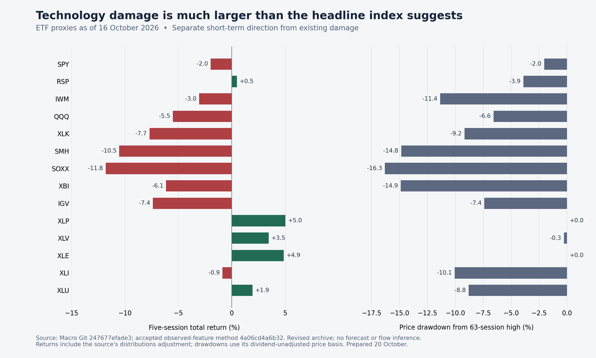

# Risk Radar — dated exposure decision update

**Prepared 20 October 2026; observations through 16 October unless a row says otherwise.** This is an additive review of retained data under the existing Grey Deer / MAS-258 programme. It preserves the accepted all-date census and does not advance model, allocation or execution authority.

## Decision

**Prioritize protection of concentrated semiconductor and technology exposure, with separate attention to small caps, biotechnology and other already damaged exposures. Staples and healthcare are the clearest observed defensive-equity candidates in this snapshot. Keep broad-market systemic escalation conditional.** This is a qualitative action review from confirmed price behavior, not an order or a validated forecast of further loss. Before any current action, the existing policy owner needs current quotes and its own portfolio constraints: this record contains no 19 October close or current executable price.

The S&P proxy remained only 2.03% below its rolling high and 5.27% above its 200-session average, while SMH/SOXX were 14.85%/16.31% below their rolling highs. QQQ lost 5.52% over five sessions, XLK 7.70%, SMH 10.53% and SOXX 11.80%. Small caps, biotechnology and industrials also carried material damage. A broad index alone would conceal that exposure-level condition.

**Instrument scope:** SPY and RSP are ETF proxies for capitalization-weighted and equal-weight S&P 500 exposure; DIA and IWM represent Dow and Russell 2000 exposure. QQQ tracks the **Nasdaq-100**, not the Nasdaq Composite. This snapshot therefore does not complete the requested literal-index reconstruction; the DIA observation is also two sessions behind. The sector, theme and USD country ETFs are exposure proxies, not independent constituent populations or local-currency country indices. [Primary identity and close check](PRIMARY_SOURCE_CHECK_2026-10-20.md).

The strongest alternative explanation remains contained rotation: RSP retained a positive five-session return, staples/healthcare/energy had positive five- and twenty-session returns, and SPY remained above its 200-session average. Those observations argue against declaring everything broken. They do not make the whole configuration healthy broadening: 7 of 11 sector proxies were at least 5% below their 63-session highs and 5 were below their 200-session averages. Those are counts of overlapping ETF proxies, **not constituent breadth, independent events or the canonical broad-market gate**.

Across the 32 proxies with a valid 16 October observation, 20 had at least 5% rolling damage and 8 at least 10%. The eight were IWM, XLI, SMH, SOXX, XBI, KRE, GLD and MCHI. That supports a wider damage watch. It does not establish a causal propagation chain or systemic funding stress. Credit ETF prices, rates exposures, USD country ETFs and domestic sectors have different economic drivers.

## Ranked action map

These ranks are judgment priorities within this dated diagnostic. They are not a fitted portfolio ranking. Numerical allocations, order size and execution remain with Portfolio/Prophet and their validated policy owners.

| Priority | Exposure and horizon | Action supported by the observations | Entry or continuation condition | Invalidation / what changes the view |
|---|---|---|---|---|
| 1 | SMH/SOXX; 1–5 and 5–21 sessions | Protect or reduce excessive semiconductor concentration under existing limits; avoid an automatic dip-buy solely because the index drawdown is small. | Fresh observations and portfolio risk checks; treat any rebound first as a stabilization candidate. | Persistent repair of absolute price and relative strength with current evidence can reduce defensive urgency. Continued lower lows or weakness spreading to wider exposures raises it. |
| 2 | XLK/QQQ/IGV; 1–5 and 5–21 sessions | Review overlapping technology/growth exposure together; protect existing concentration. | Use the current exposure map so ETF and company positions are not treated as independent bets. | Repair must hold beyond one positive session. Sector strength alongside persistent small-cap/credit weakness would still require differentiated policy. |
| 3 | Cash / short bills; near-term capital preservation | Retain as a defensive option under the existing cash and liquidity policy when confirmed risk exceeds tolerance. | Refresh instruments, quotes, settlement and policy eligibility. The BIL/SGOV archive is dated 14 October. | Re-entry needs its own evidence and execution rule; risk reduction does not determine when to redeploy. No guaranteed ETF return is inferred. |
| 4 | XLP/XLV; 1–5 and 5–21 sessions | Hold or consider defensive-equity additions within the existing mandate, subject to current prices. Their five- and twenty-session absolute returns are positive. | Preserve absolute trend as well as relative strength; evaluate entry and concentration with the policy owner. | If they merely fall less than SPY, the relative case may survive while the capital-preservation case fails. A broad liquidation can invalidate defensive-equity protection. |
| 5 | IWM/XBI/XLI/KRE; 1–5 and 5–21 sessions | Review or reduce vulnerable concentration; monitor these as additional damage channels. KRE's positive week does not erase its 10.42% drawdown. | Demand current confirmation by exposure; maintain separate damage and recovery fields. | Durable absolute repair weakens the propagation concern. More simultaneous deterioration across these groups strengthens it. |
| 6 | SPY/RSP; 1–5 and 5–21 sessions | Hold/watch according to existing policy; retain exposure-specific warnings independently. | Systemic escalation remains with the existing broad-market gate and its owner. This snapshot supplies only the SPY price leg; current constituent-breadth and credit/funding evidence are not evaluated here. | Failure of broad price structure plus qualified breadth and funding/credit deterioration would change the systemic view. A healthy RSP alone cannot erase damaged sectors. |
| 7 | XLE/XLB/EWC; 5–21 sessions | Watch relative opportunity separately from capital-preservation choices. Energy is strong in absolute terms; materials and Canada proxies have different residual damage. | Require current source and economic context appropriate to each exposure. | A reversal in absolute performance or the exposure's underlying driver can invalidate the opportunity; strength does not certify a safe haven. |
| 8 | TLT/IEF/LQD/XLU; 5–21 sessions | Watch or hold only within a suitable defensive mandate; a positive week is insufficient to call repair complete. | Separate rate sensitivity from credit risk and measure current absolute performance. | TLT/LQD still had negative twenty-session returns; utilities retained 8.81% drawdown. A renewed adverse rate/credit move invalidates protection. |
| 9 | GLD and USD country/EM proxies; 5–21 sessions | Avoid assuming the asset label guarantees defense. Review actual damage and currency/exposure overlap. | Use local-country and FX context before drawing a country-level conclusion. | GLD had 10.76% damage; MCHI 10.06%; EEM lost 6.24% over twenty sessions. Absolute repair and qualified local evidence are needed to change the view. |
| 10 | Recovery in damaged leadership; all relevant horizons | Watch for stabilization; no validated risk-on re-entry is established by this snapshot. | Separate durable absolute repair, improving participation/relative strength, reduced stress and the existing execution rule. | A failed rebound, lower low or renewed transmission reverses the tentative repair view. An expiring rolling high is not anchored recovery. |

## Competing pathways and falsifiers

**Contained rotation / broader participation:** supported by RSP's positive week and positive absolute performance in staples, healthcare and energy. It strengthens if these gains persist while weak groups stop deteriorating and broad credit/funding evidence remains orderly. It weakens if relative winners turn into absolute losers or damage becomes more synchronized.

**Concentrated deleveraging with defensive escape:** consistent with the large technology/semiconductor declines and stronger defensives. Actual fund-flow direction is unmeasured; price ratios are not flow evidence. Improvement in damaged leadership would weaken this interpretation, while ongoing weakness beyond technology raises concern about spreading damage.

**Systemic contagion:** not confirmed by this record. It would require qualified evidence across broad markets and credit/funding/liquidity, not a pooled count of overlapping proxies. No updated credit spread, funding rate, MOVE, earnings-surprise or options-positioning series was added by this calculation.

**Recovery / failed recovery:** the reused feature code emits an observed stabilization candidate when recent rolling damage, price above SMA20 and a positive five-session return coexist. That descriptive flag is not a validated entry policy. For example, it is true for utilities despite an 8.81% drawdown and price below SMA200. The system must retain both facts.

## Clock, source and method qualification

- Canonical retained source: Macro commit `247677efade31ea32d6b6ef5b701de61c47392cd`; comparison archive `3ab3382af89242c7b7fe8c65360bd883a7dd3504` from the accepted census.
- The new source extends 32 proxies to 16 October. DIA, ARKK, BIL and SGOV remain at 14 October, two SPY-reference sessions behind. Their rows are explicitly unavailable at the declared 16 October anchor; displayed metrics retain their own date.
- A complete exact-value comparison of common historical rows found **zero revised close/close_price values and zero removed prior dates** across these 36 inputs. This is consistency between two retained Git vintages; it does not establish original vendor publication time or authenticate every daily close against an independent primary market source.
- The Data and Lab adapter's separate local snapshot was older: inspected SPY/SMH files ended 9 October; its Massive SPY path was absent. That observation is local to the binding, not evidence of absence from the production data owner.
- The script reuses only `valid_price`, `strict_return` and `observed_features` from accepted census source `4a06cd4a6b323312d2a59d6130efdb60997fe149`, full-source SHA256 `d6240027cd15fadfec4511a3be42203dba6df87095bd65b50a049394abf6abce`. It does not import the module or T12, compute future labels, rerun the census or fit a model. Return windows require complete consecutive support on the SPY reference lattice.
- Returns use the archive's total-return close. Drawdowns and moving-average gaps use its split-adjusted, dividend-unadjusted price. A 63-session rolling high can expire without economic recovery from an older peak.
- Historical `available_at`, first-user publication and current executable prices remain unknown. This is a revised-history descriptive diagnostic, not a point-in-time forecast or a current trading instruction. The issuer's dated 16 October SPY closing price of $763.25 exactly matches the retained price. That single-close check does not authenticate all return-window endpoints or the other 35 proxies. Full primary daily-series verification remains open; the NAV and intraday low were explicitly excluded from the comparison.
- The Yahoo model-use disposition and FRED hold are unchanged. The R1 amendment remains a proposed evaluation contract with **zero real estimation units executed**. `independent_episode_count` and new policy authority remain null/false.

## Complete 36-proxy table

All figures are percentages. Each row has its own observation date. Five-/twenty-session returns and rolling damage answer different questions.

| Proxy | Observation date | 1-session return | 5-session return | 20-session return | 63-session price drawdown | Price / SMA200 gap |
|---|---|---:|---:|---:|---:|---:|
| SPY | 2026-10-16 | -1.11% | -1.97% | +0.20% | -2.03% | +5.27% |
| RSP | 2026-10-16 | -0.42% | +0.49% | +1.23% | -3.90% | +3.56% |
| DIA | 2026-10-14 (behind) | -0.11% | +0.90% | +0.31% | -5.01% | +2.31% |
| IWM | 2026-10-16 | -1.69% | -3.05% | -4.81% | -11.36% | -2.60% |
| QQQ | 2026-10-16 | -2.50% | -5.52% | -1.51% | -6.56% | +5.17% |
| XLK | 2026-10-16 | -3.02% | -7.70% | -3.12% | -9.17% | +9.53% |
| XLP | 2026-10-16 | +1.08% | +5.02% | +6.52% | +0.00% | +4.31% |
| XLV | 2026-10-16 | -0.27% | +3.45% | +5.34% | -0.27% | +12.19% |
| XLU | 2026-10-16 | +1.34% | +1.93% | +3.46% | -8.81% | -4.74% |
| XLF | 2026-10-16 | +0.45% | +1.44% | -0.26% | -5.19% | +3.42% |
| XLB | 2026-10-16 | +0.71% | +3.01% | +2.33% | -5.12% | +0.11% |
| XLC | 2026-10-16 | -1.89% | -0.05% | -0.11% | -4.13% | -2.80% |
| XLE | 2026-10-16 | +2.52% | +4.86% | +6.74% | +0.00% | +18.44% |
| XLI | 2026-10-16 | -0.08% | -0.88% | -0.91% | -10.05% | -3.01% |
| XLRE | 2026-10-16 | +0.40% | +1.32% | -0.04% | -8.37% | -2.51% |
| XLY | 2026-10-16 | -0.84% | -0.35% | +1.51% | -6.17% | -2.96% |
| SMH | 2026-10-16 | -3.41% | -10.53% | -5.80% | -14.85% | +5.56% |
| SOXX | 2026-10-16 | -4.14% | -11.80% | -7.44% | -16.31% | +5.51% |
| XBI | 2026-10-16 | -3.65% | -6.15% | -7.91% | -14.88% | +2.97% |
| IGV | 2026-10-16 | -4.80% | -7.39% | -0.01% | -7.39% | +11.32% |
| KRE | 2026-10-16 | +0.09% | +1.16% | -3.49% | -10.42% | -1.30% |
| ARKK | 2026-10-14 (behind) | -3.09% | -4.33% | +1.56% | -8.95% | +8.16% |
| HYG | 2026-10-16 | -0.35% | -0.48% | -1.69% | -3.83% | -3.58% |
| LQD | 2026-10-16 | -0.10% | +0.97% | -0.82% | -3.24% | -4.27% |
| TLT | 2026-10-16 | +0.10% | +2.65% | -1.08% | -4.97% | -5.77% |
| IEF | 2026-10-16 | +0.08% | +1.14% | -0.08% | -3.36% | -3.94% |
| BIL | 2026-10-14 (behind) | +0.00% | +0.07% | +0.30% | -0.17% | +0.00% |
| SGOV | 2026-10-14 (behind) | +0.02% | +0.07% | +0.29% | -0.17% | +0.01% |
| GLD | 2026-10-16 | -0.18% | -0.67% | -4.78% | -10.76% | -7.94% |
| FXI | 2026-10-16 | -1.23% | -1.17% | -1.40% | -7.34% | -6.03% |
| MCHI | 2026-10-16 | -0.95% | -2.57% | -3.52% | -10.06% | -9.19% |
| EWH | 2026-10-16 | +0.05% | +0.14% | -1.60% | -5.40% | -2.96% |
| EWC | 2026-10-16 | +0.41% | +2.63% | +0.60% | -3.29% | +4.47% |
| EWJ | 2026-10-16 | -0.58% | -3.05% | -2.19% | -4.47% | +4.01% |
| INDA | 2026-10-16 | -0.60% | +3.54% | -0.75% | -5.68% | -3.73% |
| EEM | 2026-10-16 | -1.74% | -5.91% | -6.24% | -9.04% | -1.18% |

## Reproducible evidence

[Complete snapshot and per-source identities](OBSERVED_SNAPSHOT_2026-10-16.json). Snapshot: 51,139 bytes, SHA256 `ab28897bcae098669fb6f2391ce40fadebc64eb417bc2942815a87ba9470ef1d`. Computation script SHA256 `db1e96af04c496f8b04d8bdfe7be0883477cde6b415e011bc09bab9da47de46e`. Actual execution 20 October 02:49:35–02:50:12 UTC, exit 0; 36 rows, no future labels, model fits, source acquisitions or policy changes. The source archive and execution receipt remain with the existing programme evidence carrier.
