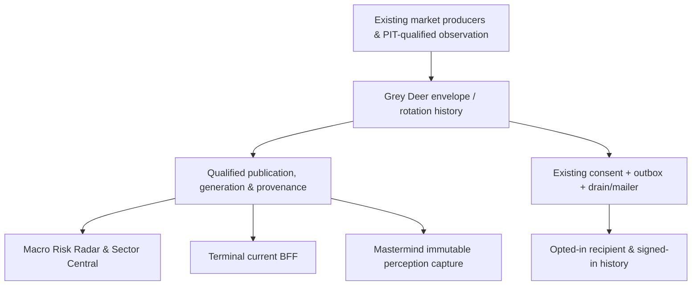

# Grey Deer × Leadership Rotation Early-Warning Intelligence — Open-Ended Fable Completion Masterplan

**Version:** research/CEO proposal, 2026-10-31 America/Chicago.  
**Adoption state:** `PLAN_NOT_ORG_LINKED` — this packet is not yet an accepted amendment to the open [source-bound Draft #10219](https://github.com/mastermindx-market-intelligence/macro/pull/10219).  
**Mission:** complete a trustworthy, useful factual sector-leadership risk journey now; evaluate prediction honestly over time; leave risk intervention to separately authorized owners.  
**Authority:** existing `WS:GREY-DEER-RISK-INTELLIGENCE` (Macro risk/hazard/policy separation) plus `WS:LEADERSHIP-ROTATION-INTELLIGENCE` (sector and theme measurements/observations). Existing alert/delivery, data publish, customer/book, Terminal and Mastermind owners remain distinct. No parallel workstream.

## 0. Executive decision and hypothesis

**Decision:** the highest marginal value is integrating signals the company already measures into a *causally honest* user warning journey. The record does not warrant inventing another crash predictor. Users complained that tech/AI/semis were breaking beneath superficially mixed market indicators, no meaningful warning arrived, and systems disagreed. The censused failures cluster at **publication/source clocks, separated signal semantics, missing canonical identity transport, default-off consent/delivery and unproven real consumers**. Science is a separate, currently unsuccessful or immature qualification problem.

The thesis is falsifiable. A factual deterioration monitor could prove worse than a plain relative-strength display by causing alarm fatigue or over-action. Fable should test comprehension and decisions, and may select the simpler presentation.

This masterplan supplies **questions, source owners, feasible options, evaluation oracles and negative proofs**. It deliberately does not assign staffing count, model choice, sprint durations, model weights, thresholds, schema migration, one UI composition or final implementation as commands to Fable.

### Separate products and claims

| Product | What can finish | What cannot be inferred |
|---|---|---|
| **A. Observational early context** | Same-clock sector/leadership change, both absolute legs, relative wealth, coverage, conflicting horizons, first-known/source clocks, limits and invalidator, in authentic UI; optional notification only after separate consent/release proof | Market crash odds, alpha, trade order, blanket de-risk policy |
| **B. Prospective forecast science** | A preregistered candidate obtains defensible skill and uncertainty **or** a recorded `NOT_SUPPORTED`, `INSUFFICIENT` or `NOT_EXECUTABLE` disposition | Retrospectively guessed early-crash accuracy, probability from a categorical watch |
| **C. Capital-policy intervention** | Only a separately commissioned current policy/book owner authorizes scoped protective rules with own independent acceptance | Automatic authority from A, B, a dashboard, email, chatbot or risk score |

## 1. Canonical source anchors and dated proof boundary

- Protected procedures: [Mastermind master `bb85b429f2ffffd38408080ce4df7d6378c34100`](https://github.com/mastermindx-market-intelligence/Mastermind/tree/bb85b429f2ffffd38408080ce4df7d6378c34100), `mastermind.sol_skillpack.v1` 1.0.1. Freshly reverified Oct31. Follow `docs/sol_skills/INDEX.md`, `ACTIVE_EXECUTION.md`, `SESSION_RELIABILITY.md`, `WEB_CEO_DELEGATION.md` and `docs/CEO_PROJECT_PLAN_CONTINUITY.md`.
- Macro main inspected `d533508a4e66e4abece8cac91466660b679bff9e` (nightly factor-series commit, Oct31); Terminal master `729a781acdb639f9e8ef9aaaba043c7624b6ceda` (Oct26).
- Current proposal [#10219 `ff4b0aab3f9c2e0130f4a98d20502dde257ee575`](https://github.com/mastermindx-market-intelligence/macro/pull/10219), Draft, exact-head CI and fences succeeded; scientific/architectural amendments still need **new nonauthor adjudication**. Formal GitHub PR review entries were absent on this head at Oct31 inspection; a prior Slack nonauthor architecture review returned REQUEST AMENDMENTS, not approval.
- [Grey Deer WS](https://github.com/mastermindx-market-intelligence/macro/blob/d533508a4e66e4abece8cac91466660b679bff9e/agentos/workstreams/WS-GREY-DEER-RISK-INTELLIGENCE.md), [Rotation WS](https://github.com/mastermindx-market-intelligence/macro/blob/d533508a4e66e4abece8cac91466660b679bff9e/agentos/workstreams/WS-LEADERSHIP-ROTATION-INTELLIGENCE.md); [frozen architecture](https://github.com/mastermindx-market-intelligence/macro/blob/d533508a4e66e4abece8cac91466660b679bff9e/research/grey_deer/GREY_DEER_RISK_INTELLIGENCE_ARCHITECTURE_FREEZE_2026-08-19.md); [Rotation Command](https://github.com/mastermindx-market-intelligence/macro/blob/d533508a4e66e4abece8cac91466660b679bff9e/research/ROTATION_COMMAND_MASTERPLAN_BY_FABLE.md); [Rotation Events v2](https://github.com/mastermindx-market-intelligence/macro/blob/d533508a4e66e4abece8cac91466660b679bff9e/research/ROTATION_EVENTS_V2_MASTERPLAN_BY_FABLE.md). These precede this proposal and remain controlling.
- Existing takeover [Oct30 handoff](https://github.com/mastermindx-market-intelligence/macro/blob/ff4b0aab3f9c2e0130f4a98d20502dde257ee575/agentos/handoffs/TECH_SELLOFF_PREDICTION_RECOVERY_2026-10-30.md); check its exact original source branch and live writer/effects before future edits. It is unusually named for a canonical dated Grey Deer WS handoff; recoverability/adoption is a task, not a reason to delete it.
- Related [Linear MAS-258](https://linear.app/mastermindx/issue/MAS-258/rru-upgrade-cross-region-risk-radar-recovery-and-unified-risk) remains **In Progress**, high priority, assignee ChatGPT1 on last read, last updated Oct22. Linear is projection, not source or runtime authority.
- A **37-PR scoped dependency census** and exact heads appear in `CENSUS_SNAPSHOT.json` and summarized in `CENSUS_AND_AUDIT.md`. This is not an exhaustive organization-wide PR audit. Scope includes both workstreams, source/collector/publisher, client, delivery, research, and adjacent owner collisions.

### Current tracked source truth, not served proof

| Artifact | Oct31 source snapshot | Conclusion |
|---|---|---|
| [Public `site/riskdata/risk_envelope.json`](https://github.com/mastermindx-market-intelligence/macro/blob/d533508a4e66e4abece8cac91466660b679bff9e/site/riskdata/risk_envelope.json), blob `ceb29e57f0b02f412e21d3021f23aa4176122127` | source session/as_of Oct30, produced Oct31 00:06:45Z; `PARTIAL`; measured `MIXED`, hazard `FRAGILE`; Oct30 leadership `BROKEN` and Radar caution; Oct20 stale rotation | There is newer real tracked public context, but mixed freshness and no accepted common-source proof |
| [Durable `data/risk_envelope/latest.json`](https://github.com/mastermindx-market-intelligence/macro/blob/d533508a4e66e4abece8cac91466660b679bff9e/data/risk_envelope/latest.json), blob `2e5a643cca555db7b76c976cde8cf067fa4493d7` | Oct20 `FRESH` and `FRAGILE`, older bundle | Same-name data copies are not one settled generation |
| [Natural daily #40803269874](https://github.com/mastermindx-market-intelligence/macro/actions/runs/40803269874) | Original tail job `123688869633` and engine job `123688873047` hit QLedger GH001 oversized tracked `claims.jsonl`; engine log had leadership writes | Publication failure proven for this run; not exclusive cause of every missing source or proof all detector logic failed |
| [#10221 parity Draft](https://github.com/mastermindx-market-intelligence/macro/pull/10221) | head `3599ba678f434a4e26b512cb8fc71bd78635bb2f`; [hosted CI failure](https://github.com/mastermindx-market-intelligence/macro/actions/runs/41145378963): new test unregistered, `ci-pack-1` and gate fail; prior Terra `FIX_REQUIRED` for post-push symbolic HEAD vs exact pushed commit | Useful diagnostic candidate, not settlement restoration or release-ready |
| [#10104 continuity Draft](https://github.com/mastermindx-market-intelligence/macro/pull/10104) | head `a324b7fc1f15e18393482ab18c4d97e12ebcbabe`, dirty/unmergeable at last GitHub read; only authority check not standard exact-head PR CI/fences | Existing source owner must reconcile, not make a parallel alert emitter |
| [#10079 QLedger Draft](https://github.com/mastermindx-market-intelligence/macro/pull/10079) | head `291d3ded65cbee29e116774dc3db2e4becf96ea9`; hosted fences and CI success; independent source-only PASS; **full authoritative generation/cut still absent** | Never treat accepted Git prefix as complete, cut/migrate/unblock GH001 by force, or retry service-refused native flag/swap |
| [#8132 severe-warning Draft](https://github.com/mastermindx-market-intelligence/macro/pull/8132) | head `639aaed06ce7754110d3bd6e94a0b704bb6c7760`; formal CHANGES_REQUESTED and hosted CI failure | Not eligible to represent confirmed repair or unqualified public probabilities |
| Mastermind [perception capture](https://github.com/mastermindx-market-intelligence/Mastermind/blob/bb85b429f2ffffd38408080ce4df7d6378c34100/brain/perception_publication.py#L29-L38) | Captures regime/cycles/RRG/group flow; not envelope or canonical observation history | A merged #1667 is not real cross-system Grey Deer consumption |
| Terminal [sector BFF](https://github.com/mastermindx-market-intelligence/mastermind-terminal/blob/729a781acdb639f9e8ef9aaaba043c7624b6ceda/terminal/app/api/sector-intelligence/route.ts#L17-L31) | Risk and rotation endpoints already fetched and independently hashed | Reuse route; independently hashed responses not a common-capture cohort |

Retained October 29 `DEGRADED/null` diagnosis in #10219 is historical. **Current Oct30 PARTIAL is not repaired.** A source label `revision=settled` is a field, not independently qualified settlement. A Git blob is not a live browser receipt; a PR merge is not a deployed release.

## 2. Expected users and exactly what success looks like

**Primary person:** concentrated tech/semiconductor or broader portfolio holder who wants to know if leadership is narrowing beneath the indexes, why and when, whether defensive stocks rose in absolute terms, and what evidence could falsify the concern.  
**Secondary:** Sector Central analyst comparing sectors/themes, Terminal investor monitoring exposure, and Mastermind reasoning/portfolio consumer which must see the same qualified evidence.  
**Operational user:** consent/notification owner who must be able to prove suppression, natural send, correction, revocation and delivered/uncertain distinctions.

A successful observation journey:

1. **Notice:** an existing Risk Radar, Sector Central or signed-in entry names *sector-specific weakening* without relabeling the market broad-risk gate.
2. **Orient:** user sees source session, published/served freshness, absolute and relative evidence, mixed market vs fragile internals, and missing rotation with no false calm.
3. **Challenge:** user expands comparison legs, horizon contradictions, participant coverage, truly independent evidence families, original-vintage status, first invalidator and correction history.
4. **Respond responsibly:** user can review concentration/watchlist under the existing book owner. No position sizing, naked options, auto-exit or generated portfolio control from this observer.
5. **Subscribe/return:** explicit opt-in for the relevant observation family, baseline non-notifying, current permissions/quiet hours; natural new event goes through canonical outbox/mailer with a signed-in destination preserving identity.
6. **Reconstruct:** user can see original observation versus corrected/withdrawn/reconstructed context and actual delivery receipt. Screens in Macro, Terminal and Mastermind agree on semantic ancestor and clock, or visibly withhold a conflicted join.

The hypothesis should be challenged against a simpler alternative: a compact relative-strength/context card with no word “warning.” Measure comprehension, review effort, alarm fatigue and unnecessary defensive escalation; clicks alone are weak success evidence.

## 3. Architecture boundaries and permissible options

All arrows are **required conceptual evidence paths**, not a claim today's runtime has every arrow or a mandate for new services. Each owner must show what it currently publishes/consumes. An alert row should reference an already-issued observation; no extra detector should re-score the feed at the consumer.

### Non-negotiable semantics

- Preserve six separations in `risk_envelope`: **measured state**, **transition hazard**, **repair**, **data quality**, **coherence/contradictions**, **policy**. Never fuse into one ordinal “risk shield” or let Terminal/LLM recalculate.
- Preserve incumbent broad-market Radar gate (SPY below 200-day moving average **and** weak breadth for loud broad alert). A sector watch is independent display-only context until its own scientifically qualified/authorized outcome.
- `rotation_early_context/v1` is an observation, not a confirmed rotation event, a crash probability, a capital instruction or measured fund flows. Show both legs' absolute returns and exact relative-wealth ratio: `(1+R_receiving)/(1+R_donor)-1`, same clock. “Both down, defensive down less” is not “defensive gains.”
- Source clock fields distinguish session/end timestamp, observed, source-available, ingested, composed, published, served, issued, sent and opened; absence is `UNKNOWN` not the input timestamp or zero latency. Corrections retain original issuance/source ancestry. Source rights, universe membership and market session calendar cannot be assumed from current prices/constituents.
- Multiple Yahoo-adjusted equity-return clues are correlated evidence, not independent confirmations. Risk-on trend can coexist with fragility and no policy. `NORMAL / 0 active` says no current policy, never safe.
- No cross-market coercion: preserve exact market scope; Terminal [#1019](https://github.com/mastermindx-market-intelligence/mastermind-terminal/pull/1019) is a separate foreign-envelope qualifier lane—do not discard it.
- No unqualified “confirmed repair” from legacy boolean proxies, falling warning number or news/announcement. False-calm refresh cannot erase a qualified previously issued severe receipt; expiry/correction distinct.

### Fable's source/publication design choice

| Candidate | Benefits | Risk/required falsifier |
|---|---|---|
| **Settled-owner admission; renderers consume accepted settled or explicitly provisional live context** | Clean contract and immutability; prevents express renders from claiming settled | Can be less fresh while nightly broken. Need natural capture admission, source rights and monotonic publish under restart/rebase |
| **Narrow pair-staging exception in the existing express/closing-bell owner** | Lower mechanical change while preserving both file copies | Needs one qualified invocation, exact staged/index/pushed SHA, Git rebase/cancellation negative tests, no broad `git add data/`; even equal bytes must fail for provisional-only capture |
| **Diagnostic-only / keep PARTIAL** | Honest near-term safe state and source telemetry | Cannot count as restored publication, settlement or recipient-product completion |

Current code mechanism: [`scripts/build_world_state.py`](https://github.com/mastermindx-market-intelligence/macro/blob/d533508a4e66e4abece8cac91466660b679bff9e/scripts/build_world_state.py) builds two copies; [express workflow](https://github.com/mastermindx-market-intelligence/macro/blob/d533508a4e66e4abece8cac91466660b679bff9e/.github/workflows/engine-render.yml) stages only site/ and discards data/ mutations; [closing-bell](https://github.com/mastermindx-market-intelligence/macro/blob/d533508a4e66e4abece8cac91466660b679bff9e/.github/workflows/closing-bell.yml#L524-L578) can publish the public path without the durable mirror; [settled builder](https://github.com/mastermindx-market-intelligence/macro/blob/d533508a4e66e4abece8cac91466660b679bff9e/scripts/build_risk_envelope.py#L728-L820) unconditionally marks `settled`, even under split writes; [live precedence](https://github.com/mastermindx-market-intelligence/macro/blob/d533508a4e66e4abece8cac91466660b679bff9e/scripts/build_live_risk_envelope.py#L632-L706) can suppress same-session provisional overlay. These are **source-derived mechanisms and falsifiers, not exclusive proven historical causes**.

Fable should decide the *minimal owner-admitted* fix, with tested negative controls. No copying old public bytes to durable to “repair” first-known clock. No retroactively republishing old source as if now issued.

### QLedger: a different custody problem on the same critical path

The Oct29 original engine and tail GH001 are real upstream publish blockers. #9556's [collection-only carve](https://github.com/mastermindx-market-intelligence/macro/pull/9556) does not protect every engine/tail stage. The running QLedger [#10079](https://github.com/mastermindx-market-intelligence/macro/pull/10079) now properly refuses a false complete-generation claim, but still cannot produce a genuine complete authoritative source cut. Original legacy claims **append and atomic replacement** both occur; preopened descriptors and failed-push tails are unresolved. Respect the recorded `MISSING_AUTHORITY_GENERATION_BOUNDARY`, full-history retention, nonblocking source-only PASS and service-rejected native flag/swap experiment (no cross-carrier retries). Solve publication **with** the original QLedger owner and exact admission—not by truncating ledger, issuing LFS as a unilateral fix, disabling validators, changing native limits, resetting history, or indiscriminately staging.

A narrow present-day publish fence may have a different permissible proof than a future immutable full-original cut; Fable should surface that separation and have the owners adjudicate it. Never claim that conditional ideas are already authorized for production.

### Canonical observation and consumers

At #10104 [builder lines 210–212](https://github.com/mastermindx-market-intelligence/macro/blob/a324b7fc1f15e18393482ab18c4d97e12ebcbabe/scripts/build_rotation_events.py#L210-L212), public `rotation_events.json` is written **before** `rotobs_` receipt recording; the recorder returns counts/status. The current public JSON cannot be assumed to carry canonical new observation IDs. Fable may add a source-owned additive identity projection, reference the existing immutable companion, or choose another qualified transport *within the existing source owner*. It must withstand publish failure, replay, correction and conditional permissions.

Mastermind [capture source list](https://github.com/mastermindx-market-intelligence/Mastermind/blob/bb85b429f2ffffd38408080ce4df7d6378c34100/brain/perception_publication.py#L29-L38) currently omits Risk Envelope and observation history. Extend the existing [market perception publication/custody contract](https://github.com/mastermindx-market-intelligence/Mastermind/blob/bb85b429f2ffffd38408080ce4df7d6378c34100/docs/market_perception_publication.md) through its current owner, not by having an LLM scrape stale public text and pronounce it captured. Existing Terminal [BFF](https://github.com/mastermindx-market-intelligence/mastermind-terminal/blob/729a781acdb639f9e8ef9aaaba043c7624b6ceda/terminal/app/api/sector-intelligence/route.ts#L17-L31) already reads risk and rotation; qualify the join without a new BFF or duplicated score. Same response hashes **must not** be mistaken for common capture ancestry.

**Cross-system negative:** deliberately splice an Oct30 envelope with an Oct20 rotation and demand visible scoped degradation; the same-bundle identity/consumer join must refuse claims that require common evidence. Correct independent current facts may still be displayed with distinct clocks.

### Consent/outbox design gate

The **reported Oct30 live DB schema** in [EW-P2 evidence](https://github.com/mastermindx-market-intelligence/macro/blob/ff4b0aab3f9c2e0130f4a98d20502dde257ee575/research/grey_deer/evidence/EW_P2_LIVE_SUPABASE_SCHEMA_2026-10-30.md) shows `email_prefs` as language+marketing, no trusted rotation family enable/revision or RLS policy; `alert_outbox` unique only on single `fire_event_id` (0 rows observed); `alert_runs` two other lanes firing, **no** `macro_delivery_drain` cadence. Confirm again before any DDL or release. Auth `user_metadata` is user-writable and existing GET→PUT race can restore stale opt-in after revocation; not an authorization fence.

Constrain the **behavioral contract**, not a specific database migration: one reviewed server-owned consent authority within existing owner; explicit default-off family activation; global/category/family revocations linearized with final send admission; persistent activation epoch, current entitlement, legal source, quiet hours and suppression; no pre-opt-in replay or late correction backfill; no stale unrelated metadata write re-enabling. Per-user logical event identity must fit the *existing* globally unique single `fire_event_id`. Real send transitions must preserve `EFFECT_UNKNOWN` after a transport acknowledgement loss. In RFC 5321 an SMTP DATA-termination timeout may occur after server acceptance; **physical exactly-once email delivery cannot be guaranteed by one DB unique index**. Keep the original drain/mailer with no second daemon. No production sends while security/release is held.

Fable may choose SQL transaction/CAS/service-layer serialization or other reviewed mechanism; require an actual concurrency proof. A final GET without serialization does not meet the revocation guarantee.

## 4. Owner-bound task tree — editorial expansion of existing EW IDs

These are **suggested acceptance details**, not an imposed worker assignment. Keep existing IDs in #10219 and reconcile current statuses from source/CI/operational receipts before changing labels. A task is complete only on its own evidence.

| Existing ID | Decision-ready objective | Immediate evidence and optional tactic | Acceptance/disproof |
|---|---|---|---|
| **EW-P0.T1** | Single-source ownership, rights and current collision reconciliation | Re-pin Macro/Terminal/Mastermind and #10219, #10221, #10104, #10079, #9957, #10212/13, #8132, #1667 and Terminal; read actual writers/effects | One lawful owner per source/effect, exact next action; no new WS or default Fable as generic worker |
| **EW-P1.T1** | Root-cause classify original inputs, job and publisher | Oct21–31 natural job logs, GH001, R2/rotation clocks, express split, permissions and source rights; isolate first failed/held invariant | Evidence differentiates source computing, accepted capture, Git settlement, site publication, serving and downstream delay; no manual builder replay |
| **EW-P1.T2** | Restore qualified publication through incumbent owners | Choose one settlement path and safe QLedger staging/cut; emit `UNAVAILABLE` while incomplete | Two *natural* consecutive eligible sessions, paired commit/source identity and rights; no false-green provisional; meaningful degraded sentinel survives |
| **EW-P2.T1** | Preserve canonical `rotobs_` receipts on existing #10104 | Resolve merge conflict under original branch, append-before-checkpoint/replay/id stability; no source split | Deterministic receipt, immutable correction lineage, CI/independent review; public/source identity transport qualified |
| **EW-P2.T2** | Atomic consent/outbox bridge through existing owners | Verify real schema, choose single owner, default-off activation and idempotent per-user row; preserve accepted hard ceilings | Concurrent tabs/opt-out race, family revocation, first-baseline no-send, rights/entitlement/quiet hours, uncertain SMTP and row-level isolation pass |
| **EW-P2.T3** | Natural signed-in user delivery | Staging then authorized opted-in release using same outbox/drain/mailer | Original observation → one logical outbox key → provider admission receipt → observed recipient → authenticated deep link, plus no-send/correction negative controls; don't call uncertain provider send delivered |
| **EW-P3.T1** | Freeze claim-specific prereg, not an algorithm | Choose one primary market/sector target and hierarchy; H5/10/21 only if justified, outcome-matched baselines, provenance and selection budget | Registered target, event onset, price basis, member/vintage rights, issue/delivery clocks, embargo, clustering/power and practical utility *before* unseen outcomes |
| **EW-P3.T2** | PIT replay plus real prospective scorecard under original science owner | Separate original as-known issued rows from historical reconstructions; include unserved/missing | Categorical watch coverage/false-alarm/lead; forecast proper score only for issued probability and same-target/same-row baseline; uncertainty/multiplicity; independent episode N |
| **EW-P3.T3** | Honest independent disposition | Science reviewer considers target/controls/power; retain mature Radar law | `VALIDATED`, `NOT_SUPPORTED`, `INSUFFICIENT` or `NOT_EXECUTABLE`; forecast/policy promotions are distinct decisions |
| **EW-P4.T1** | Risk Radar and Sector Central comprehensible observational UI | Reuse #10103 renderer, envelope inset, existing tokens; compare alternative simpler RS presentation | Real signed-in EN/ZH, dark/light, desktop/mobile + keyboard/a11y; partial, disagreement, invalidation, relative shelter and source clocks legible |
| **EW-P4.T2** | Terminal + Mastermind same-semantic consumer | Reuse Terminal BFF and Mastermind publisher, implement minimal source-owned ID/capture adapter | Same qualified bundle/IDs or explicit refusal, first model-prompt receipt, no cross-generation stale prompt, no duplicate scoring |
| **EW-P4.T3** | Optional user-specific exposure context | Existing watchlist/portfolio/book owner and entitlements; no new policy | Source-scoped concentration/exposure review, safe copies, no unapproved sizing/hedge order or leakage |
| **EW-P5.T1** | Independent adversarial and user-path acceptance | Review each source/capture/consent/UI/science proof at its exact head and actual release | 2026 Sep/Oct as-known counterfactual where legal, natural true/false/negative cases, new user contact and rollback proof, named operations owner |
| **EW-P5.T2** | Protected staged release/closeout | CI, security/privacy, product review, merger, deploy, current source and customer receipts on original carrier | Reversible default-off rollout, controlled opt-in, audited delivery and customer comprehension; proper source/AgentOS/readback and distinct capability statuses |

**Critical path:** P0 → **P1 source admission / QLedger**; simultaneously P2 continuity+consent under separate owner paths; P4 design can begin from stable source tokens; P3 scientific protocol in parallel. Do not wait for years of forecast maturation to show a well-qualified factual observation. Do not enable email until revocation, host drain and natural account path are individually proven.

## 5. Fabric orchestration charter: powerful but non-prescriptive

Fable as principal Claude-led orchestrator may draw on the **existing** full Subagent Fabric *subject to actual observed Capacity/RuntimeBinding availability and lawful grants*. This packet does **not** assert that a fabric worker has STARTed, that the M2 launcher is healthy, or that a named model pool is currently selectable. Prior Executive read-only projection showed 25 Jobs (21 complete, 1 failed, 3 queued, 0 running), 1 worker available; Studio fleet reported 8 tunnels READY **but** launcher drift and degraded physical-fleet proof; session_targets empty. Treat these as a point-in-time read, not a grant, no-live-worker proof or subscription to autonomous execution. Refresh just enough to admit each wave.

Fable decides domain coordinator split and cheapest capable workers. Suggested parallel packages, **not mandatory staffing**:

- **Source-clock forensic worker:** original job IDs, producer/source timestamps, staged index, pin exact failure; read-only.
- **Publisher/QLedger principal and bounded implementer:** one original source carrier, engineer fault-aware narrow repair with source retention, independent code reviewer.
- **Rotation identity builder:** exact #10104 branch after custody/merge repair, append/correction and reference join.
- **Consent/privacy lead:** current DB grants, atomic revocation and legitimate recipient negative tests, security review before DDL/send.
- **Consumer integration pair:** Terminal and Mastermind original owners, common source and prompt receipt.
- **Design lead:** existing Risk Radar/Sector Central/Terminal source/tokens; Paper only if its actual file/editor authority and nonrefused lane are verified; no invented canvas.
- **Science adversary:** prereg and forecast-target challenge independent of implementation, preserved negative results.
- **End-to-end independent reviewer:** different non-author model/person from implementing writer; current head plus actual customer proof, not paper review only.

Each bounded Fabric packet should include original operation and parent, exact PR/branch/source pin, approved paths, excluded paths/effects, known refused/effect-unknown operations, acceptance oracle, negative tests, real effect scope, durable return URL and a distinct `PICKUP_ACK` → `START` → `RESULT` → `SOL ruling/STOP` edge. Bounded workers can parallelize disjoint evidence and code; one qualified owner owns every effectful path. Prefer economical non-Pro for deterministic cases; reserve Fable or another principal for cross-domain choices, contradictions and scientific uncertainty. **No child opinions become source law by agreement.**

**No universal fixed worker graph:** adapt to live capacity, source collisions, findings and rejected hypotheses. Fable can stop a package early, choose alternative routes, or refine a hypothesis. Do not replay a rejected security/host command via another model, account or tool, and do not claim a failed/timed-out effect did not occur.

## 6. Research, engineering and design principles that survive architecture changes

The following are **invariants / acceptance**, not prescribed solutions:

1. **Traceability:** one normal and one failing observation journey from market source→receipt→immutable publication→all consumers→consent→outbox→mailer; every timestamp and hash comes from a named producer.
2. **Truth under failure:** missing critical source, corrupted JSON, bad market, unlicensed feed, malformed or future date, mixed generation, partial write, out-of-order revision, canceled push, red CI, unavailable user permission, and uncertain SMTP never become reassuring zero or OK.
3. **No rank authority inflation:** watcher/monitor, observed events, published forecasts and portfolio policy are typed separate objects with separately named approval owner.
4. **Source rights and history:** no current Yahoo-adjusted returns are silently substituted for old issued vintages; no unregistered GMI population, fake IP rights, reconstructed availability or corrected source backdated as first known.
5. **User comprehension:** first glance tells what changed and its scope; one tap/keyboard path shows evidence and invalidator; no color-only risk semantic, no concealed high-severity warning, no unsupported “real time.”
6. **Independent disproof:** review source, CI, release and real consumer independently; the hard negatives in `ACCEPTANCE_AND_RELEASE.md` are meaningful, not ceremonial.

## 7. Risks, uncertainty and rollback direction

| Hazard | Current basis | Control / falsifier |
|---|---|---|
| False “settled/current” on copied bytes | Split express/closing-bell publication; unconditional settled marker | Source-owned capture admission, exact pushed SHA, same-generation identity + provisional negative |
| Publication blocked by durable ledger | Natural GH001 failed engine/tail; QLedger full-cut missing | Narrow owner-reviewed non-lossy fence and natural session; no truncation/reset/flags bypass |
| Cross-system silent divergence | Mastermind source set lacks envelope/ID; Terminal independent fetch hashes | Qualified common ancestry and explicit stale/mismatch withholding |
| Opt-out sends after revocation | Existing metadata GET/PUT race; current prefs missing trusted fields | Linearizable global/category/family permission and final transport admission, adversarial race |
| Alert duplicate or lost | Existing unique row ≠ SMTP atomicity | Deterministic per-user key and uncertain-effect quarantine; no blind resend |
| Wrong financial conclusion | 2S vs 20S, defensive relative shelter, double-counted correlated inputs | Both absolute legs, comparison clock and contradiction, separate targets |
| Overfitted prediction | Frozen OOS failure, small immature forward epoch | Prereg/hypothesis ledger, independent held-out/forward scoring, negative accepted |
| Confused/unsafe user | Word “early warning” may imply crash forecasts/trade order | Comprehension testing against simpler context and authority disclaimer |
| Concurrent writer collision | Multiple old draft carrier heads and dirty #10104 | Fresh exact owner/effect check; one path writer and nonauthor review |
| Capacity assumption | Degraded Studio launcher signal and stale Executive projection | Reconcile actual admission/START; don't reserve imaginary workers |
| Bad rollback | Restoring old source or user prefs resurrects false data/consent | Stop new admission; retain original receipts, consent revisions and attempted send uncertainty; forward repair |

Rollback is **admission/serving/feature-gate control**, not deletion of original observations, SMTP history or QLedger, nor reversion that re-enables consent. Freeze new alerts if source/legal proof degrades, keep previously issued history with explicit last-qualified context, and keep mailbox uncertainty visible. Actual rollout/rollback commands are for original production owners after protected release approval.

## 8. Completion ruler and CEO handoff closeout

Record distinct verdicts, source links, exact released SHAs and actual proof for:

- **SOURCE_QUALIFIED:** two naturally occurring, correctly settled source sessions; public and durable consistency under chosen valid contract; stale/partial sentinel, no Git rejection.
- **OBSERVATION_RECORDED:** canonical `rotobs_` identity, correction lineage, original clock, rights/membership proof, replay/idempotency negative.
- **PRODUCT_COMPREHENSIBLE:** actual signed-in Macro Risk Radar/Sector Central, Terminal and Mastermind consumers; source/authority discrepancies, translations and dark/light/mobile/a11y scenarios genuinely tested, not merely designed.
- **DELIVERY_PROVEN:** default-off until explicit user activation, current entitlement, revocation concurrency, one new natural eligible event and a real opted-in send plus recipient/deep-link receipt; corrections/withdrawal and no-send path.
- **FORECAST_SCIENCE:** versioned register, exact target, forward cohort and disposition; truthful negative/insufficient result is valid research closeout, *not* validated positive prediction.
- **POLICY_ACTION:** `NOT_AUTHORIZED_BY_THIS_PLAN` unless independent scope and owner approval later; no trades, positions or leverage.
- **OPERATIONS/RELEASE:** exact-head CI, nonauthor review, authorized deployment and rollback, owner/oncall, updated existing WS/handoff/Linear projection (only after source proof), terminal child STOP/watcher reconciliation.

A **complete research/design packet** is not a completed parent product. This task's proposal status is `RESEARCH_COMPLETE / PLAN_NOT_ORG_LINKED`, with no code, UI, live schema, mail, trading or production effect applied here. On canonical adoption, the Fable owner should amend the existing #10219 task tree and the two workstream/handoff records; **do not** create a new competing plan/PR/WS. Existing draft research and historical negative evidence must remain linkable.

### Exact next action

Reconcile **EW-P1.T1** on the existing natural daily/publisher/QLedger owners—first failed/held invariant, current writer, settlement semantics, legal source clocks—and record a narrow qualified source repair decision and its nonauthor test/release gate on #10219. In independently noncolliding lanes, progress #10104 merge/consent source design, current UI composition and the corrected prereg, without activating effects.
