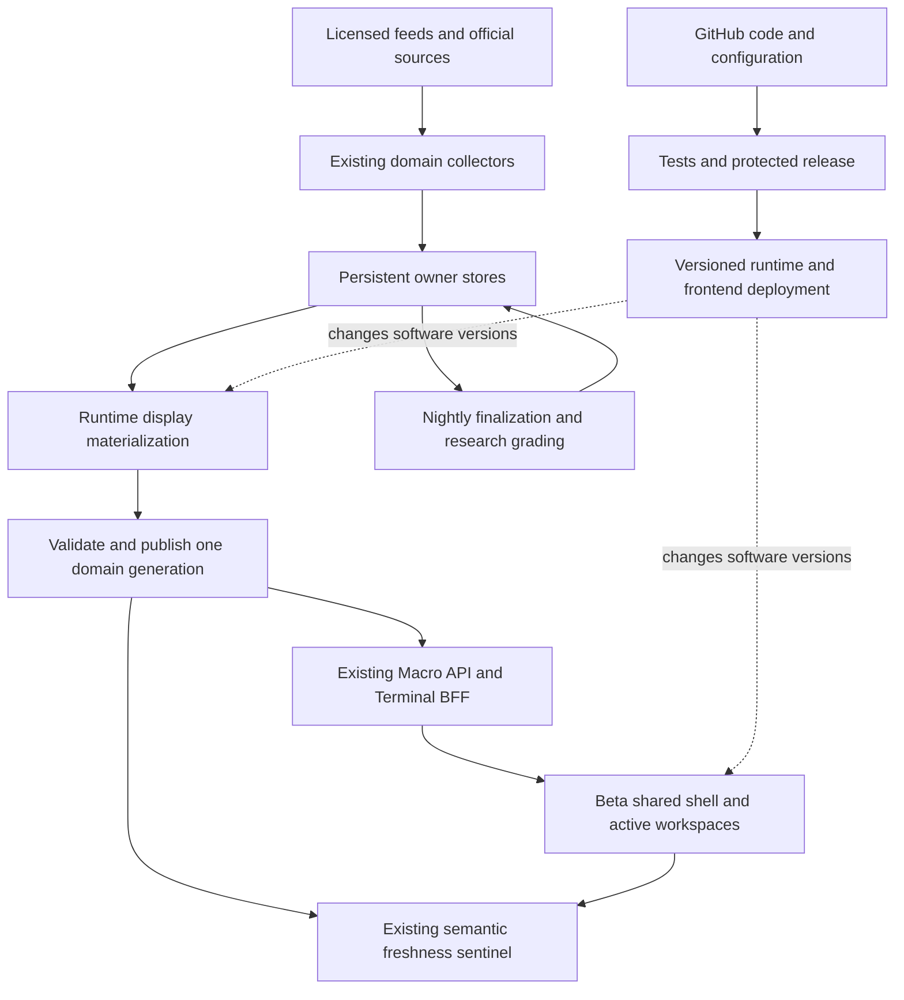

# Always-on Macro and Shared Shell migration

Date: 2026-11-05.
Status: IMPLEMENTATION IN PROGRESS; Terminal #1285 and #1311 beta releases runtime-accepted at bb65839; Macro #10780 remains unarmed; producer transfer, generation-backed native integration and authenticated acceptance remain open.
Tracking issue: https://github.com/mastermindx-market-intelligence/macro/issues/10779
Operation: `macro-always-on-shared-shell-20261105-c3`.
Source carrier: `sol/web-macro-always-on-shared-shell-20261105-c3`.
Product continuity: existing `WS:MARKET-OS`; existing Data OS, live orchestration, domain computation, identity, publication and release owners retain authority.
Protected procedure pin: Mastermind `770837b4317287fb36a3e7e3948ea701de67bbab`, skillpack 1.0.1, bootstrap-major 1 compatible.
Architecture source pins: Macro `e39ec45902c1a2bb28507beb851593be6e422167`; Terminal `f9d3280a2a3ff28dd925b128231702b836c8a247`.
Production observations: [bounded evidence](ALWAYS_ON_MACRO_EVIDENCE_2026-11-05.json).
Input ownership and qualified source audit: [parent adjudication](ALWAYS_ON_MACRO_INPUT_RUNTIME_AUDIT_2026-11-05.md).
Initial durable plan commit: `c7f9671d72329e3c33cccced276e969b2515d1e5`.

## Current implementation frontier — 2026-11-06 live setup and native integration

The existing source owner now covers ordinary updater recovery and purpose-bound live setup. The [setup transaction contract](LIVE_SETUP_SOURCE_TRANSACTION_2026-11-06.md) and [source review](LIVE_SETUP_SOURCE_REVIEW_2026-11-06.json) record 60 passing Linux cases, 43 passing corrected Git deployment cases/28 platform skips, and three PCE passes using the exact committed registry omitted by sparse checkout. The initial affected run's 633 passes and ten diagnosed failures remain recorded. Setup preserves original source/environment/timer intent, binds smoke to the actual producer invocation and published bytes, and retains a complete terminal receipt. No production setup/source/unit/timer mutation has occurred.

Terminal's original allocation uncertainty is reconciled. The documented managed workspace CLI admitted the same operation on exact accepted base bb65839; the incumbent typed publication owner verified it. The original native candidate is applied there and being corrected to consume actual Macro-produced wrapped fixtures. Core, history, Brief and board must adopt together under the same account/session/access lifetime.

The auxiliary capture source overlap hold is lifted only in the existing parent Macro carrier; the original Fabric reservation and no-retry/result fences remain unchanged. Holdings remains held because its original receipt does not prove absence.

Macro PR10780 remains unarmed. CI command denial, complete captured input adapter, runtime producer transfer/API mounting, generation-backed Terminal release, authenticated beta proof and remaining estate waves are still open. The controlled first-adoption sequence must prevent the old updater from resetting before the new installed owner is adopted. Beta1311's already accepted refresh release is not repeated.

## 1. Chairman outcome and governing predecessors

Make the entire Macro product continuously current at each source's legitimate cadence, independently of HTML builds, GitHub availability and code-release success, while adopting the existing application shell at **beta.mastermind-x.com**. The original user journey, information hierarchy, evidence, research, company drill-down, watch/portfolio separation and account rules survive the migration. Sector Intelligence displaying November 3 data on November 5 is the first end-to-end consumer. The Chairman explicitly authorizes architecture, a durable master plan and implementation, followed by the instruction to initiate implementation and complete the full migration.

This extends existing work; it does not create another scheduler, data platform, identity service, registry, queue or shell:

- [July live plan](../LIVE_INTRADAY_DASHBOARD_MASTERPLAN_2026-07-29.md): short-lived facts belong to runtime contracts; preserve one canonical writer.
- [August resilience plan, Part B](../NIGHTLY_RESILIENCE_AND_LIVE_TRANSITION_MASTERPLAN_2026-08-06.md): independent collection, incremental display computation, nightly reconciliation and removal of render coupling.
- [VPS live orchestration](../../docs/VPS_LIVE_ORCHESTRATION.md): current systemd lanes, persistent live publication and external sentinel.
- [Shared-shell migration](../MASTER_PRODUCT_SHELL_MAKEOVER_MIGRATION_2026-10-08.md): incumbent shell and page registry.
- `research/BREATHING_PLATFORM_MASTERPLAN_BY_FABLE.md` is proposal/evidence, not blanket activation authority.

The July objection to a wholesale SPA rewrite does not prohibit the Chairman's expressly assigned adoption of the existing shared shell. It remains a boundary against rewriting working domain engines just to change presentation. Nightly canonical vintages, final closes, grades and forward ledgers retain their single writer; the intraday chronicle prohibition remains.

## 2. What actually failed

The attached evidence records normal-TLS public HTTP reads at 22:06 UTC and read-only origin validation at 22:20 UTC on November 5.

| Observation | Established implication |
|---|---|
| Sector HTML returned 200; Last-Modified November 5 04:57 UTC; displayed generation November 5 03:50 UTC; `data-si-as-of=2026-11-03` | A new page build can carry frozen source data. Build freshness is insufficient. |
| Origin's existing Sector validator rejected the served bundle: November 3 source, two completed NYSE sessions behind; action-board source date/hash absent; HTML/premium action hashes differed from served action bytes | This is both old data and a publication-consistency defect, not merely a browser refresh problem. |
| Sector run [42099034826](https://github.com/mastermindx-market-intelligence/macro/actions/runs/42099034826) failed at checkout after low-speed Git transport timeouts and a bad pack header | The inspected refresh never reached computation, validation or publication. A data refresh still depends on fetching Git. |
| `/api/status` showed advancing quote, breadth and basket clocks; fast/snapshot oneshots last returned success | The live plane exists and portions are operating. An inactive completed oneshot is normal; aggregate API “ok” is not semantic health for every product. |
| `/live/staleness.json` had no Sector surface | The independent observer was blind to this particular product. |
| Beta returned 200 over verified HTTPS and redirected to /today | Public beta reachability is working. This is not authenticated browser acceptance. |

Source trace at the Macro pin:

1. `engine/sector_central.py::compute` consumes cycle, price, rotation, regime, heat and membership owners.
2. `scripts/build_baskets.py` produces basket/theme context and several additional artifacts; it also contains nightly-gated ledger and score-history behavior.
3. `scripts/build_sector_action_board.py` binds the action board to exact basket bytes.
4. `scripts/build_sector_central.py` combines inputs, appends/grades research, writes public and premium data, and renders HTML.
5. `scripts/build_sector_intelligence.py` sequences these producers and the semantic gate.
6. `.github/workflows/sector-intelligence.yml` checks out main, installs dependencies, builds, validates and commits generated outputs back to main. Separate daily/render entry points also exist.
7. `scripts/build_site.py` additionally writes `basketdata/action_board.json` as a bare `{"action_board": ...}` object. That source shape matches the missing production metadata, but the particular process that last overwrote the live file has not been attributed.
8. Existing deploy synchronization serves the files; the legacy page consumes baked HTML and JavaScript. Terminal's existing `/api/sector-intelligence` BFF proxies approved owner paths with private/no-store responses.

**Architecture conclusion:** separate code release, collection, materialization, publication and browser revalidation. Moving old HTML into a shared shell alone leaves the failing producer path intact.

## 3. Target architecture

Data collection and publication continue using the last accepted software release when GitHub, CI or a frontend deployment is unavailable. Code still builds and deploys; ordinary data refresh does not build the website or commit artifacts to Git.

### Existing owners and boundaries

| Concern | Owner to extend | Required change |
|---|---|---|
| Scheduling and process supervision | Current VPS systemd units and `scripts/vps_live_orchestrator.py` | Add bounded domain work to an appropriate existing lane; retain locks, timeouts, resource caps and return evidence. No second generic scheduler. |
| Dependency descriptions | Existing `config/dag.yml` and domain source contracts | Trace real inputs/outputs and remove migrated render edges. The current DAG is workflow-step metadata, not itself a runtime scheduler. |
| Market data/history | Existing Data OS/domain stores, persistent live directories and R2/object owners | Keep source watermarks, revisions and lineage; remove Git as a steady-state transport for migrated materializations. |
| Publication | Existing live publisher, `/var/lib/macro-live/public`, private state and incumbent object store | Extend atomic publication from individual files to coherent domain generations where multiple files must agree. |
| Read/API layer | Macro API and Terminal BFF | Serve accepted owner generations, entitlement-filtered, with explicit freshness and bounded requests. |
| Browser | Existing Terminal/shared-shell components, legacy bridge during migration | Revalidate live data independently of application navigation and deployment. Keep one shared shell and current route registry. |
| Accounts and saved state | Existing Supabase identity, Watchlist and Portfolio owners | Preserve ownership semantics and isolation; no alternate account or persistence model. |
| Monitoring | Existing freshness sentinel and current transport | Observe source age, publication consistency and actual consumer visibility independently of GitHub. |
| Durable program record | This source-linked plan, issue #10779 and existing Agent OS | Record decisions and proof; no parallel work/state controller. |

No Kafka, second Redis queue, new database or new orchestration vendor is required for the first transition. Reconsider capacity or event transport only after measured throughput, latency, fan-out or recovery limits demonstrate the need. The historical VPS sizing in the July document is not a current capacity measurement.

## 4. Runtime data contract

Extend the existing domain envelopes rather than impose a second universal schema. Every admitted live field must have these **semantics**, mapped to its owner's existing names:

- **Source observation/effective session:** when the fact applies. A provider's timestamp, exchange calendar and delay basis must be explicit.
- **Collection time:** when the source was successfully retrieved; this does not refresh the fact's observation time.
- **Computation and publication times:** when this materialization was derived and made readable.
- **Generation/revision:** immutable content identity and a publisher-owned ordering/version. Corrections on the same source date must invalidate readers; date-only cache keys are insufficient.
- **Coverage and qualification:** expected versus observed population, missing inputs and freshness/quality reason. Unknown values stay unknown.
- **Provenance:** source dataset/revision, calculation version, membership, adjustment/FX basis and applicable session. Research, forecasts and trade authority remain distinct.
- **State:** current, delayed/stale, partial/degraded, unavailable/unknown, and market closed where appropriate. A recent API response cannot make old inputs current.

Use a **domain generation**, not a whole-company global generation. Sector may contain one coherent daily research bundle plus a separately dated intraday quote/breadth overlay. A delayed daily input must not block unrelated quote service; fresh quotes must not relabel old research as current.

### Publication protocol

1. Read declared source versions and compute a candidate in staging, without writing canonical ledgers or the live pointer.
2. Validate schema, non-vacuous coverage, source clocks and required cross-artifact hashes.
3. Store immutable candidate artifacts under the existing publisher/store, preserving private versus public access.
4. Atomically switch the single domain manifest/current-generation pointer only after every required artifact is available. Per-file renames alone do not guarantee a multi-file bundle.
5. Retain the last accepted generation for bounded rollback; publish its stale/degraded state if collection stops.
6. Re-read the accepted pointer and consumer response. A successful write or HTTP 200 is not acceptance.

At the native reader cutover, validate the runtime manifest and data contract independently of HTML. HTML becomes a software/bootstrap artifact, not a required live data-generation member. Keep the temporary legacy consumer's health separately observable until it reads the same live owner or is retired; fresh beta data must not conceal a stale legacy journey.

The current Sector two-pass observation is a transitional safeguard against reading during per-file publication. It does not claim the existing publisher is bundle-atomic. The future manifest must pin a consistent generation through one request or client update.

### Browser protocol

Use the existing quote subscription for fast quote fields. Begin other domains with bounded conditional revalidation from the existing BFF, foreground/visibility aware, with jitter, timeout, cancellation and per-source in-flight deduplication. Refresh immediately when a previously hidden tab becomes active if its deadline has elapsed. Compare generation/revision and ignore late responses for obsolete identities, routes or generations.

Preserve last accepted visible content during a transient failure, clearly labelled with its observation date and degraded state. Account changes clear identity-owned data synchronously; 401/403 and entitlement changes cannot fall back to another identity's cached data. Do not cache private payloads globally by URL.

SSE is an optional upgrade through the existing event/stream capability after its delivery behavior is proven. Reconnect with a cursor where supported, then fetch a canonical snapshot if a gap is possible. No new per-widget sockets or event bus is needed to make Sector live.

## 5. Cadence and service objectives

These are **proposed acceptance budgets**, not claims of achieved performance. Qualify provider rights, market calendars and measured runtime cost before enabling a lane. A low-frequency economic series does not need fabricated minute-by-minute “updates.”

| Data class | Runtime behavior | Initial acceptance target |
|---|---|---|
| Quotes and 1D price fields | Reuse existing Terminal quote service/subscription; current Sector Discover source already includes a 5-second quote path | Respect provider delay; advancing source timestamps visible on the existing quote cadence during market hours |
| Intraday sector/basket/breadth overlays | Existing snapshot/breadth owner; approximately 5-minute materialization where supported | Source-to-accepted-publication p95 <=10 minutes; active browser sees a new accepted generation within 60 seconds |
| Fast macro risk/official-release observations | Existing fast lane, approximately 60 seconds, with scheduled-event urgency in the current release owner | Publication detection p95 <=2 minutes and validated parse/materialization <=5 minutes after source availability, measured separately |
| Sector research, membership and daily signals | Recompute display bundle on an accepted relevant input revision; completed-session cadence retained | First canary retains the current one-session breach limit; establish a source-complete daily deadline and tighten only with measured owner acceptance |
| News and filings | Existing provider ingestion, deduplication and intelligence owners | Source-specific delay and processing budget; corrections and withdrawals propagate by revision, not publication date alone |
| Rates, credit, FX, liquidity, commodities and crypto | Market/source-specific runtime lanes; 24/7 only for legitimate continuous sources | Each family receives its own observed/effective-time and maximum-age contract before migration |
| Monthly/quarterly macro and fundamental facts | Poll around scheduled publication, otherwise low-cost revision checks | Correct latest vintage and revision; unchanged values are valid when the source has not updated |
| Daily finalization, PIT archives, grading/backfills | Existing nightly single writer | Complete and reconcile independently of the web renderer; do not run the entire nightly every five minutes |

During migration, the existing 30-minute sentinel cadence is the first independent detection budget. The tighter runtime targets require an appropriate existing monitor cadence and a measured publication-to-browser probe; changing a table alone does not implement an SLO.

## 6. Scope and ordered execution

The existing compiled page registry at the Macro source pin has **353 entries: Macro 314, Terminal 32, Mastermind 7**. It includes marketing/internal routes and is not a count of 353 independently live products. All entries currently have the descriptive owner value “unowned”; the v1 registry intentionally leaves this placeholder and reserves empty `data_sources` for v2. These fields are not an authoritative runtime owner/freshness map and do not show that actual domain/runtime owners are absent. Use this registry as the denominator, map each admitted route to a family and real source owner, and preserve its original route/design/acceptance. Do not create a second page registry or silently shrink scope to the first working tab.

The L labels below are editorial plan nodes, not Executive Jobs or a new ranked queue.

| Node | Dependency | Exact work and principal source surfaces | Exit proof |
|---|---|---|---|
| L0 — pin and reconcile | none | Protected law/source pins; issue #10779; current shell and live-owner census | Immutable plan/evidence readback; no duplicate owner |
| L1 — diagnose Sector | L0 | HTML -> BFF/artifacts -> builders -> workflow -> served tree -> sentinel | Source/transport/publication/UI failure modes distinguished with the November 5 evidence |
| L2 — map scope and contracts | L0 | Existing page registry, domain contracts and DAG; Terminal source/identity/bridge paths | Every migrated family has a source owner, cadence, contract and preserved user journey |
| L3 — freeze transition design | L1,L2 | This plan; domain generation, clocks, auth/cache, fault isolation and writer-transfer rules | Reviewable design and falsifiable acceptance |
| L4a — external Sector truth | L3 | `scripts/check_sector_intelligence_freshness.py`, `scripts/freshness_sentinel.py`, existing sentinel tests | Stable current, old, mixed, missing, changing and private-payload cases; real served-tree verdict |
| L4b — extract Sector materialization | L4a | `engine/sector_central.py`, `scripts/build_sector_central.py`, `scripts/build_baskets.py`, `scripts/build_sector_action_board.py` | A pure/side-effect-bounded display calculation from explicit accepted inputs; parity on representative bundles; zero HTML or ledger writes in runtime mode |
| L4c — independent source/publication path | L4b | Existing collector/store and `vps_live_orchestrator.py`; current atomic publisher; Sector workflow/daily/render writer sites | Runtime shadow generations advance without Git checkout/commit; atomic bundle validation; fence old publication owner before cutover |
| L4d — complete beta Sector reader | L4c | Terminal `app/api/sector-intelligence/route.ts`, `lib/sectorIntelligence.ts`, `SectorIntelligenceWorkspace.tsx`; existing legacy bridge | Brief/Explore/Research/Watches/Discover consumers revalidate appropriate feeds; source dates and intraday overlays remain separate; identity and last-response guards hold |
| L5 — production canary | L4a–d | Normal protected release, existing service deploy, signed-in beta and external probes | Accepted new source generation appears in an already-open beta tab while frontend deployment is unchanged; stale/partial/failure cases are honest |
| L6 — migrate domain families | L5 | Existing family carriers and registry rows, ordered below | Each family passes the same producer/publication/BFF/browser proof and removes its data-refresh build dependency |
| L7 — retire coupling and accept estate | L6 | Obsolete generated-data Git publishing, render dependencies and duplicate subscriptions | GitHub-down/code-build-failure drills pass; full admitted registry/journey denominator reconciled; rollback/recovery and operations accepted |

L4b must separate calculation from side effects at the function boundary. Simply running `build_sector_intelligence` every five minutes is unsafe: current entry points also render and touch score/grade/ledger paths. Preserve `engine.ledger_lane` and current canonical writers, and prove zero runtime ledger writes with discriminating tests.

L4c must resolve the bare `build_site.py` action-board writer and every daily/render/Sector publication path. Do not have a Git publisher and a runtime publisher race on the same current pointer. Use the existing orchestration/cutover fence and admission controls; no independent “fallback” writer.

### Family order after the Sector canary

1. **US/China/Hong Kong/Canada discovery and sector/theme/industry desks:** common data contract and calendar handling; native source differences remain explicit.
2. **Macro command, releases, calendar, rates, credit, FX and liquidity:** integrate current live release/risk work and preserve vintage/revision semantics.
3. **Commodity, energy/metals and crypto workspaces:** adopt source-appropriate sessions and 24/7 behavior, then their cross-asset links.
4. **Company intelligence, filings, research, news and explanatory briefs:** remove render-bound retrieval, keep provenance and source revisions, refresh briefs when accepted inputs change.
5. **Portfolio, Watchlists, scenarios and personal workspaces:** compose the already accepted owner-backed data; preserve the distinction between attention, ownership and trade authority.
6. **Residual registry routes, marketing/editorial/internal tools:** decide and record which content legitimately remains static or published editorially; a static legal page is not a live-market-data defect.

Existing completed or accepted work is reused. Current observed integration dependencies include Terminal #1191 (open shared-shell/history work), Terminal #1231 (merged quote refresh; installed behavior not yet proved here), Macro #9435 (open CPI/release repair) and Macro #10645 (draft foundation candidate). These observations do not authorize taking their active source carriers or release holds.

## 7. Failure drills and rollout

For Sector first, then each family, test:

- GitHub unavailable and a frontend build failing while the running data lane continues.
- Provider timeout, rate limit, malformed data, empty population and stopped source watermarks.
- Freshly republished old data; same-date corrected data; wrong session/calendar/price basis.
- Partial bundle publication, late writer and changing generation; previous accepted pointer remains usable.
- Worker crash/restart and lane lock recovery without duplicate collection/publication or ledger effects.
- Browser left open across the close, hidden then visible, disconnect/reconnect, old response arriving last.
- Sign-out, account switch and entitlement loss; no private cached cross-account fallback.
- Reader rollback to the previous compatible contract without enabling a second publisher.

Run shadow computation first against immutable input versions. Compare meaning, coverage and calculation outputs with the existing owner; a digest mismatch alone is not an explanation. Canary one product/family before fan-out. Preserve old software and accepted generations for rollback. Producer ownership rollback requires an explicit fence/reconciliation; frontend rollback alone must not start an old data writer.

No broad production failure injection is authorized merely to test the architecture. Use isolated/staging faults first and bounded canary evidence through current release controls.

## 8. Implementation and evidence ledger

### Source delivery

- Initial plan committed and exact-byte read back at `c7f9671d72329e3c33cccced276e969b2515d1e5`. Issue [#10779](https://github.com/mastermindx-market-intelligence/macro/issues/10779) is pinned, with GraphQL `isPinned: true` readback.
- Macro [#10780](https://github.com/mastermindx-market-intelligence/macro/pull/10780), first implementation head `0c4c28e4a3e1ba0b1dde3ebdd9774355822f1527`: Sector checker reads an explicit served root or immutable in-memory bytes; the existing sentinel observes two bounded snapshots and reuses source/calendar/hash rules. Detailed private payloads/hashes stay out of public health output. No builder or repair is called.
- Monitor qualification: **142 sentinel tests and 12 existing Sector semantic/date/HTML tests passed**; Agent OS validation had zero errors. Hosted CI identified five missing import-closure paths in four existing exclusive jobs. The returned worker correction is integrated as five additive paths in `.github/ci/legacy-jobs.yml`; no gate, scope mode, ceiling or test is removed. Parent verification of the integrated manifest returned **zero uncovered jobs and zero uncovered paths**; Agent OS again validated 2,073 records with zero errors (187 existing warnings), and diff whitespace checks passed. Its parent placement differs from the worker's serialized blob, so the worker's file hash is not claimed as the integrated file hash.
- Terminal [#1311](https://github.com/mastermindx-market-intelligence/mastermind-terminal/pull/1311), exact head `26a8bbec0859959d48f97fcbc06c289dbf66ffd2`: the existing Sector workspace revalidates all active feeds every 60 seconds while visible and immediately on visibility resume. Per-feed/context coalescing, abort/timeouts and owner checks prevent overlap and obsolete-account responses. The existing five-second quote owner stays intact; source dates are not replaced by browser receipt time. Existing failure clearing remains; broader last-accepted-content policy is still open.
- Consumer qualification: **78 focused unit tests, 12 Playwright cases at three viewports, and TypeScript validation passed**. Eighteen screenshots and a scoped receipt are committed under `docs/pr-crops/sector-always-on-refresh-20261105/` in that Terminal head. Hosted unit/type, quote, ingest and PostgreSQL checks succeeded at the latest observation; end-to-end shards were still running. Fixture-browser proof is not production proof.

### Actual installed baseline

Read-only origin observations on November 5 around 23:37 UTC found both services running with clean tracked source checkouts:

| Target | Installed source/deployment ID | Shared-shell status |
|---|---|---|
| Production Terminal | `db06eacd8938cf44588d3906bca95bfd7122b74b` | disabled |
| Beta Terminal | `3930ce93bb1ed6f3d66ba1ae4cac7e441995ba78` | enabled; `mmx.shared-shell.v1` |

These are baseline observations, not installation of #1311. Beta already has its separate service, port, checkout and release receipts. Its existing `terminal-build.sh --target beta --target-sha <merged-full-sha>` owner performs future upgrades; do not bootstrap a second beta service or bypass its source/receipt fences.

The connected browser attempt timed out during beta navigation. The bounded tab-state reconciliation returned `INVALID_ARGUMENT`; authenticated production browser proof is unresolved. No alternate browser, account, sign-in workaround or fixture was substituted.

### Fabric and parent adjudication

- Sector source audit `macro-always-on-20261105-c3-sector-audit-01`: terminal rc0, complete return consumed and accepted as bounded diagnosis; exact last-writer attribution remains unproved.
- Input/runtime audit `macro-always-on-20261105-c3-input-runtime-01`: terminal rc0, 20,309-byte complete return consumed and accepted as qualified source evidence. The linked parent adjudication qualifies its source facts and rejects its purity, unique-cause and redundant-wrapper overclaims. It is source evidence, not release or production acceptance.
- CI closure `macro-always-on-20261105-c3-ci-closure-01`: terminal rc0, 3,406-byte complete return consumed; worker's local-only commit `81b0677716b5527e0fee4ad8a0c9ed74b256da09` reported three focused CI tests passing. Parent integrates equivalent exact path additions under the verified law pin and verifies the actual resulting manifest. No sibling live worktree is adopted.
- Action-writer repair `macro-always-on-20261105-c3-action-writer-01`: original controller PID 6964; latest observation ACTIVE_OR_WAITING, root unverified, worker state UNKNOWN. Preserve its original carrier; no duplicate writer implementation.
- Shell audit, Terminal refresh and estate census runs ended in pre-task thermal admission refusal (rc75, retry disallowed). Eligible parent source work continued under the authorized unavailable-worker exception; those requests were not replayed.
- Pure-core request `macro-always-on-20261105-c3-sector-pure-core-01`, controller PID 98784: retained status `REQUEST_REFUSED_BEFORE_LAUNCH`; controller exited rc75, root remains unverified and result retrieval returned `ROOT_UNVERIFIED`. No implementation return or running-worker claim; do not invent a thermal cause from rc75 alone or replay the request.
- Native architecture consultation is advisory judgment about publication and input ownership, not formal GitHub approval.

### Next independent daily slice

The first new producer slice must advance named close-derived Sector fields from a newly completed session through the existing runtime to an open native beta view without a Git data commit or frontend deploy. The price history owner must retain adjustment, revision and coverage semantics. Existing builders become snapshot consumers for the transferred lineage only after all old writer paths are fenced.

An explicit input boundary must include the cycle spine, context, close history, membership, raw/narrative rotation and evaluation date. `compute()` currently reads these from global files and the clock; lack of direct writes does not make it pure. Tests must detect undeclared repository fallback and ledger/grader effects. Baseline research dates remain separate until their producers also migrate.

The existing Git-store maintenance decision explicitly leaves off-Git publication to a pipeline decision; the Chairman's current assignment supplies that direction. Existing fixed shallow-history, issuer ancestry, pull-guard and maintenance requirements remain in force. This change does not authorize re-shallowing or replacing the data/control owner.

### November 6 integration and deployment boundary

The explicit fusion/action-board foundation is published at
`8f452a0bb7fd171b9c63aa9b4b060040a61ce219`. Its original uncertain typed push was
reconciled APPLIED with matching local/remote heads. The original Macro #10780 carrier
has been fast-forwarded locally to that descendant; there is no second main-targeted
foundation PR. Preserve the original PR through the remaining CI repairs.

Qualification at this boundary is 210 focused source tests, two existing CI closure/packing
checks, and 16 full-output parity cases. These results prove the extracted fusion boundary
and canonical action-board metadata behavior. They do not prove independent input collection,
a running daily producer, complete native journey parity, or live beta freshness.

[November 6 runtime evidence](ALWAYS_ON_RUNTIME_EVIDENCE_2026-11-06.json) records:

- 14 individually stable Yahoo history reads through November 4, with both price bases.
- Served central/cycle/basket research through November 3 at VPS source
  `8d55f6dc49e85ce577949b090562741da84039e5`, plus the continuing action-board binding
  mismatch. Source lag and downstream publication lag are separate.
- A bounded incumbent SPY acquisition returning November 4, without store/publication calls.
  November 5 provider availability is not inferred.
- All 21 Terminal candidate checks successful at
  `847af34df5f811fa4a9152936e42d199b8a45b08`, followed by actual native merge-queue
  entry readback. The original queue request's incompatible branch-deletion CLI flag was
  rejected before admission; its corrected same-carrier form retained exact-head and
  protected-queue controls.
- Beta's incumbent generation `3930ce93bb1ed6f3d66ba1ae4cac7e441995ba78` passed a CLEAN
  read-only preflight. The immutable receipt was read back and its policy digest matched.
  Neither queue admission nor preflight is deployment or browser acceptance.

The private coherent publisher's first worker artifact is not accepted. Parent inspection
found concrete defects in retained-manifest validation, unchanged-path integrity, safe
path handling and crash-durability claims. Its bounded rework remains inactive. No runtime
or paid serving route was enabled from that candidate.

The detailed source-transfer and consumer decision is now recorded in the existing
[architecture decision](../../agentos/decisions/DEC-MACRO-ALWAYS-ON-DATA-SEPARATE-FROM-CODE.md).
The next integration package is the existing owner's explicit cohort binding and writer
fences, after the already commissioned cycle/cohort/publisher artifacts qualify. A single
immutable bootstrap may use one installed commit; recurring collection cannot depend on Git.
Existing R2 transport requires a verified fixed-manifest mode before it can act as a coherent
compatibility replica. Old provider collectors and direct parquet writers must settle and
be fenced before runtime authority changes.

The named native consumer receives one bounded Sector view through the existing BFF and
registration/entitlement owners, resolving one generation per request. Brief leadership and
comparison come from the established handoff and basket-series owners. Personal saved
investigations stay on the existing Supabase owner; device-local legacy notes remain a
declared migration constraint, not silently recovered data. These changes preserve the
original family and journey denominator.

### November 6 complete Brief dependency closure

The pure native projection is published at `38f2441def30f02cf2accf9ddfbaee334d86e1b5`.
It reuses the existing action-board tier split, validates declared source/baseline dates,
and supplies the original Brief leadership and comparison chart from accepted basket/handoff
inputs. Its 52 focused projection/tier tests and two CI checks passed locally. This is
qualified source, not a running publisher or beta acceptance.

The current hosted contract-delta check at that head subsequently found three missing
helper import-closure paths and a three-weight-second increase in unrelated packing probes.
These are introduced integration defects, separate from the original copy-law repair PR10759.
Preserve the existing gate and original repair carrier; fix actual dependency selection
rather than lowering assertions or transferring an old green result.

[New bounded origin evidence](ALWAYS_ON_BRIEF_INPUT_EVIDENCE_2026-11-06.json) records
November 4 observations in the broad, smallcap, midcap and extra-member history panels
while served Sector artifacts still carry November 3. Individually stable files do not
prove a coherent cohort, and archived column counts do not prove active coverage.

The original Brief therefore requires this complete calculation chain:

1. Qualified broad/smallcap/midcap historical panels, extra members and SPY with source
   identities, completed-session coverage and consistent correction vintages.
2. Basket membership and the incumbent broad-calendar/whole-column resolution algorithm.
   Extras cannot independently advance the basket calendar.
3. Current theme intelligence and narrative allocation using explicitly captured context,
   calibration and prior accepted Sector demotion input. Do not create a current-generation
   circular dependency.
4. Theme context derived from that allocation and a declared history/alignment snapshot.
   The existing nightly context-history owner retains seeding and advancement.
5. The incumbent action-board data algorithm separated from HTML builders, retaining
   qualified alpha/insider/timing inputs and the canonical basket-byte/date association.
6. One validated private generation and an entitlement-filtered native consumer.

A view that declares an older basket baseline is a safe transitional representation,
not acceptance of the original fresh Brief. Final Sector proof requires its leadership,
chart endpoint, theme ranking and board to advance from the qualified completed session
without Git data transport or frontend deployment.

[Full active commission briefs and latest bounded dispositions](ALWAYS_ON_ACTIVE_COMMISSIONS_2026-11-06.json)
retain scope, source pins, interfaces and acceptance obligations. Controller creation
and local controller polling are not worker START proof. The API adapter returned for
source review. Yahoo-profile, basket-context and board-data requests ended before task
execution on host-temperature admission; they are not replayed or rehomed, and direct
parent recovery remains available. The cohort request ended with a provider error after
an immutable source artifact was recovered; that artifact is not accepted from prose.
Publisher, cycle, source barrier, native UI and remaining active tasks keep their original
carriers. The cohort, broad-history and runtime input snapshots remain private and inactive.

After ownership transfer, rollback selects a previous accepted generation under the same
runtime authority. It must not silently resume an old Yahoo/breadth provider writer.

## 9. Acceptance and next action

**Do not call the migration complete because this plan, a PR, a green test or a shell route exists.** Sector acceptance requires a new accepted data generation visible in an already-open authenticated beta workspace without a page build or frontend deployment; coherent data, honest stale/unavailable behavior, preserved account boundaries and the original investigation journey must all pass.

Whole-program acceptance requires a reconciled registry/family denominator, truthful source clocks and coverage, independent collection/materialization/publication, bounded fault isolation, real browser journeys and durable proof for every admitted family. Accepted static/editorial exceptions must be explicit.

Next on this carrier: publish the qualified captured-board/OHLCV/enrichment source, extract the stock/sector timing and setup preparation, and compose the fixed-five Sector documents through the existing owners. Continue the original updater/writer-transfer carrier. The exact CI registration remains blocked by the recorded explicit command denial; it requires legitimate capability-owner resolution before that action is attempted again. Each repository's established protected release path and installation proof still bind. Terminal #1311 must reach the existing beta deployment owner at its eventual merged SHA; signed-in open-tab proof and the remaining native journeys are still required. Do not enable a five-minute copy of the current builder. After the independent Sector canary is production-proven, migrate each remaining family through its existing carrier and acceptance rules.

## Private broad/member input milestone — 2026-11-06

The source now contains a fixed19member private generation for the three broad groups, full extras archive, dated membership, optional reference closes and truthful acquisition evidence. Its captured Yahoo dependency is content-bound and keeps its original publication clock. The existing publisher's retained-byte verifier supports recovery when Yahoo advanced but breadth did not. New publication still requires the current completed source session.

The actual temporary publication/read/basket-calculation path passed focused verification with checkout reads forbidden. Final contract49, affected consumer76, expanded254 and generic publisher68 tests passed; these counts overlap and are not additive. Exact receipts, limits, source provenance and independent baseline fixture hashes are in `BREADTH_MEMBER_GENERATION_CONTRACT_2026-11-06.md`. Runtime ownership, provider freshness, release and authenticated beta remain unproven.

Next safe source slice: use genuine captured member fields to extract the existing close-index kernel for Sector cycles. The primary capture has close/high/low/volume, and extras have only close; no open or alternate close basis may be synthesized. Then finish the data-only handoff/board and full producer, alongside the existing updater/CI/Terminal release lanes.

## Captured member-index milestone — 2026-11-06

The existing basket close-index calculation now accepts actual captured close and
optional volume inputs. Its legacy OHLC path shares the same numerical kernel.
The private thematic generation feeds the existing Sector `MemberIndexCandle`
without a loader or synthesized range fields. The endpoint clock excludes removed
members, and an older population cannot be served as a current Sector candle.
Separate amalgam populations remain an explicit next input obligation.

The complete affected gate passed 204 tests; six warnings concern pytest's old
temporary-directory cleanup. Literal pre-extraction numerical fixtures, actual
private publication/read/consumer proof and the baseline Canadian-fixture diagnosis
are recorded in [the member-index contract](MEMBER_INDEX_EXPLICIT_INPUTS_2026-11-06.md).
No provider acquisition, runtime transfer, release or authenticated beta is implied.

Next safe source slice: extract the existing Pulse projection and basket/Brief
handoff assembly over explicit archive, calibration and display inputs, then the
canonical board and final Sector composer. Source updater recovery, CI capability,
protected releases and Terminal/authenticated beta remain separate open lanes.

## Data-only Pulse and Brief assembly milestone — 2026-11-06

The existing Pulse owner now accepts explicit archive observations and heat verdicts.
It retains observation-clock, grading and field-precedence semantics; legacy readers
and writers reuse the same calculator. One data-only basket/Brief assembler retains
the original chart, bottoming/dual-read fields, factor/flow projections and computed
member list. It requires a coherent basket/theme/allocation/context baseline and
keeps older auxiliary dates separate. Legacy builders reuse the extracted helpers.

Pulse verification passed 139 tests, and final document verification passed 24,
including actual computed basket/context outputs consumed by the native Brief.
The broader run passed 463 with four sparse-artifact failures and one subsequently
repaired test receipt enum; four tests skipped. Exact results and limits are in
[the composition contract](SECTOR_BASKET_DOCUMENTS_2026-11-06.md). These overlapping
counts do not establish hosted CI, release, production refresh or beta acceptance.

Next safe source slice: canonical action-board preparation, reducer and exact-basket-
byte envelope, followed by full input-family capture and the final Sector producer.
Current Terminal queue entries are preserved; no source owner or serving route is
activated. CI capability, updater/drain, protected release and authenticated beta
remain distinct open delivery obligations.

## Captured action-board milestone — 2026-11-06

The canonical action-board reducer and exact-basket-byte envelope now accept explicit
values. Both legacy builders delegate to the same owner; focused canonical injection,
atomic writer, invalid-input preservation, six-lane routing and standout selection are
preserved. The runtime composition detaches inputs and performs no acquisition or writes.
The alert/action-board separation guard follows the moved calculation owner.

The final affected gate passed 310 tests with four skips and four explicit generated-
site precondition deselections. An unchanged test's integer-total iteration defect was
reproduced against its exact published source and the literal original reducer before
repairing the test. The source algorithms, writer envelope parity and remaining input
obligations are recorded in [the action-board contract](SECTOR_ACTION_BOARD_INPUTS_2026-11-06.md).
Diff-check exited0; source-only qualification does not establish runtime or beta proof.

Next: explicit genuine thematic OHLCV and signal/texture calibration inputs, stock/sector
timing and setup preparation, separately needed amalgam/holdings/auxiliary capture, and
the final Sector composer. Preserve the existing updater, publisher, auth, BFF and
protected-release owners; source barrier and authenticated open-tab acceptance remain
open. No collection or serving authority has transferred.

## Genuine member-field and enrichment milestone — 2026-11-06

The existing deep member downloader and adjusted-price owner now support explicit
Open/High/Low/Close/Volume capture, whole-history replacement and truthful historical/
current qualification. Placeholder cleanup preserves original response extent and
real holes; malformed values and impossible OHLC bars are refused. The four-field
public path remains exact against the literal published implementation.

The theme enrichment calculator now constructs each basket candle from that basket's
captured membership and binds prepared observations to the actual resolved thematic
panel. It preserves the legacy union calendar, weighting, late births, stale-tail
behavior and deep history. Captured cycle inputs and texture calibrations replace
ambient reads; unavailable/older full fields use the labelled close-only fallback
without volume/tape substitution. Real preparation, enrichment and final theme
intelligence executed together with ambient store/configuration acquisition blocked.

Affected verification passed 388 with one skip and two exact sparse-membership
precondition deselections; both failures reproduced against published source. Final
boundary verification passed 119 after whole-frame allocation and snapshot-detachment
fences. Counts overlap. [Contract and limits](SECTOR_OHLCV_ENRICHMENT_INPUTS_2026-11-06.md)
and [exact source proof](SECTOR_OHLCV_ENRICHMENT_SOURCE_REVIEW_2026-11-06.json) retain
the hashes, baseline comparison and actual consumer evidence. No provider or beta
runtime acceptance is implied.

The earlier board-only typed commit returned REFUSED/NOT_APPLIED; original publication
remained 4eddd4, and no commit/push retry occurred. The current qualified source is a
materially new candidate on that same carrier. At 10:56 UTC, an authoritative provider
quota observation showed capacity; the distinct planned holdings-capture commission
then ended with remote_admission_refused rc75. Worker start and complete effect absence
are unproven, result consumption/retry/continuation are disallowed, and its source
owner remains protected. Parent-owned independent source work continues. Full receipts
are in the existing active-commission record.

Next: timing/notable/setup calculation in the existing board owner, then the thin
data-only fixed-five composer. Preserve captured source vintages, previous-generation
Central input, distinct theme/allocation projections and deferred effects. Complete
amalgam/holdings/auxiliary capture through their established owners. Sole-writer
transfer, updater barrier, hosted/protected release, API/BFF/native integration,
authenticated open-tab refresh and all remaining estate families remain open.

## Timing/setup source and bounded beta release — 2026-11-06

The existing board owner now computes sector timing, notable stocks and setup/display
values from captured inputs. Legacy pages delegate to the same calculation owner.
Actual source parity retains fund-context analysis, optional stock high, the original
300-frame-row floor, historical member clocks, tactical base rates and two-read chips.
The affected suite passed **397**, with four skips and five exact missing-generated-file
preconditions deselected. The newly observed absent `site/us_stocks.html` failure was
reproduced using byte-identical published test source. [Contract](SECTOR_TIMING_SETUP_INPUTS_2026-11-06.md)
and [qualification receipts](SECTOR_TIMING_SETUP_SOURCE_REVIEW_2026-11-06.json) record
proof and limits. No live acquisition or Macro runtime activation is implied.

The existing beta release owner also completed one ordinary upgrade of merged Terminal
#1285 to **334980ac7339a6edfa2ebf357a3b235732ad5419**. The original attempt
`c23390bc536c4f3ab570d0f5328714f5` committed at 12:20 UTC, with a CLEAN source
preflight and runtime-accepted record. Independent readback agrees across Git, deployment
marker, local status and public HTTPS status; the service is active/running/enabled.
Pending and shared build holds are absent. The credential-free Sector route returns
401/access_denied/data:null with private/no-store.
[Full bounded live proof](BETA_TERMINAL_1285_RELEASE_PROOF_2026-11-06.json).

That release installs the existing static-feed BFF/heatmap repair. It does not install
the five-artifact native transport, move the Macro data owner or prove authenticated
current data. PR #1311's original queue carrier remains untouched.

Next: finish the thin fixed-five composer and remaining captured-source projections,
complete the sole-writer source barrier, then integrate the private API and actual
shared-shell consumer through their existing owners. The original CI capability
denial, unresolved holdings commission and browser capability failure remain local
fences; none has been bypassed or silently retried. Authenticated two-generation
open-tab refresh and remaining estate family migrations are still required.

## Document-completion value seams — 2026-11-06

The cycles rotation stamp, Central self-grader and publication/crowding metadata now
have explicit-value entry points under their existing owners. Legacy builders share
those calculations. Rotation/guard tests passed 64; grader/publication neighbors
passed 253. The latter retain 232 flat-fixture correlation warnings. Literal source
parity, frozen-only grading, score-version segmentation and legacy acquisition failure
semantics are proven in the [contract](SECTOR_DOCUMENT_COMPLETION_INPUTS_2026-11-06.md)
and [receipt](SECTOR_DOCUMENT_COMPLETION_SOURCE_REVIEW_2026-11-06.json).

Runtime grading will consume the captured pre-append log; it does not advance any
ledger. Native metadata explicitly declines legacy HTML/premium-write claims and
discloses that the raw research-handoff receiver is unbound. These facts must survive
the fixed-five composer, source capture and eventual native journey integration.
The next source step is that composer; no data-writer transfer or Macro release has
occurred. Existing CI, holdings and browser fences remain unchanged.

## Fixed-five composition, private publication and beta refresh — 2026-11-06

All five Sector documents now compute through the incumbent engines from explicit
input objects. The same effective Yahoo panel feeds cycles, Central and grading;
shared setup/timing prices and cycle membership are checked. The final basket bytes
bind the board. The existing Orchestrator now stages this exact composition through
its private publisher, with source/baseline/build facts checked and actual-time final
admission. Deferred ledger effects remain unapplied.

The final seven-suite integration passed **328 tests**. The real synthetic-input chain
reaches both preview and entitled API wire responses through the existing gates.
Older declared baselines, expired inputs, delayed reuse, future computation and changed
composition data are covered. [Contract](SECTOR_DOCUMENT_COMPOSITION_INPUTS_2026-11-06.md)
and [exact proof](SECTOR_DOCUMENT_COMPOSITION_SOURCE_REVIEW_2026-11-06.json).

The current-price adapter reads one selected Yahoo and one selected breadth generation,
requires their exact dependency/current session and preserves explicit historical
recovery separately. Its three new tests pass; the preceding affected run's one new
assertion had the wrong expected error code and is corrected. This is the price pair,
not yet the complete OHLCV/holdings/configuration/context/history capture.
[Capture contract and remaining source classes](SECTOR_CURRENT_PRICE_CAPTURE_2026-11-06.md).

Terminal #1311 merged through its original queue carrier and was deployed once by the
existing beta release owner to **bb65839dc6078f2943f6b5a6f58f5261350a85dd**.
Attempt `c009336b0f544f01a2af7efa43fb949c` committed; source preflight is CLEAN;
independent Git/marker/local/public status agree; service is active/running/enabled;
pending and shared holds are absent. The credential-free Sector path still returns
401/access_denied/data:null/private,no-store. [Full release proof](BETA_TERMINAL_1311_RELEASE_PROOF_2026-11-06.json).
This installs the existing 60-second visible polling and resume-refresh lifecycle,
not the new generation-backed native consumer. Authenticated behavior is still owed.

The distinct managed Terminal generation-consumer workspace request returned
REFUSED / NOT_APPLIED / REPOSITORY_SOURCE_UNAVAILABLE. One bounded diagnostic found
no mmx-workspace executable in the current shell PATH; exact underlying source cause
is unproven. No unchanged retry or alternate carrier was attempted. The CI denial,
holdings effect fence and browser capability failure remain. Macro source is not
activated, its PR is not armed, and the source updater/writer transfer, complete
capture, application/native integration and estate rollout remain open.

## Captured context and source-barrier recovery ruling — 2026-11-06

The existing Theme, Conditions, Crowding and Central owners now expose explicit-value
context calculations without changing their mathematical bodies. One captured overlay
supplies MRS weights and transition settings; full broad prices and the full FINRA
population retain the original percentile statistics. Market State must be the actual
captured published snapshot or the resolved incumbent fallback; unbound input cannot
be represented as captured absence. [Contract](SECTOR_CONTEXT_INPUTS_2026-11-06.md).

The focused suite passed 67 tests. The affected run passed 262 with one unchanged
sparse-checkout CSS precondition failure. That exact baseline test reproduces the
missing file and passes unchanged with the exact baseline CSS in an isolated tree.
[Exact qualification](SECTOR_CONTEXT_INPUTS_SOURCE_REVIEW_2026-11-06.json).

Source-barrier mutation remains held for correctness. The incumbent updater must
retain fd9 and every Options pre-reset/EXIT/finalization fence. A separate stable-inode
fd8 source lock must cover the exact recorded reset plus Movers/OHLC/site/both-press
mirrors. First adoption must install and attest guarded definitions before reset and
drain old unwrapped services: an exclusive lock alone cannot drain those old readers.
A durable pending record must survive reboot and block guarded starts, including
dangling or invalid markers. Recovery must reconcile the original target before
mutable helper imports; HEAD equality or a completed phase marker alone does not
prove mirrors or drains survived. No fresh fetch or optimistic new attempt may erase
that uncertainty. Preserve each of the six units original timer/service intent, masks
and later operator changes, and preserve original setup/Options finalizers. The
immutable-helper closure and crash-safe restoration intent are still unresolved;
no source barrier is claimed deployed or qualified.

Next source work is the genuine member OHLCV private byte binding and the remaining
captured auxiliary closure. The protected holdings result may not be consumed or
redispatched. CI registration, a new Terminal managed carrier and browser acceptance
remain fenced by their recorded capability results. No Macro source activation,
legacy-writer transfer or estate-wide completion is claimed.

## Genuine member OHLCV generation and recovery closure — 2026-11-06

The real five-field acquisition now has a bounded six-member private generation
under the incumbent publisher. It binds exact captured breadth/Yahoo evidence,
keeps failed replacements unchanged, preserves archive-only prior names, and
distinguishes historical-only, current, retained and unavailable observations.
The current Sector capture owner can bind this selected generation without
rereading either price dependency. [Contract](SECTOR_MEMBER_OHLCV_GENERATION_2026-11-06.md).

The final affected run passed **130 tests**, including 36 new contract tests.
Actual local private publication/readback, stale reuse, original publication,
allocation-before-decode and exact prior/dependency checks are exercised.
[Source/test receipts](SECTOR_MEMBER_OHLCV_GENERATION_SOURCE_REVIEW_2026-11-06.json).
This remains source qualification; collection and runtime scheduling are not activated.

The earlier barrier design hold is materially narrowed by source inspection: the
three Options helpers form a complete sourced closure. Their exact original bytes
can be retained in the original attempt capsule before checkout mutation, allowing
recovery to reach unchanged Options admission without importing a partial checkout.
One journal must distinguish incomplete source from SOURCE_READY/RESTORING; the
latter allows guarded runtime starts while preserving unresolved per-timer intent.
No later target may overwrite that journal. A held restoration is not success.
The barrier-aware installed updater/helper must precede first guarded reset. These
are ready design requirements, not implemented or deployed protection.

Next: complete the auxiliary captured-value projections and composition-input
adapter, then implement and qualify the existing updater/setup barrier. Required
holdings remain protected, and original CI/Terminal/browser gates still bind.

## Auxiliary value projections and embedded updater design — 2026-11-06

Captured earnings, aggregate breadth, risk/entry configuration, volatility selection
and gates, and Theme/Narrative calibration now use the incumbent shared value
projections. A deliberate freshness correction removes import-time fallback
settings from fresh CycleCalculationInputs acquisition. Central fusion may now be
derived from the actual computed cycle spine and that same captured risk calibration,
with a supplied macro-beta table; mixed manual-map inputs refuse.
[Contract](SECTOR_AUXILIARY_VALUE_PROJECTIONS_2026-11-06.md).

The two new suites pass 97 tests. The affected engine/composer suites pass 447 with
two unchanged real-cache Narrative smoke skips; exact reasons are separately
confirmed. Literal prior functions and the byte-identical composer fixture support
parity. [Exact proof](SECTOR_AUXILIARY_VALUE_PROJECTIONS_SOURCE_REVIEW_2026-11-06.json).

For source-barrier implementation, prefer the smaller embedded installed-owner
design: macro-update handles a closed early --live-lane fast/snapshot/bars branch,
takes only fd8 SH, validates journal state using isolated stdlib code, then execs
the original Python lane while retaining the lock. Main update retains fd9 and
its unchanged Options finalizers. No second installed helper/control owner is needed.
Bind pending recovery to the executing script bytes via /proc/$$/fd/255 and the
original three-helper capsule. Atomic same-directory rename plus fsync is required
at both existing updater installation sites. Any unresolved journal, including
SOURCE_READY restoration, blocks owner replacement and a new source attempt.

First adoption uses a narrow install-only entrance in existing setup.sh under fd9,
installs the qualified updater without resetting the checkout, and returns before
the separately observed ordinary updater invocation. Full setup must not use
bootstrap_repo.sh's direct reset on enrolled/partial live installations. Existing,
fresh and partial live-setup states must be distinguished from all six unit facts
and existing public/state footprints; disabled-fast is not first-install proof.
These are implementation requirements, not deployed protection.

Next safe parallel scopes are bounded auxiliary-byte capture and the existing
updater/setup barrier. The original protected holdings result and earlier failed
worker attempts are not consumed or retried; new labor requires its own admitted
first attempt. Runtime/application/native/whole-estate acceptance remains open.
