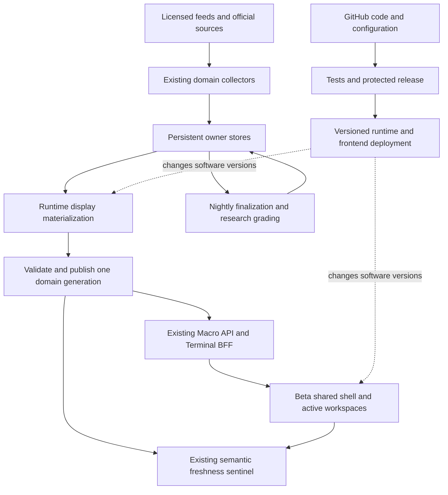

# Always-on Macro and Shared Shell migration

Date: 2026-11-05.
Status: ARCHITECTURE DEFINED; INITIAL IMPLEMENTATION LOCALLY QUALIFIED; production migration remains open.
Tracking issue: https://github.com/mastermindx-market-intelligence/macro/issues/10779
Operation: `macro-always-on-shared-shell-20261105-c3`.
Source carrier: `sol/web-macro-always-on-shared-shell-20261105-c3`.
Product continuity: existing `WS:MARKET-OS`; existing Data OS, live orchestration, domain computation, identity, publication and release owners retain authority.
Protected procedure pin: Mastermind `49c2e1d93e5e080b1671c98087a845e5beb09dd5`, skillpack 1.0.1, bootstrap-major 1 compatible.
Architecture source pins: Macro `e39ec45902c1a2bb28507beb851593be6e422167`; Terminal `f9d3280a2a3ff28dd925b128231702b836c8a247`.
Production observations: [bounded evidence](ALWAYS_ON_MACRO_EVIDENCE_2026-11-05.json).
Initial durable plan commit: `c7f9671d72329e3c33cccced276e969b2515d1e5`.

## 1. Chairman outcome and governing predecessors

Make the entire Macro product continuously current at each source's legitimate cadence, independently of HTML builds, GitHub availability and code-release success, while adopting the existing application shell at **beta.mastermind-x.com**. The original user journey, information hierarchy, evidence, research, company drill-down, watch/portfolio separation and account rules survive the migration. Sector Intelligence displaying November 3 data on November 5 is the first end-to-end consumer. The Chairman explicitly authorizes architecture, a durable master plan and implementation initiation.

This extends existing work; it does not create another scheduler, data platform, identity service, registry, queue or shell:

- [July live plan](../LIVE_INTRADAY_DASHBOARD_MASTERPLAN_2026-07-29.md): short-lived facts belong to runtime contracts; preserve one canonical writer.
- [August resilience plan, Part B](../NIGHTLY_RESILIENCE_AND_LIVE_TRANSITION_MASTERPLAN_2026-08-06.md): independent collection, incremental display computation, nightly reconciliation and removal of render coupling.
- [VPS live orchestration](../../docs/VPS_LIVE_ORCHESTRATION.md): current systemd lanes, persistent live publication and external sentinel.
- [Shared-shell migration](../MASTER_PRODUCT_SHELL_MAKEOVER_MIGRATION_2026-10-08.md): incumbent shell and page registry.
- `research/BREATHING_PLATFORM_MASTERPLAN_BY_FABLE.md` is proposal/evidence, not blanket activation authority.

The July objection to a wholesale SPA rewrite does not prohibit the Chairman's expressly assigned adoption of the existing shared shell. It remains a boundary against rewriting working domain engines just to change presentation. Nightly canonical vintages, final closes, grades and forward ledgers retain their single writer; the intraday chronicle prohibition remains.

## 2. What actually failed

The attached evidence records normal-TLS public HTTP reads at 22:06 UTC and read-only origin validation at 22:20 UTC on November 5.

| Observation | Established implication |
|---|---|
| Sector HTML returned 200; Last-Modified November 5 04:57 UTC; displayed generation November 5 03:50 UTC; `data-si-as-of=2026-11-03` | A new page build can carry frozen source data. Build freshness is insufficient. |
| Origin's existing Sector validator rejected the served bundle: November 3 source, two completed NYSE sessions behind; action-board source date/hash absent; HTML/premium action hashes differed from served action bytes | This is both old data and a publication-consistency defect, not merely a browser refresh problem. |
| Sector run [42099034826](https://github.com/mastermindx-market-intelligence/macro/actions/runs/42099034826) failed at checkout after low-speed Git transport timeouts and a bad pack header | The inspected refresh never reached computation, validation or publication. A data refresh still depends on fetching Git. |
| `/api/status` showed advancing quote, breadth and basket clocks; fast/snapshot oneshots last returned success | The live plane exists and portions are operating. An inactive completed oneshot is normal; aggregate API “ok” is not semantic health for every product. |
| `/live/staleness.json` had no Sector surface | The independent observer was blind to this particular product. |
| Beta returned 200 over verified HTTPS and redirected to /today | Public beta reachability is working. This is not authenticated browser acceptance. |

Source trace at the Macro pin:

1. `engine/sector_central.py::compute` consumes cycle, price, rotation, regime, heat and membership owners.
2. `scripts/build_baskets.py` produces basket/theme context and several additional artifacts; it also contains nightly-gated ledger and score-history behavior.
3. `scripts/build_sector_action_board.py` binds the action board to exact basket bytes.
4. `scripts/build_sector_central.py` combines inputs, appends/grades research, writes public and premium data, and renders HTML.
5. `scripts/build_sector_intelligence.py` sequences these producers and the semantic gate.
6. `.github/workflows/sector-intelligence.yml` checks out main, installs dependencies, builds, validates and commits generated outputs back to main. Separate daily/render entry points also exist.
7. `scripts/build_site.py` additionally writes `basketdata/action_board.json` as a bare `{"action_board": ...}` object. That source shape matches the missing production metadata, but the particular process that last overwrote the live file has not been attributed.
8. Existing deploy synchronization serves the files; the legacy page consumes baked HTML and JavaScript. Terminal's existing `/api/sector-intelligence` BFF proxies approved owner paths with private/no-store responses.

**Architecture conclusion:** separate code release, collection, materialization, publication and browser revalidation. Moving old HTML into a shared shell alone leaves the failing producer path intact.

## 3. Target architecture

Data collection and publication continue using the last accepted software release when GitHub, CI or a frontend deployment is unavailable. Code still builds and deploys; ordinary data refresh does not build the website or commit artifacts to Git.

### Existing owners and boundaries

| Concern | Owner to extend | Required change |
|---|---|---|
| Scheduling and process supervision | Current VPS systemd units and `scripts/vps_live_orchestrator.py` | Add bounded domain work to an appropriate existing lane; retain locks, timeouts, resource caps and return evidence. No second generic scheduler. |
| Dependency descriptions | Existing `config/dag.yml` and domain source contracts | Trace real inputs/outputs and remove migrated render edges. The current DAG is workflow-step metadata, not itself a runtime scheduler. |
| Market data/history | Existing Data OS/domain stores, persistent live directories and R2/object owners | Keep source watermarks, revisions and lineage; remove Git as a steady-state transport for migrated materializations. |
| Publication | Existing live publisher, `/var/lib/macro-live/public`, private state and incumbent object store | Extend atomic publication from individual files to coherent domain generations where multiple files must agree. |
| Read/API layer | Macro API and Terminal BFF | Serve accepted owner generations, entitlement-filtered, with explicit freshness and bounded requests. |
| Browser | Existing Terminal/shared-shell components, legacy bridge during migration | Revalidate live data independently of application navigation and deployment. Keep one shared shell and current route registry. |
| Accounts and saved state | Existing Supabase identity, Watchlist and Portfolio owners | Preserve ownership semantics and isolation; no alternate account or persistence model. |
| Monitoring | Existing freshness sentinel and current transport | Observe source age, publication consistency and actual consumer visibility independently of GitHub. |
| Durable program record | This source-linked plan, issue #10779 and existing Agent OS | Record decisions and proof; no parallel work/state controller. |

No Kafka, second Redis queue, new database or new orchestration vendor is required for the first transition. Reconsider capacity or event transport only after measured throughput, latency, fan-out or recovery limits demonstrate the need. The historical VPS sizing in the July document is not a current capacity measurement.

## 4. Runtime data contract

Extend the existing domain envelopes rather than impose a second universal schema. Every admitted live field must have these **semantics**, mapped to its owner's existing names:

- **Source observation/effective session:** when the fact applies. A provider's timestamp, exchange calendar and delay basis must be explicit.
- **Collection time:** when the source was successfully retrieved; this does not refresh the fact's observation time.
- **Computation and publication times:** when this materialization was derived and made readable.
- **Generation/revision:** immutable content identity and a publisher-owned ordering/version. Corrections on the same source date must invalidate readers; date-only cache keys are insufficient.
- **Coverage and qualification:** expected versus observed population, missing inputs and freshness/quality reason. Unknown values stay unknown.
- **Provenance:** source dataset/revision, calculation version, membership, adjustment/FX basis and applicable session. Research, forecasts and trade authority remain distinct.
- **State:** current, delayed/stale, partial/degraded, unavailable/unknown, and market closed where appropriate. A recent API response cannot make old inputs current.

Use a **domain generation**, not a whole-company global generation. Sector may contain one coherent daily research bundle plus a separately dated intraday quote/breadth overlay. A delayed daily input must not block unrelated quote service; fresh quotes must not relabel old research as current.

### Publication protocol

1. Read declared source versions and compute a candidate in staging, without writing canonical ledgers or the live pointer.
2. Validate schema, non-vacuous coverage, source clocks and required cross-artifact hashes.
3. Store immutable candidate artifacts under the existing publisher/store, preserving private versus public access.
4. Atomically switch the single domain manifest/current-generation pointer only after every required artifact is available. Per-file renames alone do not guarantee a multi-file bundle.
5. Retain the last accepted generation for bounded rollback; publish its stale/degraded state if collection stops.
6. Re-read the accepted pointer and consumer response. A successful write or HTTP 200 is not acceptance.

At the native reader cutover, validate the runtime manifest and data contract independently of HTML. HTML becomes a software/bootstrap artifact, not a required live data-generation member. Keep the temporary legacy consumer's health separately observable until it reads the same live owner or is retired; fresh beta data must not conceal a stale legacy journey.

The current Sector two-pass observation is a transitional safeguard against reading during per-file publication. It does not claim the existing publisher is bundle-atomic. The future manifest must pin a consistent generation through one request or client update.

### Browser protocol

Use the existing quote subscription for fast quote fields. Begin other domains with bounded conditional revalidation from the existing BFF, foreground/visibility aware, with jitter, timeout, cancellation and per-source in-flight deduplication. Refresh immediately when a previously hidden tab becomes active if its deadline has elapsed. Compare generation/revision and ignore late responses for obsolete identities, routes or generations.

Preserve last accepted visible content during a transient failure, clearly labelled with its observation date and degraded state. Account changes clear identity-owned data synchronously; 401/403 and entitlement changes cannot fall back to another identity's cached data. Do not cache private payloads globally by URL.

SSE is an optional upgrade through the existing event/stream capability after its delivery behavior is proven. Reconnect with a cursor where supported, then fetch a canonical snapshot if a gap is possible. No new per-widget sockets or event bus is needed to make Sector live.

## 5. Cadence and service objectives

These are **proposed acceptance budgets**, not claims of achieved performance. Qualify provider rights, market calendars and measured runtime cost before enabling a lane. A low-frequency economic series does not need fabricated minute-by-minute “updates.”

| Data class | Runtime behavior | Initial acceptance target |
|---|---|---|
| Quotes and 1D price fields | Reuse existing Terminal quote service/subscription; current Sector Discover source already includes a 5-second quote path | Respect provider delay; advancing source timestamps visible on the existing quote cadence during market hours |
| Intraday sector/basket/breadth overlays | Existing snapshot/breadth owner; approximately 5-minute materialization where supported | Source-to-accepted-publication p95 <=10 minutes; active browser sees a new accepted generation within 60 seconds |
| Fast macro risk/official-release observations | Existing fast lane, approximately 60 seconds, with scheduled-event urgency in the current release owner | Publication detection p95 <=2 minutes and validated parse/materialization <=5 minutes after source availability, measured separately |
| Sector research, membership and daily signals | Recompute display bundle on an accepted relevant input revision; completed-session cadence retained | First canary retains the current one-session breach limit; establish a source-complete daily deadline and tighten only with measured owner acceptance |
| News and filings | Existing provider ingestion, deduplication and intelligence owners | Source-specific delay and processing budget; corrections and withdrawals propagate by revision, not publication date alone |
| Rates, credit, FX, liquidity, commodities and crypto | Market/source-specific runtime lanes; 24/7 only for legitimate continuous sources | Each family receives its own observed/effective-time and maximum-age contract before migration |
| Monthly/quarterly macro and fundamental facts | Poll around scheduled publication, otherwise low-cost revision checks | Correct latest vintage and revision; unchanged values are valid when the source has not updated |
| Daily finalization, PIT archives, grading/backfills | Existing nightly single writer | Complete and reconcile independently of the web renderer; do not run the entire nightly every five minutes |

During migration, the existing 30-minute sentinel cadence is the first independent detection budget. The tighter runtime targets require an appropriate existing monitor cadence and a measured publication-to-browser probe; changing a table alone does not implement an SLO.

## 6. Scope and ordered execution

The existing compiled page registry at the Macro source pin has **353 entries: Macro 314, Terminal 32, Mastermind 7**. It includes marketing/internal routes and is not a count of 353 independently live products. All entries currently have the descriptive owner value “unowned”; this is a metadata mapping gap, not evidence that the actual domain/runtime owners do not exist. Use this registry as the denominator, map each admitted route to a family and real source owner, and preserve its original route/design/acceptance. Do not create a second page registry or silently shrink scope to the first working tab.

The L labels below are editorial plan nodes, not Executive Jobs or a new ranked queue.

| Node | Dependency | Exact work and principal source surfaces | Exit proof |
|---|---|---|---|
| L0 — pin and reconcile | none | Protected law/source pins; issue #10779; current shell and live-owner census | Immutable plan/evidence readback; no duplicate owner |
| L1 — diagnose Sector | L0 | HTML -> BFF/artifacts -> builders -> workflow -> served tree -> sentinel | Source/transport/publication/UI failure modes distinguished with the November 5 evidence |
| L2 — map scope and contracts | L0 | Existing page registry, domain contracts and DAG; Terminal source/identity/bridge paths | Every migrated family has a source owner, cadence, contract and preserved user journey |
| L3 — freeze transition design | L1,L2 | This plan; domain generation, clocks, auth/cache, fault isolation and writer-transfer rules | Reviewable design and falsifiable acceptance |
| L4a — external Sector truth | L3 | `scripts/check_sector_intelligence_freshness.py`, `scripts/freshness_sentinel.py`, existing sentinel tests | Stable current, old, mixed, missing, changing and private-payload cases; real served-tree verdict |
| L4b — extract Sector materialization | L4a | `engine/sector_central.py`, `scripts/build_sector_central.py`, `scripts/build_baskets.py`, `scripts/build_sector_action_board.py` | A pure/side-effect-bounded display calculation from explicit accepted inputs; parity on representative bundles; zero HTML or ledger writes in runtime mode |
| L4c — independent source/publication path | L4b | Existing collector/store and `vps_live_orchestrator.py`; current atomic publisher; Sector workflow/daily/render writer sites | Runtime shadow generations advance without Git checkout/commit; atomic bundle validation; fence old publication owner before cutover |
| L4d — complete beta Sector reader | L4c | Terminal `app/api/sector-intelligence/route.ts`, `lib/sectorIntelligence.ts`, `SectorIntelligenceWorkspace.tsx`; existing legacy bridge | Brief/Explore/Research/Watches/Discover consumers revalidate appropriate feeds; source dates and intraday overlays remain separate; identity and last-response guards hold |
| L5 — production canary | L4a–d | Normal protected release, existing service deploy, signed-in beta and external probes | Accepted new source generation appears in an already-open beta tab while frontend deployment is unchanged; stale/partial/failure cases are honest |
| L6 — migrate domain families | L5 | Existing family carriers and registry rows, ordered below | Each family passes the same producer/publication/BFF/browser proof and removes its data-refresh build dependency |
| L7 — retire coupling and accept estate | L6 | Obsolete generated-data Git publishing, render dependencies and duplicate subscriptions | GitHub-down/code-build-failure drills pass; full admitted registry/journey denominator reconciled; rollback/recovery and operations accepted |

L4b must separate calculation from side effects at the function boundary. Simply running `build_sector_intelligence` every five minutes is unsafe: current entry points also render and touch score/grade/ledger paths. Preserve `engine.ledger_lane` and current canonical writers, and prove zero runtime ledger writes with discriminating tests.

L4c must resolve the bare `build_site.py` action-board writer and every daily/render/Sector publication path. Do not have a Git publisher and a runtime publisher race on the same current pointer. Use the existing orchestration/cutover fence and admission controls; no independent “fallback” writer.

### Family order after the Sector canary

1. **US/China/Hong Kong/Canada discovery and sector/theme/industry desks:** common data contract and calendar handling; native source differences remain explicit.
2. **Macro command, releases, calendar, rates, credit, FX and liquidity:** integrate current live release/risk work and preserve vintage/revision semantics.
3. **Commodity, energy/metals and crypto workspaces:** adopt source-appropriate sessions and 24/7 behavior, then their cross-asset links.
4. **Company intelligence, filings, research, news and explanatory briefs:** remove render-bound retrieval, keep provenance and source revisions, refresh briefs when accepted inputs change.
5. **Portfolio, Watchlists, scenarios and personal workspaces:** compose the already accepted owner-backed data; preserve the distinction between attention, ownership and trade authority.
6. **Residual registry routes, marketing/editorial/internal tools:** decide and record which content legitimately remains static or published editorially; a static legal page is not a live-market-data defect.

Existing completed or accepted work is reused. Current observed integration dependencies include Terminal #1191 (open shared-shell/history work), Terminal #1231 (merged quote refresh; installed behavior not yet proved here), Macro #9435 (open CPI/release repair) and Macro #10645 (draft foundation candidate). These observations do not authorize taking their active source carriers or release holds.

## 7. Failure drills and rollout

For Sector first, then each family, test:

- GitHub unavailable and a frontend build failing while the running data lane continues.
- Provider timeout, rate limit, malformed data, empty population and stopped source watermarks.
- Freshly republished old data; same-date corrected data; wrong session/calendar/price basis.
- Partial bundle publication, late writer and changing generation; previous accepted pointer remains usable.
- Worker crash/restart and lane lock recovery without duplicate collection/publication or ledger effects.
- Browser left open across the close, hidden then visible, disconnect/reconnect, old response arriving last.
- Sign-out, account switch and entitlement loss; no private cached cross-account fallback.
- Reader rollback to the previous compatible contract without enabling a second publisher.

Run shadow computation first against immutable input versions. Compare meaning, coverage and calculation outputs with the existing owner; a digest mismatch alone is not an explanation. Canary one product/family before fan-out. Preserve old software and accepted generations for rollback. Producer ownership rollback requires an explicit fence/reconciliation; frontend rollback alone must not start an old data writer.

No broad production failure injection is authorized merely to test the architecture. Use isolated/staging faults first and bounded canary evidence through current release controls.

## 8. Implementation and evidence ledger

Completed in this source carrier:

- Initial master plan committed, pushed and exact-byte read back at `c7f9671d72329e3c33cccced276e969b2515d1e5`; issue #10779 created.
- Production HTTP and origin served-generation diagnosis recorded in the linked JSON evidence.
- Sector gate now accepts an explicit served root and immutable in-memory reads; build CLI contract stays fail-closed.
- Existing sentinel gains `sector_intelligence`, observes two bounded byte snapshots, and uses the same source/calendar/hash rules. Unknown observations feed existing blindness handling; conclusive old data remains stale even if another field is missing.
- Only allowlisted status, reason and source age enter the public health projection. Detailed errors and premium/internal hashes remain in private facts. The observer never calls a builder or repairs data.
- Focused validation: `python3 -m pytest tests/test_freshness_sentinel.py -q` — **142 passed**. Existing Sector semantic/date/HTML gate subset — **12 passed**. Diff whitespace check passed. Hosted CI, merge, installation and signed-in browser acceptance are separate pending stages.

Fabric evidence:

- `macro-always-on-20261105-c3-shell-audit-01`: terminal rc75 admission refusal, `host_temperature_at_or_above_limit`, no task execution; retry not authorized. Independent bounded source work continued directly under the existing no-eligible-worker exception.
- `macro-always-on-20261105-c3-sector-audit-01`: original controller PID 62474, latest observed ACTIVE_OR_WAITING, worker state UNKNOWN, result unavailable and root unverified. Preserve the original effect; no duplicate audit or claim of running durable execution.
- A native principal architecture consultation challenged publication, clock, ownership and failure semantics. It is advisory judgment, not a formal GitHub approval.

## 9. Acceptance and next action

**Do not call the migration complete because this plan, a PR, a green test or a shell route exists.** Sector acceptance requires a new accepted data generation visible in an already-open authenticated beta workspace without a page build or frontend deployment; coherent data, honest stale/unavailable behavior, preserved account boundaries and the original investigation journey must all pass.

Whole-program acceptance requires a reconciled registry/family denominator, truthful source clocks and coverage, independent collection/materialization/publication, bounded fault isolation, real browser journeys and durable proof for every admitted family. Accepted static/editorial exceptions must be explicit.

Next on this carrier: publish the locally qualified L4a implementation and source-linked decision through normal required CI/release; verify the installed sentinel on the actual served generation. In parallel with legitimate CI waits, finalize the L4b side-effect/input boundary and L4c writer-transfer patch against the existing owners. Do not enable a five-minute copy of the current builder. After the Sector canary is production-proven, admit the next family through its existing carrier and acceptance rules.
