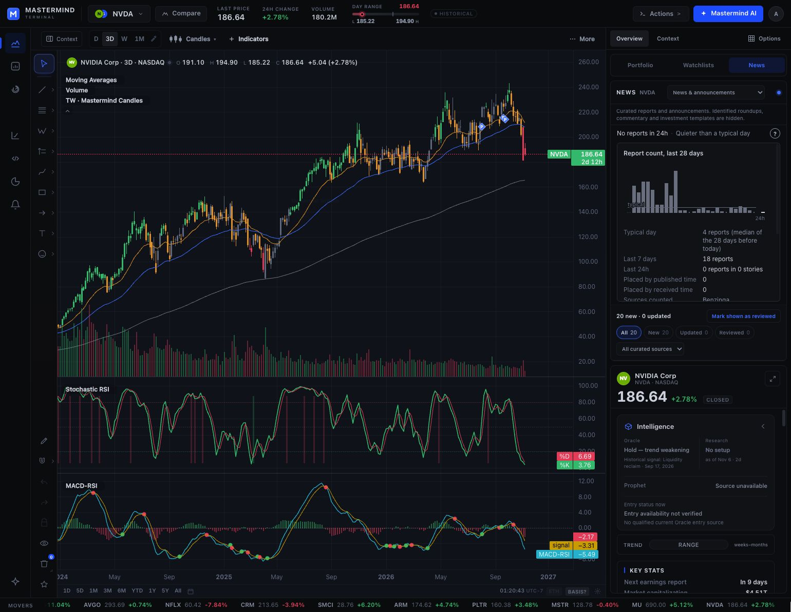
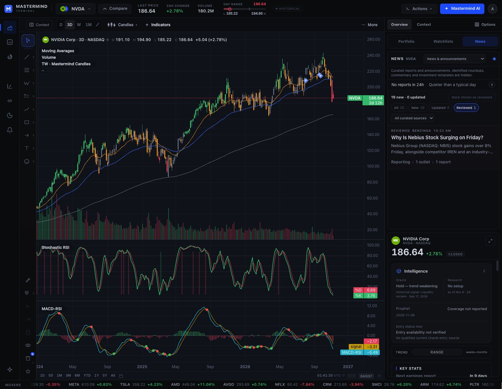
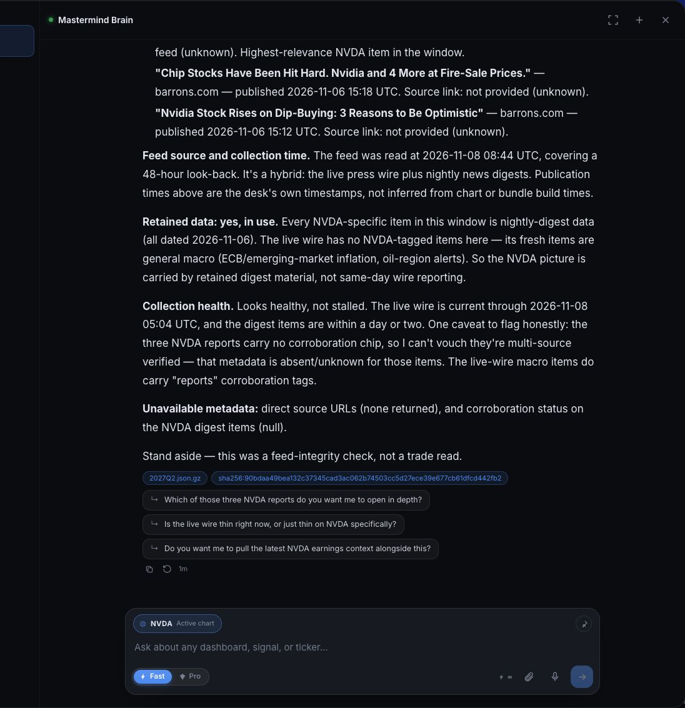

# News consumer proof and bounded repair — 2026-11-08

## Scope and source

This continues the Chairman's News Intelligence completion mission at Macro #10244. It preserves the accepted seven journeys and the independent factual, contextual and quantitative outcomes. Protected procedure pin: `1981aea5122943ce59d7ebe9706ddf5a658b377d`. Source base: Macro `4bf5db311721bb2ceffe66f694de08a52d9d168c`.

The observations below distinguish a real authenticated browser result, a verified deployed source/artifact identity, and an offline candidate proof. They do not declare the programme or all seven journeys accepted.

## Production Terminal: one report reviewed and reopened

The connected local Chrome session rendered NVDA's News rail with 20 available reports, source links, review filters and coverage counts. One report, story ID `ev2_65b7aba108a04451`, was marked reviewed once. A fresh page in the same browser then showed the same report as reviewed, with All 20 / New 19 / Updated 0 / Reviewed 1. Selecting Reviewed returned that one report.

This proves persistence across a fresh page on this browser/device. It does not prove cross-device persistence, account-backed notes, a saved thesis, or correction propagation after save. The company-detail card still occupied the lower rail; no deployed Terminal source SHA was bound by this browser observation.

## Production Brain: an accepted turn exposed an evidence gap

An initial Send click around 08:22Z left the nonempty draft and welcome state unchanged. Original-server reconciliation found no corresponding stream POST in the bounded journal and no retained caller run at 08:35:07Z, with the Macro API process unchanged. One same-tab keyboard recovery used the widget's documented Meta+Enter shortcut.

The recovery was accepted: the draft cleared, a user message and busy state appeared, and an answer completed. The original authenticated run owner reported:

- Run `f70ce541c9d04fc4a5626990be5d9f8d`.
- Started 2026-11-08T08:44:41.104392Z; finished 08:45:34.469740Z.
- Done true, cancelled false, truncated false, 29 buffered events.
- The UI reported “Analyzed for 46s · 1 check.” UI elapsed time and server-run duration are separate measurements.

The request asked for up to three NVDA reports with links, publication times, feed collection time, retention and collection health, explicitly marking unavailable metadata unknown and excluding trading recommendations.

The answer identified older nightly-digest reports, supplied no source URLs, inferred retention from nightly/older content, and called collection “healthy, not stalled” because a wire item was recent. The visible footer also contained a chart-artifact chip; it is not accepted as attribution for these news reports.

The observed phase label, “Skimming the wire for news,” maps in the source gateway to `get_market_events`. This is a source-supported tool identity inference, not a recovered raw tool-call payload. A read-only attempt to navigate the existing run replay endpoint was blocked by Chrome with `net::ERR_BLOCKED_BY_CLIENT`; no alternate-carrier replay or additional model submission followed.

### Verified contributing owner

The VPS helper `engine/neuralweb/brain_market_intel.py` matched the pinned source exactly:

`1f890c03f1d856835db061d466e8e4f3371dddb5a7ef8180b409768c51b0ff00`.

The actual gateway source hash was:

`f2b649764cd6662408124c246b5ad585c5dd0d35308710754d3b898abe89f833`.

The helper returns a reader-clock `asof`, event timestamps and source kinds, while dropping source URLs and contributing-envelope metadata. It reads no applicable collection-health receipt. Thus recent items cannot support a current collection-health claim, and nightly source kind does not establish a retained-from-previous-build flag.

Independent artifact inspection found supplied Google News intermediary links on two of the answer's selected reports. They are available source links, not verified publisher-canonical URLs. The production financial digest's fetch clock was `2026-11-07T09:57:50.834666+00:00`; it did not carry an explicit `retained_from_previous_build` boolean. The standalone by-ticker artifact's retention metadata belongs to that distinct document and must not be borrowed.

Exact artifact hashes matched both the VPS observation and the files at the pinned source commit:

| Artifact | SHA-256 |
|---|---|
| `site/news/macro.json` | `f9c246b7f22147eff1c113247f6ce02aedf61c8710423a808e09ab96fedccffd` |
| `site/news/financial.json` | `6a2fe38100abdaf82e1a71e61bdd019b83b9b5d331b65bcb5728137b94a76925` |

## Candidate repair

The existing reader now:

1. Labels its read time with `asof_basis="tool_read_time"`.
2. Reports `collection_health.state="unknown"`, explaining that no applicable collector-health receipt was read. Availability, recent items and an empty result remain separate facts.
3. Preserves actual valid HTTP(S) `source_url` values, including intermediary links, without constructing citations or fetching their destinations.
4. Labels the existing selected event clock with `timestamp_basis`. A `seendate` or wire `ts` does not certify publisher publication time.
5. Projects the same contributing document's four `news_freshness` fields. The nightly schema's parseable `fetched_at` is a collection clock; wire `updated_at`, build dates, item age and another document's metadata are not substitutes. Explicit producer retention must be a boolean; absent/malformed values remain null.
6. Teaches these evidence limits in the existing tool schema.

The strict fact whitelist remains. No predictions, beneficiaries, sizing, trading authority, new source reads, health store, collector, router or publisher is introduced. Source selection, event content, ordering, deduplication, symbol preference and the nightly top-up boundary remain unchanged.

## Verification and its limits

- The first 23 new provenance cases failed before implementation and passed after it. Source review found malformed-clock and malformed-port edges; five additional cases cover their repair.
- **74 affected event, provenance, wire-ranking and schema cases pass**, including the existing real-artifact smoke test after the exact pinned data was materialized. No skips in that final focused run. Unrelated research-vault tests were outside this local selection.
- The existing suite stays registered in its incumbent CI owner; no new test job or planner weight is added.
- The [offline projection receipt](BRAIN_NEWS_PROJECTION_2026-11-08.json) proves that the real pinned nightly artifacts keep the old selected event content/order while source links and truthful metadata survive the unchanged gateway model-result projection and JSON normalizer.
- That proof evaluates the exact gateway function bodies without starting the gateway. It is not authenticated dispatch, a provider call, a recovered raw live run, or corrected production model behavior.
- Required hosted checks, qualified publication, installed code identity and a new ordinary consumer proof remain necessary.

Reproduce the focused suite from [the recorded test-node list](BRAIN_AFFECTED_TESTS_2026-11-08.txt). The standalone proof is [verify_brain_news_projection.py](verify_brain_news_projection.py); provide a baseline helper extracted from the pinned base with `--baseline-module`, and an isolated checkout containing the candidate and its pinned data via `--root`.

## Continuing acceptance

After permitted release, verify the installed helper identity and an ordinary authenticated answer that uses available links, labels clock uncertainty, and reports unknown health/retention when unsupported. Retain the failed pre-release observation as the before-state.

The bot/portfolio unified-news path in Mastermind #2280 and Macro #10851, the qbus-to-Press health path in Macro #10850, and this mixed-wire/nightly Brain path are distinct consumers. Evidence on one does not certify the others.

Terminal #1207 still requires current-master integration and fresh captures. The reviewed-report observation does not satisfy the full corrected-event saved-research journey. Quantitative disposition and populations remain unchanged: defensible negative; 600 registered / 74 v2 scorable / 135 v3 drawn / 40 routing pending / zero prospective.
