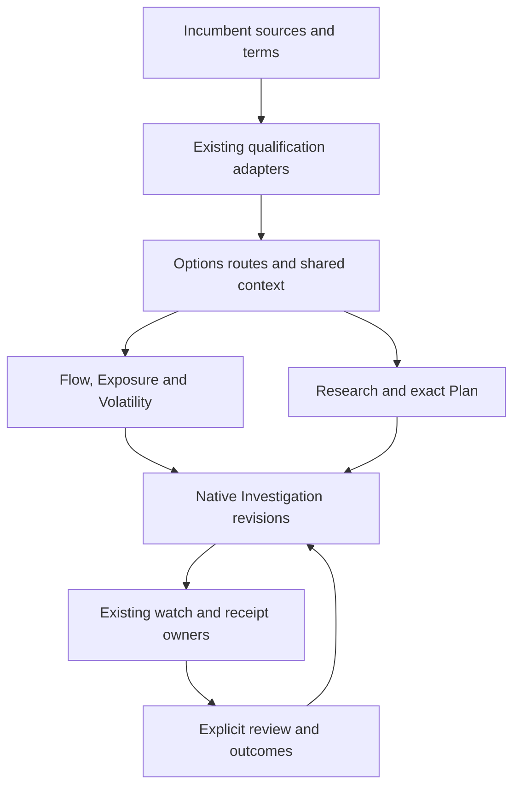

# Options Suite — Architecture Hardening

## Rounds 3–4 · Source adjudication and integration contracts · 10 November 2026 UTC

**Purpose:** turn the completed Paper candidate into a buildable extension of the existing Terminal and Macro systems. This is architecture and acceptance work. It is not a production release, source-rights grant, scientific promotion, or implementation dispatch.

**Programme:** Terminal [#599](https://github.com/mastermindx-market-intelligence/mastermind-terminal/issues/599), workbench [#603](https://github.com/mastermindx-market-intelligence/mastermind-terminal/issues/603), existing WS-ADVANCED-DATA-OPTIONS and associated Options Alpha, Intraday and context-audit owners. The canonical planning carrier remains [Macro draft PR #10898](https://github.com/mastermindx-market-intelligence/macro/pull/10898).

Read this with [the inherited census](01_MASTERPLAN.md), [the Paper build contract](02_PAPER_DESIGN.md), [the round-4 implementation baseline](05_IMPLEMENTATION_MASTERPLAN.md), and [the additional-round programme](06_FUTURE_ROUNDS.md). The seven contracts below are boundaries within incumbent owners, not seven new services.

## 1. Architecture decisions that materially change the build

### 1.1 Reuse the held exact Plan implementation

Protected Terminal at 26c800c265d2cc627098955d186ddc8ef2886960 still contains a preparation-only OptionsPlanInvestigationHost. The current original Investigation branch, #804 at 27df56d997df0ae94a17b6b8e2d14867431bb394, already contains:

- investigation_manifest.v3 with the existing validated option_plan field;
- admitInvestigationOptionPlan, which admits a detached whole Plan only to a fresh native research draft under the current authenticated guard;
- OptionsPlanResearchBridge, which separates explicit Add from native Save;
- route and embedded history modes;
- an exact acknowledged-revision reader;
- OptionsPlanSavedRevisionControl shared by embedded Options and canonical Analysis, with invalidation of the working copy when the reader is revoked;
- explicit recalculation using newly shown dated terms, separate from reopening saved authored inputs.

The branch reports scoped local and exact-head hosted CI acceptance. It remains Draft under release hold 5989604142. Those receipts do not prove SQL application, admission, deployment or authenticated customer acceptance. **Integrate this source through its original owner and holds. Do not build another Plan adapter, manifest version, save endpoint or journal to bypass it.** [A03–A06]

This corrects a possible reading of round 2: “unavailable on protected master” does not mean “not implemented anywhere.” The implemented admission is specifically for a fresh new research draft. B04's existing-case revision-2 specimen exceeds that admission domain; §7.2 adjudicates the required design correction. The original release and consumer gates still apply.

### 1.2 Fix selection integrity before richer intelligence

Current source permits several mismatches:

- FlowDeskView and the Hub can accept ticker-context responses without binding them to the request generation that selected the root. InspectorPane reads selected-event identity independently.
- VolView starts from SPY, lacks the proposed cross-surface root/expiry receiver, and can choose a first available expiry when a selected expiry disappears.
- GexDeskView parses several route values at initialization; its history listener does not uniformly rederive all view, research and symbol state. An initially correct deep link is insufficient proof of Back/Forward correctness after the view has stayed mounted.
- Prophet lane and the OI Changes screener preset are local state. A navigation label cannot be treated as a durable deep link until the incumbent decoder supports it.

These are source-level findings, not a claim that a production incident was observed. They establish required fixes and discriminating tests. Use existing reducers, host scope and route decoders; no second global selection store. [A01, A02, A07]

### 1.3 Original evidence and current evidence are different reads

currentOptionsEvidence compares saved references/digests against sources as read now. It does not recover arbitrary historical numeric books. An exact saved source can be shown only through its admitted retained source resolver. When that resolver cannot supply the original, preserve the saved identity and show the Paper E09 state. Do not display latest values under an original timestamp.

The existing scenario-native path already separates authored inputs and references from protected source basis/results. Its initial capture and recovery qualification are different operations. Extend this ownership; do not place a generic market-data snapshot inside the Investigation journal. The held Plan v3 contract is a separately admitted whole-Plan contract and must be reused as defined, not silently rewritten into the scenario shape. [A05, A08, A09]

### 1.4 Exposure has several maturity levels

The refreshed Macro projection contract distinguishes:

1. retained legacy analytics, whose original descriptive semantics remain;
2. qualified dated provider-Gamma observed-v2, including a retained SPY evidence-copy dry run;
3. instantaneous, joint, repricing and point-in-time capabilities whose additional qualification remains unsatisfied.

The documented SPY sample has 13,104 observed, 12,212 qualified and 892 missing observations. It is a dry run and evidence-copy application, not a production publication claim. QQQ policy and synthetic contract output do not establish actual QQQ market capture. Snapshot acquisition provenance is real engineering progress; it does not establish serving model build, unsupported Vanna/Charm units, economic expiry or historical first availability.

The interface must identify the exact metric/population capability being shown. Neither a blanket “Exposure unavailable” nor a blanket “full live exposure qualified” is correct. [A10]

### 1.5 Preserve exact historical requirements without inventing rows

The recovered sources contain 60 AC rows, 76 R2 rows, 35 execution rows and 123 dated supersession claims. The historical continuation also identifies an original 104-task OPT / 130-requirement OPR packet. Its complete row contents were not recovered in this round.

The final coverage projection explicitly records that gap. Counts, grouped ranges and broad labels cannot stand in for the original row text. Recovering and binding that packet is an early additional-round obligation and a condition of a claim that the whole inherited programme is implementation-ready. It does not block unrelated source-qualified fixes.

## 2. Source cuts and what this review proves

| Source | Exact cut | Scope of this round |
|---|---|---|
| Protected Mastermind procedure | 9e6659c4a49ee6f11a6f6ee690d222ce81d67b09 | Reused compatible governance pin |
| Canonical plan before this round | Macro 626715ab73e3a0f9413c69faabd8a2a5030227de | Original census, 34 boards, 44 states, synthetic fixture |
| Protected Terminal | 26c800c265d2cc627098955d186ddc8ef2886960 | Affected routes, Flow, Volatility, Lab, Plan, Investigation, alerts and transport source |
| Current original Investigation branch | Terminal 27df56d997df0ae94a17b6b8e2d14867431bb394 | Held exact Plan bridge, v3 admission, embedded history and canonical reopen |
| Affected Macro projection | fc07cb58b17df11aa9cb83c782f8833d035482cb | Current exposure projection documentation |
| Original retained-selection wire branch | Macro f9d9c1883b9a25ea2bd5f6b5b21f922a01307434 | #10866 lossless source contract; open with merge-on-green and merge-blocked |
| Other inherited source facts | Pins in 01_MASTERPLAN.md | Retained unless specifically refreshed here |

This is not a second complete repository census. The six commits between the round-2 Terminal pin and this cut include shared shell and other changes; this review refreshes affected files rather than asserting that every old receipt remains current. Actual deployment identity is unverified. The current Terminal head also records an installed-builder deployment problem; production planning must consume its existing owner's resolution rather than infer installation from protected source. No deployment or installer action was attempted.

## 3. Core model: one investigation, independently qualified evidence

A user should be able to move from “what changed?” to a retained, reviewable research question without losing the exact object, source or assumptions that made it interesting.

Every transfer names what it carries. Flow to Exposure may carry only the root plus an origin reference. That is useful if clearly stated. It is not a join between an intraday activity group and a dated standing book. An exact contract transfer requires a receiving source that qualifies the contract and terms.

### 3.1 Identity, time and numbers

| Concept | Required meaning | Forbidden substitution |
|---|---|---|
| Underlying | Existing security/root identity and applicable mapping | Display ticker as permanent economic identity |
| Contract | Exact series, expiry, strike token, right, terms/deliverable binding | Nearest strike, ordinary 100 multiplier by default, same-date different settlement |
| Activity | Original source group/event identity and revision | Array index, rank, recreated nearby print |
| Observation time | When the market observation applies | Fetch time or browser render time |
| Receipt/read time | When the collector/reader observed bytes | First availability or source publication |
| Available-by cutoff | Admitted evidence was knowable by the decision cut | Build date, digest order or current fetch |
| Source session | Civil trading-session label | Midnight UTC coerced across time zones |
| Saved case | Exact case and requested immutable revision | Current head automatically substituted |
| Firing | Qualified event identity, or explicitly identity-unavailable fallback | Latest firing borrowed by an older assessment |
| Numeric identity | Original precision for strikes, counts, clocks and digests | Float conversion used to establish equality |
| Missingness | Absent, null, observed zero and refused remain distinct | Unknown converted to zero or neutral |

Retain source precision. The retained-selection wire uses canonical decimal tokens and original captured bytes; only bounded structural sizes/indexes are ordinary JSON integers. Presentation may format a qualified value, but formatting never establishes identity or qualification. [A11]

### 3.2 Capability is specific to the action

A read, compare, retain, reopen, export, forecast and arm operation can have different eligibility. Existing authentication, subscription, source-use and destination authorizers remain authoritative. A successful schema parse, visible button, saved digest or previously granted access does not supply current action rights.

Existing commercial data approval is retained. Do not reopen the Chairman's standing commercial attestation as a generic procurement task. Separately qualify technical access, exact historical coverage, point-in-time availability, current consumer entitlement and admitted effects.

## 4. Contract 1 — selection, routing and return

**Owners:** OptionsWorkspace/optionsIa, OptionsHubView, current host reducers, Research Lab adapter, authenticated owner scope, existing route parsers.

The six destinations are presentation groups over the existing depth: Overview, Flow, Exposure, Volatility, Research, Plans & review. Preserve all fifteen current view keys and contextual Futures/Equity replay entry points.

### 4.1 Route compatibility decisions

- Preserve the current bare /options default until an explicit migration changes it. The current default is Tape.
- Preserve vol and screener as the Flow screener. They must not become aliases for Volatility.
- Preserve prism as the accepted GEX/Exposure alias.
- The supported 0DTE URL is ?tab=0dte. zero_dte is an internal view key, not an already-supported URL alias.
- Saved research remains /analysis?view=investigations&investigation=ID&revision=N through its existing decoder. The six-destination navigation may expose this directly.
- Embedded Investigation uses the existing #804 historyMode="embedded" behavior. It must not overwrite the outer Options route.
- Any new serializable preset/lane/expiry grammar is an additive extension to the current decoder with strict validation and old-link compatibility. Document the actual accepted grammar before adding a hyperlink.

Adopt the following target grammar for the next implementation through the existing route owner. These are planning decisions, not currently accepted source syntax: new primary homes `tab=research` and `tab=plans`; Screener `preset=doi`; Prophet `lane=macro|options|issue`; Volatility `symbol` plus an exact `expiry` receiver using its native date/tenor vocabulary. Overview, Flow, Exposure and Volatility retain `desk`, `tape`, `gex` and `volatility`. Validate duplicate/invalid fields, apply fields only to their own view, preserve origin/history state, and prove cold and warm round trips before publishing links. The Plans home reuses the canonical Investigation ID/revision decoder and host-aware navigation. Exact firing links require the original receipt-selection contract; no firing ID is invented from a trigger stamp.

### 4.2 Context projection

At the receiving boundary, carry a typed projection of the existing state: owner partition, scope generation, source identity/revision, root, exact selection if supported, metric/units, population, filters/sort, comparison references, originating case/revision, and return anchor. This is an interface contract, not a second persisted context database.

There are three explicit outcomes: exact transfer; root-only transfer with independent evidence; or refused transfer with a reason. An unsupported exact object cannot become a neighboring object.

Bind asynchronous replies to the owner, root, request generation and source revision they were requested for. Recheck after all awaited parsing/qualification, and at render time where a retained response could otherwise flash under new props. Abort is an optimization; identity equality is the correctness condition.

Back, Forward and direct reload use the same decoder. Keep source selection when valid. If an explicit expiry/contract/row has disappeared, preserve its identity and show unavailable/withdrawn. Defaults apply to an unselected initial state, not to an explicit historical selection.

### 4.3 Proof

Use deliberately inverted response order A→B→A, account change during parsing, a correction during inspection, disappearance of a selected expiry, and Back/Forward after GEX remains mounted. The result must remain paired with its exact identity. Closing a pane restores the originating row and scroll, or a stable heading plus an absence announcement if that row no longer exists.

## 5. Contract 2 — observations, source detail and comparisons

**Owners:** incumbent Flow publisher, flowSource, /api/flow, flowStream, flowClientCache, existing exposure/volatility projections and Lab's sole adapter.

### 5.1 Flow child evidence

Current FlowEvent and projectFlowPrint expose aggregate facts. The six-child Paper timeline is a target, not current source truth. Required extension fields must be supplied by the existing producer:

| Field group | Minimum contract |
|---|---|
| Parent | Source group ID, source revision, aggregation method/window, declared child membership/completeness |
| Child | Stable source print ID/revision, exact contract reference, trade time and available receipt time |
| Trade | Supplied contracts, per-unit premium, sourced multiplier/currency or explicit unknown |
| Quote comparison | Original bid/ask observations and clocks, method/version, eligible age/skew, classification and unknown reason |
| Lineage | Correction/cancellation/withdrawal references; original versions retained |
| Reconciliation | Child counts, contracts and premium against the parent, with partial/unknown distinctions |
| Population | Visible subtotal versus admitted universe; units and denominator named per measure |

Never manufacture children from n_prints. Estimated buy/sell/mixed signing is not an NBBO at-ask partition. “At ask” is not buyer identity, opening demand, a package, or a profitable signal. Multi-leg membership remains unavailable without sourced membership.

Use S01/E01 while only an aggregate exists. Source correction shows a reviewable change; withdrawal does not select another row. The existing cache already owns request deduplication and the stream registry already owns one connection per feed key. Extend those owners and their tests. No extra interval, collector or cache.

### 5.2 Exposure and OI

A displayed quantity must name metric, unit, sign/inventory assumption, observation and OI dates, terms/model domain and known population. A qualified subset can be useful without pretending to be a full book.

The current projection defines per-metric expected, received, qualified, missing, exclusions, net/gross and known-subset quantities. Full totals require the appropriate membership and both sides to qualify. A zero observed OI is different from a missing OI. A known subtotal is null when no members qualify; genuine cancellation remains zero. A joint shock cannot combine unrelated qualified subsets or use an unavailable nonzero-shock term. [A10]

For matched comparisons, retain exact baseline/current book identities and a compatibility result. Partition matched, added, removed and unknown members. Show each source's spot and dates. The Paper +50m is a matched known-subtotal change under its stated assumption, not measured dealer inventory, a percentage, a velocity or a future price target.

OI Changes uses the existing Screener DOI source and eligibility. It is not inferred from intraday Flow. Bind an explicit preset in the incumbent host or show a named unavailable result. Missing data must not make a button appear to perform a successful empty query.

### 5.3 Volatility

Make expiry selection and source dates primary. Accept explicit root/expiry context only when the receiving book qualifies it. Preserve a missing selected expiry, missing wing and unknown history.

Keep IV, realized volatility, source-published VRP, skew, term comparisons and any forecast as separate quantities with their own clocks/methods. The Paper 22% minus 18% is a source-published display fixture, not the six-pilot matched variance estimand. Do not infer IV rank or percentile without an eligible reference history.

Align surface/table coordinates, units, side, delta convention and missingness. Repricing and interpolation disclose their model and domain; an attractive smooth surface is not evidence of observed points between source nodes.

### 5.4 Matrix and replay

Reuse #10866's lossless retained-selection wire through the incumbent Lab adapter after its original source integration gates. It explicitly supports known snapshots and exact captured aggregate-event ledgers. Unknown first availability, history/correction order, universe coverage and package membership stay unknown.

Do not sort digests or build timestamps to invent historical replay. A known snapshot can support inspection even when ordered replay is unavailable. Same-data 2D, 3D and exact table must use the same qualified selection, not separately fetched approximations. [A11]

## 6. Contract 3 — research families, signals and sleeves

**Owners:** existing Options Alpha, Flow books, Prophet family catalogue, qledger/Evaluation OS/trial ledger and the original six-pilot programme.

A high-value Research page exposes the hypothesis, formation context, relevant evidence, uncertainty, horizon, baseline, failure conditions and maturity. It can show useful descriptive observations before a forecast is scientifically qualified.

Keep at least five kinds of output distinct in copy and data binding:

1. observed market fact;
2. deterministic conditional mechanics under declared assumptions;
3. unvalidated research candidate;
4. empirically qualified forecast for an exact target/horizon/domain;
5. actual option execution or realized outcome.

The current catalogue does not establish eight live Options sleeves. Two Flow books and the inactive Options Alpha v2 state remain their recorded maturity. Do not turn accruing fires, a source merge or an equity-family result into option-level trading authority.

Per-claim display reads existing qualification evidence: exact target, population, decision cutoff, training/validation/test status, effective sample/episodes, baseline, loss/utility, uncertainty, costs, exclusions, drift/domain limits and permitted claim. No omnibus confidence score or new authority registry.

Preserve all six preregistered pilots, their fixed family correction and their specific stage/domain/coverage gates. The S0 seal is a research contract, not empirical completion. Detailed scientific decisions and the advanced capability programme are in 05 and 06, with the original source contracts remaining authoritative.

## 7. Contract 4 — exact Plan, scenario and comparison

**Owners:** optionsPlanDraft, optionsPlanPayoff, existing terms resolver and model applicability, OptionsShortlistPlan, the #804 native Investigation bridge, incumbent exposureScenario/scenarioNative.

### 7.1 Plan input and calculation identity

Preserve source-qualified shortlist pins and detached authored assumptions. Blank is not a default premium. Quantity is an integer from 1 to 1,000,000 under the current validator. Authored thesis/invalidation and the research case's question/continuation remain separate fields with explicit mapping and validation.

A calculation binds the whole submitted Plan, exact terms used, engine version, scope and evaluation identity. Editing an input makes the displayed result stale/dirty until explicit recalculation. No background update may reprice the user's authored entry without a visible action.

The current bounded payoff is expiry intrinsic payoff, with its admitted contract domain. Costs, assignment, exercise, dividends, path-dependent marks, pre-expiry valuation and probability remain excluded unless the existing owner is explicitly extended and validated for them. Missing/adjusted/ambiguous terms block the affected whole expression.

### 7.2 Save and reopen

Use #804's native New research → Add Plan inputs → Save research → exact readback → open saved Plan inputs pathway. The first save produces **revision 1 of a new case**. The held workspace refuses Plan admission when an existing case detail or duplicate is present and requires a fresh idle draft. “Added” means copied into that draft. Only a committed exact revision is saved. A later working edit cannot alter the saved copy.

Keep historyMode embedded in Options, canonical route mode in Analysis, and the shared exact-revision reader. Reader invalidation must retire the working copy even if the next reader points to the same case/revision. A missing requested revision cannot open latest automatically.

**Round-4 design adjudication:** B04 (`p-1R-0 / 2BEJ-0`) depicts adding a Plan as revision 2 of an existing Exposure case. That is an unimplemented future admission extension, not behavior supplied by the reused bridge. The current implementation baseline uses a new Plan-bearing research case at revision 1; an original Exposure case may remain return/context identity only where the incumbent host supports it. Round 6 must revise the B04 specimen and its fixture, or explicitly commission same-case attachment through the existing owner with its own admission proof. Do not create another adapter to make the old specimen appear supported. O08/P10/P11's assessment revision 2 remains a separate valid design target. CAS prevents conflicting writes; it does not expand the Plan admission domain.

Keep the Investigation horizon limit of 64 separate from the Plan research horizon of 160 codepoints. Preserve thesis/invalidation and case question/continuation as explicitly authored fields. No silent truncation or implicit copy can make incompatible fields valid.

### 7.3 Comparisons and numerical proof

Compare exact saved or authored assumptions under aligned evaluation points, terms/model and result kind. Explain which assumptions differ. Do not mix an expiry curve with a current valuation or realized P&L.

Retain the synthetic Paper oracle: 600/610 call debit spread at 5.60/2.40 and 100 multiplier has debit 320, worst expiry P&L -320, best 680, analytic breakeven 603.20 and P&L 280 at spot 606. The 6.10 long-entry comparison shifts every expiry result by -50. The source axis contains 103 points and the focus subset 20; an analytic breakeven need not be a sampled point.

These are internal synthetic checks, not market or execution evidence. Numerical changes require boundary/oracle tests in the incumbent engine, not a second browser pricing implementation.

## 8. Contract 5 — persistence, exact resolution and recovery

**Owners:** /api/investigations, current apply/read/list/operation RPCs, Investigation contracts/save/journal, existing native retention/resolution and migration owner.

### 8.1 Existing API contract

The protected API already has authenticated list, exact case/revision, original-operation lookup and admitted-owner queries. POST binds a parsed command containing case ID, operation ID, expected revision, action and manifest. It uses private/no-store responses and a request-time server admission gate. It does not create current entitlement merely because a saved manifest is valid. [A05, A12]

Extend original APIs and forward migrations only through their incumbent owner. The held branch contains additional kernel/recovery behavior; integrating it must preserve the accepted compatibility corpus and exact migration bytes. Never patch production SQL or a browser journal to make a design demo succeed.

### 8.2 State transitions

| Situation | User-visible and technical result |
|---|---|
| Validation failure before send | Retain full input; show field-level correction |
| Pending operation | Freeze that operation's payload and duplicate action |
| Committed, readback unavailable | Report saved receipt separately from missing exact readback; retry only the read |
| Transport uncertainty | Retain original operation and owner; query its outcome; no new mutation identity |
| Missing receipt | Remains inconclusive, not proof of no effect |
| Definitive no-effect/refusal | Follow the existing owner's precise fence; preserve draft |
| Revision conflict | Show exact conflict and compare/reopen options; no automatic overwrite |
| Account change | Withdraw visible protected data and callbacks; partition retained recovery |
| Missing original source | Show saved identity and absence; no current-source substitution |
| Source correction | Preserve original reference and disclose correction; no retroactive rewrite |

The held #804 recovery law is stricter than a generic retry button. The UX must follow that owner's allowed next edge. Do not copy a formerly accepted refusal rule from protected master over the held kernel repair.

### 8.3 Security and retention proof

Test cross-account reads and writes using actual owner-scoped database paths; mocked authenticated responses are not that proof. RLS, server authorization, source-use and destination checks are separate layers. Explicit role access does not replace row ownership; privileged definer paths and service roles require their actual controls. Current official Supabase/PostgreSQL documentation is referenced in the source register. No database modification was performed here.

Use existing retention policies and private destinations. Source expiry, deletion and revocation must invalidate resolvability without erasing a user's harmless research identity. Export eligibility is independently checked. Raw paid source bodies, protected results and sensitive source URLs do not belong in generic logs or public traces.

## 9. Contract 6 — watches, firing and delivery

**Owners:** existing alerts API, alerts_engine/suite_alerts evaluators, alert_runs, alert_outbox and current notification transport.

The Paper condition is a one-shot price-touch watch evaluated on a five-minute cadence with an explicit expiry. It does not promise continuous monitoring, a tick-perfect cross, or a scientific thesis result.

Keep condition creation, arm acknowledgement, evaluator health, firing, queue/delivery state and user assessment separate. Existing receipts distinguish readable zero, unreadable and a returned event. The current endpoint caps its recent outbox read at 200 rows; absence from that window is not complete historical absence. [A13]

### 9.1 Required hardening

- Bind arming to the exact case/revision and owner at action time.
- Preserve exact condition, threshold semantics, time zone/session, cadence, expiry, and re-arm generation under the existing owner.
- Treat an ambiguous arm response as an unknown effect. The inspected ordinary POST path inserts an alert and does not demonstrate an operation-key reconciliation contract. Before promising safe retry, extend that existing owner with deduplication/lookup semantics or keep the UI in an explicit reconcile state. Do not create another watch store/queue.
- Extend the incumbent read path with exact event/case lookup or supported pagination before claiming complete firing history.
- Freeze an explicitly selected qualified fire_event_id while an assessment is authored. Newer events produce a notice, not a selection change.
- Preserve null event ID/source clock/delivery when only a trigger stamp is available.
- Never synthesize an older event's value from the alert's latest trigger stamp.
- One-shot firing, suppression, deferral, failure, expiry and re-arm retain distinct copy.

Material-change watches beyond existing conditions need exact comparison semantics, source availability and replayable evaluator inputs. They belong in the existing alert owner and are a later-round extension, not a generic AI watcher.

## 10. Contract 7 — review, outcomes and learning

**Owners:** InvestigationReviewPanel/investigationReview for authored assessments; existing candidate/outcome/quote/fill ledgers for empirical outcomes.

The review panel already creates a new immutable revision for confirmed, contradicted or inconclusive assessment. Preserve that path. Add explicit event selection and distinguish a user's interpretation from a scored forecast outcome or realized return.

A useful review presents: original question and evidence, what became available later, exact comparable changes, the selected firing and delivery evidence, the assessment and why, and the next observation. “Price touched 605” does not prove the broader thesis. No event or source-clock inference may close a scientific result.

User-authored notes need one declared Unicode counting rule across input, counter, client validator and server validator. Preserve over-limit pasted text and explain the limit; do not silently truncate. The current native maxLength/codepoint mismatch needs a targeted implementation fix.

Learning is an explicit, versioned process through the existing evaluation owner. Saved-case engagement, clickthrough or subjective assessments cannot silently retrain or promote a signal. Separate research-quality product measures from financial performance.

## 11. Production design and operational budgets

Reuse the shared Terminal shell, current tokens and established chart/rendering libraries. The Paper candidate specifies one desktop contextual pane, focused mobile detail, explicit EN/ZH copy, light/dark art direction and neutral hierarchy without colored edge stripes.

The implementation must preserve a short first-reading layer and inspectable depth. A source limitation that changes interpretation stays next to the result; engineering hashes stay in details.

| Budget or invariant | Required evidence |
|---|---|
| Local selection/filter response | Proposed p95≤200ms on a declared device, build and source population; not yet measured |
| Dense-data path | Existing R2/P74 approximately 13k-contract profile, main-thread/memory/scroll traces; no claim from a toy fixture |
| Refresh | Existing deduplicated transport; visible stale-held/failed/absent states; no duplicate timers |
| Source freshness | Per-family acquisition, processing, publication and consumer clocks using incumbent instrumentation |
| Accessibility | Keyboard-complete journey, focus recovery, semantic tables, non-color meaning, reduced motion,44px responsive action hit areas |
| Responsive coverage | 1440 desktop,820 tablet,390 phone,320/zoom stress; retain source-specific 768px evidence |
| Localization | Same figures, units, dates, refusals and actions in EN/ZH; market direction color independent of health semantics |
| 3D degradation | Same-data exact table remains fully usable on unsupported/reduced-capability devices |
| Persistence | Lost-response, reload, account switch, stale revision, revoked rights and exact reopen witnesses |
| Deployment | Merged source, installed build, migrations, admitted source and real browser transaction correspond |

Keep observability inside existing telemetry. Record bounded correlation identifiers, route/action, source age, qualification reason, request generation, original operation and resulting revision where appropriate. Measure stage latency and refusal/error rates; do not log protected payloads. Alert on actionable degradation through current monitoring owners.

## 12. Source register

The links below are the actual reviewed source cuts. Unrefreshed older programme evidence retains the exact pins in 01_MASTERPLAN.md.

| ID | Evidence |
|---|---|
| A01 | [Options IA](https://github.com/mastermindx-market-intelligence/mastermind-terminal/blob/26c800c265d2cc627098955d186ddc8ef2886960/terminal/lib/optionsIa.ts), [OptionsWorkspace](https://github.com/mastermindx-market-intelligence/mastermind-terminal/blob/26c800c265d2cc627098955d186ddc8ef2886960/terminal/components/workspaces/OptionsWorkspace.tsx) |
| A02 | [FlowDeskView](https://github.com/mastermindx-market-intelligence/mastermind-terminal/blob/26c800c265d2cc627098955d186ddc8ef2886960/terminal/components/flowdesk/FlowDeskView.tsx), [InspectorPane](https://github.com/mastermindx-market-intelligence/mastermind-terminal/blob/26c800c265d2cc627098955d186ddc8ef2886960/terminal/components/flowdesk/InspectorPane.tsx), [Hub](https://github.com/mastermindx-market-intelligence/mastermind-terminal/blob/26c800c265d2cc627098955d186ddc8ef2886960/terminal/components/OptionsHubView.tsx) |
| A03 | [Protected preparation-only host](https://github.com/mastermindx-market-intelligence/mastermind-terminal/blob/26c800c265d2cc627098955d186ddc8ef2886960/terminal/components/options/OptionsPlanInvestigationHost.tsx), [original held #804](https://github.com/mastermindx-market-intelligence/mastermind-terminal/pull/804) |
| A04 | [Held Plan admission](https://github.com/mastermindx-market-intelligence/mastermind-terminal/blob/27df56d997df0ae94a17b6b8e2d14867431bb394/terminal/lib/investigationOptionPlanAdmission.ts), [held v3 contract](https://github.com/mastermindx-market-intelligence/mastermind-terminal/blob/27df56d997df0ae94a17b6b8e2d14867431bb394/terminal/lib/investigationContracts.ts) |
| A05 | [Held InvestigationWorkspace](https://github.com/mastermindx-market-intelligence/mastermind-terminal/blob/27df56d997df0ae94a17b6b8e2d14867431bb394/terminal/components/workspaces/InvestigationWorkspace.tsx), [protected Investigation API](https://github.com/mastermindx-market-intelligence/mastermind-terminal/blob/26c800c265d2cc627098955d186ddc8ef2886960/terminal/app/api/investigations/route.ts) |
| A06 | [Existing Plan bridge](https://github.com/mastermindx-market-intelligence/mastermind-terminal/blob/27df56d997df0ae94a17b6b8e2d14867431bb394/terminal/components/options/OptionsPlanResearchBridge.tsx), [shared saved revision control](https://github.com/mastermindx-market-intelligence/mastermind-terminal/blob/27df56d997df0ae94a17b6b8e2d14867431bb394/terminal/components/options/OptionsPlanSavedRevisionControl.tsx) |
| A07 | [VolView](https://github.com/mastermindx-market-intelligence/mastermind-terminal/blob/26c800c265d2cc627098955d186ddc8ef2886960/terminal/components/vol/VolView.tsx), [GexDeskView](https://github.com/mastermindx-market-intelligence/mastermind-terminal/blob/26c800c265d2cc627098955d186ddc8ef2886960/terminal/components/gexdesk/GexDeskView.tsx), [Prophet lanes](https://github.com/mastermindx-market-intelligence/mastermind-terminal/blob/26c800c265d2cc627098955d186ddc8ef2886960/terminal/components/prophet/ProphetLanesView.tsx) |
| A08 | [Current evidence comparison](https://github.com/mastermindx-market-intelligence/mastermind-terminal/blob/26c800c265d2cc627098955d186ddc8ef2886960/terminal/lib/optionsEvidenceCurrent.ts), [evidence contract](https://github.com/mastermindx-market-intelligence/mastermind-terminal/blob/26c800c265d2cc627098955d186ddc8ef2886960/terminal/lib/investigationEvidenceOptions.ts) |
| A09 | [Scenario reference contract](https://github.com/mastermindx-market-intelligence/mastermind-terminal/blob/26c800c265d2cc627098955d186ddc8ef2886960/terminal/lib/investigationScenario.ts), [native save qualification](https://github.com/mastermindx-market-intelligence/mastermind-terminal/blob/26c800c265d2cc627098955d186ddc8ef2886960/terminal/lib/investigationScenarioServer.ts) |
| A10 | [Refreshed exposure projection](https://github.com/mastermindx-market-intelligence/macro/blob/fc07cb58b17df11aa9cb83c782f8833d035482cb/docs/OPTIONS_EXPOSURE_PROJECTION.md) |
| A11 | [Retained-selection caller/wire contract](https://github.com/mastermindx-market-intelligence/macro/blob/f9d9c1883b9a25ea2bd5f6b5b21f922a01307434/docs/OPTIONS_RETAINED_SELECTION.md), [original #10866](https://github.com/mastermindx-market-intelligence/macro/pull/10866) |
| A12 | [Investigation RPC client](https://github.com/mastermindx-market-intelligence/mastermind-terminal/blob/26c800c265d2cc627098955d186ddc8ef2886960/terminal/lib/investigations.ts), [admission gate](https://github.com/mastermindx-market-intelligence/mastermind-terminal/blob/26c800c265d2cc627098955d186ddc8ef2886960/terminal/lib/investigationApiAdmission.ts), [recovery state](https://github.com/mastermindx-market-intelligence/mastermind-terminal/blob/26c800c265d2cc627098955d186ddc8ef2886960/terminal/lib/investigationSave.ts) |
| A13 | [Alerts API](https://github.com/mastermindx-market-intelligence/mastermind-terminal/blob/26c800c265d2cc627098955d186ddc8ef2886960/terminal/app/api/alerts/route.ts), [receipt read](https://github.com/mastermindx-market-intelligence/mastermind-terminal/blob/26c800c265d2cc627098955d186ddc8ef2886960/terminal/app/api/alerts/receipts/route.ts), [review projection](https://github.com/mastermindx-market-intelligence/mastermind-terminal/blob/26c800c265d2cc627098955d186ddc8ef2886960/terminal/lib/investigationReview.ts) |
| A14 | [Flow aggregate](https://github.com/mastermindx-market-intelligence/mastermind-terminal/blob/26c800c265d2cc627098955d186ddc8ef2886960/terminal/components/flowdesk/FeedPane.tsx), [print projector](https://github.com/mastermindx-market-intelligence/mastermind-terminal/blob/26c800c265d2cc627098955d186ddc8ef2886960/terminal/lib/flowPrintInspector.ts), [existing stream](https://github.com/mastermindx-market-intelligence/mastermind-terminal/blob/26c800c265d2cc627098955d186ddc8ef2886960/terminal/lib/flowStream.ts), [existing cache](https://github.com/mastermindx-market-intelligence/mastermind-terminal/blob/26c800c265d2cc627098955d186ddc8ef2886960/terminal/lib/flowClientCache.ts) |
| A15 | [Supabase RLS](https://supabase.com/docs/guides/database/postgres/row-level-security), [PostgreSQL row policies](https://www.postgresql.org/docs/current/ddl-rowsecurity.html) — current documentation consulted for access-design principles; installed database version remains a release-time fact |

