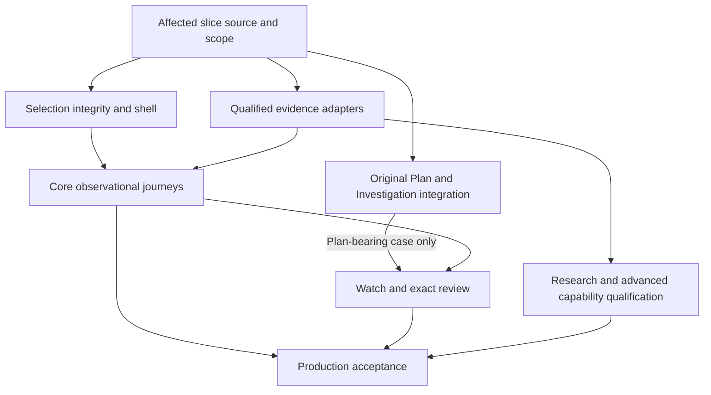

# Options Suite — Implementation Masterplan Through Round 5

## Production design baseline and Fable/T3 build contract · 10 November 2026 UTC

**Status: Round 5 recovery and source-readiness planning complete; the extended programme remains open.** This is the integrated implementation baseline, amended by [10](10_ROUND5_SOURCE_READINESS.md) and [11](11_RELEASE_AND_DESIGN_CONTRACT.md). Those files govern updated source semantics, exact original vertical scope and Round 6 work. Accepted source, release holds, original requirements, scientific contracts and runtime authority remain intact.

**Canonical carrier:** [Macro PR #10898](https://github.com/mastermindx-market-intelligence/macro/pull/10898), branch claude/options-suite-production-plan-20261109. **Programme parent:** [Terminal #599](https://github.com/mastermindx-market-intelligence/mastermind-terminal/issues/599); narrower workbench [#603](https://github.com/mastermindx-market-intelligence/mastermind-terminal/issues/603). Fable-led T3 implementation is the intended later execution model. No Fable message, worker commission, activation, merge, deployment or trade was sent or performed in this planning round.

The Chairman authorized further rounds. Round 5 recovered and verified the original packet, reconciled 528 references and completed the source-readiness/release dossier. Round 6 now uses those findings in Paper. [06_FUTURE_ROUNDS.md](06_FUTURE_ROUNDS.md) preserves later research, lifecycle, portfolio, monitoring and production-proof work. The same programme and Draft PR continue; this is not a final whole-suite implementation acceptance.

## 1. The product we are building

Options should help a serious researcher answer six connected questions:

1. **What deserves attention?** A concise scan of actual activity, source-qualified changes and saved work.
2. **What exactly happened?** Inspect the original event, contract, source clocks, population and uncertainty.
3. **What could explain it?** Compare independently qualified Flow, Exposure, volatility and contextual research without implying causality from co-occurrence.
4. **What would an explicit expression do?** Build a supported exact-contract Plan, change assumptions and understand conditional outcomes.
5. **What would change the assessment?** Save the question and evidence, then arm a supported, understandable observation condition.
6. **What did we learn?** Reopen the exact revision, inspect later comparable evidence and the selected firing, then record an assessment or examine a separately scored outcome.

The main competitive advantage should come from coherent evidence, useful explanations and dependable continuity. Dense expert tools remain reachable; the first screen should communicate the result, limitation and next useful action without requiring the user to reconstruct the backend.

### Product completion ruler

A feature is complete only when its intended user can perform its job through the actual admitted consumer, recover from its relevant failure states, and return to the exact research context. An endpoint, model artifact, screenshot, source merge or green CI establishes only its own evidence layer.

Production design requires:

- one consistent shared shell and one contextual pane;
- six understandable destinations while retaining fifteen existing view keys and deeper capabilities;
- truthful observations, conditional mechanics, research candidates, forecasts and execution outcomes;
- exact source/selection/revision identity through navigation and asynchronous updates;
- explicit authored assumptions, uncertainty, qualification and exclusions;
- useful mobile and keyboard workflows with EN/ZH and both themes;
- saved research that can be recovered without rewriting history;
- source, scientific and operational acceptance proportionate to the claim;
- concrete production/build/data proof and a safe rollback path.

## 2. Read this package in this order

| File | Responsibility |
|---|---|
| [05_IMPLEMENTATION_MASTERPLAN.md](05_IMPLEMENTATION_MASTERPLAN.md) | Current outcome, build slices, dependencies, owners and acceptance |
| [04_ARCHITECTURE_HARDENING.md](04_ARCHITECTURE_HARDENING.md) | Exact contracts and source adjudications behind the plan |
| [02_PAPER_DESIGN.md](02_PAPER_DESIGN.md) | 34 editable boards, 44 states, interaction contract and synthetic fixture |
| [03_PAPER_MANIFEST.json](03_PAPER_MANIFEST.json) | Exact page/node identities and design verification; documentation inventory only |
| [07_REQUIREMENT_TRACEABILITY.csv](07_REQUIREMENT_TRACEABILITY.csv) | 528 reference rows; prior 294 fields preserved and actual 104 OPT/130 OPR appended with Round 5 adjudication |
| [08_COVERAGE_GAPS.json](08_COVERAGE_GAPS.json) | Recovered packet disposition, actual remaining gaps and namespace boundaries |
| [10_ROUND5_SOURCE_READINESS.md](10_ROUND5_SOURCE_READINESS.md) | Current source/owner contracts and production-proof limits |
| [11_RELEASE_AND_DESIGN_CONTRACT.md](11_RELEASE_AND_DESIGN_CONTRACT.md) | Exact original release scope, next Paper work and consumer proof |
| [12_PACKET_RECOVERY.json](12_PACKET_RECOVERY.json) / [13_ROUND5_VALIDATION.json](13_ROUND5_VALIDATION.json) | Exact archive/graph and current documentation verification |
| [06_FUTURE_ROUNDS.md](06_FUTURE_ROUNDS.md) | Further architecture/design/proof rounds and the final dispatch condition |
| [01_MASTERPLAN.md](01_MASTERPLAN.md) | Preserved census, progress history, original 245-board estate and earlier decisions |
| [Frontend review](appendices/FRONTEND_REVIEW.md) | Full route/action/return mapping and source counterexamples |
| [Quantitative review](appendices/QUANT_REVIEW.md) | Domain/maturity contracts, six-pilot details and advanced-capability falsifiers |
| [Acceptance review](appendices/ACCEPTANCE_REVIEW.md) | Inherited task/acceptance adjudication and preservation decisions |

The traceability file is a versioned planning projection. It is not a replacement task database, a count of unique acceptance assertions, an Executive plan, or a source of release authority.

## 3. What already exists, and how to use it

| Area | Evidenced progress | Required build decision |
|---|---|---|
| Options estate | Existing Flow, Exposure/Structure, volatility, Statistics, Prophet lanes, exact Plan, Lab, watch/review and contextual replay work | Compose through current owners; retain all capability aliases |
| Paper | 34 new boards in the original Terminal file, 44 state components, complete primary EN/ZH path, coherent synthetic case | Use as the composition and state baseline; extend only where a real capability gap demands it |
| Flow transport | Shared cache, typed absent/failed/data behavior, one stream per feed key | Add missing evidence and identity fences inside these owners |
| Exact Plan | Existing draft/payoff plus implemented detached New/Add/Save/exact-reopen bridge on original held #804 | Integrate and qualify that branch; do not rebuild it |
| Investigation | Immutable revisions, original-operation recovery, source references, review pathway, server admission and owner guards | Preserve the incumbent kernel and its held forward-repair/migration requirements |
| Matrix/Lab | Existing admitted Lab, exact-table fallback, source-bound Brain reference; lossless retained-selection wire on #10866 | Integrate original wire and supplier paths after source/custody gates; known snapshots do not imply ordered replay |
| Exposure | Legacy analytics plus distinct dated provider-Gamma observed-v2 progress | Show exact valuation class and population; qualify stronger capabilities separately |
| Scientific programme | Six fixed OIF pilots and separate FS-5, candidate/quote-ruler and sleeve programmes | Preserve endpoints, stages, losses, multiplicity and authority boundaries |
| R1/R2 | Substantial accepted/merged subsets and retained design/acceptance ledgers | Reuse scoped evidence; discharge remaining rows individually, including P74 and P76 |
| Full inherited parity | Exact 104-task/130-requirement packet recovered with full checksums and original statuses | Apply original dependencies and row-specific acceptance; recovery does not establish implementation or full parity |

Source pins and direct references are in 04 §2/§12 and the review appendices. “Exists” is not “installed and production accepted.”

### Current material holds

- **Terminal #804:** Draft at 27df56d997df0ae94a17b6b8e2d14867431bb394; release hold 5989604142. Exact migration/application, admission, integration and authenticated consumer gates remain under the original owner. Accepted unchanged backup/restore and source receipts must not be rerun merely to make a new packet.
- **Macro #10866:** original head f9d9c1883b9a25ea2bd5f6b5b21f922a01307434 remains unmerged. Current controller hold 6756074745 records changed main CI definitions and a content conflict; earlier green checks do not prove current-base acceptance. Keep the original root/effects and exact wire limits.
- **Paper:** D08D p-2-0/1N2L-0 stays read-only. Adjacent p-Q-0/1B5H-0 and p-1-0/189S-0 custody is preserved. No substitute-board replay.
- **Other inherited held carriers:** Intraday#6867, campaign#9677, expression#9682, coverage#8191, Outlook#7328 and the full 01 register retain their dated dispositions until affected facts are refreshed. This round does not claim a new status for every carrier.
- **Uncertain/denied effects:** the original T03k/P09 and other fenced operations remain with their original owners and carriers. A new UI, a clearer document or another worker does not authorize replay.
- **Release infrastructure:** verify the existing installed-builder recovery and actual deployment state at execution time; source movement alone does not establish installation.

A held capability blocks its dependent action, not every useful Options view.

## 4. Navigation and interface contract

### 4.1 Destination map

| Destination | Retained capability depth | Principal user action |
|---|---|---|
| Overview | Current desk intelligence, observed changes, source health, saved work | Inspect one meaningful observation or resume exact research |
| Flow | Tape, Tide,0DTE, Largest, Surface, Screener, Tickers | Understand actual activity and its relevant comparison |
| Exposure | GEX/matrix/ladder, Positioning, Levels, Structure, contextual Futures/Equity replay | Inspect qualified sensitivity and compare exact populations |
| Volatility | Expiry/tenor, term, smile/skew, source comparisons | Understand dated volatility structure and what is missing |
| Research | Statistics, Lab, Options Alpha, Macro Plans, Issue Desk | Inspect evidence and scientific maturity for the exact question |
| Plans & review | Authored Plan, Compare, Saved, Watching, Review | Retain a research question, follow it and learn from outcomes |

Preserve /options→Tape, vol/screener→Flow Screener, prism→Exposure/GEX, and ?tab=0dte→internal zero_dte. Any new preset/lane grammar is an explicit decoder extension. Saved cases reuse the canonical Analysis investigation URL and exact revision.

### 4.2 Reading hierarchy

Each primary screen has three levels:

- **Assessment:** one or two short, qualified statements answering the user's question.
- **Evidence:** the actual table, plot, comparison or authored inputs supporting that statement.
- **Inspection:** exact source, terms, method, population, corrections and limitations.

Useful examples include “Activity is concentrated in this 600 Call group,” “The known sensitivity changed across these matched members,” and “This authored spread pays this amount at expiry under these assumptions.” None requires an invented confidence score.

All primary actions must have a named handler, receiver, qualified input, result state and return. A visually enabled control that only opens a generic page does not close its intended action. The frontend appendix maps the full Paper action set, including OI Changes, Unusual, source/correction inspection, exact tables, Brain reference, Save, Watch and Review.

### 4.3 Design assets to preserve

The current Paper file is [Terminal](https://app.paper.design/file/01M3NSZGE8JWN2EZCSF0DT05RM/p-1R-0).

- [Build contract](https://app.paper.design/file/01M3NSZGE8JWN2EZCSF0DT05RM/p-1R-0): 4 boards.
- [Product](https://app.paper.design/file/01M3NSZGE8JWN2EZCSF0DT05RM/p-1O-0): 10 desktop boards.
- [Responsive](https://app.paper.design/file/01M3NSZGE8JWN2EZCSF0DT05RM/p-1P-0): 14 phone and 2 tablet boards.
- [States & help](https://app.paper.design/file/01M3NSZGE8JWN2EZCSF0DT05RM/p-1Q-0): 4 atlases containing 44 components.

The original 245-board census is retained. The new design does not erase older detailed capabilities or their holds. Text uses established Inter/PingFang SC and shared tokens. Light and dark are both deliberate compositions. No decorative colored edge stripes.

## 5. Implementation graph on existing tasks

These slices are an editorial ordering of incumbent tasks. They do not create new workstream IDs, worker identities, queues or accepted runtime jobs.

This graph orders capability slices; its “Production acceptance” node is acceptance of the particular admitted slice, not OPT-100 or whole-suite closure. The recovered original OPT-100 has 15 direct/36 transitive unconditional predecessors, including core conditional Trade Lab comparison, selected-node monitoring and outcome review; see 11 §4. A read-only observational precursor or ordinary saved-case/watch/assessment increment cannot close it. Held science is required only for claims that use it; held Plan admission applies to Plan-bearing cases. Independently ready repairs such as OPT-032 retain their original prerequisites and do not wait for the entire Paper programme.

### Slice: selection integrity and coherent navigation

**Incumbents:** G00/G01/C00, U01–U04, F01/F02, existing R1/R2 shell and source tasks; relevant OPT references are preserved in the traceability projection.

**Paths:** optionsIa, OptionsWorkspace, OptionsHubView, FlowDeskView/InspectorPane, VolView, GexDeskView, analysisRoute, existing owner/auth scope.

**Work:**

1. Freeze the accepted route alias/default table and implement six presentation groups.
2. Fix stale-response identity at both assignment and render boundaries.
3. Make explicit expiry disappearance, source correction and withdrawal visible states.
4. Reconcile initial and history-change decoding for mounted workspaces.
5. Bind OI Changes preset and Prophet lane through a validated receiver.
6. Preserve focused detail/Back, filters/sort/source mode and a single pane.
7. Prove auth/entitlement changes withdraw protected responses and callbacks through existing owners.

**Exit proof:** all fifteen keys/accepted aliases; cold and warm navigation; inverted A/B response order; A→B→A account lifetime; correction with unchanged display date; selected expiry/row removal; mobile focus return. Capture actual changed UI at the required language/theme/viewport representatives.

**Release boundary:** can ship as a useful correctness/experience increment independently of unqualified child-print or predictive features, subject to its source owner and normal release gates.

### Slice: honest Flow and deep source inspection

**Incumbents:** F01–F02, D01–D04, Intraday publication, flowSource/API/cache/stream. F03/F04 prospective lifecycle obligations remain with the research/lineage slice below.

**Work:** bind the useful aggregate and reuse its existing measured NBBO block through the existing validator. Keep pre-signing measured, post-signing event and loaded-feed populations separate; shares use covered premium, with no current maximum quote-age qualification. Disclose fixed-100 arithmetic. Add source-confirmed child-print/version/quote/correction evidence only when supplied; reconcile children to their actual declared parent population, not an incompatible measured denominator. Keep unknown signing/package membership and actual DOI/Unusual rules visible.

**Exit proof:** source→publication→API→browser trace for one non-fixture qualified aggregate; optional measured-block admission and coverage arithmetic; unknown quote/terms; quiet/absent/failed/access-denied distinctions; one transport owner. Child-enabled slices additionally prove correction/cancellation, duplicate child and partial membership. Those absent capabilities do not become a new gate on a truthful aggregate precursor.

**Release boundary:** aggregate inspection remains useful before children qualify. At-ask timeline and richer classification cannot be faked to satisfy Paper.

### Slice: Exposure, Volatility and retained Lab

**Incumbents:** M01–M04, V01–V02, D01–D04, Lab A–G programme, #10866 and its existing supplier/consumer owners. V03's Plan mechanics and V04's prospective expression obligations remain separately assigned below.

**Work:** bind the actual GEX chart receiver and exact dated Gamma class; show known-subset versus full totals and nullable dated spot. Separate reported membership from qualification changes; current comparator refuses same-session corrections. Qualify a real DEX supplier before claiming receiver readiness as publication. Repair Volatility tenor/percentile/history-window semantics and add the real root/expiry receiver. Integrate lossless schema-specific retained selection through the sole Lab adapter, with correct own-side admission and exact table/2D/3D selection.

**Exit proof:** missing versus zero; raw precision; foreign/duplicate identity refusal; both-side/membership qualification; independently dated source clocks; comparable versus incompatible books; corrected exact bytes; same selected data across representations; first-availability unknown remains unknown.

**Release boundary:** known-snapshot inspection can release before temporal replay. Vanna/Charm/joint/instantaneous controls remain tied to their actual qualification.

### Slice: exact Plan → native Save → exact reopen

**Incumbents:** V03 and U02 explicitly, with U01/U04 integration, existing Plan/payoff/terms owners, original #804 and its accepted integration source. N01–N03 retain their distinct near-expiry latency, lifecycle and workflow requirements; ordinary Plan save does not discharge them.

**Work:** compose the held detached Plan bridge with the new interface; preserve explicit New research/Add/Save and native operation journal; first save is revision 1 of a new case. Reconcile original uncertain operations; keep known-commit/read-failed distinct from not-applied. Compose 0047/0043 predicates and TypeScript/admission probe forward through their original owner based on actual installed identity. Retain canonical/embedded exact readers and native lifetime guards. B04's existing-case revision-2 attachment requires correction or a separately qualified extension; it is not implemented by this bridge.

**Exit proof:** qualified ordinary-domain Plan; unresolved/adjusted terms refusal; two-leg arithmetic and aligned sampled axis; dirty input; detached copy after Add; lost response/reload; exact operation lookup; no duplicate mutation; two-tab revision conflict; account revocation; exact revision missing; reader invalidation; correct canonical and embedded return.

**Release boundary:** only after the existing migration/admission/release gates permit the real path. Reusing branch source does not clear those gates.

### Slice: core Trade Lab comparison for the first complete vertical

**Incumbents:** original OPT-062 with OPT-026/027/054/060/064, existing Plan/shortlist/conditional-valuation/terms/quote owners. This is required core scope before OPT-100, not wholly optional Round 8 depth.

**Work:** compare stock, one supported long option, one defined-risk vertical and wait. Show price-IV-time loss table and separately named expiry payoff, exact terms, executable quote convention, costs and mark clock. Reuse accepted numerical machinery in its admitted domain; the dated Gamma class or intrinsic-payoff calculator cannot masquerade as pre-expiry repricing.

**Exit proof:** the user understands what must happen and what can fail; exact assumptions/terms/clocks remain visible and reproducible. Modeled P&L, expiry payoff, quote-based research outcomes and actual fills remain separate. Unsupported structures/terms/models refuse honestly. Broader lifecycle/instrument/structure expansion stays in later rounds without erasing this core.

### Slice: watch → selected firing → review revision

**Incumbents:** existing Investigation watch/review, alerts API, evaluator, outbox, notification and operation owners.

**Work:** retain clear preview and separate Arm; reconcile ambiguous creation under the existing alert owner; add exact firing selection and history lookup/pagination where needed; keep source/read/queue/delivery states distinct; implement Unicode-safe assessment input; save a new immutable revision.

**Exit proof:** condition copy reflects strict sampled >/< or the actual wall-transition semantics; show expiry/consent only where admitted by that condition owner. Unknown Arm does not duplicate; one-shot/re-arm identity, valid delivery status, absent source clock and capped/unreadable history remain explicit. New firing cannot change the selected event during authoring; inconclusive assessment saves/reopens exactly. Ordinary price watch/assessment does not close original selected-node OPT-035 or the outcome journal.

**Release boundary:** do not promise reliable observation until the admitted evaluator and delivery receipts are observed. The condition firing never auto-confirms a thesis.

### Slice: research and signal/sleeve capability

**Incumbents:** Q01–Q05, F03/F04/V04, OA-1C/OA-3 and R05; Options Alpha/Flow books, Prophet families, Evaluation OS/trial ledger, original six-pilot and FS-5 owners. Preserve campaign correction, lawful activation prerequisites, frozen expression, prospective quote capture and full outcome attrition as explicit obligations.

**Work:** build useful evidence-maturity cards and attrition views over existing records; preserve observational/mechanical/research/forecast/execution result types; expose target, horizon, baseline, sample, exclusions and failure conditions; integrate stronger claims only when their original owners qualify them.

**Exit proof:** every displayed claim resolves to its exact evidence/domain/use status; blocked/unrun differs from negative/inconclusive; no equity-to-option performance substitution; frozen expression before outcomes; full attrition; held-out and untouched-test rules intact; no UI-enabled activation.

**Release boundary:** research transparency can ship before empirical success. Forecast ranking, probability, issuance, sizing and trading authority are separate decisions.

### Slice: production acceptance and operational completion

**Incumbents:** R01–R05, G/C, existing delivery/DB/source/telemetry owners, R2/P74/P76.

**Work:** close changed-path correctness and visual acceptance; actual source/migration/admission installation; authentic consumer journeys; real source timing and device performance; operational degradation/rollback; complete original requirement disposition.

**Exit proof:** a source/build/migration/data/consumer chain, not a pile of screenshots. Required CI is exact-head and concluded. Reuse accepted unchanged evidence. Record remaining limitations and held capabilities clearly.

## 6. Backend field and ownership map

| Contract | Existing source/command owner | Required extension or composition |
|---|---|---|
| Selection/return | Workspace/route reducers, authenticated owner lifetime | Tagged responses, strict handoff receiver, same history decoder, exact return |
| Flow evidence | Flow producer/API/stream/cache and existing measured validator | Reuse aggregate NBBO; preserve distinct populations/covered denominator and terms limits; qualify later children/lineage separately |
| Exposure/volatility | options_hub, projection/terms/model owners, Lab adapter | Dated chart domain, DEX supplier proof, lossless side admission, actual tenor/percentile/history window and compatible comparisons |
| Candidate/sleeve | Formation/campaign/evaluation/trial owners | Per-claim maturity/attrition projection; preserve existing activation/use contract |
| Plan and calculation | optionsPlanDraft/payoff/terms + #804 | Integrate existing v3 option_plan and exact reader; no duplicate calculator/save owner |
| Retained evidence | Native source retention/resolver + Investigation references | Exact historical resolution, current rights, correction/retention behavior |
| Watch/delivery | Alerts/evaluators/outbox/notification | Existing-owner arm reconciliation, exact firing selection/history and truthful status |
| Review/outcomes | Investigation revisions + empirical outcome owners | Separate authored assessment, underlying label, quote-ruler, fill and portfolio result |
| Observability/release | Current telemetry, source publisher, DB/deployment owner | Correlated bounded proof, stage latencies, refusal reasons, installed identity and rollback |

A new component is warranted only when the incumbent genuinely lacks the required function. Prefer a narrow adapter or extension. Use maintained existing libraries for generic charting, tables, accessibility and numerical primitives; custom work belongs in differentiated semantics and scientifically validated models.

## 7. Scientific implementation contract

### 7.1 Preserve six exact primary pilots

| Pilot | Exact target | Primary scoring |
|---|---|---|
| Pilot.P1 | Next exact 30-minute log high/low range from completed activity | Squared error; prescribed >2% MSE improvement |
| Pilot.P2 | Next 30-minute market/sector residual total-return log increment from signed dollar delta | Squared error; prescribed >2% improvement |
| Pilot.P3 | Matched 20-session ACT/365F realized variance | QLIKE;0.01 paired-loss margin |
| Pilot.P4 | Five-session market/sector residual log total return after the registered one-session skip | Squared error; prescribed >2% improvement |
| Pilot.P5 | Next 10-minute variance under the fixed SPY/QQQ/IWM inventory/shock study | QLIKE;0.01 margin |
| Pilot.P6 | Actual full-fill implementation shortfall within 60 seconds, initial option-premium bps | Absolute error;5-bps MAE improvement |

These are inherited research-design choices, not newly discovered product thresholds. Preserve exact feature/domain/population/baseline rules, the six-member one-sided Holm family, blocked/unrun/invalid p=1, training/frozen-validation/matured-power/final-test ordering, and existing G0–G6. Do not substitute generic direction prediction or invent universal 20-per-bin/200-total gates.

The November 1 S0 seal must be read with its blindness audit and inputs addendum. Empirical windows and bindings remain separate. Some required validation histories and matured outcomes cannot be created by adding workers or spending another planning round. The [quantitative appendix](appendices/QUANT_REVIEW.md) links the complete human and JSON contracts and records the exact constraints.

### 7.2 Preserve outcome types

Plan expiry payoff, OA3's exact one-long-contract H+60 ask-in/bid-out research ruler, P6's actual fills/fees, underlying returns, user assessments and actual portfolio outcomes remain distinct. A missing option outcome cannot be replaced with the stock return. A later best-performing option cannot retroactively become the selected expression.

Research can revisit expressly reopened hypotheses while retaining earlier negative evidence and prior exclusions. Revival is a registered successor study, not automatic promotion or permission to reuse an inspected holdout.

## 8. Acceptance matrix and anti-shortcut tests

### 8.1 Coverage accounting

| Namespace | Recovered count | Meaning |
|---|---:|---|
| EXEC | 35 | Existing execution rows; plus original C00 parent by reference |
| AC | 60 | Original acceptance assertions |
| R2 | 76 | Original product requirements; production acceptance is not established by the design |
| SUP | 123 | Dated claim dispositions, not 123 new implementation tasks |
| Paper | 34 boards /44 state components | Design artifacts and specimens |
| OPT | 104 recovered tasks | Exact source rows, dependencies, conditions and child contracts preserved |
| OPR | 130 recovered requirements | Exact 112 competitor-referenced +18 product rows, owners and acceptance preserved |

The 528 rows reference overlapping layers; they are not 528 independent tests or a completion percentage. All original fields of the prior 294 rows are retained unchanged in the CSV. Added round5_* columns provide current adjudication/next proof; original_acceptance_text and dependency/child-contract columns preserve recovered semantics. OPT/OPR IDs are intrinsically qualified; earlier qualified IDs remain unchanged. The archive contains the complete original documents.

The 123-claim source register contains 75 accepted/do-not-redo, 17 held, 17 superseded/obsolete, 13 retained/open and 1 unknown claim. Preserve each as a dated disposition; later exact receipts may qualify a change. The unknown claim remains unknown.

Namespace every reference. Paper.S02/P01 is not R2.P01 or Pilot.P1. FrozenEnrollment.P09 is not R2.P09. R1.W1–W5 and EXEC.R01–R05 are separate. No unqualified “P09 done” statements.

### 8.2 Required proof layers

| Layer | What proves it | What does not |
|---|---|---|
| Design | Exact editable nodes, source-bound states, coherent content and visual review | Screenshots prove no API or persistence |
| Source | Owned diff, exact schema/method, focused checks, compatibility and actual review rule | Source merge proves no installation |
| Data | Qualified original input, clocks, population, units, correction lineage and access | Digest proves no historical knowability |
| Consumer | Actual source→API→screen action and recovery | Mock response proves only fixture behavior |
| Persistence | Owner-scoped commit, exact operation/revision readback and reopen | Draft/Add acknowledgement proves no save |
| Science | Original registered evaluation and required admission | Backtest/UI confidence proves no trading authority |
| Production | Installed source/migration/admission/data and authenticated real journey | Hosted CI proves no production transaction |

### 8.3 Make-or-break cases

The original requirements remain authoritative. At minimum the changed core loop must fail honestly on:

- root A/B response inversion and account A/B/A lifetime;
- equal date with corrected source bytes;
- withdrawn row or vanished explicit expiry;
- missing wing, absent side, missing Greek and observed zero;
- incompatible comparison model/population/currency/terms;
- unknown original source availability and unavailable retained book;
- protected source denied after a saved reference was created;
- incomplete package or missing child membership;
- Plan dirty calculation, unsupported terms and calculation grid mismatch;
- double action, lost response, reload, missing operation receipt and revision conflict;
- old requested revision missing while latest exists;
- ambiguous Arm and capped/unreadable firing history;
- later firing during authored assessment;
- long Unicode paste and translated errors at narrow width;
- 3D failure with exact table still available;
- price trigger interpreted as thesis success;
- quote-ruler result mislabeled actual execution;
- source/evaluator freshness hidden behind a healthy wrapper;
- a capability shown as production accepted solely because a PR merged.

## 9. Rollout, migration and rollback

Implement vertical capability slices so each has an observable user outcome. Freeze accepted schemas and changed-path acceptance before handing bounded work to builders. Existing in-flight source owners remain authoritative for their paths.

Use additive compatibility where appropriate. Retain old supported URLs, saved revisions, operation receipts and source references. A new presentation can be introduced progressively through existing configuration; do not build a second feature-flag or access system. Old data remains readable under its original semantics or explicitly unavailable, never silently reinterpreted.

For database/release work, preserve the incumbent forward migrations, exact bytes, approval/application conditions and authenticated proof. Do not invent migration filenames, edit applied migrations or replay unknown operations. Existing accepted backup/restore proof is reused unless materially invalidated.

Rollback has distinct scopes:

- **Presentation:** return to the prior composition while retaining canonical cases, references and operation identities.
- **Source adapter:** withdraw the new qualified capability and expose truthful fallback; retain original evidence and corrections.
- **Model claim:** withdraw the specific forecast/use through the existing research owner; keep descriptive observations.
- **Persistence/release:** follow the incumbent migration and installation recovery contract; never erase committed revisions or uncertain receipts to make rollback appear clean.

Instrument p95 local response against the proposed 200ms target and the original R2/P74 approximately 13k-contract profile. Preserve applicable D08 web-vital targets and label lab versus field measurements. Measure acquisition, compute, publication and browser delay separately; cache TTL is not evidence freshness.

## 10. Fable-led T3 execution model

**Intended role:** Fable leads architecture-sensitive integration, continuity and acceptance across Terminal, Macro, Investigation/DB, data publication and quantitative owners. This matches the Chairman's requested team shape.

**WHY FABLE:** the remaining mission crosses held source branches, persistence/migration contracts, data qualification, UI identity semantics and distinct scientific programmes. The principal must adjudicate conflicts and keep the original acceptance intact across long-horizon integration. This is a principal responsibility; importance alone is not the justification.

Bounded workers should own independently testable slices through the actually admitted least-scarce routes. Do not assign all coding to Fable or introduce managers whose only job is relaying messages.

| Responsibility | Accountable role in the eventual team | Bounded result |
|---|---|---|
| Programme integration | Fable/T3 principal under current assignment | One coherent outcome, resolved cross-owner decisions, original scope preserved |
| Source/contract integration | Incumbent data/publication and Options owners | Qualified inputs and exact adapter behavior |
| Frontend composition | Terminal owner with bounded engineering/design labor | Routes, states, responsive/action closure and browser proof |
| Plan/persistence | Original Investigation/Plan owner | Admitted native path, migration/recovery and exact reopen |
| Quantitative validation | Existing research/evaluation owners | Exact study outcomes and permitted claims, including negative results |
| Release/operations | Existing deployment/DB/telemetry owners | Installed consumer identity, degraded operation and recovery |
| Acceptance | Assigning principal and actual binding review controls | Evidence against original user jobs; no self-issued formal approval |

This is a planned responsibility map, not a list of started workers. At dispatch, use actual source custody and admitted tools/capacity. Preserve original-root accounting and unknown effects. No Slack or T3 message is authorized by this document alone.

### Minimum eventual commission packet

The full brief lives here and in its linked sources. It must bind:

1. the exact accepted revision of this package and current affected source heads;
2. the verified original packet, exact original rows and explicitly bound conditional dependencies;
3. one ready useful slice with exact paths, inputs, outputs and non-goals;
4. original dependency/hold and mutation-carrier identities;
5. design targets and truthful degraded behavior;
6. source/data/consumer/production acceptance and falsifiers;
7. actual writer/capacity/runtime grants and appropriate release controls;
8. evidence return location and parent consumption;
9. rollback and continuation after a partial or negative result.

Do not dispatch a packet consisting only of “make it billion-dollar quality” or a link to a screenshot.

## 11. Current disposition and next action — Round 5

**Completed:** exact original packet recovery with CRC/checksums; 104-task CSV/JSON/graph and 130-OPR ownership validation; 528-row crosswalk preserving prior rows; source-readiness dossier; updated native Plan/Matrix/Save/watch contracts; exact first-vertical dependencies; and concrete Round 6 design inputs. Prior Round 4 architecture, accepted narrow source work and the 34-board/44-state Paper artifact remain preserved.

**Still owed:** remaining deep design and source contracts; semantic repairs identified in 10; held integration/admission; exact retained-source and firing-history behavior; real implementation/installation/consumer proof; P74/P75/P76; original scientific stages; usefulness and release acceptance. Recovery is not acceptance.

**Next:** Round 6 Paper work in 11 §8, especially B04, Flow aggregate semantics, Volatility correctness, Opportunities, core Trade Lab and Monitor. Independently ready original correctness work retains its own prerequisites. No restart of the census, new task hierarchy or Fable/T3 dispatch is required by this document.

The planning PR remains Draft. The eventual commission must cite the exact accepted package, real runtime grants, original effects/holds and bounded acceptance return. No application, Paper, production, SQL or activation effect occurred in Round 5.
