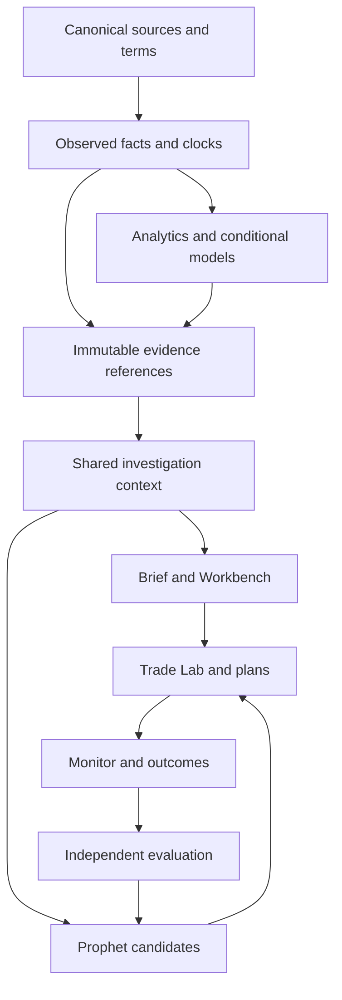
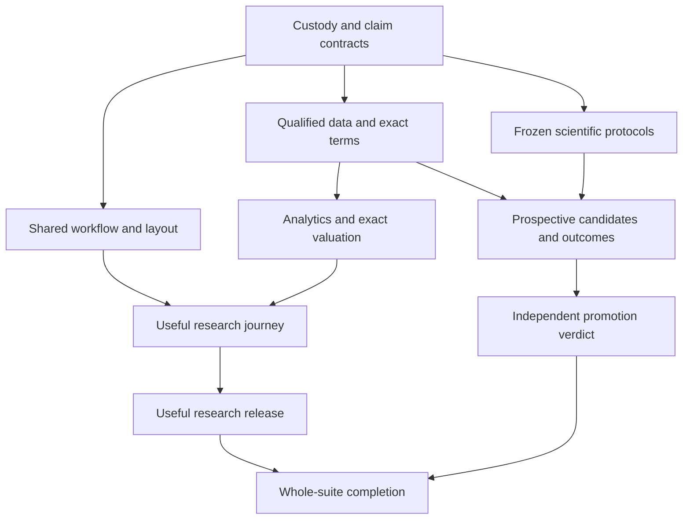

# Terminal Options and Options Prophet
## Whole-estate audit, north star and Fable execution masterplan

**Audit date:** 21 October 2026. Source and carrier snapshot cutoff: 10:50 UTC.  
**Commission:** complete-suite product and intelligence upgrade, including Options Prophet.  
**Deliverable state:** reviewed planning packet. No implementation, takeover, ticket creation, deployment, purchase, message or scientific promotion was performed by this audit.  
**Execution design:** Fable Meta-CEO → seven substantive Opus domain suborchestrators → bounded Subagent Fabric work, with principal execution where difficulty or authority requires it.

## 1. Executive judgment

Terminal has substantial Options infrastructure, real delivered product slices and serious research. The estate is nevertheless far from a complete, consistently useful Options decision system. Its main deficit is the incomplete connection between **a trustworthy observation, an intelligible market thesis, a suitable exact structure, a monitorable risk plan and an honestly measured outcome**. Adding more independent dashboards will not close that connection.

The high-reaching goal is to make Terminal the place a user can understand the options market, identify a defensible opportunity, compare ways to express it, see how each can lose, preserve the evidence and monitor the result. A professional should be able to inspect the underlying contracts, quotes, assumptions, models and historical evidence. A newcomer should be able to reach the same correct conclusion without first learning the vocabulary of every chart.

**North-star product promise:** every supported opportunity becomes a complete, source-grounded decision dossier. It explains what changed, why the hypothesis is worth investigating, what contradicts it, which horizon matters, which exact expressions fit, their costs and downside, the conditions that would invalidate the thesis, and what subsequently happened. When evidence does not justify an opportunity, the product gives a useful reason to wait.

Three decisions follow from the audit:

1. **Unify the experience around user jobs.** Use Market Brief, Opportunities, Workbench, Trade Lab and Monitor as the five primary destinations. Existing analytic views become lenses, presets and contextual tools within those jobs. Preserve deep links and useful expert controls.
2. **Complete the original release and evidence chains.** The current Fable R1, sibling R2, Lab, Exposure, Flow, OA-3, AD1 and Institutional Options programmes contain work to adopt. Apparent chat inactivity does not establish abandoned ownership. Continue their valid carriers and transfer a specific responsibility only after reconciling its source, receiver and effects.
3. **Pursue advanced intelligence with explicit empirical standards.** Build ambitious volatility, positioning, flow, catalyst, structure and portfolio machinery. Separate the useful descriptive product from unearned predictive claims. Earn qualified buy/sell candidates and risk decisions family by family; preserve failed experiments and source limitations.

The packet contains **60 audited capability units, 104 planned work packets, 11 competitor references, 130 detailed competitor and product requirements and a 92-entry source register**. These are explicit census units, not a claim that every runtime, raw record or paid competitor interaction was inspected. The task graph is acyclic and every census item maps to work. No defensible single completion percentage can currently summarize the estate.

## 2. What the audit establishes

### Evidence and limits

The audit pinned Terminal `master` at `d9ec4d2b86e9e9e0129d7fcd4c646f25f7670c49`, Macro `main` at `d18dbe338fda75691d2f548efcd3a54242ea5978`, and the protected Mastermind procedure source at `a0faf7e44f76ac77c61e177738663544ddb6949d`. Terminal's recursive tree returned 7,941 entries without truncation. Relevant plans, source contracts, current PR states and issue receipts were read; the full raw historical ledgers were not reprocessed.

Current public competitor material was reviewed alongside the retained internal teardowns. Competitor documentation establishes advertised features and semantics. It does not establish predictive accuracy, latency or complete service quality. Two retained repository screenshots were visually inspected as historical fixture evidence. They are not screenshots of the current entitled production product.

The connected browser reached the Options subscription gate at `https://app.mastermind-x.com/options`. Therefore this audit **does not claim a fresh entitled production walkthrough**. It relies on pinned code and precisely scoped retained production receipts where available. Fable's release acceptance must use a legitimate authorized session and current natural data. [A-browser]

An attempted bounded paid-Fabric census request ended with `EXECUTION_NOT_ELIGIBLE`, return code 78, `canonical_source_unreadable`, no accepted work product and `retry_allowed=false`. Worker start and execution absence were both unproven. That original disposition was preserved. Two native principal reviews supplied product and quantitative judgment; they were not represented as Fable or Opus workers. The current runtime projection also had unjoined provenance and an unarmed CEO submission path. No actual Fable/Opus hierarchy was launched. [A-runtime]

### Status vocabulary

| Evidence state | What it permits us to say |
|---|---|
| Source exists | The implementation or contract is present at the stated revision. |
| Source accepted / merged | The specified change passed its stated source gates and landed. |
| Installed / deployed | The serving or job source identity was checked. |
| Natural source proven | The original producer advanced through the intended schedule with meaningful coverage and clocks. |
| Consumer proven | The actual entitled user path consumed that source correctly. |
| Useful | Representative users completed the intended decisions accurately and efficiently. |
| Scientifically qualified | The specific claim passed its preregistered, independent evidence requirements. |
| Product accepted | All applicable source, rights, operating, scientific and usefulness gates passed for a defined scope. |

One state never silently grants the next. Missing data, an intentional research abstention, a disabled unadmitted capability and a reproduced defect are separate conditions.

## 3. The estate: what exists and what remains

### 3.1 Experience and navigation

The current workspace has seven categories: Command, Flow, Exposure, Structure, Volatility, Statistics and Prophet. Its IA registry contains fourteen workspace views. `OptionsHubView.tsx` declares sixteen `TabKey` values, but Leaders and Radar are relocated and legacy aliases remain; this is not sixteen visible top-level tabs. The hub is 4,931 lines, approximately 261,000 characters. Existing dynamic imports, source gating and shared flow caches are useful foundations. The sensible migration is staged extraction around stable contracts, not a whole-product rewrite. [S13, S14, S29]

The retained Lab screenshot exposes a design weakness: several navigation/status/title/explanation rows occupy much of the upper viewport before the analytical stage begins. The 3D form is visually compact relative to its container, and interpretation depends on a separate inspector. The retained scanner screenshot is calmer and more readable, but its fixture shows only one admitted row and empty historical content. Neither proves the complete suite is useful under real coverage. These observations motivate measured redesign; they are not current live layout failure claims. [S07, S08, TPR1083]

Some layout work is already accepted. The October 14 Paper receipt for Terminal #1001 records actual deployed and authenticated EN/ZH desktop, tablet and phone geometry and chart-return journeys. Preserve that narrow success. Later #1083 and #1091 extend Exposure; their existence does not erase the remaining source or interaction gates. [S21, TPR1083, TPR1091]

### 3.2 Flow, source coverage and statistics

Tape, Tide, 0DTE, Largest Events, ticker views and screeners exist. Current source includes SSE and dated replay families. The July claim that the whole product has no SSE, replay, alerts or expanded IA is obsolete. There are canonical Options alert evaluators, a read-only exact-contract shortlist, CSV exports and shared data access. [S02, S13, S30, S31, S33, S34]

The October 20 Flow receipt accepts #1061/#1090 with real authenticated filtered, sorted and deep-linked Tape use in EN/ZH. The natural startup also consumed the accepted 30 configured EOD-252 baselines. Its source read reported 28 requested roots and 11 successful roots; those are different denominators. Full-day premium baselines are explicitly not adjusted for time of day. This is a meaningful scoped product acceptance, not proof of whole-market coverage, sub-minute latency or incident-free operation. [S21, MPR9664]

Remaining Flow work includes:

- Complete #9808's prior-session price chain. The PR is open at the snapshot; its qualified installer is unexecuted. Historical qualification accepted 27/30 inputs and retained missing/stale names. The fixed contract requires the previous NYSE session's native `close_price`, not a convenient older or adjusted close.
- Maintain the recovered commodity/rate anchors through #9739 and the original daily maintenance path. Do not repeat the completed backfill or baseline repair.
- Bring raw conditions, quote classification, corrections, package identity, venue populations and true source cadence into coherent consumer contracts.
- Complete Statistics. The current category is explicitly a placeholder without its separately gated publisher.
- Generalize filter groups and alerts without creating a second alert or persistence owner. [MPR9808, MPR9739, S21, S29, S31, S40]

The 0DTE/Largest selectors currently process **contract-level aggregates from a poll batch**, not necessarily individual trades. Show aggregate events, constituent print counts and premium without implying one record is one institutional trade. [S40]

### 3.3 Exposure, positioning, scenarios and research lab

There is meaningful source and visual capability: matrix, strike and expiry views; profiles; aggregate trends; delta-space views; chart levels; own-history comparisons; historical GEX ladders; source-aware exposure projections; and a Lab with chain/table and matching-session raw IV. [S02, S33, S36, S41, S42]

The current source also has a concrete defect. The #1091 owner reproduced initial source failure → Retry → return of the same-digest book without restoring the selection, and the return status can disappear. The inspected `ExposureMap.tsx` still guards its return-resolution effect with a non-null `returnCheck`. Repair that exact recovery transition on the original carrier and preserve the controls. It is unnecessary to reopen every previously accepted return journey. [TPR1091, S35]

Macro #9815 delivered the native source-bound exposure projection. The actual historical SPY evidence associated with #1083 included 13,104 contracts, 33 expiries and 6,552 strike-expiry cells, with 12,212 qualified Gamma contracts and 892 unavailable. This is an October 16 historical book acquired later, not an authenticated historical point-in-time forecast or current live book. The original QQQ acquisition returned HTTP 472/native NO_DATA with no captured pair. Its response-specific cause was not retained by the reviewed wrapper. Preserve that unknown cause and original acquisition custody; do not switch providers or retry to create apparent health. [MPR9815, TPR1083, S21]

The Lab's state is particularly clear in source:

- Chain volume/OI/ΔOI and exact table: implemented.
- Raw IV for a compatible source session: implemented.
- Fitted volatility surface: not established by raw IV alone.
- Replay and change: requires shared dated chain frames and availability clocks.
- Flow and packages: lacks package identity and dated quotes in the supplied snapshot.
- Scenario lens: requires verified terms, entry prices and an admitted Plan valuation output.
- Save investigation: disabled pending genuine source-use and IW2 integration. [S36]

These unavailable states are preferable to fabricated values, but they are unfinished product commitments. The programme must complete their upstream contracts and useful journeys.

Full-book scenario work also exists. Macro #8684 and its #8920 test carrier remain open. #9927 is merged source with a narrow qualified domain: standard SPY/QQQ American calls under its specified carry and dividend restrictions. This is not arbitrary American-option valuation or a granted public scenario API. Terminal #640/#661 are draft scenario integration work. Preserve the original pricer and extend supported domains explicitly. [MPR8684, MPR8920, MPR9927, TPR640, TPR661]

### 3.4 Options Prophet and scientific readiness

Prophet already separates MacroPlans, Options Alpha and the private operator-reviewed Issue Desk. The August audit and architecture describe immutable episodes/campaigns, selection, exact expressions, portfolio comparison and lifecycle management. The current problem is unfinished acceptance and integration, not absence of an architectural idea. [S06, S10, S32, S38, S39]

The recorded quantitative state is materially below a production prediction system:

| Receipt | Observed facts | Consequence |
|---|---|---|
| Flow gate, October 18 | 103,893 ledger rows over 49 sessions; 11,319 ordered-clock rows; 92,574 legacy-unknown rows; zero non-null published clocks; scoring disabled | A large ledger does not establish independent trades, historically knowable decisions or calibrated predictions. |
| Campaign checkpoint | 8,385 campaign revisions and 28,423 outcome records; training and action authorities false | Preserve exact prefix and incident repair. Do not turn row count into sample size or option profitability. |
| Dislocation gate, October 1 | 48 dates against that gate's 120-date requirement, 408 names; scored false, weight zero | Cross-sectional breadth does not replace temporal evidence. Its short-regime statistics do not grant alpha. |
| OA-3 | Exact long-option evaluator and retained-evidence consumer source exist; #9663 merged | Prospective expression formation, qualified terms, quote capture and lifecycle remain separate obligations. |
| Issue Desk | Private research-only contract; four new issues over three sessions; automatic authorities false | Preserve policy until a precise qualified successor is accepted. |

Sources: [S23, S24, S26, MPR9663, S39].

The current B5 outcome composition waits on #9682's exact-expression publication dependency. Its incident cohort distinguishes **24,578 lawful, 28,423 incident and 3,845 quarantined records**. These counts are not a new universal outcome population. Source preparation does not activate live capture or scientific admission. [S21, MPR9682]

The Institutional Options programme is substantial. Its original root contains a twelve-family atlas, six frozen pilots, G0–G6, the merged #9492 identity-link numerical kernel, a positive-link variance candidate and repeated empirical qualifications. Some research returns remain archived rather than canonically persisted; source adoption is a real task. [IOB15–IOB18]

R18's primary retrospective test on 312 weekly origins did **not** earn promotion: variance QLIKE worsened from 0.4025873 to 0.4145204, risk Brier worsened from 0.1759672 to 0.1789086, and both adjusted primary p-values were 1. The alternative lag was not a selected winner. Preserve those scoped findings and do not retune the same feature block on the same inspected weeks. They do not prove that every form of options information is useless. The next valuable experiments require genuinely new qualified observations or a different known-book hedge-utility question. [IOB18]

### 3.5 Operations and completeness

AD1 still owes its original producer/consumer proof. A cancelled workflow with runner ID zero and no steps does not show producer execution. The context-audit v2 charter also addresses a real growing-corpus problem; implementation remains separately gated. Do not solve it by widening a pinned v1 bound, hiding a timeout, truncating owner history or coupling it back into another trusted-context publisher. [S04, S12, S21]

These findings justify a complete programme. They do not justify a blanket statement that nothing works. Preserve accepted slices while making the unfinished state visible and actionable.

## 4. Reconcile the masterplans and live programmes

| Existing programme | Retain | Required reconciliation |
|---|---|---|
| July Options Parity / Superintelligence | Competitor catalogue, shared tape/replay/filter/IA goals, source truth and early accepted slices | Replace obsolete current-state assertions with this snapshot; reopen only actual unmet obligations. |
| Market Structure Core | Corrected spot-grid flip, profiles, level grades, chart overlay, positioning and source boundaries | Maintain recorded negative level results; finish scenarios/intraday/participant/forecast obligations without a second model owner. |
| Volland parity | Existing trend, delta-space and positioning work | Old estimates of data cost, coverage and inventory identifiability require fresh evidence; mathematical observables and unvalidated proprietary interpretations must remain separate. |
| August consolidated programme | Four enduring source/production responsibilities, canonical data planes and authority progression | Make this the architectural foundation; Opus supervision domains do not create extra data owners. |
| Options Alpha / Prophet | Candidate, episode, campaign, exact-expression, outcome, Issue Desk and evaluation identities | Complete the existing chain and precise downstream admission, then extend strategy domains explicitly. |
| Workbench / Lab #603 | Geometry, source failures, replay and typed scenario adapters | Adjudicate local unlanded proposals against current source; complete useful 2D/table first and justify optional 3D. |
| Fable R1 / Terminal #1096 | Sector→holding→exposure→chart→matched change→save/watch/review | Absorb into the whole-suite journey; source-only W1 tests are not final product acceptance. |
| Sibling Fable R2 | Delta and node reducers with explicit exclusive paths | Preserve its writer and exact return identities. |
| Institutional Options | Atlas, six pilots, kernels, original negative results, G0–G6 | Resolve persistence, unknown worker returns and binding fields; no second HAR/evaluation implementation. |

References: [S01–S06, S07, S21, S22, S27, S28, S41–S43, IOB15–IOB18].

R1's proposed investigation type and its manifest wording must be checked against the exact currently admitted IW2 application/manifest/source-use contract. Different version numbers alone do not prove a schema incompatibility. The actual question is whether Save, read and reopen compose the genuine rights and recovery semantics. Likewise R1 watches must compose P09's trusted prior, arming, source/action authority and explicit category consent. The preparatory `options_exposure_node` category remains off by default. [S21, S27]

### Custody and takeover procedure

Fable should maintain a single integration map with each original root, branch, writer, controller, receiver, accepted artifacts, pending effect and next permitted action. Continue active original work. If a responsibility needs a new executor, transfer that responsibility through the existing custody mechanism after settling or explicitly preserving unknown effects. Do not create another observer, poller, outcome ledger, source collector or implementation root merely because the previous chat looks idle.

The three user-reported sibling efforts are inputs to this reconciliation, not evidence that their work is useless. The inspected records already show recent meaningful activity. The masterplan gives Fable strategic authority to consolidate the outcome, with scope-specific handover for implementation ownership.

## 5. Competitive parity and the ambition beyond it

The companion competitor CSV is an eleven-reference family map. `TERMINAL_OPTIONS_PARITY_REQUIREMENTS.csv` expands it into 130 individually mapped capabilities with concrete acceptance criteria, evidence limits and task links. Core inherited competitors are Quant Data, SpotGamma, MenthorQ, VolSignals/VS3D, IVolatility and Volland. The current commission additionally requires TerraShade, GammaPulse and the 3D/Quanted work; MomoEdge provides an integrated workflow reference. OptionStrat is an additional structure-design benchmark.

| Capability family | Parity reference | Terminal obligation |
|---|---|---|
| Tape, filters, conditions, statistics and alerts | Quant Data; SpotGamma | Qualified print/aggregate semantics, corrections, packages, reusable filters, credible cadence and useful statistics. |
| Exposure, ladders, price maps, expiry and replay | TerraShade; GammaPulse; Quanted; VS3D | Whole admitted population, shared session clock, coherent metrics, exact selection and responsive linked views. |
| Positioning, scenario and participant analysis | SpotGamma; VS3D; Volland | Explicit inventory assumptions or observations, full repricing, units, membership and empirical limits. |
| Volatility, earnings and relative value | IVolatility; Quanted; MenthorQ | Matched-tenor surfaces/history, event variance, IV/RV, skew/term and economically useful comparisons. |
| Structures and pretrade decisions | OptionStrat; IVolatility | Exact legs, costs, scenario losses, lifecycle risk, constrained alternatives and saved monitoring. |
| Integrated context and scan-to-investigation | GammaPulse; MomoEdge; MenthorQ | Brief, opportunities, ticker dossier, sector/holdings context and coherent next steps. |
| Layouts, mobile, education and reproducibility | All retained product families | Efficient presets, optional expert composition, accessible exact data, saved state and trustworthy exports. |

Sources: [E01–E10, E17] and retained internal catalogues [S01, S02, S41, S42].

### Detailed requirements and newly explicit scope

The 130-row acceptance register contains **112 competitor-referenced requirements and 18 Terminal product requirements**. Each has one accountable task and lead, plus collaborating task IDs. Those links assign responsibility; they are not extra unconditional dependency edges. The current public/retained catalogue is a baseline to reconcile, not exhaustive authenticated proof of every paid application.

The detailed pass found eleven obligations that were too easy to hide inside broad parent tasks. Their exact acceptance contracts are now attached to the accountable task's `required_bounded_child_contracts`:

| Requirement | Explicit capability or decision | Accountable packet |
|---|---|---|
| OPR-050 | Participant-position OHLC, comparison marks and strike/expiry rebucketing on an admitted position basis | OPT-053 |
| OPR-055 | Spot/volatility regression, beta, residual gauges and historical comparison | OPT-058 |
| OPR-056 | Reproducible spread/depth/liquidity measures; unresolved dealer-specific semantics stay visible | OPT-064 |
| OPR-057 | Direction/volatility plane and short/swing/long horizon-extremes scanner | OPT-058 |
| OPR-058 | Positioning-implied skew reference with declared assumptions and independent review | OPT-058 |
| OPR-059 | Actual versus theoretical **notional-delta** curves, with a defined reference book | OPT-053 |
| OPR-060 | Separate dispositions for proprietary regime, stability, reaction-zone, swing and catalyst gauges | OPT-053 |
| OPR-081 | Halt, LULD and REG SHO notices, correction/resumption and plan lifecycle integration | OPT-023 |
| OPR-086 | Every retained asset class and external chart/API destination, with basis and rights | OPT-099 |
| OPR-109 | Grounded reproducible strategy research/backtesting, including context capacity and retention | OPT-080 |
| OPR-119 | Explicit native packaging, offline and push decisions in addition to responsive web | OPT-031 |

These are obligations to specify, build and qualify on the original owners, or to resolve explicitly where the comparator is unobservable or outside an admitted domain. A generic profile, raw IV chart, responsive screenshot or narrative assistant cannot close them. An original documented functional equivalent can meet a user workflow; an undisclosed vendor formula remains unverified numerical parity. The retained Quant Data catalogue also says “15 Greeks” while listing fourteen; reconcile the catalogue instead of inventing a fifteenth metric. [S01, S02, S41, S42, S43; detailed OPR references]

**Parity means a complete task on supported real data.** A disabled control, impressive screenshot, API shape, fixture or unmounted component fails. Fable must reconcile the attached feature-level register against the full retained catalogues and the exact current product tier before making material architecture or data commitments. Each subfeature maps to a current implementation, a concrete task, a functional equivalent or an explicit unresolved/de-scoped item. The register is a researched acceptance inventory, not a claim of exhaustive authenticated access to every paid competitor screen. Full parity cannot be claimed while an item is silently excluded. Proprietary vendor labels and claimed predictive performance are not scientific specifications.

The differentiating goals are proposed product opportunities, not assertions that no competitor already has them:

1. **Thesis-to-structure intelligence:** compare the expression with the underlying, alternatives and waiting; explain the trade-off in the user's actual horizon and risk budget.
2. **Evidence that changes with the thesis:** show which support weakened, which contradiction appeared and whether the new information was available before the decision.
3. **Inventory uncertainty made useful:** scenario ranges and known coverage instead of falsely precise dealer holdings; identify decisions robust to plausible inventory assumptions.
4. **Event-aware volatility economics:** separate being right about direction from overpaying for volatility, timing decay badly or taking avoidable assignment risk.
5. **Portfolio-aware opportunity quality:** detect overlapping sector/theme/factor exposures and compare a new position with a hedge or no addition.
6. **A continuously accountable record:** retain the original candidate, expression, source state and realistic outcome, including abstentions, bad calls and unavailable data.
7. **A genuinely teachable workflow:** guided explanations that improve decision comprehension while experts retain the complete analytical tools.

## 6. Product and layout architecture

### Five primary jobs

| Destination | User question | Default content | Advanced depth |
|---|---|---|---|
| **Market Brief** | What matters now, and what changed? | Market context, meaningful changes, risk calendar, data coverage and a small investigation queue | Breadth, sector/ETF concentration, conditional regime comparisons and source detail. |
| **Opportunities** | What deserves investigation and why? | Sparse candidate dossiers with support, contradiction, horizon, readiness and reason to wait | Family-specific ranking, evidence lineage, comparable cohorts and uncertainty. |
| **Workbench** | What does the market evidence actually show? | One large price/flow/positioning view, exact selection and contextual inspector | Chain, exposure, volatility, history, participant scenarios and optional task-proven 3D. |
| **Trade Lab** | How could I express the thesis, and how can it lose? | Two or three defensible alternatives with cost, loss scenarios and invalidation | Exact legs, Greeks, model controls, structure search, density and portfolio stress. |
| **Monitor** | What changed in my investigations and plans? | Watches, thesis changes, expiry/event risk and review queue | Exposure aggregation, hedge analysis, outcome attribution and audit trail. |

These are navigation responsibilities. They share the existing data, valuation, persistence and lifecycle owners.

### Proposed layout specification

The following are starting design constraints to test, not measurements of the current product:

- A compact suite navigation row and one persistent context row. Instrument, source session/as-known time, expiry scope, metric/normalization and live/replay state have a visible owner.
- On a typical desktop, start with roughly **65–75%** of usable width for the analytical stage and **25–35%** for the contextual inspector. A roughly 300–380px inspector is a starting range, not an immutable rail. It must collapse, resize and respect content needs.
- Put the main chart or comparison in the first meaningful viewport. Avoid stacking category navigation, view navigation, a large title, several banners and generic instruction cards above it.
- Lead with one main visualization and two or three supporting summaries. An expert can choose a multi-panel preset. A newcomer should not face thirteen equal-weight cards.
- Place the selected finding, source freshness, strongest contradiction and next useful action together. Keep explanations expandable; preserve critical limitations at the point of interpretation.
- Use readable critical text. Do not make 9–11px annotations essential to completing a decision. Validate EN/ZH, 200% magnification, keyboard, screen-reader labels, contrast and touch targets with actual tasks.
- On narrow screens, show one task at a time with a detail sheet. Prefer readable 2D and exact tables. Preserve scope and selection when moving between chart, table and inspector.
- Use stable scales, explicit units and clear net/gross/call/put populations. Color is supplementary; negative, zero, missing and excluded must remain distinct.
- Unavailable content should state the consequence and a useful next action without consuming the primary analysis area. Never disguise a missing source as zero.

### Shared investigation state

All destinations consume a common, versioned reference to the existing state owners:

`instrument identity + source/session/as-known clock + scope/expiry + metric/unit/model + selected contracts/nodes + comparison references + origin + evidence/rights references + draft/plan identity`.

That reference is not another data store or a new permission grant. Back, forward, open in chart, save, reopen and replay must preserve it or explain exactly why a part can no longer be restored. Latest data may be offered as a new view; it must not silently replace the saved evidence.

### What the visual system should actually show

| Analytical need | Primary representation | Supporting representation |
|---|---|---|
| Where positioning is concentrated | Price-linked strike ladder or strike×expiry matrix | Gross/net population and exact table. |
| How it changed | Matched-frame difference and price-linked time map | Matched, entered, exited and excluded counts. |
| Whether volatility is expensive relative to a defined baseline | Fixed-tenor term/smile/history comparison | Carry/event assumptions and fit quality. |
| How a structure behaves | Price×IV scenario slices at selected dates | Expiry payoff, current Greeks, costs and full leg terms. |
| Whether a candidate is supported | Compact evidence/contradiction dossier | Source lineage and qualified family diagnostics. |
| What risk the user owns | Portfolio stress and concentration view | Position-level contribution and hedge alternatives. |

3D earns prominence only when it improves a predefined analytical task over a good 2D view plus exact table. If it does not, keep it optional, redesign it or remove it. This is a product decision, not a ban on advanced visualization.

## 7. The backend that supports the product

### 7.1 Preserve one canonical source and one owner for each responsibility

The consolidated programme's enduring responsibilities remain Advanced Data/EOD, Intraday Flow, Options Alpha and independent Context Audit. Existing source collectors, store resolvers, publishers, event/campaign IDs, replay contracts, valuation kernels, Issue Desk, observations, investigations and alerts remain authoritative. The seven Opus supervision domains coordinate across those owners; they do not create seven competing data planes. [S03]

The feedback arrow updates future admitted models. It never rewrites earlier decisions or imports their future outcomes into past features.

### 7.2 Time, identity and source quality

Every admitted record needs the exact meaning of its event/observation time, ingestion/first-seen time, decision time, publication/consumer availability time and correction vintage. Preserve the contract identity, listing/root history, economic expiry/fixing, exercise style, multiplier, deliverable, currency, venue and source/model version. A chart coordinate is not automatically a tradeable instrument identity.

Keep these questions distinct:

- What existed economically?
- What did the source report?
- When could this system know it?
- Which correction version is now considered accurate?
- What did this user or model actually consume?

The coverage manifest must report requested, configured, captured, qualified and displayed populations independently. It must separate quote, option-flow, OI, reference-term, IV, price and catalyst coverage. An aggregate cannot declare health because one sibling source is fresh.

Historical replay needs both an **as-known** mode for decision research and a clearly labeled corrected-history mode. Gaps remain gaps. Acquisition today of an old EOD file does not establish availability at the historical decision time.

### 7.3 Correct mathematics and model domains

Use the existing numerical engine with one convention registry. Define whether a derivative is per unit of volatility or per volatility point, per year or calendar/trading day, and with respect to elapsed time or time to expiry. Define currency and normalization. Report gross exposure before cancellation when concentration matters.

For a supported simple share-deliverable option with signed inventory `q`, explicit multiplier `m`, spot `S` and per-share delta/gamma, common diagnostic units can be written as:

- Dollar delta: `q × m × Δ × S`.
- Local gamma exposure for a +1% spot move: `q × m × Γ × S² × 0.01`. This is the change in signed option delta valued at the reference spot.
- Corresponding delta-neutral hedge-demand change, valued at that same reference spot: `−q × m × Γ × S² × 0.01`. This uses a fixed option book and local approximation; it is not an executed hedge or the full change in the marked value of an existing hedge.
- Conditional hedge-share target change between two model states: `−q × m × [Δ(state_1) − Δ(state_0)]`.

These are proposed convention examples for review, not permission to apply a 100-share model to every listed contract. A complete-book repricing is preferable to a local Greek approximation for large or near-expiry shocks. The model must handle or explicitly refuse early exercise, discrete dividends, borrow/carry, settlement/fixing crossings, nonstandard deliverables and incomplete membership. Model outputs are conditional calculations; they do not identify actual dealer positions or executed hedges. [MPR8684, MPR9927, E13]

Required model families include a qualified IV solver/surface, fixed-tenor volatility comparisons, causal realized-risk baselines, event variance decomposition, exact structure valuation, portfolio stress and scenario-sensitive hedge analysis. More elaborate stochastic volatility, jump, state-space or optimal-control challengers are research options after simpler baselines and required data are qualified. Complexity is not an acceptance criterion.

### 7.4 Positioning and flow intelligence

Produce a complete sequence of useful outputs:

1. Correct trade/aggregate facts, quote location, conditions and corrections.
2. Measured classification uncertainty and observed package identifiers versus package hypotheses.
3. Delta-weighted flow and scenario-based hedge-demand views with explicit inventory assumptions.
4. Participant/position reconstruction only where data population, initial conditions and lifecycle permit it.
5. Independently tested incremental forecasts or hedge utility, followed by precise consumer admission.

Cboe's current Open-Close product provides participant and opening/closing bins for specified exchanges, including intraday interval products. That alone is not a universal real-time dealer inventory census. Its enhanced trade-by-trade product currently describes C1 coverage and T+1 delivery. Retain actual delivery and license restrictions. These are potential validation or richer-observation sources, not a substitute for full source, inventory and rights qualification. [E11, E12]

Open interest is an outstanding-contract count, not bullishness, and volume/OI does not establish a buyer's opening intent. OI or volume also does not prove executable depth. [E13] A large gross 0DTE tape need not imply correspondingly large net dealer hedge exposure. [E14] These distinctions must exist in both calculations and user language.

### 7.5 Architecture for scale and reliability

Extend the incumbent append/partition/checkpoint architecture rather than introducing an arbitrary replacement database. Decide storage/index changes from measured retained volume, complete-corpus requirements, retention rights and query patterns. Preserve immutable raw receipts where licensed and permitted, source hashes, idempotent publication, correction lineage and recovery boundaries.

Instrument source-to-screen latency, successful coverage, gaps, stale withdrawal, refresh/reconnect behavior and user-visible errors. Push transport is useful only when it carries meaningful source advances. Agree per-source cadence budgets against actual provider capacity. A slow source must be labeled and scoped, not made to look live by a fast browser timer.

## 8. Options Prophet: the full product contract

### 8.1 Six evidence families

Prophet should organize the user's requested confluence into six families:

1. **Options information flow:** qualified trade activity, quote-side uncertainty, packages, corrections and abnormal activity relative to an appropriate history.
2. **Positioning and conditional hedge response:** expiry concentration, modeled or observed inventory, sensitivity to spot/vol/time and uncertainty about the book.
3. **Volatility and valuation:** term/skew/event pricing, realized-risk baselines, carry, liquidity and relative expression cost.
4. **Price and pressure response:** technical regime, lit-pressure proxy, response to information and execution conditions.
5. **Catalysts and economic context:** first-known news, earnings, economic events, sector/theme and supported relationship context.
6. **Execution and portfolio suitability:** exact terms, firm quotes, costs, risk budget, correlated exposures, assignment and exit feasibility.

These are organizational families, not six votes. Price, pressure and outcome labels can share the same underlying information. The evidence graph groups shared lineage, displays contradictions and tests incremental contribution through ablation and held-out comparison. A strong-looking chart combination must not create an unvalidated universal confidence score. [S03, S06]

### 8.2 Candidate dossier

Every candidate should answer:

| Field | Required content |
|---|---|
| Thesis | A specific observable hypothesis, direction/range/variance/hedge objective and horizon. |
| Why now | What changed, its source clock and what would have been known earlier. |
| Supporting evidence | Material evidence grouped by independent information lineage. |
| Contradiction | Strongest opposing evidence and alternative explanation. |
| State | Research observation, qualified family, waiting for trigger, stale, invalidated or expired. |
| Trigger / invalidation | Explicit observable conditions and what happens if data becomes unavailable. |
| Exact expression | Underlying and eligible option/structure alternatives with precise terms. |
| Economics | Entry convention, spread, size/depth evidence, fees, loss scenarios and uncertainty. |
| Risks | IV crush, time decay, event gap, early exercise/assignment, settlement, concentration and nonfill. |
| Decision support | Why one expression fits better; why waiting may be preferable. |
| Provenance | Model/policy/source/contract versions and permitted use. |
| Outcome | Original decision and realistic later result, with missing and matured states. |

“Asymmetric” should mean attractive payoff and loss characteristics under explicit plausible scenarios and costs, with probabilities only where independently qualified. A huge maximum payoff or very cheap far-out-of-the-money option is not sufficient.

### 8.3 Progression to actionable candidates

The programme must aim beyond permanent display-only status. Its progression is:

1. Complete truthful and useful descriptive investigations.
2. Form prospectively frozen research candidates on original identity and availability contracts.
3. Compare exact feasible expressions using admitted terms and quotes.
4. Qualify a specific family scientifically and economically on appropriate uninspected observations.
5. Admit the exact model/policy/consumer version to reviewed plans or recommendations.
6. Monitor that authority and withdraw it on degraded data, drift or invalidation.

User-facing buy/sell recommendations, ranks, sizing or autonomous lifecycle actions require the specific accepted successor contract. The user's ambition is a mandate to complete that path, not evidence that a disabled model already passes it. Brokerage execution is a separate action scope and is not commissioned by this audit.

The existing OA-3 ruler is a narrow one-long-contract, firm-ask entry / later firm-bid exit research evaluation within its supported session and fee contract. It must not silently become a short, package, 0DTE or dynamic hedge simulator. Extend those domains with explicit lifecycle contracts and independent evidence. [S05, MPR9663, IOB15]

### 8.4 Structure selection and portfolio usefulness

The first exact research expression uses the admitted deterministic selection policy and authentic terms/quotes. It does not wait for probability forecasts, an optimizer or every additional structure family. Modeled scenario P&L and expiry payoff are useful conditional calculations; they remain separate from quote-based research outcomes and actual fill P&L.

Trade Lab begins with a simple comparison: underlying exposure, one long option, one eligible defined-risk spread and waiting. The user sees cost, maximum supported loss, path-dependent and pre-expiry scenarios, event sensitivity, spread/quote quality and what would make each alternative unsuitable.

Expand to covered calls, protective puts/collars, cash-secured puts, straddles/strangles, butterflies/condors, calendars/diagonals and advanced custom combinations as their pricing, terms, margin and lifecycle cases are accepted. Defined-risk expiration payoff must not conceal temporary assignment or capital requirements. Default guided journeys favor understandable, bounded-loss structures; advanced users can inspect broader supported domains.

OPT-063 adds optimization only when the chosen policy needs it; OPT-065 admits additional structures independently. Probability-dependent expected utility needs its exact qualified probability model, while a cost/downside/liquidity Pareto comparison can remain conditional.

Optimization is constrained and multi-objective: downside, cost, liquidity, exposure, robustness, execution feasibility and qualified expected utility. Show the trade-offs and Pareto alternatives. Avoid an optimizer whose sole objective is the highest theoretical return under one chosen spot outcome.

Use known user holdings to assess aggregate risk. New candidates that repeat the same sector, theme, supply-chain or macro exposure should not look like independent diversification. Consume the GMI canonical entity/relationship programme through a versioned read-only interface; do not create another ontology. Relationship-based transmission remains a hypothesis until qualified for the claimed use.

### 8.5 Assistant and education

A grounded assistant can explain the selected evidence, translate a user's question into typed filters, construct a reviewable strategy draft, compare scenarios and prepare a reproducible research protocol. All numerical outputs come from admitted tools. The assistant cites source state, distinguishes hypothesis from observation and preserves the existing authority controls. It cannot originate economic identity, probability, ranking or execution authority through prose.

Education belongs at the decision point: explain why a bullish underlying thesis can still lose money in an option, what expiry changes, what a spread buys and gives up, how IV changes affect value, and why quoted liquidity matters. Use the same calculations for guided and expert modes.

## 9. Scientific programme and model acceptance

### Existing six pilots to reuse

| Pilot | Original question | Required boundary |
|---|---|---|
| P1 | Does option activity relative to underlying activity improve a later price-range forecast? | Activity/range; no directional or opening-intent inference. |
| P2 | Does qualified signed delta flow improve market/sector-residual return prediction? | Strict preceding quotes, package controls and missing-exposure handling. |
| P3 | Does forward-ATM IV minus a causal HAR risk forecast improve matched-horizon variance prediction? | Volatility and variance units, exact tenor support and no extrapolation. |
| P4 | Does controlled matched call/put IV spread improve later residual returns? | Carry/borrow/dividend/liquidity controls and causal nuisance fitting. |
| P5 | Does a frozen inventory scenario's nonlinear hedge response improve later realized-variance prediction? | Hypothetical holdings remain hypothetical; no actual dealer/hedge claim. |
| P6 | Does quoted spread explain actual implementation shortfall? | Independent real fills/fees; explicit partial and nonfill outcomes. |

The inspected frozen specification contains nine null binding fields and does not authorize empirical execution. Bind the original contract before running it. Reuse the kernels and original G0–G6 rather than create a parallel research programme. B1-RI is a target-trained summary of incumbent information, not the live production policy; beating it does not by itself establish product superiority. [IOB15–IOB18]

### Required qualification sequence

1. **Measurement:** correct terms, units, signs, member populations, clocks, corrections and coverage.
2. **Historical knowability:** authentic availability and vintage evidence; causal baselines and matured labels; no later file silently supplied as past knowledge.
3. **Preregistration:** useful endpoint, baseline, controls, sample unit, horizon, split/embargo, cost model, multiple-testing family, useful margin and refusal/kill conditions.
4. **Independent evaluation:** appropriate out-of-sample comparisons, dependence-aware uncertainty, regime/subpopulation results, stability and missingness sensitivity.
5. **Calibration and decisions:** physical probability calibration where claimed, abstention/coverage trade-off and decision loss. Risk-neutral option-pricing probabilities are a different object. [E16]
6. **Economics:** feasible quotes, spreads, fees, nonfills, capacity and lifecycle; underlying direction, modeled option return and actual trade return kept separate.
7. **Prospective shadow:** immutable decisions and expressions against genuinely future observations.
8. **Consumer admission:** exact version, limited use, monitor, rollback and independent approval.

No universal number of trades, win rate, Sharpe or AUC establishes readiness. Required independent information depends on horizon, effect size, overlap, regimes and error costs. Report opportunity/fire/campaign/session counts separately from revisions and repeated outcome rows. Preserve all selected research families and failures to prevent undisclosed model shopping.

The most promising next difficult scientific work is a known-book hedge-utility study with actual hedge actions and costs, or an incremental prediction study on genuinely uninspected, historically authenticated observations with required controls. R18's inspected history is not fresh evidence. The fixed prior models and negative results remain in the record.

### Acceptance objectives

Numerical correctness, forecasting accuracy, economic usefulness, user comprehension and reliable operation are five different evaluations. A model can be arithmetically correct and economically useless. A visually attractive chart can be factually accurate and unhelpful. A product can be valuable through risk comparison and uncertainty even when it should abstain from a directional call.

## 10. Fable and Opus operating design

### Principal responsibilities

Fable owns the north star, priority, scarce-resource choices, cross-owner decisions, source/claim amendments, transfer adjudication, kill decisions and final outcome acceptance. It should directly handle difficult strategy or adversarial integration issues when delegating would only create a relay.

| Opus suborchestrator | Owns the delivery outcome | Principal tasks reserved for Opus/Fable |
|---|---|---|
| Product and Experience | IA, layout, learning, workflows and useful decisions | Resolve competing user needs, information hierarchy and task-based acceptance. |
| Source and Temporal Data | Canonical source contracts, identities, clocks, coverage and replay integration | Provider/rights ambiguity, temporal lineage and source-owner conflicts. |
| Market Microstructure | Flow, positioning, packages, exposure and context semantics | Inventory identifiability, classification limits and conditional mechanism design. |
| Valuation and Trade Lab | Greeks, surfaces, exact structures, scenario and hedge mathematics | Model domain, numerical architecture and objective design. |
| Prophet and Portfolio | Candidate state machine, expression, selection, monitoring and portfolio integration | Evidence dependence, decision policy, lifecycle and difficult causal reasoning. |
| Independent Evaluation | Scientific protocols, negative-result custody, quantitative red team and promotion verdict | Independent judgment; cannot self-accept its own implementation or be subordinated to delivery pressure. |
| Integration and Production | Cross-slice contracts, release, reliability, auth, accessibility and completion evidence | Critical production failures, unknown-effect recovery and final seam adjudication. |

Opus scopes are supervisory domains over existing owners. Use named lead/acceptor roles, not relay-only orchestration layers. Do not keep every lead active merely to create activity; activate the smallest set that advances independent ready work under actual capacity.

### Fabric work-packet contract

Every dispatched leaf must include:

- Original root/parent/run and actual receiving owner.
- Exact source revisions and minimal necessary evidence.
- One bounded outcome, allowed files and exclusive write scope.
- Explicit inputs/outputs, model/rights/authority limits and what cannot be inferred.
- A file/call/fixture/time/cost envelope approved before dispatch.
- Specific positive, negative and failure-recovery acceptance cases.
- Required return: artifact/diff, tests, untouched boundaries, unresolved questions, output hashes and actual effect status.
- The independent reviewer and a concrete next action on pass or refusal.

A CSV row is a commissioning packet. If its approved source surface exceeds one coherent seam, Opus splits it into bounded children before dispatch. The work graph describes dependencies; it is not permission to launch all 104 packets concurrently. Its JSON/CSV includes machine-readable conditional rules: bind the selected pilot/family, source population, expression policy, structure domain and exact consumer claims before dispatch and before inspecting outcomes. Every matching rule applies; an unknown binding blocks that leaf rather than waiving a gate. An unrelated pilot is not an automatic prerequisite. Probability claims require OPT-091; actual-fill predictive claims require OPT-090. The first supported exact expression and useful conditional research journey can proceed without those claims. The accompanying `QUANT_QUALIFICATION_CONTRACTS.md` gives the original P1–P6 and known-book matrix. No nested worker launch is assumed merely because an adapter advertises support. Verify the actual admitted Fabric and model capabilities.

Fabric can implement adapters, components, bounded model code, migrations, fixtures and focused tests once contracts are settled. Opus should inspect the hard semantics and cross-seam effects. Fable may execute principal work directly for mission-critical ambiguity or a failed worker admission. Preserve original worker state and no-retry rules. No substitute pool or duplicate worker is allowed to erase an unknown effect.

### Coordination and return discipline

Use one integration queue and the existing protected merge/deploy mechanisms. Source, test and deployment owners receive exact artifacts rather than chat summaries. Mark separate facts: returned, reviewed, source accepted, merged, installed, naturally observed, user accepted and scientifically qualified. Missing usage or receiver evidence remains missing.

In particular, do not collide with R1's Exposure/GexDesk/GexMemory/sector paths or R2's `exposureMapProjection.ts`, `exposureMap.ts` delta branch and `exposureNodeReducer.ts`. Cross-owner work begins with a precise interface agreement and scoped custody, not simultaneous edits.

## 11. Execution sequence and critical path

### First dispatchable programme work

Fable should consume this packet through the existing programme carrier and do the following in order, while parallelizing independent work:

1. **Adopt and reconcile:** OPT-001–009 and OPT-095. Freeze the detailed parity inventory and initial cohort/value rubric early; OPT-010 later ratifies the final value scorecard. Establish the current original owners, pending effects, exact R1/R2 custody, source/claim vocabulary and first user journey. Refresh only the carrier states needed for the next action; the snapshot is not an evergreen runtime truth.
2. **Advance the known release chains:** OPT-012–019. #9808 remains protected merge → merged-source parity → fresh original-job idle check → qualified one-time installation → natural startup and entitled consumer proof. #9682 remains the dependency for original B5 outcome composition. #9663 and #9488 are already merged. #8684/#8920, AD1 and context v2 retain their specific source/admission gates.
3. **Make the visible experience materially better:** OPT-026–032 and OPT-041–042. Design the five-job shell, agree shared context, improve the first analytical stage, fix the witnessed retry defect, and finish original R1/R2 source-to-user delivery.
4. **Complete save, watch and risk comparison:** OPT-034–035, OPT-060, OPT-062, OPT-064 and OPT-079. Establish a genuinely useful investigation-to-plan-to-review loop on a supported cohort.
5. **Accrue prospective evidence now:** OPT-069, OPT-083–086 and OPT-092. Improve future research eligibility while completing product work; do not wait until the UI is finished to discover missing decision clocks.

The bounded Exposure retry repair (OPT-032) proceeds on its original carrier after current-source and custody checks; it does not wait for the new shared context. R1 W1 (OPT-041) completes its original release gates without waiting for the whole redesign, unless a specific observed integration defect requires it.

Accepted Paper/Matrix/Flow work and completed baseline/history recoveries are inputs, not tasks to repeat. The original natural-consumer schedule already supplies attention; this plan does not create another poller or schedule.

### Release waves

| Wave | Outcome | Exit gate |
|---|---|---|
| **0 — Orient and bind** | Existing roots, source/rights contracts, first journey and measurable acceptance agreed | Every immediate effect has a real owner; no contradictory source or action assumptions. |
| **1 — Useful research vertical** | Brief → Workbench → exact risk comparison → save/watch → review for a supported cohort | Real source, legitimate entitled browser and useful novice/expert tasks; descriptive/conditional scope explicit. |
| **2 — Institutional analytical depth** | Complete chain/replay, coherent flow/statistics, exposure changes, volatility/events and reusable filters/layouts | Task-based parity for admitted families; data/cadence/coverage and model domains independently checked. |
| **3 — Qualified Prophet family** | Prospective candidates, exact expressions, sparse selection and measured economic outcomes | The selected family passes chronology, scientific, cost, prospective and consumer gates. |
| **4 — Portfolio and full-suite excellence** | Supported advanced structures, hedge utility, monitor, grounded assistant and cross-suite/futures adapters | All retained parity commitments and integrated production/user criteria pass. |
| **5 — Maintained acceptance** | Original plans closed accurately and operating ownership sustained | No hidden critical gaps, unknown promoted effects or source-only claims in the completion dossier. |

The first vertical is scoped to its declared cohort, cadence and lenses. It requires actual save/watch/review (OPT-034–035, OPT-037, OPT-079) and the bounded cohort usefulness verdict (OPT-101), plus applicable performance and isolation evidence. Expanded saved layouts and full intraday interval maps attach to the releases that introduce them. OPT-100 is accepted only after that first canary/user evidence; a deployed canary by itself is not a complete useful release.

Science and source rights have their own clocks. Fable should estimate engineering work after the first capability manifest, and estimate scientific readiness from independent sample accrual and power. It should not promise a calendar date by assuming historical backfills become point-in-time evidence. A useful descriptive/conditional product can ship before predictive promotion, while the latter remains a committed programme outcome.

### Dependency structure

## 12. Definition of done

### Product usefulness

Use blinded cases covering ordinary, contradictory, stale, sparse, event-sensitive and unavailable inputs. Compare the upgraded journey with the current product and a simpler baseline. Users should identify the relevant horizon, distinguish observation/model/scenario/prediction, select or reject an expression, explain the main loss scenario and preserve the investigation through monitoring.

Starting targets to ratify are **at least 90% task success in every defined persona/locale/device cohort**, **zero critical misinterpretations in the release test set**, **useful orientation within 90 seconds**, and **candidate-to-risk comparison within three minutes**. Report cohort size, uncertainty, time, critical errors and abandon rate separately. A finite test set with zero observed errors is not a guarantee of universal safety. Experts should reach source evidence and calculation detail within two deliberate transitions.

### Production and source quality

Each released family needs sustained natural source evidence, correct freshness/coverage, recoverable partial failures, current entitlement and source-use isolation, source-bound saved state, lawful exports and explicit alert consent. Suggested web performance budgets such as p75 LCP ≤2.5s, INP ≤200ms and CLS ≤0.1 should be ratified against the selected reference devices and authenticated application; they are proposed engineering targets, not this audit's measurements. Quantitative computation and data-age budgets must be set per source rather than copied from a generic webpage target. [E18]

Require the complete chain: protected source → installed identity → natural producer → exact consumer → actual useful journey. Include ordinary, failure and recovery cases. Do not equate a build marker with the correct runtime semantics.

### Intelligence and economics

Each stronger claim must have its exact family-specific verdict. Candidate eligibility, direction, physical probabilities, structure ranking, position size and management are separately admitted capabilities. Forecasts need comparison with credible baselines; economics need feasible quotes/costs/nonfills/lifecycle; promotion needs prospective evidence and rollback. Repeated rows do not replace independent opportunities. A paper or research result does not automatically authorize customer-facing claims.

### Full parity and closeout

OPT-095 freezes and reconciles the attached detailed parity acceptance register before substantial build commitments. OPT-103 requires an evidence-backed disposition for **every OPT-001 through OPT-102** and every retained parity requirement. OPT-104 is the continuing operating contract. A qualified negative scientific result can complete that study without qualifying its proposed production claim. Unsupported or deferred product obligations remain explicit limitations and prevent unqualified whole-suite/full-parity acceptance. An intentional omission can be a reasonable product decision, but must be disclosed and cannot coexist with an unqualified full-parity claim. Fable's final dossier must link every accepted feature to its current owner and supporting source, user, operational and scientific receipts.

The final release must demonstrate the core journey with both ordinary and adverse inputs: orient; investigate; understand uncertainty; compare exact structures; save; monitor; respond to an invalidation; and inspect the immutable later outcome. That is the completed Options product.

## 13. Principal decisions to make inside the programme

These are reviewable Fable decisions, not questions that block this audit:

| Decision | Recommended direction | Required evidence |
|---|---|---|
| Product architecture | Adopt the five-job navigation with advanced lenses and retained deep links | Prototype task comparison and route migration. |
| First production cohort | Choose the smallest sufficiently liquid, source-qualified cohort that supports the complete journey | Capability manifest; do not assume QQQ is currently admitted. |
| Data investments | Resolve concrete incremental value, rights and operating cost per source | Current contract/field/retention/display evidence; no speculative purchase. |
| 3D prominence | Earn through task performance; otherwise optional | 2D/table baseline, accessibility and rendering measurements. |
| First predictive family | Select from the original six pilots by data eligibility and expected user value | Bound protocol and power; do not select on attractive prior test results. |
| First structure scope | Long option and defined-risk vertical with exact terms/quotes | Valuation, cost, lifecycle and user comprehension. |
| Takeover | Continue existing active carriers; transfer only unresolved responsibilities with custody proof | Exact-root owner/effect/receiver records. |
| Scientific expansion | Complete precise amendments for qualified ranking/recommendation/management | Independent verdict and admitted downstream version. |

## 14. Files and source navigation

- `FABLE_OPTIONS_EXECUTION_HANDOFF.md`: pasteable commissioning brief and next-effect order.
- `TERMINAL_OPTIONS_EXECUTION_TASKS.csv` / `.json`: 104 planned packets, dependencies, lead, reviewer, scope, outputs, gates, existing carrier and labels.
- `TERMINAL_OPTIONS_FEATURE_CENSUS.csv`: 60 capability units with current evidence, gaps and task mapping.
- `TERMINAL_OPTIONS_COMPETITOR_PARITY.csv`: eleven product references and mapped capability families/tasks.
- `TERMINAL_OPTIONS_PARITY_REQUIREMENTS.csv`: 130 feature-level requirements, current evidence and concrete acceptance criteria.
- `QUANT_QUALIFICATION_CONTRACTS.md`: exact pilot/domain/claim prerequisites and terminal scientific dispositions.
- `EXECUTION_REGISTER_GUIDE.md`: label vocabulary, conditional dependency semantics and completion rules.
- `TERMINAL_OPTIONS_SOURCE_REGISTER.csv`: exact repository revisions, PR references, owner receipts and public primary URLs for identifiers used here.
- `TERMINAL_OPTIONS_AUDIT_SNAPSHOT.json`: machine-readable audit pins, counts, runtime/browser limitations and no-dispatch state.
- `PACKET_VALIDATION.json`: consistency checks on the planning packet, not product tests.
- Principal product and quantitative reviews: attached in the complete packet.

Source references such as `[S21]` identify entries in the source register. Exact recent programme receipts include [accepted Paper](https://github.com/mastermindx-market-intelligence/mastermind-terminal/issues/599#issuecomment-6166760394), [accepted Flow](https://github.com/mastermindx-market-intelligence/mastermind-terminal/issues/599#issuecomment-6297716939), [latest source/consumer reconciliation](https://github.com/mastermindx-market-intelligence/mastermind-terminal/issues/599#issuecomment-6308981996), [B5 composition](https://github.com/mastermindx-market-intelligence/mastermind-terminal/issues/599#issuecomment-6312948454), [P09 boundary](https://github.com/mastermindx-market-intelligence/mastermind-terminal/issues/599#issuecomment-6310229574), and [R18 scientific verdict](https://github.com/mastermindx-market-intelligence/mastermind-terminal/issues/599#issuecomment-6230275005).

**Completion of this packet is completion of the audit and execution design. The Options product, its takeover and the proposed Fable programme have not been executed by this audit.**
