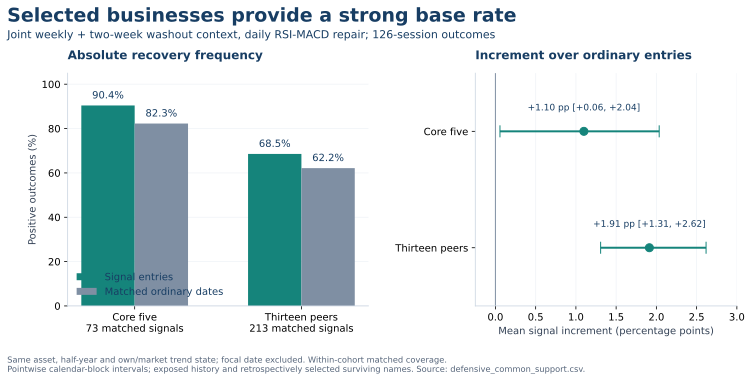
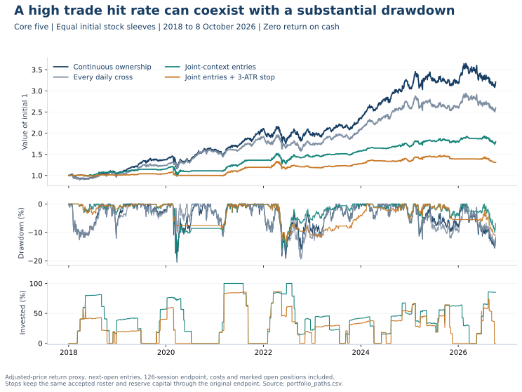
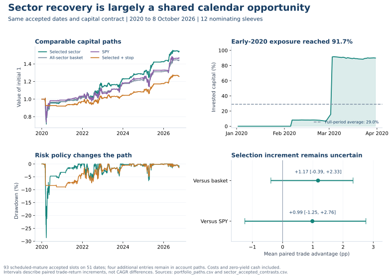

# Recoveries, Durable Lows, and the Capital Between Them

## A deeper assessment of ownership, timing, and risk

**Research date: 21 October 2026. Price cutoff: 8 October 2026.** This is a continuation of the durable-pivot and entry-mechanism studies, with a reconstruction of the earlier defensive V11 research. The new work tests specific explanations rather than searching another indicator grid. The histories and selected cohorts were already exposed to research. All conclusions are exploratory historical evidence, with no production or prospective qualification.

The main finding is that **an attractive recovery entry, an already durable low, and a stable portfolio are three different outcomes**. The strongest defensive combination still produced a high eventual profit rate in the selected core stocks. However, much of that reliability was already present on ordinary dates in those businesses, the reference low frequently broke before the eventual recovery, and a usable capital policy still suffered a substantial drawdown. The favorable sector setup also appears to identify shared recovery opportunities more clearly than superior sector selection.

This does not make the signals useless. It changes the decision they can plausibly support. The evidence favors investigating conditional additions to independently eligible businesses, a diversified recovery allocation, and a separately governed risk budget. It does not justify interpreting an oscillator conjunction as permission to buy aggressively because the final low is known to be in place. [E1-E7]

## 1. What this continuation actually tested

The preceding studies asked which combinations of weekly or two-week Stoch RSI washouts, MACD states, and shorter-timeframe conditions identify durable pivots. This continuation follows the two most useful unresolved leads: the high recovery rate in the original defensive core and the favorable daily RSI recovery results in sector ETFs. It asks whether their apparent usefulness comes from the businesses chosen, the entry calendar, the specific instrument selected, or the holding and risk policy.

The defensive core is MCD, WMT, WM, COST and PG. The comparison set is RSG, KO, PEP, CL, CHD, KMB, MDLZ, HSY, CLX, JNJ, ADP, CTAS and KR. These are surviving, retrospectively selected names. The study does not establish a historically available rule that would have selected this roster and included its failed alternatives. The sector set is XLK, XLF, XLE, XLI, XLY, XLP, XLU, XLV, XLB, XLRE, XLC and SOXX. SPY supplies a market comparison. There are 31 unique instruments in this continuation.

The defensive signal is precisely the original V11 construction. Its MACD is calculated **on RSI**, using EMA14 minus EMA60 and an EMA5 signal. It is not standard price MACD. The weekly condition requires Stoch RSI K at or below 20 during the last three completed weekly bars. The two-week condition requires that washout within the last two completed bars and current K below 60. Both higher-timeframe series require 200 native observations. A daily bullish RSI-MACD histogram cross supplies the entry decision. This is a washout-context-plus-daily-repair setup; it should not be renamed a simultaneous weekly and two-week bullish crossover.

The reconstruction classifies every daily cross as joint context, weekly only, two-week only, or neither. Entry is the following open; the defensive endpoint is signal session plus 126 sessions. The sector experiment reuses the prior daily RSI30 recovery event roster and a 63-session endpoint. It does not select a new threshold. The common-account experiment preserves four immature sector signals that would disappear from a completed-outcome event table.

The frozen protocol was committed before the new outcomes. It specified the cohorts, comparators, holding rules, costs, stop rule, cash scenarios and uncertainty calculation. Thirteen additional public price histories were acquired to reconstruct the defensive study; retained verified inputs supplied the other names. All inputs stop at the same cutoff. Original raw V11 temporary paths were unavailable, so this is a current-vintage reconstruction, not a claim of original-byte price replication.

The reconstruction nevertheless reproduced **all 1,872 archived daily event dates and context classes**, with no additions, omissions or class mismatches. The largest absolute return difference was approximately 0.00011 percentage points. This is strong mechanical continuity with the prior study, while leaving historical data-vintage and universe-selection limitations intact. [E1, E8]

## 2. The three questions that must stay separate

| Research question | Appropriate evidence | What does not answer it |
|---|---|---|
| Was an already durable low identified? | An observable reference low, proximity and age, subsequent survival, independent-pivot precision and coverage | A positive return months later |
| Was this a useful entry? | Net payoff, adverse path, incremental benefit over comparable entries, executable timing | A visually convincing crossover alone |
| Was this a useful capital policy? | Cash, concurrency, costs, drawdown, recovery time and open positions | Averaging overlapping event returns |

An eventual winner may first undercut the supposed bottom. A correct low may be identified so late that the entry has poor reward relative to risk. A collection of attractive entries may concentrate almost all available capital into one common market shock. These are different failure modes and require different remedies.

For this continuation, the frozen reference is the lowest low in the 63 sessions through the signal close. We record its age and entry distance in signal-date ATR units. A strict breach means a future low falls below that level. The old quarter-ATR allowance is retained as a separately named sensitivity. Neither definition is the prior study's complete independent-pivot label: this reference test does not impose the original depth, proximity and coverage requirements.

That distinction prevents a particularly misleading shortcut. An old low far below the market can survive easily. It does not follow that a current signal identified a fresh washout. The study's neither-context crosses illustrate this: their reference lows were typically 53 sessions old and roughly seven ATR below entry. Their higher low-survival rate is not proof of better bottom location. [E2, E3]

## 3. How much of the defensive success is selection, and how much is timing?

### The strong headline survives reconstruction

Among all complete joint-context events, the core produced **67 positive outcomes out of 74**, or **90.5%**, with a mean 126-session net return of **10.68%**. The 13 peers produced **151 out of 218**, or **69.3%**, with a mean of **6.77%**. The difference between these selected populations is substantial. [E2]

The relevant counterfactual is not just another oscillator class. We also compare each signal with ordinary entries in the same stock, calendar half-year, own above/below-200-session-average state, and SPY above/below-200-session-average state. The focal date is excluded and at least ten other complete outcomes are required. This is a retrospective descriptive control, not a causal estimate or an executable matched portfolio.

| Joint-context comparison on common matched support | Core five | Thirteen peers |
|---|---:|---:|
| Signals with an ordinary-date match | 73 of 74 | 213 of 218 |
| Signal positive fraction on that support | 90.4% | 68.5% |
| Matched ordinary-date positive fraction | 82.3% | 62.2% |
| Signal mean return on that support | 10.43% | 6.33% |
| Ordinary-date mean return | 9.33% | 4.42% |
| Mean signal increment | +1.10 pp | +1.91 pp |
| Pointwise calendar-block 95% interval | +0.06 to +2.04 pp | +1.31 to +2.62 pp |

The core's high absolute reliability therefore starts from a high ordinary-entry base rate. The timing association is positive, but much smaller than the raw 90.5% headline suggests. The peer group has a lower absolute hit rate while showing a larger mean increment over its own ordinary dates. A high raw hit rate is not the same as a large incremental timing contribution.

The one unmatched core event and five unmatched peer events were all profitable. They are retained in the full event tables and explicitly excluded from matched comparisons. The common-support table prevents attributing those favorable unmatched outcomes to the timing estimate. On the same matched support, the core's mean advantage over other core stocks bought on the same dates is **-0.40 percentage points**. Peers versus other peers show **-0.47 points**. On the full joint rosters these differences are -0.21 and -0.12 points, respectively, with intervals spanning zero. [E2, E4]

This pattern is consistent with a common recovery calendar and a favorable ownership cohort. It does not establish that the nominated stock is uniquely attractive relative to its cohort on that date. Nor does it prove the economic reason for the calendar effect: ordinary controls still leave valuation, business information, exposure and historical selection imperfectly matched.

### Stability checks narrow the claim

The core's joint-event positive fraction was 88.1% in the 2018-2022 complete-outcome split and 96.6% in 2023-cutoff. Its mean ordinary-date increment was +0.62 and +1.35 points; the earlier interval crossed zero. Peer hit rates fell from 76.0% to 60.4%, while their mean ordinary-date increments remained about +1.69 and +1.78 points. Events whose outcomes cross the split boundary are excluded from those split comparisons, so the split counts do not add to the full-period count.

Dropping one core stock leaves the joint-event hit rate between 89.2% and 91.8%; dropping one signal year leaves it between 87.0% and 97.1%. This rules out a simple claim that one ticker alone creates the result. It does not cure selection of the entire favorable cohort or dependence on the observed market history.

The core event hit rate falls from 90.5% to **85.1%** using price-only returns, and also to **85.1%** under the separate 50-basis-point round-trip friction sensitivity. Those are separate changes, not a combined scenario. Returns remain positive on average, but several outcomes sit close enough to zero for measurement and costs to change the win label. [E2, E5]

All intervals here are pointwise exploratory uncertainty descriptions. The resampling keeps the cross-section together in consecutive two-half-year calendar blocks, includes empty half-years, and uses 2,000 draws. Intervals are withheld with fewer than four populated half-years or fewer than 95% usable draws; contrasts retain joint usable-draw fractions. The intervals do not adjust for the earlier choice of cohorts, the prior search, or all new diagnostics. They should not be read as confirmatory significance tests.

## 4. The crucial result: profitable recovery is often not a durable bottom

| Joint-context outcome | Core five | Thirteen peers |
|---|---:|---:|
| Eventual positive return | 67/74, 90.5% | 151/218, 69.3% |
| Frozen low not undercut over 126 sessions | 39/74, 52.7% | 71/218, 32.6% |
| Median reference-low age at signal | 5 sessions | 4 sessions |
| Median entry distance above low | 2.38 ATR | 1.58 ATR |
| Low survives using a separate 0.25-ATR allowance | 56.8% | 34.9% |

The setup is meaningfully closer to a recent low than the neither-context cross. But the stronger original proposition, that the low has already become durable, does not follow. Almost half of the core reference lows and more than two-thirds of peer lows were later undercut. The ordinary-date breach rates on matched support were also high, approximately 53.7% and 69.7%. [E2, E3]

The economic interpretation is conditional. A recent washout and an improvement in momentum may identify a price region from which a resilient business subsequently recovers. That is compatible with another low first. It is also compatible with an investor needing to tolerate significant adverse movement. Neither tolerance nor the selected business's eventual recovery should be silently substituted for accurate bottom identification.

A useful system should therefore estimate and display at least two different questions: the chance of a positive outcome over its intended horizon, and the chance that the specified reference low survives. It also needs an adverse-path estimate. A single confidence score would hide the discrepancy observed here.

## 5. What the stop experiment actually says

The stop is fixed at entry minus three signal-date ATRs. It includes entry-day trading and fills a gap through the stop at the worse opening price. Stopped capital remains in cash through the original scheduled endpoint. No new entry replaces the stopped trade. Defensive barriers use adjusted-price proxies; sector barriers use raw prices with the adjusted-return conversion. These definitions should not be pooled as identical broker orders.

One plausible explanation was that entries occur far enough above an intact low for a three-ATR stop to cut an otherwise valid setup. The new diagnostic substantially weakens that explanation as a general account of these joint-context failures.

| Stop-geometry diagnostic | Core joint | Peer joint | Sector RSI events |
|---|---:|---:|---:|
| Complete events | 74 | 218 | 104 |
| Stop initially above the frozen low | 31.1% | 9.2% | 9.6% |
| Eventual winners converted to stopped losses | 23 | 51 | 21 |
| Converted winners with reference untouched through stop day | 4 | 2 | 1 |
| Untouched-reference share of converted winners | 17.4% | 3.9% | 4.8% |

The untouched-reference condition is stringent and observable after the event: every low through the stop day must remain strictly above the frozen reference. If both levels are touched on the same day, daily data cannot determine their intraday order. A touched or undercut reference is not counted as untouched.

Only **four** of the core's 23 converted winners fit the proposed harmless-stop-above-an-intact-low explanation. Only **two** peer converted winners and **one** sector converted winner fit it. In the defensive ordinary-date controls, the corresponding all-entry intersection was actually more frequent than in joint signals: about 8.9% versus 5.4% in the core, and 5.9% versus 0.9% in peers. [E2, E6]

The more common story is that the earlier reference failed and price eventually recovered anyway. Removing the stop can preserve those recoveries, but that does not establish that the stop was mistaken or that a wider stop is optimal. The stop also changes losses on eventual losers and the account's drawdown path. In peers, for example, it improved the average result among eventual losers by about 3.57 points while reducing the result among eventual winners by about 5.28 points. These outcome-conditioned groups are explanatory, not tradable labels.

This is a conflict between objectives: maximizing the frequency of profitable endpoint outcomes can favor tolerating deeper interim losses, while limiting account damage can reduce that frequency. The right assessment must include both. It cannot use eventual profit to retroactively declare every stopped trade a bad decision.

## 6. From overlapping events to usable defensive capital

Each stock receives an equal initial capital sleeve. The sleeves cannot borrow from one another and do not rebalance. A sleeve accepts an eligible signal only when its scheduled interval is free. Open positions remain marked at cutoff, including a terminal liquidation-fee adjustment. Idle cash earns zero in the primary calculation. This is a dividend-adjusted return-proxy simulation, not a cash-dividend/pay-date accounting system.

| Core-five policy, 2018-cutoff | Annualized growth | Maximum close-marked drawdown | Average invested capital | Terminal value of 1 |
|---|---:|---:|---:|---:|
| Continuous ownership | 14.27% | -20.51% | 100.0% | 3.212 |
| Every eligible daily RSI-MACD cross | 11.55% | -19.47% | 89.0% | 2.601 |
| Joint-context cross, 126-session endpoint | 6.94% | -19.17% | 39.4% | 1.799 |
| Same joint roster with three-ATR stop | 3.13% | -14.03% | 26.4% | 1.309 |

The joint policy produced positive compounded growth. That is relevant to an objective that does not require beating the market. However, its roughly 39% average invested fraction did not translate into a proportionally shallow maximum drawdown. Nor did its high trade hit rate make its capital path more stable than the selected ownership basket. Both the core ownership and joint policies had seven positive full calendar years out of eight; their paths and opportunity costs differed substantially. [E7]

Among joint entries with a scheduled endpoint mature by cutoff, **29 of 32** were profitable. The same 32-entry maturity roster produced **14 profitable outcomes** with the stop. The often tempting comparison of 29/32 against 14/36 is invalid as a paired hit-rate comparison: early stops also closed four entries whose unstopped six-month endpoints were not yet mature. The account NAV comparisons include all 36 accepted entries and remain valid.

All four open core joint positions were below their entry values at cutoff: MCD -15.33%, WMT -0.47%, WM -3.98% and COST -1.36%, after the return-proxy fees. These are unfinished outcomes, not four established losses. They are nevertheless real negative marks in the account. Excluding them from a completed-trade percentage without showing them would overstate what that percentage says about the current path. [E7]

The result is not confined to the five-stock account. Peer ownership grew at 10.01% annually, versus 5.11% for joint entries and 2.92% for joint entries with stops. Their maximum drawdowns were -26.74%, -14.09% and -7.66%. Across all 18 names, joint entries grew at 5.65% with a -15.50% drawdown; stops reduced those figures to 2.98% and -9.51%. The risk tradeoff differs by population.

### Why the worst defensive drawdown happened

The core joint account peaked on 18 February 2020 and reached its worst trough on 23 March. It had **76.8% invested at the peak**, far above its full-sample average. MCD, WM, COST and PG positions had been entered 80, 65, 26 and 60 sessions earlier. WMT's sleeve was cash. The losses contributed approximately -6.83, -6.19, -2.15 and -4.00 percentage points to the account's -19.17% drawdown.

This was not solely the failure of a new bottom entry during the crash. The fixed holding policy carried older recovery positions into a later shock. The account did not regain that peak until 15 April 2021, while the continuous core ownership account regained its own February peak on 4 August 2020. The timing policy's cash and missed opportunities also matter during recovery. [E7]

This suggests a distinct research question: how long does the original entry thesis remain relevant, and what evidence should force reassessment? A six-month endpoint is a research contract, not an economic guarantee that the original washout remains informative for six months. Testing a prespecified thesis-expiry or information-update policy would address this mechanism more directly than adding another entry oscillator.

## 7. Sector recovery: shared calendar or superior selection?

The sector account uses 12 equal initial nominating sleeves. Each sleeve accepts its first eligible RSI recovery signal while free. On the exact same dates and with the same scheduled occupancy, we compare the nominated ETF with a fixed-value equal-sector basket and SPY. Basket holdings drift without rebalancing. Buying the basket in several nominating sleeves is deliberately allowed, so this is a common-capital comparison rather than a claim of independent diversified signals.

| Sector policy, 2020-cutoff | Annualized growth | Maximum drawdown | Average invested capital |
|---|---:|---:|---:|
| Continuous equal-sleeve ownership | 14.99% | -35.43% | 100.0% |
| Nominated sector on recovery dates | 6.62% | -28.65% | 29.0% |
| All-sector basket on those dates | 5.58% | -28.23% | 28.9% |
| SPY on those dates | 5.84% | -25.97% | 29.0% |
| Nominated sector with three-ATR stop | 3.46% | -9.15% | 21.5% |

The selected ETF had the higher terminal result in this sample, but most of the positive recovery result was also available through the same-date diversified alternatives. Across **93 completed accepted entries on 51 dates**, the mean selected-sector advantage was **+1.17 points over the sector basket**, with a pointwise interval of **-0.39 to +2.33 points**. Against SPY it was **+0.99 points**, with **-1.25 to +2.76 points**. The selected ETF beat the basket on 52.7% of these entries and SPY on 47.3%. These are paired trade-return intervals, not intervals for the CAGR difference. [E6, E7]

This evidence supports investigating a shared recovery allocation. It provides weak evidence for a large security-selection advantage. It does not yet prove that the recovery calendar beats a prespecified scheduled calendar under the same capital constraints; that is the next clean comparison.

### The sector drawdown had a different mechanism

The nominated-sector account's worst peak-to-trough episode ran from 4 March to 23 March 2020. Exposure at the peak was **91.7%**, despite a sample average near 29%. Nine sector sleeves entered on 3 March, SOXX on 2 March, and XLE was already invested from 6 February. Only XLC was cash.

The drawdown was broad: individual sleeve contributions ranged from about -1.94 to -3.40 percentage points across the invested sectors. This was not merely one bad oil-sector selection. Many early rebound signals consumed capital together before another common decline. Counting those signals as independent confirmations would have made confidence rise exactly when exposure to one shared shock was accumulating. [E7]

Unlike the core's older-position drawdown, this points directly to **deployment concentration and early-rebound risk**. An aggregate recovery budget, an explicit rule for correlated nominations, and a prespecified staged-deployment comparison are plausible research directions. Their benefits have not been established by this study.

The stop policy offers a useful counterweight to a win-rate-only objective. It reduced maximum account drawdown from about 28.7% to 9.2%, while retaining positive historical growth. On the same 93 scheduled-mature entries, the positive fraction fell from 75/93, or 80.6%, to 54/93, or 58.1%. The stopped account's longest underwater run was also longer. Shallower maximum drawdown, faster recovery, high hit rate and high growth are not interchangeable measures of stability.

## 8. Cash, costs and the exact meaning of stability

Adding a constant 3% annual return on idle cash raises core joint growth from 6.94% to 8.86% and sector selected growth from 6.62% to 8.88%. It raises the corresponding stopped policies from 3.13% to 5.35% and from 3.46% to 5.88%. These are declared cash-yield scenarios, not realized Treasury returns; no historical bill series was substituted.

At 50 basis points round trip, core joint growth falls to 6.58% and sector selected growth to 6.23%. The original core event hit rate also loses several marginal winners. Costs do not erase the historical mean result, but they change the classification of small gains. All fees are simplified proportional assumptions; taxes, financing needs, spreads by date and market impact are outside this model. [E7]

For the user's objective, stability should be specified as a set of tolerances: an acceptable drawdown, maximum time underwater, adverse excursion before recovery, cash needs, holding flexibility and acceptable opportunity cost. The present evidence establishes tradeoffs among these dimensions. It has not produced one policy that simultaneously delivers the high headline hit rate, shallow drawdowns and the strongest compounded return.

A lower-return policy can still be useful if it satisfies the investor's actual constraints. A policy that never beats the market can still be worth using. Conversely, an 80-90% event hit rate does not by itself establish dependable capital availability when needed.

## 9. Why the earlier 74-event and 50-entry defensive studies differed

The two original defensive studies were not alternative summaries of the same trades.

| Archived cohort reconciliation | Count |
|---|---:|
| Joint context present on daily crossover: Study A | 74 |
| First completed entry after a previously armed watch: Study B | 50 |
| Entry dates shared by both | 41 |
| Study A only: later crosses within a watch | 20 |
| Study A only: crosses outside an active watch | 13 |
| Study B only: first watch cross after joint context changed | 9 |

Of the 41 shared signals, 39 had different scheduled endpoints. Study A exits at signal plus 126 sessions. Study B exits at watch-arm plus 126, so waiting for a crossover shortens its remaining holding period. The archive contains 57 watches: 50 filled, one skipped and six incomplete.

Study B's original 43/50 positive fraction is 86%. Its archived fixed-entry-horizon alternative has 44/50 positive outcomes, or 88%, with a different mean payoff. Those numbers cannot be substituted for Study A's 67/74 result. Neither can the new capital account's 29/32 mature-entry result: capital occupancy filters that roster again. [E8]

The first-versus-repeat diagnostic also provides no simple justification for keeping only the first core crossover. Core first and repeat joint events had approximately 90.2% and 90.0% positive fractions. The peer first group was somewhat stronger than repeats, but both remained exposed to frequent reference-low failures. These descriptive strata do not validate a new entry restriction.

This reconciliation improves the product contract. A signal state, a watch that persists after its original state changes, and an actual capital entry are separate objects. Their definitions, clocks, endpoints and denominators must remain visible.

## 10. What additional information could supply what oscillators miss?

Stoch RSI measures RSI's position within its recent range. A low reading describes an indicator state, not a valuation or business-quality judgment. A histogram turn describes a change in a filtered momentum relationship. It can occur while price is still falling and while the business outlook is deteriorating. Higher and lower timeframe indicators also transform overlapping prices, so agreement is not automatically independent evidence. [S1]

The promising missing dimension is therefore not necessarily another price transformation. It may be an independently documented change in the economic expectations governing the stock. Original issuer guidance is one candidate, provided its components and availability are preserved.

### A new distinction: annual guidance improvement versus future operating repair

Walmart's 25 July 2022 release projected a fiscal-2023 adjusted-EPS decline of 11-13%. The 16 August release projected a decline of 9-11%, while explicitly maintaining the back-half outlook and reflecting better second-quarter performance. Both releases already included the identified Chile insurance and JD.com dividend effects; their presence is not a newly discovered explanation for the entire revision. [S2, S3]

A headline classifier could label that sequence a forward improvement. A more faithful classifier records improved annual guidance, realized-period information, and explicitly unchanged remaining-period guidance separately. Better realized execution may still matter; it simply tests a different hypothesis from an increase in future operating expectations.

Clorox's November 2021 materials projected fiscal-2022 adjusted EPS of $5.40-$5.70 and a gross-margin decline of 300-400 basis points. Its February 2022 update lowered adjusted EPS to $4.25-$4.50 and indicated a roughly 750-basis-point margin decline, even while its sales-decline range improved from 2-6% to 1-4%. [S4, S5]

That sequence shows why revenue improvement alone is insufficient confirmation. Demand, pricing, mix and costs can pull in different directions. The correct feature should preserve disagreement rather than hide it inside a single positive fundamental score.

These are purposively chosen illustrations of measurement requirements, not a blinded case sample or evidence that the proposed feature predicts returns. They do not establish whether the market had already priced the disclosures, whether valuation was attractive, or what happened after a qualified signal.

### A feasible information schema

The economic bridge is conceptual: an annual outlook can change because completed periods differ from earlier assumptions, remaining-period expectations change, or accounting, financing, FX and perimeter effects change. The arithmetic must respect the metric. Annual margins are weighted ratios, and quarterly EPS cannot automatically be subtracted from annual EPS when share counts and adjustments differ.

For each original disclosure, retain the issuer, verified public-availability time, retrieval time, fiscal target, metric, basis, currency, prior and current ranges, completed-period bridge, remaining-period statement, exceptional items and comparability status. Classify each relevant dimension as improved, unchanged, deteriorated, mixed or unknown. Distinguish directly stated evidence from a reconstruction.

If the original publication time is unknown, do not assign the information to an earlier decision. If the comparable prior forecast is missing, do not label the update unchanged. If consensus is unavailable, do not describe an issuer revision as a consensus surprise.

The retained data audit explains why this matters. The earnings snapshot inspected here has 2,315 rows and a September 2026 snapshot clock. Historical surprises inside those rows are not thereby proven historically available in their present form. A 2.28-GB transcript file exists, but its presence alone does not qualify its timestamps, versions or completeness. Fundamental files contain useful statement and estimate fields, but their current snapshots do not prove historical publication timing. [E9]

SEC filing dates also need care. Form 8-K generally permits several business days after a triggering event, and SEC guidance describes earnings releases furnished with a 10-Q in relevant circumstances. An Item 2.02 roster is therefore neither the original release clock nor a guaranteed complete earnings calendar. A missing retrieved filing must remain missing information, rather than being coded as no news. [S6, S7]

## 11. A more coherent system for Mastermind and Macro

The findings support four candidate strategy families with distinct jobs. None is newly production-qualified.

| Candidate family | Decision it serves | Evidence still needed |
|---|---|---|
| Ownership-first defensive allocation | Own independently eligible businesses; use recovery signals for bounded additions | A point-in-time eligibility rule including disappointments and departures |
| Common recovery allocation | Deploy a limited budget into a simple basket during recovery episodes | Same-capital comparison with a prespecified ordinary or scheduled calendar |
| Risk-constrained recovery sleeve | Seek positive growth within explicit account-loss constraints | Untouched-history evidence for aggregate exposure and thesis-expiry policies |
| Durable-pivot detector | Identify a recent low that is likely to remain intact | Better low-survival precision and coverage, independently of eventual return |

The dashboard should preserve the causal questions instead of displaying one aggregate buy-confidence score. It should show the ownership eligibility and its as-of evidence; completed-bar washout and repair states; the candidate low's price, age and distance; the information-outlook state; the return and low-survival estimands; and the account's existing exposure to the same episode.

It also needs to distinguish a fresh entry from a continuing position. A good original entry is not a permanent hold decision. New adverse information, a changed macro environment, or an expired research horizon may require reassessment. A broad market crash can overwhelm a previously reasonable local setup without implying the original oscillator was calculated incorrectly.

For multi-timeframe mechanics, keep the roles explicit. The slower series describes the larger washout or trend context. The faster series describes the stage of repair or retest. Its opposite crossover can be a local pullback within a slower recovery, or evidence of a renewed decline. Requiring every timeframe to be simultaneously positive suppresses that distinction and can delay entries. A state-and-sequence representation is a better hypothesis to test than a vote count. The prior studies' mixed synchronization results remain the empirical motivation; this continuation does not claim to have established a universal weekly/daily or two-week/three-day pairing.

Tops remain a separate problem. This continuation does not retest a new top-exit strategy or establish symmetry with bottoms. The earlier top candidates remain unqualified. Selling a compounding asset because a bounded oscillator is high has a different opportunity-cost structure from buying an oversold asset. Any exit system needs its own absolute avoided-loss, foregone-upside and re-entry evaluation.

## 12. The next decisive experiments

The next work should discriminate among mechanisms rather than expand a threshold grid.

**First, test additions against additions.** Freeze an independently justified ownership basket and a fixed contribution budget. Compare prespecified signal-triggered additions with scheduled additions using identical total capital, maximum exposure, costs and contribution dates. This tests whether the signal improves a decision it may genuinely be suited to support. It avoids claiming success simply because a favorable basket was owned.

**Second, isolate the recovery calendar.** Buy the same diversified basket under the existing signal calendar and one prespecified ordinary calendar, preserving sleeve occupancy and capital. The current sector experiment isolates instrument choice; this further comparison isolates timing. Keep the rule fixed before observing its outcomes and include the early-2020 failure.

**Third, distinguish deployment risk from thesis expiry.** The sector account's early rebound cluster and the defensive account's older positions suffered through different paths. A proposed aggregate deployment rule should be tested against the first mechanism; a prespecified continuing-position reassessment rule against the second. Comparing both with the present fixed-horizon policy would be informative. Searching many caps, delays and exit thresholds would not provide a clean answer.

**Fourth, qualify the information feature before testing its returns.** Build a small, blinded original-release corpus with comparable prior forecasts and verified availability. Independently classify remaining-period operating changes, realized-only roll-forwards and mixed updates. Resolve disagreement and quantify missingness before joining price outcomes. Then ask whether the classifications distinguish reference survival and adverse paths at comparable price states. Two illustrative companies are insufficient.

**Fifth, freeze the eligibility and evaluation contract for new evidence.** Include point-in-time membership, delistings, corporate actions, original source clocks, asset-specific frictions and explicit missing states. The current history cannot be made untouched by renaming a split. Prospective observation or genuinely unexamined data is needed before stable probabilities or deployment claims become credible.

The strongest new research conclusion is therefore specific: **the promising oscillator setups are better supported as conditional recovery signals than as declarations that the final low is already behind us.** The observed high win rate belongs partly to selected businesses, partly to the entry calendar, and partly to tolerating the path to recovery. A superior system must make those contributions and the capital required visible, then test the missing information and risk decisions directly.

## Evidence and sources

### Reproducible research outputs

- **E1:** `PROTOCOL.md`, `prepare_inputs.py`, `analyze.py`, `supplement.py`, `results/input_provenance.json`, `results/registration.json`. Frozen definitions, input custody and calculation.
- **E2:** `results/defensive_events.csv`, `results/defensive_summary.csv`, `results/defensive_common_support.csv`, `results/defensive_contrasts.csv`. Full events, matched controls and paired uncertainty.
- **E3:** `results/reference_location.csv`. Known-low age, distance, strict survival and separately labeled tolerance.
- **E4:** `results/defensive_common_support.csv`. All defensive comparators on the same matched observations; unmatched cases remain in E2.
- **E5:** `results/defensive_subgroups.csv`, `results/defensive_influence.csv`. Chronological, sequence and omission diagnostics; no optimized replacement rule.
- **E6:** `results/sector_events.csv`, `results/sector_event_summary.csv`, `results/sector_accepted_paired.csv`, `results/sector_accepted_contrasts.csv`. Complete sector events and common-roster instrument comparisons.
- **E7:** `results/portfolio_summary.csv`, `results/portfolio_paths.csv`, `results/portfolio_annual.csv`, `results/portfolio_trades.csv`, `results/portfolio_trade_maturity.csv`, `results/open_positions.csv`, `results/portfolio_diagnostics.csv`, `results/drawdown_sleeve_attribution.csv`, `results/capital_rosters.csv`. Account paths, maturity, exposure and drawdown attribution.
- **E8:** `results/v11_reconstruction.json`, `results/v11_reconstruction_comparison.csv`, `results/v11_cohort_membership.csv`, `results/v11_cohort_reconciliation.json`. Archived V11 parity and denominator reconciliation. Original archive SHA256: `97966f72ea15cb34e0f5453252eef683411c894b7ca4432de4ce7c540d1ffaf0`.
- **E9:** `INFORMATION_AUDIT.md`, `results/information_availability_audit.json`. Bounded schema and clock findings; no private corpus reproduced.
- **E10:** `VERIFICATION.md`, `verify.py`, `results/mechanical_verification.json`, `results/audit_corrections.json`. Independent review, repairs and invariance proof.
- Prior published studies: [Macro PR 9970](https://github.com/mastermindx-market-intelligence/macro/pull/9970), merge `479e9e4cc1851eca04c8bb5fd65a9684c8b6cdbd`; `research/durable_pivots_20261021` and `research/entry_mechanisms_20261021` at that revision.

### Primary external sources

- **S1:** [TradingView, Stochastic RSI](https://www.tradingview.com/support/solutions/43000502333-stochastic-rsi-stoch-rsi/). Indicator definition; no empirical strategy endorsement inferred.
- **S2:** [Walmart, 25 July 2022 guidance update](https://corporate.walmart.com/news/2022/07/25/walmart-inc-provides-update-for-second-quarter-and-fiscal-year-2023).
- **S3:** [Walmart, 16 August 2022 earnings release](https://stock.walmart.com/sec-filings/all-sec-filings/content/0000104169-22-000065/earningsreleasefy23q2.htm).
- **S4:** [Clorox, 1 November 2021 prepared remarks](https://s204.q4cdn.com/178752512/files/doc_financials/2022/q1/Q1FY22-Clorox-CEO_CFO-prepared-consolidated-remarks.pdf).
- **S5:** [Clorox, 3 February 2022 earnings and outlook update](https://investors.thecloroxcompany.com/news/news-details/2022/Clorox-Reports-Q2-Fiscal-Year-2022-Results-Updates-Outlook/default.aspx).
- **S6:** [SEC, Form 8-K, General Instruction B](https://www.sec.gov/files/form8-k.pdf).
- **S7:** [SEC, Exchange Act Form 8-K interpretations, Questions 101.01 and 106.04](https://www.sec.gov/rules-regulations/staff-guidance/compliance-disclosure-interpretations/exchange-act-form-8-k).

All source access for this continuation occurred on 21 October 2026. The issuer cases preserve historical publication dates but have not been admitted to an automated point-in-time trading feature. The research package contains code, derived ledgers, methods, figures and audit receipts; source price bytes and private earnings/transcript corpora remain outside the published package.
