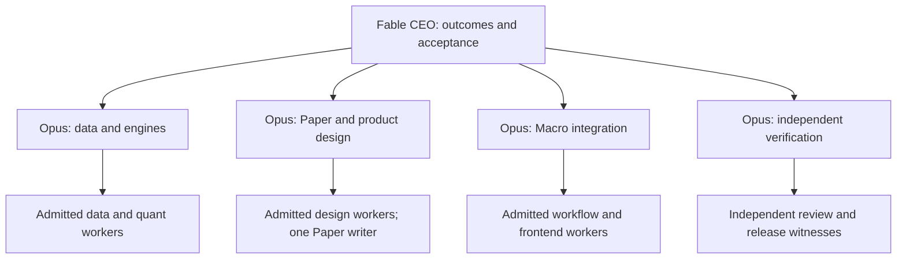

# Sector Intelligence and Sector Cycles — completion masterplan

## Handoff to Fable CEO, Opus domain suborchestrators and the Subagent Fabric

**Prepared:** 21 October 2026 UTC. **Census observations:** 20–21 October 2026 UTC, with selected PR metadata refreshed through 00:13 UTC on 21 October (20 October, 19:13 CDT). Repository facts are pinned below; workspace, Paper and publication facts are point-in-time observations. Refresh only material overlaps before execution.

**Commission:** complete the backend, finish the editable Paper design, and replace the existing US Macro Dashboard Sector Intelligence and Sector Cycles experience with that design while preserving and improving its existing features and unique engines.

**Deliverable status:** an evidence-backed proposed completion contract and handoff. This document does not claim production acceptance, a new RIG receipt, a deployment, a Paper edit or a launched Fable/Fabric programme. It reconciles previous plans; it does not silently admit their unapproved migration proposals.

**Canonical programme:** [macro issue #7646][S01], operation `sector-central-redesign-20260921-sol-001`. Preserve its source custody, accepted decisions and evidence history. The current Macro implementation carrier is `sector-central-macro-paper-pivot-20261020-sol-001`. The correct product repository is `mastermindx-market-intelligence/macro`.

---

## 1. Executive decision

This programme is unfinished primarily because its work has not been brought through one end-to-end delivery chain. Substantial engines, source contracts, visual work and implementation already exist. The missing chain is: accepted source-bound design → complete backend contracts → integrated Macro implementation → independent user-path acceptance → normal publication → verified production and natural update.

The immediate starting point is better than the written checkpoint suggests: the correct Macro candidate is **committed and clean at `4fd82658fc4a9cc6259f5acff015e2a9f1cfaa51`**. Its publisher reports **`NOT_APPLIED`, no remote head and `ready_to_push: true`**. A GitHub lookup found no matching PR. Preserve and qualify this candidate; do not repeat a now-obsolete diagnosis that it cannot be committed.

The correct programme is also broader than that candidate. The newest Dossier and Research designs are not yet fully ported to Macro; the current Paper build page has no complete standalone Cycles design; source-generation alignment, metric definitions, a grader denominator, access/compatibility and natural consumption proof still need closure. Existing historical tests, archived screenshots, a merged design document or a working Terminal implementation cannot close these gaps.

### 1.1 What Fable should authorize within the accepted commission

1. Recover and integrate the existing Macro carrier, with one accountable integration owner.
2. Reconcile the 92 inherited Sector Central capabilities plus the dedicated Cycles and upgrade matrices in this handoff. Every retained capability gets a producer, a Paper home, an implementation home and acceptance evidence.
3. Finish the native backend contracts and targeted repairs. Preserve the current calculation, membership, identity, replay, access, research, watch and publication owners.
4. Finish a coherent, editable Paper design for Brief, Explore, Dossier, Research, saved investigations and the full Cycles workspace, including real data and failure states.
5. Implement the accepted Paper design in the Macro routes; preserve deep links and useful existing engines.
6. Prove real user journeys on the exact integrated candidate and the served production version, then observe the next normal data update.
7. Record predictive qualification separately. A negative research result is a valid scientific result; it is not a working predictive capability or a reason to leave the descriptive product broken.

### 1.2 Definition of full completion

Full completion requires all of the following, with evidence attached to the canonical programme:

| Completion dimension | Required outcome |
|---|---|
| Backend complete | Every contracted product field has a canonical producer, correct definition, population, clock, provenance, access behavior and failure behavior. Required missing producer fields are implemented or explicitly accepted as not applicable; a placeholder is not a completed backend. |
| Paper complete | Active, editable, source-bound boards and components cover every capability, principal journey and relevant state. The design is accepted through the applicable real review process. Archives and screenshots alone do not count. |
| Macro implementation complete | The new experience actually replaces the two Macro surfaces, matches the accepted design and retains all required engines, routes, populations, controls and access rules. |
| Release complete | Reviewed source and concluded binding CI lead to the normally published artifact. The served identity matches the accepted candidate; real navigation, auth and data journeys work. |
| Operationally complete | The next natural scheduled update reaches the new views correctly. Existing ledger and refresh owners continue to work; rollback and issue ownership are documented. |
| Scientifically honest | Every claim carries the correct measured/reconstructed/model/prior/opinion/unavailable status. Unqualified prediction or sizing claims remain unqualified. Their research disposition is explicit. |

Do not report a percentage complete from board counts, lines of code, tests or PRs. Track unresolved blocking gates and missing capability evidence. A useful partial release may be reported as a partial release; it must not be renamed end-to-end completion.

---

## 2. Current-state census

### 2.1 Evidence identities and the fresh publication observation

| Item | Observed identity/status | Meaning |
|---|---|---|
| Macro source census | `16d965fffe27debb66fc846cbaa6a169484c522c` | Immutable base for repository findings in this document. |
| Protected Mastermind law | `3d75cc73fd1c83936fff875c7a3e248b9c6c846e`; protected master | Current execution, custody and delegation guidance was read at this pin. Reconcile material changes before dispatch. |
| Existing programme | macro #7646; `sector-central-redesign-20260921-sol-001` | Continue the existing programme and checkpoints. |
| Correct implementation operation | `sector-central-macro-paper-pivot-20261020-sol-001` | Preserve the original carrier and its evidence. |
| Correct candidate branch | `sol/web-sector-central-macro-paper-pivot-20261020-sol-001` | Existing owned branch, not a proposed new branch. |
| Workspace | `/Volumes/Mastermind 2/agent-workspaces/macro/web/sector-central-macro-paper-pivot-20261020-sol-001` | Read through the existing Studio owner; no source edits were made for this census. |
| Fresh local HEAD | `4fd82658fc4a9cc6259f5acff015e2a9f1cfaa51` | Direct workspace read; clean status, no diff. |
| Managed publication | `local_head_sha=4fd82658…`; `remote_head_sha=null`; `clean=true`; `publication_state=NOT_APPLIED`; `ready_to_push=true` | The old commit-blocked checkpoint is superseded. Publication is not complete. |
| Matching GitHub PR | Exact branch lookup returned no PR | Do not claim reviewed or published. Recheck on the same carrier before the next action. |
| Local plan | `research/SECTOR_CENTRAL_MACRO_PAPER_PIVOT_2026_10_20.md`; 27,219 bytes; SHA-256 `133483186ffb8150c3de4a8a70983888d46f70fed5e07b00cfc0acbafc518365` | Read-only local evidence. The first 22,000 characters were inspected; this census does not claim a line-by-line audit of its uninspected tail. |
| Source review archive | `Macro_Sector_Central_Source_Review_2026-10-20.zip`; 615,900 bytes; 58 entries; SHA-256 `9ed2731cf6729805ef1635b3bfa898805b192ff0e0fd96f0ca1651de3c1b5bf5` | Retained review artifact, not deployment evidence. Earlier attachment transfer failed; do not reconstruct source from chat fragments. |

The cumulative checkpoint is [#7646 comment 6247254582][S02]. Use it for history, with the fresh local/publication observation above taking precedence on the commit state. A read-only census does not transfer ownership from an active source carrier. If another owner has advanced the branch, reconcile that movement before any mutation.

### 2.2 Product and implementation status

| Area | What exists | What remains before completion |
|---|---|---|
| Live Macro Sector Intelligence | Public `/sector_central.html` remains the current six-view product shell, with substantial native functionality. [S36] | Prove and release the accepted replacement on this actual product, not a separate demo or Terminal route. |
| Live Macro Sector Cycles | `/sector_cycles.html` and its rich native template/engines exist. The public page read is only a shell observation, not a complete JS interaction test. [S29][S37] | Complete active Paper design, implementation and browser acceptance for the whole Cycles workflow. |
| Correct Macro candidate | Native router, six route mappings, measured Brief/Rotation work, exact basket measurement, sector-context Prophet/Screener bridges and retained source owners. [S02] | Full Dossier, remaining lens depth, complete Cycles, source-bound Research, full state/access/compatibility proof and release. |
| Wrong-product candidate | Terminal PR #1055 is closed unmerged, head `243d4c75d8954b045dd333787ee9a703bd09d344`. [S05] | Preserve useful reference work; do not reopen it as the Sector Macro delivery vehicle. |
| Sector backend | Cycle kernel, Sector Central aggregation, leadership projection, Pulse, rotation/event/participation sources and graders are already substantial. [S11][S12][S13][S14][S39][S40] | Resolve the specific contracts and defects in §6; do not rebuild an alternative engine stack. |
| Leadership Rotation | T01–T26 largely executed through accepted work; current AgentOS waves W1–W5 DONE, W6 TODO. [S21][S22] | Natural user-consumption proof remains open; predictive qualification is not established. Do not restart all 26 tasks. |
| Paper | Current active page has 26 artboards; legacy archive has 71. Selected current Brief, Rotation, Dossier and archived Cycle screenshots were visually inspected. [S09][S10] | Complete current Cycles and remaining production states, update authority/TOC, bind all inherited features and obtain actual design acceptance. |
| Research continuation | Latest design prepares entity/question. Existing candidate has dated sector context into actual Prophet and an explicit native Screener action. | Grounded Research must actually receive the snapshot/references and preserve return context. A question prefill is not a completed evidence handoff. |
| Watches | Existing candidate supports symbol saves/instrument links. | Keep that capability; finish any accepted saved-investigation workflow through the existing owner. Do not call saves condition alerts. |
| Runtime readiness | One Executive Fabric `roots` read returned `backend_unavailable` with no request sent. Other read-only Studio/Paper paths worked. | Verify the exact required route at dispatch time. This observation does not establish a fleet-wide outage or justify a substitute execution path. |

### 2.3 Preserve the work already present in the Macro carrier

The existing candidate should be the starting implementation, subject to source review and material-overlap checks:

- Six native route mappings: `#overview` → Brief; `#map` → Market map; `#moving` → Rotation; `#money` → Breadth & money; `#explore` → Themes & compare; `#confluence` → Entry evidence. The visual workflow can coordinate these without introducing a competing router.
- The current alias inventory is 24, including the archived 21 aliases and accepted additions. Preserve native events, lazy mounts, deferred trace/theme navigation and history behavior.
- The basket chart measures **20 observed-session intervals from 21 aligned closes**, using relative wealth: `(group_close/group_start)/(benchmark_close/benchmark_start) - 1`. Do not relabel a 21-session producer metric or a percentage-point difference as the same measure.
- Measured leadership has its own **63-session, 11 canonical sector ETF** population, SPY total-return basis and source dates. Its coverage is not market breadth or basket membership coverage.
- The actual Prophet destination is `us_stocks.html`. `us_stocks_v2` is a shadow; `#prophet-live` is a conditional forming strip, not the entire Prophet application.
- Preserve the qualified bridge `us_stocks.html?si_sector=<ETF>#sector-prophet-context` and return `sector_central.html?g=<ETF>#map`, including the receiver's own validations and clock.
- The native Screener continuation is an explicit user action using existing filters and source owners. Arrival must not silently apply a new filter or create entry eligibility. Retain the 11 registered choices and truthful loaded denominator. In the observed public fixture, Materials had 0 of 3 loaded rows; that is a valid no-results state, not a full-universe zero.
- Preserve separately dated snapshots. The candidate's frozen Sector and Prophet/basket inputs did not share one date; page assembly must not make them appear simultaneous.
- Keep the neutral visual grammar. No decorative colored container edges, inset rails or substitute pseudo-element stripes; functional chart color and complete focus outlines remain valid.

The reported candidate baseline was **565 passes across 13 suites**, plus three separate CI-registration checks. These are recorded earlier results, **not tests rerun by this census and not full Macro browser acceptance**. Similarly, Terminal's reported 13,329 unit passes and 57 browser cases are not acceptance of this Macro candidate. [S02][S05]

### 2.4 Current data-generation census

At the pinned Macro source, `site/sectordata/sector_central.json` is dated 19 October, with 11 sectors and 49 baskets. Its measured read is available for 11/11 sectors, while early context and confirmed events are marked `incompatible_generation` because the rotation input is dated 16 October. `site/basketdata/sector_pulse.json` is dated 19 October with 49 themes. The board falls back to conviction ordering. [S15][S16][S38]

This is an example of a protective join doing its job. The fix is to restore compatible source production and expose the fallback clearly, not to suppress the incompatibility or blend old events into a new measured snapshot. The Paper example's 9/11 cohort is a fixture state; it is not today's universal coverage denominator.

---

## 3. Why the programme has not finished

These are causal conclusions from the delivery record, not a claim that every historical action was wasted.

### 3.1 Work was completed in the wrong application

Terminal PR #1055 built a convincing candidate but was withdrawn because the target is the Macro Dashboard. A technically strong implementation in another product cannot replace `/sector_central.html` or prove its native access, source and routing behavior. Recover reusable ideas and evidence, but finish on the correct Macro carrier. [S05]

### 3.2 Design progress was mistaken for migration authority

There are many boards, mockups and design documents. The October design packet is explicitly held in `research/design_candidates/`, and its README says the documents are unreleased proposals, not an approved migration packet. Full RIG for the actual frozen before/after artifacts and the complete 92-capability scope, with genuine required review and receipt, remains a real condition for consuming-build admission. PR #9648 itself is closed unmerged; the de-admission behavior was reconciled elsewhere. Do not call that PR merged. [S06][S34]

Historical acceptance was withdrawn, and later R2 recovery restored useful tabs and links while much detail remained archived. Those were necessary corrections, but neither event established whole-product completion. The current Paper working page and the old cycle archive still do not form one accepted, fully specified implementation package. [S31][S32][S09][S10]

### 3.3 Delivery fragments advanced without one accountable integration chain

Backend changes, roster fixes, access shells, template builders, design references and scientific plans have separate carriers. Some merged; some conflict; some remain drafts; some are now incorporated through different PRs. PR #9592 delivered documents/reference mockups, not production templates or engines. A large set of individually useful outputs is not yet an accepted product. [S33]

The fresh committed candidate illustrates the cost of stale checkpoints: a coordinator reading only the earlier note would spend time repairing a commit operation that has already succeeded. Source and publication observations must be reconciled at every handoff, without repeatedly recensing the whole programme.

### 3.4 Cross-product links and evidence handoffs have been overcounted

A source-aware Sector → Prophet bridge, a plain stock link, a Research question prefill, a saved symbol and a condition alert are different capabilities. The newest designs and candidate do not yet fulfill all earlier Research promises. Full completion needs receiver-visible context, authenticated interruption/resume and a valid return, not only a clickable button.

### 3.5 Backend existence and scientific validation were treated as the same milestone

The cycle and rotation engines contain valuable structure, but past experiments qualified some claims and rejected others. An engine being present does not validate its labels as forward-return predictions. Conversely, a negative predictive experiment does not justify withholding a useful descriptive product indefinitely. The plan must close product delivery and scientific claims on separate, explicit evidence. [S17][S18][S19][S20][S21]

### 3.6 Acceptance stopped too early

Source tests, merged reference work and HTTP 200 responses cannot establish that a signed-in user can navigate the actual new Macro page on mobile, inspect an industry, reach the right company or Prophet context, return without losing the investigation and see the next natural update. Leadership Rotation's T26 closeout explicitly preserves that natural-consumption gap. [S21]

### 3.7 The cure

Use one existing programme record, one integration owner, one admitted Paper writer and one exact release candidate. Every packet ends with a small verifiable capability outcome; every domain has an independent acceptance witness. Fable receives decisions and exceptions, not an endless stream of low-level edits or unranked progress narratives.

---

## 4. Reconciliation of previous masterplans

The following plans remain valuable inputs. Their original scope and findings must not be flattened into one “unfinished” bucket.

| Prior work | Keep | Continue / close | Do not repeat or misclaim |
|---|---|---|---|
| Sector Intelligence Consolidation masterplan | One coherent Sector hub; preserve useful native engines and cross-product continuity. [S23] | Resolve its remaining integration and replacement obligations in Macro. | Do not begin another independent hub implementation. |
| Institutional Sector Intelligence masterplan | Useful Foresight/catalyst dependencies and source qualification. [S24] | Consume an existing accepted dependency when the US experience needs it. | Do not expand this commission into a wholesale rebuild of all institutional research systems. |
| Cycle Intelligence masterplan | Structure/phase/rhythm, confirmed-turn history, ontology, risk context, measured scorecards and model/prior distinctions. [S17] | Repair current semantics and UX; retain historical qualification boundaries. | Do not resurrect failed timing, direction or sizing claims as accepted product requirements. |
| Cycle Pattern Intelligence masterplan | Point-in-time discipline, accrual, preregistration, meaningful measurement. [S25] | Connect qualified outputs and publish remaining accrual/research status. | Do not fabricate matured samples or promise that more UI work creates predictive power. |
| Rotation Command / Events v2 / continuation | Native event, fragmentation, desk and observation owners. [S26][S27][S28] | Generation compatibility, correct event population, source-specific failure states and visible user paths. | Do not substitute `si_handoff.json` for the five native Moving artifacts. |
| Leadership Rotation 26-task plan | Accepted T01–T26 source work, measured contracts and scientific harness fixes. [S21][S22] | T25 natural-consumption proof; LR-W6; a new preregistration only where the scientific next step is justified. | Draft #9134 is not proof that all 26 tasks are unbuilt. Do not rerun V1 hypotheses looking for significance. |
| September unified handoff | Standardize composition while retaining each producer's truth and each region's specific capabilities. | Apply the principle to the US product and retain interfaces for shared components. | Do not silently import China/HK/country scopes into this US delivery. |
| October 18 design package and crosswalk | Proposed feature disposition, current source limitations, neutral visual grammar and 92-row preservation baseline. [S07][S08][S30] | Update to actual current Paper/candidate facts; obtain the required genuine admission and acceptance. | The files' location and their old header wording do not grant build admission. |
| October 20 Macro pivot | Correct app, native route owners, exact chart semantics, existing Prophet/Screener bridge and retained source tests. [S02] | Publish/review through its existing owner, then complete missing product slices. | Do not restart from the closed Terminal PR or use an obsolete commit-blocker status. |

### 4.1 Scientific findings that must survive the redesign

- **Position/phase return edge:** the keystone study did not establish a forward-return edge from position deciles. Phase/rhythm and risk context remain useful descriptive information. [S17]
- **Legacy timing/cones:** the first scorecards falsified the shipped turn-timing promise and found miscalibrated cones. Do not present a historical median projection window as a reliable future appointment. [S17]
- **Hazard models:** W4.2 qualified four of six recorded cells against a family-stratified baseline under its frozen evaluation gates: up/1m and down/1m, /3m, /6m. Up/3m and up/6m remained PRIOR; the longer down-side cells were marginal. These were research-surface qualifications, not a demonstrated position-sizing decision benefit, and revision/PIT caveats remain. [S18]
- **Risk sizing:** W4.6 found zero of 48 FDR survivors after volatility residualization, and all risk multipliers stayed 1.0. Do not display a neutral multiplier as a useful active risk-sizing signal. [S19]
- **Pairwise lead-lag:** W5.1 reached STOP/NO-GO; the descriptive synchronization gauge was the accepted fallback. No predictive interaction layer should be quietly reinstated through a prettier map. [S20]
- **Leadership Rotation:** T26 distinguishes measured-product/source completion and scientific disposition from predictive qualification. H1/H2/H3 were not executable at registered margins, and the recorded P1/P2/P3 look counts were zero. The documented next scientific step is a dated PREREG V3 with a nonconstant H1 statistic and corrected H2/H3 scale-versus-margin reasoning, followed by fresh size/power assessment before a real-data P1. [S21]

A new model can be proposed in a bounded, preregistered packet with a meaningful baseline, point-in-time/revision controls, multiple-testing discipline and an explicit decision benefit. It must not become an unbounded dependency that prevents the product replacement from shipping. The final closeout must separately list any original predictive aspirations still unqualified.

---

## 5. Target product and preservation contract

### 5.1 One coherent investigation

The primary workflow is **Brief → Explore → Dossier → Research / existing stock or Prophet destination → return to the same investigation**. Saved watches use the existing watch owner. Cycles is a first-class Explore lens and a fully usable standalone Macro workspace, not a small generic Signals card.

| Surface | User question | Required content and behavior |
|---|---|---|
| Brief | What changed, and where should I look? | Measured leadership, separate observed change, own dates/coverage, native graded calls, distinct Bottoming Watch, explanatory disagreements and one clear investigation action. |
| Explore — Rotation | Where is leadership moving? | Correct native coordinate maps, accessible linked lists, universe selection, measured 21/63-session views, selected-group detail, qualified historical trails and explicit gaps. |
| Explore — Turns | What has actually changed state? | Native confirmed events, early context, fragmentation, desk/tape observations and their independent statuses. No automatic conversion into stock entry. |
| Explore — Leadership / themes | What groups lead and how do they compare? | All current groups/baskets, native order and metrics, filters/sorts, comparison, exact return/basis labels, overlap and membership disclosure. |
| Explore — Money / participation | How broad is the move, and what do flows show? | Participation/concentration with real denominators, actual ETF flow and units, heatmap refresh, index-leadership status, distinct live/settled clocks. |
| Explore — Confluence | What does each native stock/group universe say? | Separate S&P, Nasdaq, Russell and Baskets populations; native identity, regime, entry authority, coverage and ordering; no cross-universe mixing. |
| Dossier | Why does this sector, industry or theme look this way? | Signals, Drivers, Companies, Record/History and Methods with source-bound membership, dates, source disagreements and correct company continuation. |
| Cycles | Where are we in the observed structure, and what is qualified? | Complete price/position history, comparison, phase/leg structure, narratives, cycle DNA, stance, relative strength, model/prior hazards, overdue rhythm, track record and accessible alternatives. |
| Research | What should I investigate next? | Editable question plus canonical entity, permitted snapshot/source references, clock, evidence mode and return context received by the real existing research product. |
| Watches | What have I chosen to follow? | Persistent native saves and resumable context as supported by the accepted owner. Distinguish saved items, observational watch states and condition-triggered notifications. |

### 5.2 Structural rules

- Keep the six current Sector Central hashes and their aliases working. Add the new visual organization through the existing routing boundary. Keep `sector_cycles.html` and its accepted deep links functional; a route migration requires an explicit compatibility mapping and proof.
- Preserve 11 canonical sector ETFs and the actual current theme/basket universe; do not hardcode a fixture count into general logic. Keep industry, structural group, basket, ETF proxy and company identities distinct.
- Preserve separate S&P, Nasdaq, Russell and Baskets Confluence source artifacts. A common renderer is welcome; a combined synthetic universe is not.
- Preserve native graded calls, source restrictions and stock-entry eligibility. Measured leadership, descriptive cycles, narrative text and broad sector strength do not grant new action authority.
- Keep one global application shell, one route owner, one auth/session owner and one set of premium contracts. Do not embed Terminal's root application or hide duplicate headers with CSS.
- Reuse the existing chart, replay, heatmap polling, research, watch and publication owners. New presentation adapters are allowed; an additional competing engine or scheduler needs a separate justified decision.
- Preserve functional depth. A new layout may reorganize old controls, but every retained function must have a discoverable home and a testable route/control.

### 5.3 Membership, dates and evidence language

A Dossier must not invent a sector relationship for a group when the native source does not supply it. The inspected Semiconductors design correctly separates its 14-member group from Technology ETF context and explicitly says the relationship is not supplied. Retain that honesty; add the canonical mapping only through an accepted producer change.

For each displayed metric, carry its canonical ID/kind, value/unit, basis/benchmark, lookback/start/end session, valid/expected population, source date, generated time, generation/version, evidence mode and qualification status where applicable. This is a contract checklist for adapters, **not a mandate for a new universal API, database or schema owner**. Fields may retain their existing native names.

Do not collapse these distinctions:

| Distinction | Required treatment |
|---|---|
| Relative wealth vs return difference | Label separately; wealth uses `(1+R_group)/(1+R_benchmark)-1`; difference uses percentage points. |
| Price structure vs total-return performance | The intended structural basis is qualified price; disclose the existing explicit `price`, `tr_fallback` or `tr` path. Return/RS retain their qualified basis. Current-membership basket reconstruction is not historical point-in-time membership. |
| 20 intervals vs 21 sessions vs 63 sessions | Derive from the actual endpoint/session contract; never swap labels to make charts agree. |
| Breadth vs leadership coverage vs membership coverage | Separate populations and denominators; 9/11 sectors is not 46/79 constituent participation. |
| Observed event vs reconstructed trail | Preserve event IDs/confirmation times and reconstruction labels; reconstructed history is not evidence of what was known then. |
| Neutral vs missing vs zero | Retain values and explicit reasons; do not use truthiness to turn zero into missing. |
| Fresh vs generated recently | Source observation time and applicable session policy control freshness, not the page build time. |
| Research model vs baseline prior vs opinion | Label each at its true authority and qualification; no shared confidence badge. |
| Membership overlap vs return correlation | Show the actual measure, denominator and date; never relabel one as the other. |

## 6. Backend completion and engine improvement

The backend goal is to complete the existing architecture and improve its usefulness with verifiable changes. Do not begin with a wholesale rewrite. The main shared cycle kernel, Sector aggregator, measured-leadership projection, Pulse, rotation engine and outcome grader already exist. [S11][S12][S13][S14][S39][S40]

### 6.1 Required repair and completion packets

| ID | Concrete work | Required output / acceptance | Owner |
|---|---|---|---|
| B01 | Reconcile current producer → artifact → builder → client bindings and sibling carriers. | One authoritative ownership map attached to the existing programme, with exact files, generations, consumer contracts and incorporated/superseded/remaining dispositions. No duplicate source owner. | Data Opus + integration owner |
| B02 | Repair rotation-to-Central generation/session alignment and the standalone Cycles raw rotation/fragmentation loader. Replace incorrect freshness/error behavior at the existing owners. | Same-generation data combines correctly; incompatible generations stay separate with typed reasons. Test settled-session, weekend/holiday, future, missing and invalid timestamps. The current Oct19/Oct16 case is an explicit counterexample. | Data workers |
| B03 | Complete membership, identity, participation and weights. | Dated native group identity, effective membership, eligible/observed/expected counts, issuer-resolution status and weight coverage. Missing inputs do not silently shrink the denominator or renormalize partial weights into a full-market claim. | Data workers |
| B04 | Freeze metric definitions and exact endpoints. | Contract tests for 20-interval basket measurement, 21/63-session metrics, relative wealth versus percentage points, price versus TR, benchmark and currency. Missing exact endpoints remain unmeasured. | Data workers + independent quant review |
| B05 | Resolve legacy/v2 cycle semantics and phase age. | Every position/phase/stance/axis/tooltip identifies its semantic family. Implement measured phase age from retained/replayed transitions; use unknown only for legitimate insufficient-history or unavailable-source boundaries. Replacing every age with unknown is an interim honesty repair, not completion. Version any behavioral change. | Cycle workers |
| B06 | Repair overdue rhythm and uncertainty presentation at the producer/presenter boundary. | Preserve dated anchored rhythm windows and explicit overdue state; never roll dates forward to look fresh. Distinguish descriptive rhythm, qualified hazard model, baseline prior and missing estimate. | Cycle workers + design |
| B07 | Repair grader definitions and make historical performance interpretable. | Separate directional coverage, conditional directional hit rate, Neutral/abstention outcomes, RankIC/excess distributions and cohort maturity. Preserve original ledger definitions and a versioned migration; no silent historical rewrite. | Grader worker + independent quant reviewer |
| B08 | Complete coverage and correction contracts missing from inherited rows 66 and 92. | Native basket thin/gateable fields where defined; a truthful canonical version/correction/supersession contract through the existing record owner. Do not invent unknown historical corrections. If required fields cannot be supplied, retain an explicit open blocker rather than accepting the row. | Data + record owners |
| B09 | Complete source-bound Dossier and Research adapters. | Canonical subject/kind, permitted reference or immutable snapshot identifier, source/generation/clock, methods/evidence mode and return context actually consumed by the receiver. Missing sector relationships stay explicit. | Data + product workers |
| B10 | Finish publication/access/fail-soft contracts. | Canonical builders produce matching shell and payload; current entitlement policy holds at URL and serialization boundaries. Malformed narrative success-as-empty and shared optional-script failure propagation are repaired where applicable. Native ledger, scheduler and refresh ownership stays unchanged. | Integration/access workers |
| B11 | Preserve history integrity and response fencing. | Time Machine, group history, phase narratives and corrections distinguish observed-then, reconstructed and restated data. Old requests cannot overwrite a new selection, date, account or revision. Replays cannot advance live ledgers or send alerts. | History workers |
| B12 | Bounded engine upgrades and scientific disposition. | Each proposed new estimator has a frozen question, baseline, inputs, data maturity, falsifier and finite verdict. Prove live hazard feature/imputation/basis/direction/epoch parity with its admitted scorer before a current MODEL claim. Existing historical hazard verdicts, priors and rejected sizing/lead-lag conclusions remain. Only qualified claims can enter the product. | Data/science Opus + independent reviewer |

### 6.2 Specific defects and ambiguous outputs found in the census

**Grader denominator.** In `engine/sector_central_grader.py`, the inspected `hit` calculation adds correct up and down calls but divides by `len(g)`, which includes Neutral/flat rows. It therefore cannot simply be labeled conditional directional accuracy. The current artifact's approximately 0.274 value must not be described as a 27.4% win rate or trading profitability. Define and show, at minimum:

- directional coverage = eligible directional calls / all eligible calls;
- conditional directional accuracy = correct directional calls / eligible directional calls;
- Neutral/abstention frequency and outcomes separately;
- matured/excluded/accruing counts per horizon, with clustered/cohort uncertainty where claimed;
- rank and excess-return evidence with original basis and frozen-call semantics.

The inspected Sector Central conviction-grading artifact recorded 4,294 logged calls, 649 eligible graded observations at the 21-trading-session horizon and 187 at the 63-session horizon after applicable membership/chain exclusions, with 126-session results accruing. These are not Cycles hazard-accuracy statistics. Its reported mean within-date RankICs were negative (−0.0612 over 59 dates and −0.1606 over 17 dates). Preserve unfavorable results. These are descriptive evaluation statistics over potentially correlated observations, not an independently verified trading P&L. [S14][S15]

**Competing cycle semantics.** Legacy `pos`/`phase` and oscillator BUY/SELL labels coexist with `pos_v2`/`phase_v2` and resolved stance. The Sector Central carry path still consumes legacy fields. This does not imply the entire engine is wrong, but it creates a risk of mixing meanings in one visually unified badge. State which family each displayed value uses; preserve a legacy explanatory view if useful; migrate with versioned semantics and a contradiction fixture. [S11][S12]

**Unmeasured phase age.** `phase_v2_age_bars` is explicitly set to placeholder zero in the inspected kernel. Do not display “0 days” as a measured duration. A measured-age upgrade needs actual retained/replayed state transitions and an unknown-age case. [S11]

**Overdue projections.** All 11 inspected sector rhythm projections had `overdue=true`, with some windows anchored in 2024–25. The UI must explain that these are old rhythm estimates that have been exceeded, rather than promising a current timed turn. Historical hazard qualification does not automatically validate these legacy projection windows. [S15][S18]

**Freshness inconsistency.** The older fast-rotation reader uses a 48-hour wall-clock check, and the inspected timestamp parse-failure path can accept the data. The measured adapter is more protective and refuses mismatched generations. Repair the incorrect native path with explicit malformed/future/session logic. Do not replace every product's own clock with one global rule: an intraday feed, a settled daily series and the existing hero guard can have different legitimate policies. [S12][S13][S39]

**Standalone Cycles consumer gaps.** `templates/sector_cycles.js` fetches raw rotation events and fragmentation and turns failed requests into null/empty maps without the same schema, generation or observation-date checks used by the Central measured adapter. Repair this actual receiving path too. The standalone renderer does not currently consume the backend `overdue`, reconstructed `rs_history` or Central outcome grader. Its “Sector scorecards” are current-state cards, not outcome evaluation. Source dates begin as an ellipsis until JavaScript. These are concrete presentation/consumer upgrades, not features already complete in the standalone frontend. [S29][S46]

**Current cycle labels.** Existing standalone cards can insert both legacy BUY/SELL and resolved stance, while the shown phase/position still use legacy semantics. The new design must explicitly reconcile that presentation; a nearby code comment is not proof of rendered behavior. Shared timing fields and Central trend/regime/conviction traces also need real UI homes where the upgrade promises them. [S11][S12][S29]

**Live hazard feature parity.** The inspected live path estimates age from fractional years × 252, uses `rs_63d` as a proxy for `mom_score`, supplies `vol_pctile=None`, and uses above-200-day state as `trend_pass`. Historical W4.2 used a defined training/scoring feature contract. This establishes a required parity investigation, not by itself a quantified current calibration failure. Reproduce the actual live vector, missing-value policy, direction, basis and epoch against the admitted scorer and record the verdict before displaying a current qualified MODEL claim. A proxy is acceptable only if its role is genuinely part of the admitted contract or newly qualified. [S11][S18]

**Historical series and exact endpoints.** The shared kernel has explicit price/TR-fallback paths, and basket cycle construction can use current membership (`pit=False`). Existing cycle RS also permits benchmark forward-fill, including an unbounded basket path. Preserve the actual reconstruction labels and improve endpoint qualification through the native producer; do not relabel the existing series as exact-session or point-in-time evidence without proof. [S11]

**Apparently conflicting headlines.** A positive measured leader, a risk-on gate and elevated risk can coexist because their horizons, populations and methods differ. Show those differences and their reasons. Do not manufacture one blended confidence or green “all clear” badge.

### 6.3 Useful engine upgrades with controlled scope

Prioritize upgrades that improve decision quality without requiring unearned prediction:

1. More reliable data coherence and explicit source disagreement.
2. Complete dated membership and participation coverage, including common-member change rather than roster-composition artifacts.
3. Interpretable native conviction components, phase/stance distinctions and outcome records.
4. Exact comparative measurements, reproducible history and transparent source corrections.
5. Better explanations of what changed, which evidence is missing and what would invalidate an investigation.
6. More useful research continuation grounded in the actual source snapshot.

Predictive additions are a separate finite research lane. Existing recordkeeping and negative findings must remain visible while that work proceeds.

---

## 7. Complete the Paper design before claiming implementation readiness

### 7.1 Actual Paper inventory

**File:** MASTERMIND PAGES, `01M2WGNCX9475G79JRKJTCM08P`.

**Current build page:** [p-Y-0][S09], 26 artboards and 3,840 nodes at inspection. **Legacy archive:** [p-Z-0][S10], 71 artboards, explicitly marked “Not for Build.” Other older pages are references, not the current authority.

The direct Paper connection was readable, and its current catalog read reported `accepted_for_write=true` on this census carrier. This does not resolve another operation's prior catalog refusal or unknown mutation effects. No Paper write occurred during this census. The basket-detail carrier #9536 retains its own `ROOT_UNVERIFIED` and two `EFFECT_UNKNOWN` records; never retry, transfer or clear them by inference from this separate read.

| Existing node(s) | Observed role | Required action |
|---|---|---|
| `24OB-0`, `27SZ-0`, `2SS6-0` | Authority, backend/release contract, table of contents | Update current source/delivery truth and active links after accepted design work. Resolve old Research promises and stale source references. |
| `6K0C-0` | Latest measured Brief; screenshot inspected | Retain hierarchy and source qualifications; add native calls/watch/access and degraded-state variants needed for full scope. |
| `6JVY-0` | Latest 63D/21D Rotation; screenshot inspected | Retain native coordinates, equal point treatment, accessible-list parity and distinct breadth. Complete all relevant universes and event/history states. |
| `6L4C-0`, `6L8V-0` | Latest desktop/mobile Dossier; desktop screenshot and JSX inspected | Port into Macro and finish member/Signals/Drivers/Record/source-conflict states; do not invent missing sector relationships. |
| `6LQ6-0`, `6LSO-0` | Latest desktop/mobile editable Research question | Finish actual receiver contract and authored-text lifecycle; design explicit no-snapshot and unavailable states. |
| `1W6W-1`, `28OT-0`, `1WW5-1` | Breadth desktop/mobile | Bind real participation denominators and separate actual flow. |
| `1XAO-1`, `1XLT-1`, `28SK-0`, `20MT-1` | Subtheme, comparison and themes | Finish discovery, kind/identity, native ordering, overlap and mobile comparison behavior. |
| `1Y9Q-1`, `20P9-1` | Source/version conflict | Retain readable conflicting sources and explain why they cannot be merged. |
| `1YSZ-1`, `20R6-1`, `20L6-1` | Methods and memory/history | Complete evidence mode, provenance, corrections, maturity and history controls. |
| `24RC-0`, `2596-0`, `261A-0`, `273O-0`, `28BJ-0` | Earlier Brief/Rotation/Dossier/Research/mobile references | Explicitly mark supersession or retained role; do not leave competing “latest” instructions. |
| Archived `P54-0` | A simpler cycle workspace; screenshot inspected | Useful visual input only. It does not cover the present Cycles engine depth and is not a current implementation-ready replacement. |
| Dedicated full Cycles boards | **Missing from the current active build inventory** | Create admitted active desktop/mobile compositions, controls and states for C01–C28. Record actual returned node IDs; none are invented in this plan. |

### 7.2 What “Paper complete” must mean

The design owner must produce an active, editable package in the existing file with a clear current/candidate/archive distinction. Whether it is an admitted new page or an update to the current page is the existing design owner's decision after snapshot/custody reconciliation; do not create a duplicate canvas merely because an older proposal suggested an R3 page.

The package must include:

- A complete navigation and selection model across Brief, Explore lenses, Dossier, Research, Watches and the Cycles standalone route, with return behavior.
- Desktop and mobile compositions for every major surface, including a dedicated Cycles workspace with full analytical depth.
- Shared typography, spacing, neutral surfaces, chart colors, buttons, controls, tables, disclosures, focus states, sheets and source-status treatments.
- Actual content contracts on components: which source value goes where, units/horizon/coverage, what may be derived for display and what is prohibited.
- Meaningful examples for normal, partial, zero, empty search, loading, stale, incompatible generation, invalid payload, offline, unauthorized, locked, uncertain command and corrected-record states.
- At least one high-density case, long-name case, contradictory-evidence case, short-history case, old overdue projection, MODEL/PRIOR mixture and missing sector relationship.
- A click-through investigation demonstrating the actual intended order of actions, including an accessible map/list alternative and mobile sheet/focus behavior.
- Explicit links from all 92 inherited capabilities and C01–C28 to actual node/state IDs. Several rows may share a well-specified component; no need to manufacture 120 separate artboards.
- A source-bound design review, required independent reviews and genuine RIG/approval receipt for the actual before/after scope. The crosswalk and this plan remain proposals until that process is satisfied.

The authority board's older promise of “source context attached” must match the Research receiver. Either implement and prove the attachment through the existing owner, or show the scoped no-evidence state while the required upgrade remains open. Do not solve the gap by changing a button label while still declaring the evidence workflow complete.

### 7.3 Visual and interaction acceptance

Inspect **light/dark × English/Chinese × 1440/390 CSS pixels** as eight distinct compositions. Add 768 for transition behavior and 320/430 plus appropriate landscape boundary checks. Use real candidate screenshots and tasks, not a single screenshot scaled into multiple claimed reviews.

Require legible full names, deliberate Chinese wrapping, consistent numeric units, accessible contrast, visible focus, keyboard/table alternatives, touch controls, reduced-motion behavior, meaningful 200% zoom and no page-wide horizontal overflow. Dense tables may use intentionally contained overflow if labels and context remain accessible. A mobile dossier should recompose into a named detail route/sheet with reliable Back and focus restoration, not shrink the desktop inspector.

Keep the approved calm research workspace grammar: whitespace, neutral fills, even borders, controlled density and semantic ink. Decorative colored container rails remain prohibited. Chart colors and complete focus outlines retain their functional role.

---

## 8. Connected research, company and watch completion

### 8.1 Dossier and company continuity

The selected entity is an explicit canonical kind and ID, not a display name guessed from a ticker. Show membership-effective date separately from source observation date. Preserve displayed/priced/expected counts and the native stock producer's assessment and default ordering. An unresolved company identity must not erase usable group evidence; disable only the identity-dependent navigation with a clear reason.

Complete the path from sector/theme/subindustry to Dossier to dated Companies to the native stock destination and back. Technology ETF context may accompany a Semiconductors group, but it cannot supply an absent canonical relationship or membership list. Sector strength must not create stock-entry eligibility.

### 8.2 Research completion contract

Complete the existing Research receiver, rather than introducing a second research system. It must receive and visibly read back the permitted subject, edited question, source snapshot/reference, observation date, evidence mode and origin/return state. Reference-based transport is preferable to duplicating a large protected payload; whatever the existing owner supports must enforce current access at the receiver.

Opening a composer prepares a draft; it does not save or send automatically. Preserve unsaved authored text across language switches and in-view navigation according to the existing editor's contract. Save/submit actions require explicit user intent, durable acknowledgment and correct handling of uncertain outcomes. If only ETF/question has been passed, state that no Sector evidence is attached until the adapter is actually complete.

Test stale-origin snapshots, missing/expired access, account switch, ignored parameters, unavailable subject, a changed source generation and Back/Forward. A successful link or a populated question box is insufficient evidence of grounded research continuity.

### 8.3 Prophet and Screener

Preserve the already qualified actual destination `us_stocks.html`, dated ETF sector context and the existing return route. Do not target a shadow file or equate a conditional forming strip with the entire product. Keep native Prophet ranking, entry state, risk and Plan owners intact.

Screener is a deliberate continuation using its existing source/filter owner. Display the loaded population honestly. No automatic filter on arrival, no fabricated full-market denominator and no sector-driven stock recommendation. The zero-match case must explain the actual loaded universe.

### 8.4 Watches and notifications

The required upgrade is a truthful, durable, account-owned saved-investigation workflow through the existing watch/save owner, retaining existing symbol saves and instrument links. Extend that owner with the canonical subject and resumable investigation context, explicit save/readback/remove and account isolation. If its current contract cannot support the extension, that is an explicit product/backend blocker for Fable to resolve; the weaker symbol-only behavior cannot close this requirement.

A condition alert is a different capability. Only include it as completed when the existing alert owner persists the condition, operator, threshold/window, subject and source semantics, actually evaluates it and produces the authorized delivery evidence. This plan does not commission a new alert transport. If condition alerts are not admitted into this release scope, label their absence explicitly; do not show enabled controls or claim that symbol saves provide monitoring.

This distinction protects the user's existing good watch panels: observational Bottoming/Desk Watch states remain present even when a user's personal saved list or notification service has a different contract.

---

## 9. Fable / Opus / Fabric operating model

### 9.1 Responsibility topology

Fable is the programme executive. Use four substantive Opus domain responsibilities; the exact admitted runtime capacity determines which are active together. Do not create four idle relay agents merely to match this diagram. A domain lead may be resumed when its judgment is needed.



This is a responsibility diagram, not evidence of launched tasks or authenticated runtime roles. Use the actual admitted Fable and Opus reasoning surfaces for these principal responsibilities, then submit their child work through the admitted Fabric. The principals need not be Fabric worker aliases. Preserve real ancestry and grants; do not infer authority from an agent's display name or invent a runtime alias.

| Role | Owns | Delegates | Returns to Fable |
|---|---|---|---|
| Fable CEO | End goal, scope decisions, critical path, cross-domain conflicts, conserved budget, final acceptance | Substantive domain outcomes, not individual line edits | Accepted milestones, decisions needed, exact blockers and final disposition |
| Opus — data and engines | Contracts, targeted repairs, cycle semantics, finite scientific proposals | Disjoint producer fixes, fixtures, mathematical checks, adapters, quant review requests | Contract changes, source identities, remaining uncertainty and evidence |
| Opus — Paper and product | Complete user workflow, coverage, interaction and design acceptance | Components/boards/copy/state specifications and independent critique; only one admitted writer mutates Paper | Actual board/state links, accepted design receipt, capability coverage and unresolved product decisions |
| Opus — Macro integration | Existing candidate custody, shared shell/router/builder, connected workflow composition | Bounded page/lens/dossier/history/research implementations on assigned paths | Exact integrated candidate, source diff, CI state and acceptance-ready environment |
| Opus — independent verification | Independent source/visual/quant/product review and served-user proof | Reproducers, adversarial cases, access/compatibility checks and release witnesses | Gate decisions with precise failures, evidence and repair scope; never self-approval of its own build |

Where the current routing law and model qualification permit, use an economical operator or leaf for routine implementation, source repair, test execution and receipt collection. GLM/Grok or another admitted economical operator may be appropriate; capability and total framing/review/repair cost decide. Opus should handle judgment and integration, not personally execute every routine change. No extra coordinator layer is required where it only relays the same packet.

### 9.2 Execution rules that preserve direction and token efficiency

Apply the current protected execution and delegation law to actual operations. [S41][S42][S44]

- Attach to the existing canonical programme and preserve original root identity, actual immediate parent and source custody. Do not mint a replacement root just to avoid an uncertain operation.
- Before dispatch, discover the current admitted submission/status/return route and actual provider/model/capacity. The one failed Executive reader observed during the census is not proof that every route is unavailable.
- Pass attenuated grants, exact permitted paths, immutable inputs, acceptance contract, output destination and bounded budget. Child budgets are conserved from the parent; reserve real capacity for independent review and likely repair.
- Do not hardcode an invented number of available workers, token allocation, spend limit, depth or duration. Fable sets packet budgets from observed task size and admitted capacity; domain leads operate within them.
- Keep one writer for shared Macro template/router/builder composition, one writer for each source path, and one admitted Paper mutation owner. Parallel work belongs on disjoint paths/contracts; page separation alone does not establish independent Paper write custody.
- Preserve real `EFFECT_UNKNOWN`, refusals and uncertain commands. Read back the original operation and reconcile effects; do not automatically retry through another host or tool.
- No raw provider CLI, SSH, socket, credentials, native worktree or alternative queue may substitute for a denied Fabric route. Runtime availability is not authority.
- Use accepted evidence at its original identity. Recheck only what a material change invalidates. Do not rerun the entire history after every small patch.
- Premium-context packets contain the objective, constraints, acceptance witness and decision delta. Large logs and source bundles remain at the canonical artifact location; return pointers and small decisive excerpts.
- A worker returns a complete bounded outcome or an exact blocker. “Queued,” “started,” “source changed,” “tests green,” “merged” and “served” remain different states.

### 9.3 Worker packet template

Use the existing programme/work-packet schema where one exists. The following content must be present; it does not require another orchestration service.

```yaml
plan_task_id: Pxx  # planning label, not an invented runtime operation identity
objective: one concrete user-visible or producer-contract outcome
canonical_program: macro#7646 / sector-central-redesign-20260921-sol-001
source_custody: actual root, immediate parent, owner, branch and admitted work scope
inputs: exact source SHA, artifact/generation IDs, Paper node/state IDs
allowed_paths: disjoint owned paths or named shared-writer integration interface
must_preserve: relevant R3A/C/U rows, source semantics, access and history owners
implementation_contract: fields, identity, timing, population and failure semantics
acceptance: decisive positive journey and counterexample; evidence required
review: independent reviewer/route and reserved repair capacity
budget: actual delegated limit and stop condition inherited from parent
return: source delta, tests run, receipts, unresolved risks, next lawful step
```

### 9.4 Fable's control loop

At a domain milestone, Fable reviews only: the goal achieved; evidence that supports it; blockers/decisions; the next critical-path move; and budget remaining. An integration or scientific disagreement should produce a small explicit decision, not another masterplan. Keep the programme open while gates are unresolved; use the next natural update as an acceptance dependency, not an excuse to redo prior accepted work.

---

## 10. Finite execution plan and dependency order

The task IDs below are planning labels. Actual operation IDs, claims, grants and receipts must come from the existing authorized execution system.

### Wave 0 — reconcile the real frontier and admit the completion scope

| Task | Owner | Work and output | Depends on | Exit evidence |
|---|---|---|---|---|
| P01 | Integration Opus | Reconcile current source custody, `4fd82658…`, branch, review archive, current remote/publication state and active sibling owners. | Existing programme | One current carrier record; no duplicate writer or obsolete commit-blocker task. |
| P02 | Fable + design/data leads | Adopt the proposed 92 + C01–C28 + U01–U14 disposition; identify any actual scope conflict; recover applicable Full RIG process and actual before/after artifacts. | P01; inherited sources | Accepted scope/ownership and review path. No fabricated admission receipt. |
| P03 | Integration Opus | Use the existing supported publisher's next lawful action for the already committed candidate after material-overlap review. Expose the retained source and existing evidence as draft review material; prepare permitted reviewability. This does not admit a new design-dependent consuming build or production release before P09. | P01 | Actual remote/PR/preview receipts if completed, or a named exact blocked effect. `ready_to_push` alone does not close it. |

Wave 0 is a bounded reconciliation, not another comprehensive research project. It must preserve completed Leadership Rotation work and merged producer repairs.

### Wave 1 — parallel backend, complete Paper and integration readiness

| Task | Owner | Work and output | Depends on | Exit evidence |
|---|---|---|---|---|
| P04 | Data Opus | B01–B04: binding map, generation/session repair, populations/weights, exact metrics. | P02 | Source contracts, coherent fixture and meaningful failure cases. |
| P05 | Data Opus | B05–B07: cycle vocabulary/age/rhythm and versioned grader repair. | P02; coordinate P04 | Source review plus explicit contradiction, overdue and Neutral-denominator fixtures. |
| P06 | Data Opus | B08–B11: missing coverage/correction contracts, receiver adapters, access/fail-soft and history integrity. | P04 interfaces | Canonical producer/receiver output; missing required work remains open. |
| P07 | Paper Opus | Complete Brief/Explore/Dossier/Research and current state/component package; reconcile current authority/TOC. | P02; P04 contract draft | Actual editable nodes, source mappings and independently reviewed compositions. |
| P08 | Paper Opus | Complete dedicated Cycles desktop/mobile design against C01–C28. | P02; P05 definitions | Active current Cycles boards, complete controls/states and usable journey. |
| P09 | Verification Opus | Complete applicable Full RIG/reference/design review for the actual frozen scope and record genuine admission. | P07/P08 plus required producer contracts | Actual approved receipt; no use of unrelated historical receipts. |

Backend factual repairs with their existing authorization may proceed under their native owners. A consuming UI build must respect the applicable design/reference admission, and existing carrier work must be reconciled rather than falsely retroactively declared approved.

### Wave 2 — prove one complete Macro investigation

| Task | Owner | Work and output | Depends on | Exit evidence |
|---|---|---|---|---|
| P10 | Integration Opus | Integrate candidate Brief/Rotation with the accepted current Dossier and Cycles selection model on Macro. | P03/P04/P05/P09 | Actual same-entity Brief → map/list → Dossier → Cycles path; no alternate app. |
| P11 | Integration Opus | Complete dated members → stock/Prophet/Screener → restored origin, with native access and source owners. | P06/P10 | Receiver-visible context, correct no-results state and restored selection/focus. |
| P12 | Integration Opus | Complete source-bound editable Research through the existing receiver. | P06/P07/P10 | Exact source reference/snapshot readback, authored-text lifecycle and explicit save behavior. |
| P13 | Verification Opus | Independently accept this vertical on the exact candidate, including partial, mismatch and signed-in mobile cases. | P10–P12 | Relevant J01–J13 evidence; precise repair list if failed. |

Do not wait until every secondary screen is polished to discover that the selected subject, membership or return path cannot survive the workflow. P13 exposes these integration defects early.

### Wave 3 — finish the full analytical depth

| Task | Owner | Work and output | Depends on | Exit evidence |
|---|---|---|---|---|
| P14 | Integration Opus | Complete Turns, Money/participation/flow/heatmap, themes/subthemes, comparison and all four Confluence universes. | P09/P13; P04/P06 | All relevant R3A rows have real controls/data states, not placeholder destinations. |
| P15 | Integration + data leads | Complete all Cycles depth, historical leg/DNA/narrative/stance/hazard views, comparison/mobile, Time Machine/Record/Methods. | P05/P06/P08/P13 | C01–C28 accepted at source and candidate user-path levels. |
| P16 | Integration Opus | Complete native watches/saved investigations and any explicitly admitted alert continuation. | P07/P13; actual existing owner | Durable acknowledgment, account isolation, resumption/remove and truthful alert classification. |
| P17 | Integration Opus | Finish compatibility, access and all visual/state variants; compose shared builder/router/CI assets sequentially. | P14–P16 | Current aliases, current access policy, generated assets and full composition evidence. |
| P18 | Data Opus + independent quant reviewer | Close finite scientific disposition and any admitted upgrade experiments. | Frozen protocols and actual data readiness | Qualified/PRIOR/NO-GO/underpowered/accruing verdicts; only dependent feature claims are gated. |

P18 runs alongside product delivery where possible. It does not require discovering alpha before a truthful descriptive product can be released. It does prohibit saying an unqualified predictive aspiration was delivered.

### Wave 4 — independent acceptance and targeted repair

| Task | Owner | Work and output | Depends on | Exit evidence |
|---|---|---|---|---|
| P19 | Verification Opus | Full capability disposition and candidate-stage J01–J14 review, plus J15 release preparation; independent source, design, access, quant and user-path checks. J15 served-user/natural-update obligations remain PENDING until P22. | P17; relevant P18 verdicts | Zero unresolved pre-release blocking requirements, exact evidence identity, concluded binding CI; production/natural-consumption evidence remains explicitly pending. |
| P20 | Domain builders + independent reviewers | Repair only material failures; regenerate affected evidence and independently re-review. | P19 findings | Closed findings without invalidating accepted sibling work. |

### Wave 5 — normal release, real consumption and closeout

| Task | Owner | Work and output | Depends on | Exit evidence |
|---|---|---|---|---|
| P21 | Existing release owner + integration lead | Merge/publish/deploy through the normal authorized pipeline; retain exact previous version and existing rollback path. | P19/P20 accepted | Source → build → publication → served identity chain. |
| P22 | Verification Opus | Prove actual production user journeys and the next natural scheduled update or qualified no-change. | P21; real next update | Signed-in/anonymous permitted paths, cache/source clocks, compatible data adoption and ledger continuity. |
| P23 | Fable | Accept backend, Paper, implementation, release, operational and scientific dispositions separately; update canonical programme and retire only superseded references after parity. | P22; all required rows | Final accepted handoff with no hidden work and named owners for genuine future research/accrual. |

### 10.1 Parallelism and integration constraints

P04/P05 and P07/P08 can be prepared concurrently on agreed contracts; one Paper writer serializes mutations. Data workers own disjoint producers, while the integration owner composes shared templates, router, builder, generated assets and CI registration. P14/P15/P16 can fan out after the first vertical passes, with shared interfaces frozen. Independent review and repair capacity are reserved before the initial fan-out.

Do not attach a speculative date or token-saving percentage to this plan. The first real schedule is based on P01's actual carriers, admitted workers, bounded packet sizes and remaining gates. Optimize for accepted outcomes per total implementation/review/repair cost, not for the largest number of simultaneous agents.

## 11. Acceptance, release and operational proof

Every accepted capability must connect **real user job → exact producer/source contract → actual Paper state → Macro route/control → reviewed candidate → served result**. The matrix below combines several preservation rows into meaningful journeys; it does not require 92 or 134 redundant tests.

Use discriminating contract/arithmetic tests for source changes, actual task evidence for interaction, and natural production evidence for live data/auth/publication. Fixtures cannot prove that production received an update. Reuse accepted tests when the source identity and relevant semantics are unchanged; rerun only affected proof unless a required gate demands more.

### 11.1 Fifteen decisive acceptance journeys

| ID | Real task and setup | Decisive acceptance evidence | Counterexample that fails the journey |
|---|---|---|---|
| J01 | A first-time US reader opens Brief with a dated complete snapshot, then with a partial one. | An independent cold reader can identify the subject/universe, material observed condition, source date, limitation and useful next investigation without opening help. Current strength, change, native calls and entry readiness are visibly distinguishable. Record the task result; do not assert a measured speed improvement without measuring it. | A strong but held group disappears; missing data becomes neutral; a hero suggests all-clear while its evidence is old; the reader must reconcile several competing headlines. |
| J02 | Enter each existing six-route hash and each current legacy alias directly, refresh it, navigate between views, then use Back/Forward and return from a stock destination. | Correct content actually mounts; selected entity, universe, benchmark, window, committed filters and intended focus/scroll are preserved. Unknown hashes safely resolve without corrupting unrelated URL state. Verify the current alias inventory, including accepted additions after the old 21-row list. | Only the hash changes; Overview remains mounted; two routing listeners disagree; Back restores a URL but loses selection; an old inbound link is orphaned. |
| J03 | Explore rotation for all 11 sectors and qualified theme/subtheme universes; select overlapping points, search the equivalent list and compare two groups. | Plotted coordinates reproduce the exact producer basis and normalization population. Map/list selection is identical, full names remain reachable, and source clocks/coverage remain visible. The chosen design cannot relabel zero-centered original axes as v2 axes or mix their trails. Group kinds and overlapping holdings remain distinct. | Renaming axes without changing data; duplicate constituents counted as independent confirmation; a fabricated smooth trail; a subset presented as the full market. |
| J04 | Open the dedicated Sector Cycles workspace and investigate a selected sector and a thematic basket. | Actual Paper and Macro equivalents cover the retained price/cycle modes, native horizons, phase/stance, relevant oscillator/turn/age/projection views, comparisons and accessible readings. Every plotted value comes from its owner. MEASURED versus FRAME, fitted model versus prior, and risk context versus directional permission remain explicit. | A generic Cycle tab substitutes for the existing analytical workspace; an archived specimen is called implementation-ready; FRAME drawings imply measured timing; old rejected predictive claims silently return. |
| J05 | Use Time Machine across month/quarter/year boundaries, switch units during a pending request, seek rapidly, then lose and recover a history chunk. | Selected date, points, finite trails, labels and available domain stay coherent. Old completions cannot overwrite newer steering. Known unavailable periods break trails, valid cached observations survive, and recovery uses the existing explicit-intent contract. Reconstructed history is labelled separately from observed-then issuance and correction lineage. | A selected October frame uses December trails; Sector observations appear under Factor names; playback silently retries failures; a historical slider is described as proof of what users saw then. |
| J06 | Select a sector/group, read its Dossier, inspect members, open a native company/ETF destination and return. Include a theme that overlaps sectors and a source with unavailable membership. | Entity IDs, group kinds, membership-effective dates, source dates and displayed/priced/expected counts remain independent. The native stock assessment/order is preserved. No inferred sector-to-group relationship is inserted simply because names look related. Dossier/Research are demonstrably ported into Macro. | The UI binds Semiconductor group evidence to Technology; unavailable members are labelled weak; an ETF is treated as a constituent company; a fabricated relationship supplies missing evidence. |
| J07 | Examine a broad rally, a concentrated rally, a changing roster and one missing MA/weight observation through Participation and comparison. | Show numerator, eligible observed denominator, expected population and measured coverage. Common-member changes separate actual broadening from entries/exits and missingness. Equal-weight, window-start weighted and rebalanced returns stay distinct. Wealth-relative return is not arithmetic percentage-point excess. | Missing MA becomes false; missing weight is silently redistributed into a full-population claim; unknown-to-positive is called a fresh cross; 9/11 or 11/11 sector coverage substitutes for constituent breadth. |
| J08 | Inspect Money, leadership events, Desk Watch and each of the four independent Confluence universes. | Actual ETF flow units and source clocks are retained; price strength is not called cash migration. The five Moving artifacts remain separate and usable where qualified. Quiet, unavailable, early observation and confirmed event are distinct. S&P/Nasdaq/Russell/Baskets keep native identities, ordering, row counts and thin-coverage rules. | An outage becomes “nothing to do”; donor decline is required to show an early receiver; mixed universes are concatenated; a missing basket thin/gateable denominator is manufactured. |
| J09 | Inspect the full native calls/action board as anonymous, signed-in non-entitled and entitled users; open a strong group whose entry is held. | Current access policy is enforced before protected serialization. Full permitted counts and preview row limits agree; native call meaning, eligibility, ordering and trace remain unchanged. Measured leadership does not alter action lanes, score, sizing or entry permission. The self-grader never feeds itself back into current scoring. | Public execution-script access accidentally exposes protected data; preview rows become population counts; a bullish design chip creates buy authority; hero text moves rows between lanes. |
| J10 | Prepare a Research question from a selected subject, change language, edit text, refresh, save explicitly where supported, then return. | The existing editor receives the exact permitted ETF/question identity and preserves authored text. Opening/preparation has no save effect. UI says that no Sector evidence is attached when the current contract carries none. Pending/uncertain commands retain priority. Return restores the investigation. If the upgrade promises retained source evidence, completion additionally requires an accepted existing-owner snapshot/reference contract and exact readback; a symbol alone cannot satisfy that promise. | Loading causes an automatic save; a current quote impersonates the old research snapshot; text is lost on translation; “evidence attached” appears although only ETF/question were passed. |
| J11 | Save a symbol to My watches, change accounts, reopen it and remove it; inspect any condition-alert controls separately. | Saves use the existing account-owned watch API, with explicit confirmed versus uncertain outcomes and account isolation. Current controls describe symbol saves truthfully. If condition alerts are in the promised completed scope, prove the condition/window/operator/threshold persistence, actual evaluation and lawful delivery through the existing alert owner. Otherwise mark alerts unavailable/deferred explicitly and do not claim that capability complete. | A browser-local preference is called a durable watch; an uncertain save is blindly retried; saved symbols are labelled monitored condition alerts; no event/delivery receipt exists. |
| J12 | On the mounted page fail one secondary source, return malformed data, mix source generations, expire access and restore it. | Valid sibling instruments remain usable; stale/partial/invalid/denied/offline/empty states are distinct and helpful. Late responses cannot cross account/revision boundaries. Source date survives JS delay or anonymous asset failure. A newer wrapper never refreshes old evidence. | One optional renderer disables navigation; 401 becomes zero rows; a previous account's protected payload flashes; old values gain today's timestamp. |
| J13 | Complete the primary tasks on the actual candidate in light/dark × EN/ZH × desktop/mobile; inspect 320/430/768 widths, keyboard/touch, zoom and reduced motion. | The eight principal compositions are independently inspected with actual screenshots and task evidence. Text is readable; controls, chart alternatives, focus and scrolling work; long names and Chinese wrapping fit. No whole-page horizontal overflow or decorative colored container rails. Deeper Cycles and Dossier states receive the same scrutiny as Brief. | One language's screenshots are reused for another; only the landing frame is polished; tooltips are the only way to read data; a floating control covers research text. |
| J14 | Inspect Record/Methods, reproduce selected current calculations, run isolated replay countercases and inspect the scientific disposition. | Logs retain original/corrected/reconstructed distinctions and truthful BACKTEST/LIVE cohorts. Scratch replay cannot alter production data, histories or alerts. Existing negative/null findings remain. New prediction is unavailable unless its own finite protocol, same-information baselines, size/power, holdout and prospective gates are satisfied. Existing LR-W1–W5 and qualified hazard/prior distinctions are preserved. | Tests count synthetic cases as market validation; development incidents become holdouts; repeated windows/overlapping holdings inflate n; a measured release is called a validated predictor. |
| J15 | Release the accepted Macro candidate through the ordinary pipeline, open the real permitted account path, then observe a subsequent natural update or qualified no-change under a measured poor-latency/cache scenario. | Bind exact source → build → deployed assets/data → served response → mounted user journey. Confirm cache behavior and source age together, without intercepted feeds. One natural refresh shows coherent adoption, retained history/corrections and no new orphan route. Record concrete latency/interaction budgets from the baseline and approved design before testing. | A localhost run or HTTP200 is substituted for release; installed assets are never requested; green CI closes the programme; a warm cache displays stale intelligence as current; a fresh build clock is counted as a new observation. |

### 11.2 Release-blocking gates

| Gate | Pass condition | Evidence owner |
|---|---|---|
| G0 — custody and admission | Existing carriers reconciled; actual design/reference scope admitted through the required process; no unresolved effect is bypassed. | Fable + existing owners |
| G1 — backend | B01–B11 contracted behavior works; required producer gaps are closed; source/session/membership/math/access/history cases pass. | Data lead + independent reviewers |
| G2 — Paper | Actual accepted editable boards and component/state references cover all retained jobs, including full Cycles and Research; active authority/TOC is current. | Paper lead + independent product review |
| G3 — migration parity | All R3A-01–92 and C01–C28 rows have verified disposition; U01–U14 required upgrades are implemented/accepted. Proposed destinations alone do not pass. | Integration + independent acceptance |
| G4 — integrated candidate | Relevant J01–J14 cases pass on the same source identity; applicable binding CI concluded; no unreviewed material diff. | Independent acceptance |
| G5 — release | Normal publication yields the accepted served asset/data identities and actual mounted product. | Existing release owner + independent witness |
| G6 — natural consumption | J15 proves the real user path and next scheduled coherent update/qualified no-change, including source age and caches. | Independent production witness |
| G7 — closeout | Backend/Paper/product/release/operations/science dispositions are explicit; genuine future research has a named owner and condition, not hidden product defects. | Fable |

A missing required backend feature, unported design, unresolved access defect, missing Cycles interaction or failed receiver handoff is a blocker. An explicitly qualified PRIOR, an observed no-event day or an insufficiently matured research horizon can be an honest operating state if its product contract is fulfilled. The latter must not be used to excuse the former.

### 11.3 Performance and accessibility

Record current cold/warm page, data, chart-ready and meaningful-interaction measurements on the admitted environment, then set explicit performance budgets before implementation acceptance. Use the existing asset and lazy-loading owners. Do not invent a latency improvement percentage or a universal budget after observing the result. Test a realistically slow connection/cache scenario and large/short-history populations; no optional evidence payload may prevent core navigation.

Use semantic controls, keyboard/list alternatives, meaningful source/error announcements and correct focus return. Test actual chart selection and mobile sheets, not just a static accessibility scan.

### 11.4 Publication, observation and rollback

Bind the accepted source commit to the canonical build, generated HTML/JS/CSS, data artifacts, publication receipt and served asset/source versions. Confirm the browser requested and mounted the intended assets. Keep the previous accepted release identity and the existing release owner's rollback procedure. A rollback restores a coherent version; it must not manually copy one old file over a new mixed generation.

Use the existing telemetry and scheduled data owners to observe missing/stale sources, generation mismatches, parse/hydration failures, protected-resource errors and failed user continuations. Preserve the nightly-sole-advancer rule for grading. Do not trigger `daily.yml`, advance ledgers, synthesize a “natural” update or create an extra scheduler merely to obtain acceptance evidence.

The next natural update may be a valid no-change or market-closed observation. Prove that the schedule and freshness policy handled it correctly; do not count a new build timestamp as a new market observation. A long-maturity research cohort may remain accruing after product release, with its exact state and future acceptance condition recorded.

### 11.5 Existing refusals and execution boundaries

The old #7579 candidate browser matrix remains subject to its original refusal and `DO_NOT_REROUTE` record. Recover its actual permitted execution definition through the original owner; a separate public read, new mockup or another rendering connection does not satisfy that held acceptance. Likewise, preserve Paper/catalog refusals and #9536's unknown effects on their original carriers.

Prepare a concrete exact candidate, normal build, route list, account/data state and evidence destination before seeking any approval genuinely required by the current execution system. Complete unaffected authorized work while a specific lane is blocked. Name the exact action and reason if automatic review rejects it; do not turn a local refusal into a claim that all work is impossible.

---

## 12. Existing carriers: preserve, reconcile and close

This is a census of material carriers, not an instruction to merge every open PR. PR status is point-in-time metadata. Re-fetch a carrier's current head and relevant review only before its work is touched, and resolve semantic/path overlap with its actual owner.

### 12.1 Already delivered or superseded

| Carrier | Census disposition | Action |
|---|---|---|
| [#7211](https://github.com/mastermindx-market-intelligence/macro/pull/7211) | Merged coherent publisher work | Reuse the existing publication owner and strict-lane behavior. |
| [#7284](https://github.com/mastermindx-market-intelligence/macro/pull/7284) | Merged roster reconciliation | Preserve; verify current consumer binding, not another roster rewrite. |
| [#7650](https://github.com/mastermindx-market-intelligence/macro/pull/7650) | Merged Pulse session-clock repair | Reuse; do not assign it again as missing backend. |
| [#7633](https://github.com/mastermindx-market-intelligence/macro/pull/7633) | Merged 23 September; unified subsector/concept shell | Reuse its actual narrow scope. It did not complete all basket or regional detail products. |
| [#9224](https://github.com/mastermindx-market-intelligence/macro/pull/9224), [#9225](https://github.com/mastermindx-market-intelligence/macro/pull/9225) | Accepted replay isolation and reconstructed 21/63D history | Supersede closed #8412/#8476. Reuse the delivered behavior. |
| [#9240](https://github.com/mastermindx-market-intelligence/macro/pull/9240), [#9257](https://github.com/mastermindx-market-intelligence/macro/pull/9257), [#9271](https://github.com/mastermindx-market-intelligence/macro/pull/9271) | Leadership contract/test, measured read and UI ports | Preserve as the measured product baseline. |
| [#9371](https://github.com/mastermindx-market-intelligence/macro/pull/9371), [#9372](https://github.com/mastermindx-market-intelligence/macro/pull/9372), [#9368](https://github.com/mastermindx-market-intelligence/macro/pull/9368), [#9380](https://github.com/mastermindx-market-intelligence/macro/pull/9380) | Leadership repairs and scientific harness repair | Reconcile accepted exact behavior before creating new work. |
| [#9592][S33] | Merged design/reference documentation | Retain as reference. It did not deploy new product templates or engines. |
| [Terminal #1055][S05] | Closed unmerged, wrong target application | Preserve reference value; do not reopen for Macro delivery. |
| [#9648][S34] | Closed unmerged; de-admission classification reconciled elsewhere | Current candidate-directory README controls classification; do not describe this PR as merged. |

### 12.2 Open or held carriers needing precise reconciliation

| Carrier | Observed head / state | Completion disposition |
|---|---|---|
| Correct Macro pivot | `4fd82658fc4a9cc6259f5acff015e2a9f1cfaa51`; clean; no remote head; `NOT_APPLIED`; no matching PR | Preserve as integration starting point. Use existing publication owner after custody/material-overlap checks. |
| [#7595](https://github.com/mastermindx-market-intelligence/macro/pull/7595) | `5f395512f1bf1ac6dbfb9e2f4f6befba20d1efbc`; open, conflicted; changes requested in retained review | Resolve shell/access repairs, malformed narrative handling and shared lazy-script failure propagation. Never blanket-public protected assets/payloads. |
| [#7076](https://github.com/mastermindx-market-intelligence/macro/pull/7076) | `3b0b765574c5572d7684a4e4538f5c0744a776f9`; open, conflicted at census | Reconcile template/builder truth through the shared integration owner. |
| [#7949](https://github.com/mastermindx-market-intelligence/macro/pull/7949) | `86fcf442c578fadf071d638fffb991fc0095c492`; open; mergeable/unstable at read | Large shared-shell integration, 1,600 changed files. Use current head, not the older checkpoint; qualify only relevant material overlap, no blind wholesale merge. |
| [#7976](https://github.com/mastermindx-market-intelligence/macro/pull/7976) | `2f531c457fe374e3fcc0f33915a86ef5f2fb93f3`; draft | Finviz repricing participation context; source-population and timing review before integration. |
| [#8299](https://github.com/mastermindx-market-intelligence/macro/pull/8299) | `a9668b5c6ed23f4fe7a273b63c54af728e71608e`; draft | Measured subtheme leadership versus missing data; preserve own source dates and unknown states. |
| [#7455](https://github.com/mastermindx-market-intelligence/macro/pull/7455) | `ebc7604b624adb8452041d8240f7cda41733f167`; draft | Closed-session subtheme observations; resolve consumer compatibility, not a second daily source. |
| [#8713](https://github.com/mastermindx-market-intelligence/macro/pull/8713) | `4471d3d8bf3f417036a38b3c1e2ffd28687a3acf`; draft/hold | Keep Desk Watch outage distinct from measured quiet. |
| [#9600](https://github.com/mastermindx-market-intelligence/macro/pull/9600) | `a96b39002fcf9fbe0f8108252a7a8203709dafe9`; draft | Last valid source session before JS hydration; reconcile with current template/builder. Older checkpoint called conflict; latest API returned unknown mergeability, so recheck before action. |
| [#7252](https://github.com/mastermindx-market-intelligence/macro/pull/7252) | `e6795e1ae34c84e32ae9092779d358660ae8e5f5`; draft | Source-bound member evidence; essential to Dossier population/identity continuity. |
| [#7278](https://github.com/mastermindx-market-intelligence/macro/pull/7278) | `504a55cc99d145fb36c71466a2d6be44276ab720`; open | House-theme capitalization coverage; incomplete weights must remain explicit. |
| [#7384](https://github.com/mastermindx-market-intelligence/macro/pull/7384) | `c6e698b6d27656e6c0b831d61dd490fccaa6bd07`; open | Point-in-time Confluence history and entry-condition clarification. |
| [#9507](https://github.com/mastermindx-market-intelligence/macro/pull/9507) | `d86fbab2269cbf1c5f73003322bc4a7ab2ee29a7`; draft | Allocation intelligence R8 repairs; reported native review/CI does not remove its current-base hold or independently qualify new decision authority. |
| [#7234](https://github.com/mastermindx-market-intelligence/macro/pull/7234) | `9c3b5b25dcc6636d6f8491af42c68a952f9fc53c`; research draft/hold | Exact-member replay and existing-owner observation design; consume only qualified outputs. |
| [#7060](https://github.com/mastermindx-market-intelligence/macro/pull/7060) | `170ad35b12673eac75ebefb53b3a5da4640daf06`; open/draft, zero changed files | Body records BUILT_NOT_PROVEN W1. Determine incorporated equivalence and remaining proof; do not rebuild because the PR remains open. |
| [#9536](https://github.com/mastermindx-market-intelligence/macro/pull/9536) | `aaa390c46e50d094bb53b869407c57e8d3d1595c`; draft, HOLD-FOR-SOL | Basket detail has `ROOT_UNVERIFIED` and two Paper `EFFECT_UNKNOWN` records. Preserve custody and reconcile original effects before any write/retry. |
| [#9134](https://github.com/mastermindx-market-intelligence/macro/pull/9134) | `4d7fb55e3f3c3674a55a10292cbd843640b7641b`; planning draft | Reconcile plan to T26/AgentOS delivered reality; remaining user-consumption and scientific qualification are distinct. |

Do not silently close another owner's PR or discard a candidate. Record one disposition—reuse, integrate remaining delta, superseded with evidence, or still blocked—and have the actual owner apply the corresponding authorized action.

---

## 13. Capability matrices and use instructions

The following appendices are the complete preservation/upgrade scope for handoff. They are a proposed acceptance contract, not a claim that the new product already implements every row.

- **Appendix A:** all 92 inherited Sector Central rows, preserving their source wording and proposed target mapping. Their old field/route/access assumptions must be reconciled against the current source before implementation.
- **Appendix B:** C01–C28 for standalone Sector Cycles and shared cycle-engine depth. These prevent Cycles from disappearing inside a generic card.
- **Appendix C:** U01–U14 for concrete completion gaps and upgrades revealed by this census.

The companion CSV exposes the same 134 rows for assignment. Populate actual Paper node/state, canonical producer/artifact, implementation route/control, exact source identity, worker owner, relevant acceptance journey, evidence link and disposition in the existing programme record. Do not create a separate competing feature registry. Several rows may share a meaningful test and component; do not generate 134 implementation-mirroring tests.

A row can close as retained parity or an explicitly approved upgrade that preserves its user job. Removing or reducing a required feature needs an explicit scope decision from the actual principal; a worker cannot declare it obsolete merely because it is inconvenient. Unknown/unavailable states are required behavior, but they do not substitute for an unbuilt required producer.

### Appendix A — inherited 92-row Sector Central crosswalk

Source: [preserved candidate crosswalk][S08]. Its current directory classification is [unadmitted design candidate][S06]. Column text is retained as historical design input. Current overrides in §§2, 5–8 and Appendix C take precedence as proposed completion requirements: current alias inventory, current access policy, exact date/basis contracts, full grounded Research, grader repair and producer completion for rows 66/92. None of these prose decisions manufactures design admission.

| R3A ID | Preserved capability | New home | Migration constraint |
|---|---|---|---|
| 1 | Six action-lane keys (`buy_now,buy_soon,on_the_run,take_profits,hold,avoid`) folding into five rendered columns (hold+avoid share "Stand aside") | Brief → native calls / all calls | Preserve native fields, identity, ordering, clock and access semantics; qualify the receiving view. |
| 2 | Exact EN/ZH lane labels + subcopy (Buy now / Almost ready / In favour — don't chase / Take profits / Stand aside) | Brief → native calls / all calls | Preserve native fields, identity, ordering, clock and access semantics; qualify the receiving view. |
| 3 | Lane header counts computed off the FULL board, never gated ("counts are free, names are paid") | Brief → native calls / all calls | Counts use the full permitted producer population; preview rows never become the denominator. |
| 4 | Row merge order: theme (basket) rows lead, sector rows follow, within each lane | Brief → native calls / all calls | Preserve native fields, identity, ordering, clock and access semantics; qualify the receiving view. |
| 5 | `buy_soon` sector sub-list sorted by `days` ascending | Brief → native calls / all calls | Preserve native fields, identity, ordering, clock and access semantics; qualify the receiving view. |
| 6 | Theme row `score` + `perf_20d_rel` numeric fields | Brief → native calls / all calls | Preserve native fields, identity, ordering, clock and access semantics; qualify the receiving view. |
| 7 | Sector row qualitative `stat_en`/`stat_zh` chip (no blended score/perf pair) | Brief → native calls / all calls | Preserve native fields, identity, ordering, clock and access semantics; qualify the receiving view. |
| 8 | Per-sector conviction score (`sectordata/sector_central.json`, distinct artifact from the action board) | Brief → native calls / all calls | Keep the existing conviction score distinct from measured leadership and stock-entry qualification. |
| 9 | Sector row click destination (`US_SECTOR_PAGE` override table → `sectors/<TICKER>.html` fallback) | Dossier / native detail destination | Preserve native fields, identity, ordering, clock and access semantics; qualify the receiving view. |
| 10 | Theme row click destination (`basket/<id>.html`) | Dossier / native detail destination | Preserve native fields, identity, ordering, clock and access semantics; qualify the receiving view. |
| 11 | Bottoming-watch row click destination (href set by producer, consumed verbatim) | Dossier / native detail destination | Preserve native fields, identity, ordering, clock and access semantics; qualify the receiving view. |
| 12 | "+N more" links → `sector_central.html#actnow-section` (same-page anchor, all five lanes) | Brief → native calls / all calls | Preserve native fields, identity, ordering, clock and access semantics; qualify the receiving view. |
| 13 | Lane-foot "Drill to stocks →" → `#confluence` in-page view switch | Dossier / native detail destination | Preserve native fields, identity, ordering, clock and access semantics; qualify the receiving view. |
| 14 | Premium gate switch + preview/locked split (`config.yml sector_central_gate: gated:true, preview_rows:3`) | Shared access owner → same authorized data | Preserve native fields, identity, ordering, clock and access semantics; qualify the receiving view. |
| 15 | Split computed twice (Python payload + Jinja shell) from the identical source list — shell/payload cannot disagree by construction | Shared access owner → same authorized data | Preserve native fields, identity, ordering, clock and access semantics; qualify the receiving view. |
| 16 | `premiumdata/sector_central.json` payload, `tier_payload.v1` schema, written unconditionally every build | Shared access owner → same authorized data | Preserve native fields, identity, ordering, clock and access semantics; qualify the receiving view. |
| 17 | `sector_central.json` payload kept separate from `us_stocks.json` (no shared-file overwrite race) | Shared access owner → same authorized data | Keep the existing separate Sector and Prophet artifacts; no shared-file overwrite. |
| 18 | `/premiumdata/` URL-level enforcement ahead of the site-wide paywall switch | Shared access owner → same authorized data | Preserve native fields, identity, ordering, clock and access semantics; qualify the receiving view. |
| 19 | Authenticated hydration flow (`whenAuthSettled` → fetch → `hydrate()` schema/page validation → DOM insert by `data-ab-lane` → `restoreFold` → disclosure-line removal) | Shared access owner → same authorized data | Preserve native fields, identity, ordering, clock and access semantics; qualify the receiving view. |
| 20 | `si-read-overview` summary strip (`readOverview()`, composed purely from `theme_intel.act_now.buy` length + hero attrs) | Brief → native calls / all calls | Preserve native fields, identity, ordering, clock and access semantics; qualify the receiving view. |
| 21 | Bottoming Watch: strict display-tier/watch-only contract (`signal`/`timing_state` payload fields deliberately never rendered) | Brief → What changed / Turns | Watch context cannot promote itself into an entry call. |
| 22 | Bottoming Watch exact EN/ZH wording (lane title, subcopy, per-row chip, gate-conflict chip, dual-read chip, empty state, null disclosure) | Brief → What changed / Turns | Preserve native fields, identity, ordering, clock and access semantics; qualify the receiving view. |
| 23 | Bottoming Watch full-width strip layout under the five lanes, explicitly NOT a sixth action lane | Brief → What changed / Turns | Preserve the separate watch role; the new layout need not repeat the old full-width placement. |
| 24 | Overview hero / "This week's handoff" / "What changed" leadership context, sourced from `si_handoff.json` `theme_context`/`factor_season`/`flow` | Brief → native calls / all calls | Preserve native fields, identity, ordering, clock and access semantics; qualify the receiving view. |
| 25 | Hero fallback to generic "US Sector Intelligence" when `si_handoff.json` absent/corrupt | Brief → native calls / all calls | Preserve native fields, identity, ordering, clock and access semantics; qualify the receiving view. |
| 26 | Structural separation: no code path connects hero leadership text to action-board lane placement | All views → data, density and failure behavior | Leadership context cannot move rows between action lanes. |
| 27 | Overview absolute-clock stale guard (`_dtpState`, 12h threshold vs `Date.now()`) | All views → data, density and failure behavior | Keep absolute source-clock semantics; an invalid timestamp is unavailable, never fresh. |
| 28 | Zero-vs-missing distinction (`is not none`/`is defined` idioms, never truthiness) | All views → data, density and failure behavior | Preserve zero and missing as distinct; null carries its reason. |
| 29 | Per-lane empty-state copy via Jinja `` (genuine zero-length construct, not a string check) | All views → data, density and failure behavior | Preserve native fields, identity, ordering, clock and access semantics; qualify the receiving view. |
| 30 | Independent fail-soft degrade per secondary source (`ctx`/`action_board`/`_bottoming`/`flows_html`, each with its own fallback) | All views → data, density and failure behavior | Preserve native fields, identity, ordering, clock and access semantics; qualify the receiving view. |
| 31 | Fetch-fail / malformed-JSON collapse to one fixed "Data failed to load — please refresh." string | All views → data, density and failure behavior | Preserve native fields, identity, ordering, clock and access semantics; qualify the receiving view. |
| 32 | 401/403/offline collapse to no-op keeping the server-baked preview + sign-in disclosure line | Shared access owner → same authorized data | Preserve native fields, identity, ordering, clock and access semantics; qualify the receiving view. |
| 33 | `dispshort()` curated long-name abbreviation table + CSS ellipsis fallback for unlisted names | All views → data, density and failure behavior | Full names must remain available; use deliberate wrapping and disclosure. |
| 34 | Fold/show-more at the 3-row threshold, CSS-suppressed control below threshold; DOM-side `restoreFold()` reimplements the same threshold for the hydrate path | All views → data, density and failure behavior | Preserve native fields, identity, ordering, clock and access semantics; qualify the receiving view. |
| 35 | Self-grader / Track Record (`#grader`, `engine.sector_central_grader`, nightly-sole-advancer, ledger NEVER read back into a live score) | Dossier Record / Time Machine / Methods | Preserve grader provenance and no feedback into current scores. |
| 36 | Rotation map SVG quadrant scatter (`#rvx-rmap`), context-labeled, no gated call | Explore → Rotation / native linked board | Preserve native fields, identity, ordering, clock and access semantics; qualify the receiving view. |
| 37 | Rotation-map accessible text/table equivalent (`#rvx-board`, full ranked list) | Explore → Rotation / native linked board | Preserve native fields, identity, ordering, clock and access semantics; qualify the receiving view. |
| 38 | Linked-board `reco` tag rendering (`enter/accumulate/hold/trim/avoid` → Buy/Add/Hold/Trim/Avoid) | Explore → Rotation / native linked board | Preserve producer meaning without amplifying action-shaped tags into new authority. |
| 39 | Sector-cycle clock chart (`#sc-chart`, lazy-mounted `@cycles`) | Explore → Cycles | Keep the native cycle history and add an equivalent accessible reading. |
| 40 | "One gated read per sector" board (`#board`, 11 GICS SPDRs, engine.sector_central conviction chain) | Brief calls / Dossier native sector judgment | Preserve native fields, identity, ordering, clock and access semantics; qualify the receiving view. |
| 41 | `si-read-map` strip (`readMap()`, same `theme_intel.themes` source as the board) | Explore → Rotation / native linked board | Preserve native fields, identity, ordering, clock and access semantics; qualify the receiving view. |
| 42 | Map-view context disclaimer copy ("Only the lanes above carry a gated, graded call") | Explore → Rotation / native linked board | Preserve native fields, identity, ordering, clock and access semantics; qualify the receiving view. |
| 43 | `si-read-moving` strip (counts up/down movers from `pulse_rank_delta_5d` sign only) | Explore → Rotation / Turns | Preserve native fields, identity, ordering, clock and access semantics; qualify the receiving view. |
| 44 | Rotation-events / flow-lane board (`#rc-events-mount`) | Explore → Rotation / Turns | Observed events remain distinct from reconstructed history and early/unconfirmed context. |
| 45 | Whole-market rotation map (`#rotation-app`, 269 subsectors + Mag-7 composite) with `drawStrip()`/`drawTrackRecord()` text accessible equivalents | Explore → Rotation / Turns | Use the original native coordinate basis; do not mix v2 tails with original rs_ratio/rs_mom. |
| 46 | Desk-watch panel (`#desk-watch-mount`, turn desk + tape-onset, both DISPLAY-ONLY by producer docstring) | Explore → Rotation / Turns | Preserve native fields, identity, ordering, clock and access semantics; qualify the receiving view. |
| 47 | Moving's canonical binding = five nightly artifacts (`rotation_events.json`, `sector_fragmentation.json`, `subsector_rotation.json`, `oracle_turn_desk.json`, `oracle_tape_onset.json`) — NOT `si_handoff.json` | Explore → Rotation / Turns | Keep all five actual source artifacts; si_handoff is not their substitute. |
| 48 | `si-read-money` strip (`data-regime` attribute, baked server-side from `si_handoff.json` `flow.cluster.regime`) | Explore → Money / Participation | Flow regime is the native classification, not a cash amount. |
| 49 | Money-flow verdict card (server `flow.cluster.regime` headline + client `etf_pulse.json`/`vol_sentiment.json` chips) | Explore → Money / Participation | ETF and volume chips require their actual source fields; absent in this reference. |
| 50 | Market breadth gcards (`#mkt-breadth` etc., `theme_intel.market_concentration`, per-field null guards) | Explore → Money / Participation | Participation counts keep their own population and date; never substitute the measured 9/11 cohort. |
| 51 | Sector-ETF flow board table (`#sc-flows`, server-rendered, display-only) | Explore → Money / Participation | Preserve real flow units and source; no price-return proxy relabeled as flow. |
| 52 | Market-heat treemap (`#heatmap-scorecard`) with client polling on `generated_utc` change | Explore → Money / Participation | Keep the actual intraday refresh owner and generated_utc; no new polling mechanism. |
| 53 | Index-leadership strip (`#scc-leadership`) with self-graded "Validated / Measuring / Accruing" sub-line | Explore → Money / Participation | Keep self-grading status and the source clock. |
| 54 | Client-side filter/sort controls (mode tabs, category chips, column sort, chart range picker) with `localStorage` persistence, no server round-trip | Explore → Leadership; discovery / comparison depth | Preserve every native filter/sort/range control; the new design may add a display-only search. |
| 55 | Full basket table (`#btable`): name, optional Group-pulse, sparkline, 1d/5d/20d/60d/MTD/YTD, synthetic S&P 500 benchmark row | Explore → Leadership; discovery / comparison depth | Preserve native fields, identity, ordering, clock and access semantics; qualify the receiving view. |
| 56 | Default 20d-descending sort; top-8/bottom-8 render with "Show all" revealing all 49 baskets | Explore → Leadership; discovery / comparison depth | Preserve native fields, identity, ordering, clock and access semantics; qualify the receiving view. |
| 57 | Performance chart (`lightweight-charts`, rebased to 0% at window start, deferred-mount fix for `display:none` 0px-width bug) | Explore → Leadership; discovery / comparison depth | Keep chart basis and deferred sizing; add a labeled accessible equivalent. |
| 58 | Time Machine (`#tm-mount`, replay of measured history, unit/year/preset controls, "no predictive claim") | Dossier Record / Time Machine / Methods | Use the existing replay owner; current-membership reconstruction is not observed-then proof. |
| 59 | Forming Narratives deterministic score + 5-leg breakdown (fixed-weight formula, no LLM) | Explore → theme universe / Dossier Drivers | Deterministic narrative computation stays with its native producer. |
| 60 | Forming Narratives `ai_watch` field — LLM-sourced (DeepSeek via `engine.master_brain._call_model`), printed verbatim, feeds no score/rank/gate | Explore → theme universe / Dossier Drivers | Label model analysis; never count it as another independent confirming signal. |
| 61 | Forming Narratives standing caveat text (non-predictive disclosure, conditional caveats) | Explore → theme universe / Dossier Drivers | Preserve native fields, identity, ordering, clock and access semantics; qualify the receiving view. |
| 62 | Falsifier-register label rewrite at read time ("Kill criterion: X" → "Watching for: X") | Explore → theme universe / Dossier Drivers | Keep the existing 'Watching for' vocabulary. |
| 63 | Four independent universe artifacts (S&P/Baskets/Nasdaq/Russell), one shared render engine, structurally no client-side mixing | Explore → Confluence, separated universes | No client-side concatenation or fallback between the four universes. |
| 64 | Tab order: hard-coded DOM order S&P → Nasdaq → Russell → Baskets | Explore → Confluence, separated universes | Retain S&P → Nasdaq → Russell → Baskets order. |
| 65 | S&P thin-but-listed wording (`n_gateable`/`n_subsectors`/`n_thin`) | Explore → Confluence, separated universes | Preserve counts; correct the inaccurate claim that excluded groups appear in the timed table. |
| 66 | Baskets-tab thin/gateable disclosure | Explore → Confluence, separated universes | Still blocked without native gateable/thin fields; do not manufacture a denominator. |
| 67 | Nasdaq/Russell thin-but-listed wording (code-shared with S&P, currently silent at `n_thin=0`) | Explore → Confluence, separated universes | Separate dropped coverage from low-reliability rows; zero is not missing. |
| 68 | State/regime label vocabulary (`_STATE_META`, 9 states, EN/ZH) shared across all four universes | Explore → Confluence, separated universes | Retain native bilingual state meanings. |
| 69 | Coarse class/ribbon buckets (`entry_now/forming/tailwind/neutral/late/headwind`); `forming` has no ribbon bucket and folds into Neutral | Explore → Confluence, separated universes | Do not silently relabel 'forming' as new confirmation; preserve its native class. |
| 70 | S&P row identity + producer sort order (`_slug(sub_industry_name)`, `kind="subsector"`, `_CLASS_ORDER` tuple) | Explore → Confluence, separated universes | Preserve group kind, identity and native default order. |
| 71 | Full-table client-side re-sort (default tier-ascending; independent of, and can diverge visually from, producer class/weight/rs60 order) | Explore → Confluence, separated universes | A user sort is a display transform, never a new recommended order. |
| 72 | Basket rows: `basket_id` stamp + `b-` filename-prefix disambiguation (same `subsector/` directory as S&P) | Explore → Confluence, separated universes | Keep basket identity and b- route disambiguation. |
| 73 | Nasdaq/Russell amalgamation rows (`kind="sector"`, `amalg-` id prefix, always `with_members=True`) | Explore → Confluence, separated universes | Preserve amalgamation identity and the actual member contract. |
| 74 | Per-universe group detail pages (`subsector_detail.html.j2`, separate directories for Nasdaq/Russell) | Dossier → Companies / native stock detail | Preserve native fields, identity, ordering, clock and access semantics; qualify the receiving view. |
| 75 | Members-listing sort (own-cascade weight desc, tie-break `vs_basket` desc) | Dossier → Companies / native stock detail | Preserve the stock producer's ordering; sector strength does not create stock eligibility. |
| 76 | Stock detail destination (`stockHref`, uniform `stock.html#<TICKER>` across all four universes) | Dossier → Companies / native stock detail | Use the real stock destination; context-aware Prophet acceptance requires a proved receiver. |
| 77 | Coverage wording template (verbatim EN/ZH, per-universe noun swap) | Explore → Confluence, separated universes | Preserve native fields, identity, ordering, clock and access semantics; qualify the receiving view. |
| 78 | S&P row-identity detector for a foreign/theme row (5-part rule: `kind`, no `basket_id`, `_industry_map()` traceable label, `universe=="sp500_subsectors"`, producer-only attack surface) | Explore → Confluence, separated universes | Keep the existing five-part foreign-row detector. |
| 79 | Confluence full-table search has NO "no results" message on zero matches (count-only `0/N` header) | Explore → Confluence, separated universes | New display-only no-results copy is permitted by the fresh UX commission; do not invent missing source data. |
| 80 | Six canonical views + `VIEWS` array, exact-match hash dispatch | Existing router → shared-shell boundary | Preserve native fields, identity, ordering, clock and access semantics; qualify the receiving view. |
| 81 | 21-entry `LEGACY_ANCHORS` table | Existing router → shared-shell boundary | Preserve the current alias inventory, including accepted additions after the archived 21-row census. |
| 82 | `#theme-*` boot-time-only redirect via `resolveThemeHash()` | Existing router → shared-shell boundary | Qualify dynamic theme navigation on the existing router; do not invent a second listener. |
| 83 | `#read-*` trace-open with defer/retry (`pendingTrace`, held until the Act-Now board exists) | Existing router → shared-shell boundary | Keep deferred native trace-open and its actual authority. |
| 84 | Unknown/empty-hash fallback to Overview + `replaceState('#overview')` on empty hash | Existing router → shared-shell boundary | Preserve safe fallback and unrelated URL/history fields. |
| 85 | Deep-link scroll mechanics: `scrollIntoView({block:'start'})`, no `behavior` key (defaults instant, not smooth) | Existing router → shared-shell boundary | Preserve native fields, identity, ordering, clock and access semantics; qualify the receiving view. |
| 86 | Per-view working-destination inventory (Overview/Map/Moving/Money/Explore/Confluence hrefs, static + runtime-generated) | Existing router → shared-shell boundary | Preserve native fields, identity, ordering, clock and access semantics; qualify the receiving view. |
| 87 | Single premium wall = `premiumdata/sector_central.json`, gating ONLY the Overview Act-Now board | Shared access owner → same authorized data | Current access source and #7595 supersede archived access assumptions; no widening. |
| 88 | Explore/Confluence/Map/Moving/Money payloads all ungated | Shared access owner → same authorized data | Archived 'ungated' is not current authorization; verify current policy and actual response. |
| 89 | Nightly-sole-advancer rule for the Track Record ledger (`engine.ledger_lane.nightly_advance_enabled()`) | Dossier Record / Time Machine / Methods | Preserve native fields, identity, ordering, clock and access semantics; qualify the receiving view. |
| 90 | Loading state: baked HTML for Overview (no skeleton); Confluence's `#sc-app` pre-`render()` static shell (no skeleton) | All views → data, density and failure behavior | New loading presentations may improve UX; distinguish loading, empty, locked and failed. |
| 91 | Cardinality-extreme capping with count-labeled controls (Overview lanes cap 3; Confluence caps 4/8/12) | All views → data, density and failure behavior | Counts and show-all controls expose the true population; cards never silently cap it. |
| 92 | Correction/revision representation (a value later corrected/restated) | Dossier Record / Time Machine / Methods | Do not invent a correction marker where the native source has no correction contract. |

### Appendix B — full Sector Cycles preservation and upgrade matrix

Source basis: the pinned existing Cycles frontend, shared kernel and related native owners. [S11][S12][S14][S29] Proposed homes below are not invented Paper nodes or claims of existing completed design. Some rows describe shared backend capabilities that must receive an honest home in the upgraded Cycles workspace. In particular, C09 reconstructed history, C16 timing depth, C17 full gate trace, C18 overdue, C23 outcome grading and C24 server-rendered date are shared-source capabilities or required upgrades, not already completed standalone UI. C20/C21/C28 require the raw standalone loader to gain the same truthful generation/failure handling promised by the product. Historical hazard qualification in C19 still requires present live-feature parity.

| ID | Exact existing capability | Existing implementation / required addition | Proposed design home | Backend or semantic requirement | Concrete acceptance test |
|---|---|---|---|---|---|
| C01 | Eleven US SPDR sector ETF cycle records with sector identity, names and group metadata | Existing producer/frontend; explicit missing coverage remains to qualify. | Cycles workspace default; the selected sector's Cycle tab | Preserve `SECTORS` identity and the expected eleven-sector population. Missing records remain explicit missing coverage; never silently shrink the denominator or create a synthetic neutral record. | Remove one sector input: show ten measured of eleven expected and identify the missing sector. Restore it: the same eleven IDs appear in map, list, dossier and record view. |
| C02 | Thematic baskets plus Nasdaq and Russell amalgamation families, selectable within the existing family registry | Existing family producers and selector; preserve distinct semantics. | Universe/family selector with family-specific list and detail | Preserve family identity, membership provenance, benchmark and basis. Do not equate a sector ETF, EW sector proxy, thematic basket and index family because their labels resemble each other. | Exercise sectors, baskets, Nasdaq and Russell. Selection returns to the same ID in its own family; identical names in different families do not share records or ranks. Missing family data shows an unavailable family, not an empty successful population. |
| C03 | Real-price series rebased to a common start, with displayed rebase metadata | Existing rebased chart; declared price/TR fallback and disclosure need qualification. | Main chart Price mode; chart methods drawer | Preserve the distinction between split-adjusted dividend-unadjusted structural price and total-return momentum. Surface `price`, `tr` and `tr_fallback` basis as applicable. Rebase only the display; do not recompute engine signals in JavaScript. | A dividend fixture changes TR return while structural price turns remain unchanged. Removing price basis produces an explicitly labelled fallback; chart and methods agree on the actual basis. |
| C04 | Cycle-position oscillator, legacy phase/position, and additive canonical v2 position/phase | Existing frontend uses legacy position/phase; v2 fields are backend; coherent v2 presentation is new work. | Cycle-position mode and labelled methodology comparison | Freeze which semantic family each axis, filter, badge and tooltip uses. Legacy stochastic position and v2 `100·Φ(z)` are different quantities. A migration may preserve legacy context but must not mix its phase with a v2 position. | Use the retained high-position/Trough contradiction fixture. The rendered position, phase and stance either use one coherent semantic family or disclose the distinct definitions; no silently mixed pair passes. |
| C05 | Log/linear price scale and chart re-anchoring | Existing controls; verify mathematical/display invariance. | Price chart controls | Preserve mathematical scale and visible anchor behavior. Log transformation applies only to positive eligible price levels and cannot modify source returns, phase or rank. | Toggle log/linear at a fixed selection/window and back. Source values and ordering remain unchanged; labels and tooltip units stay readable; nonpositive levels are unavailable rather than passed into a logarithm. |
| C06 | Zoom controls, selected history window, available-history domain and price re-anchoring | Existing controls; date-domain and short-history boundaries need acceptance. | Shared chart toolbar; focused comparison chart | Preserve the actual observed date range, `xDomain`, `xDomainDefault`, rebase date and recent-history tapering semantics. No fabricated pre-inception series or implied observation between unsupported points. | Zoom, pan and reset on a short-history basket and long-history sector. Visible dates never precede the supported series; resetting restores the documented default, and re-anchoring does not alter the underlying return definition. |
| C07 | Phase filter chips and cyclical group filtering with pinned-focus behavior | Existing filters/focus; vocabulary must move with semantic changes. | Compact filter row and synchronized list | The displayed filter vocabulary must match the selected phase definition. Preserve a pinned selection visibly when a filter excludes it; the UI must explain that exception. Filtering never changes the measured cohort. | Pin a sector, apply a phase filter excluding it, and clear the filter. Selection remains recoverable, excluded/pinned status is clear, and breadth/reference counts remain the original population. |
| C08 | Multiple-series selection, family-specific chips, series search, select-all/clear and focused comparison | Existing comparison controls; cross-basis/history disclosure is an upgrade. | Searchable compare tray; chart/list switch | Preserve exact series identities and selection state. A deliberate comparison should replace the all-series default without deleting the ability to compare. Disclose differing basis, benchmark or history before interpreting the spread. | Select three series, search for another, switch chart/list, and return. The same series remain selected and distinguishable. Compare incompatible bases: an explicit comparison limitation appears; no blended score is generated. |
| C09 | Existing 21/63-session RS and within-family leadership; reconstructed RS history is a shared backend capability not yet consumed by the standalone renderer | Current RS/ranks exist; rs_history is backend-only here; exact endpoints and visible trail require work. | Leadership summary; selected group's Relative performance section | Preserve benchmark, units, horizon, cohort and evidence mode. Existing sector RS uses limited benchmark forward-fill and basket RS can use unbounded forward-fill; the exact-endpoint upgrade must explicitly repair/qualify those cases, not assume field names prove it. Reconstructed history is not naturally observed publication history. Keep sector/theme ranking populations separate. | Verify two known return paths against relative-wealth arithmetic, not return-difference arithmetic. Missing exact endpoints remain unmeasured. A reconstructed trail is visibly labelled and never appears as an original published call. |
| C10 | Confirmed historical peaks/troughs and chart turn markers | Turn markers exist; full as-known confirmation inspector/replay proof is additional acceptance/work. | Price/Cycle chart with accessible turn inspection | Keep pivot date, confirmation time where available, method/threshold, turn epoch and price basis distinct. A historical pivot must not be treated as knowable on its pivot date before confirmation. | Replay immediately before and after a turn's confirmation: no earlier decision can use the turn. Changing epoch leaves old annotations auditable and does not silently reassign them to different turns. |
| C11 | Clickable peak-to-trough leg timeline and dated leg explanations | Existing timeline and explanations; verify exact selected-leg binding. | Cycle tab History view; chart-linked timeline | Preserve exact turn-to-leg binding and real endpoints. Clicking a leg should select its actual chart interval and evidence rather than an arbitrary polished illustration. | Select two nonadjacent legs and return to the latest leg. Chart highlighting, dates, source narrative and Back behavior stay aligned; an absent leg narrative shows a measured leg without fabricated explanation. |
| C12 | Epoch-aware researched leg narratives, dated analyst overlay, TTL and stale quarantine | Existing epoch/TTL treatment; quarantine and stale behavior require acceptance. | Selected leg Evidence/Analyst note section | Preserve `narratives.<epoch>.json` resolution, orphan quarantine and source/known dates. Narrative must not override plotted numbers or engine state. Expired or incompatible notes remain labelled or withheld. | Supply the wrong narrative epoch and an expired note. Neither silently attaches to the new turn; the measured chart still works. EN and ZH show the same dated evidence and freshness disposition. |
| C13 | Cycle DNA / history-rhymes profiles with lazy-loaded historical mechanisms | Existing lazy DNA/context; keep hypothesis rather than forecast meaning. | Group dossier Cycle → Historical patterns | Preserve the researched profiles as contextual hypotheses and source-linked mechanisms. Similarity language must not imply a calibrated future outcome or turn narrative reuse into training evidence. | Open a profile, inspect its historical mechanism and source dates, then remove the optional DNA payload. The page remains usable and shows an honest unavailable state; no new forecast is inferred from similarity. |
| C14 | Factual engine-owned read, generated in English and Chinese, primary to analyst prose | Existing bilingual engine read; verify precedence and missingness. | Compact cycle summary at the top of the Cycle tab | One backend-derived explanation must agree with the fields displayed beside it. Retain explicit uncertainty and missing-value omission. Do not let narrative copy replace or contradict the computed read. | Give the renderer an engine read and a conflicting old analyst note. The engine read remains primary; the note is separately dated and attributed. Missing RS is not described as average or neutral. |
| C15 | Resolved stance, semantic tone and “clocks disagree” divergence output | Resolved stance exists alongside legacy action labels; reconcile actual rendering. | Cycle summary and expandable timing explanation | Render the stamped `stance`, `divergence`, `tone` and explanatory fields. Preserve disagreement between slower structural cycle and faster timing; do not calculate a competing stance in the frontend. | Use a stretched-but-rising and a countertrend fixture. Display the correct backend stance and divergence note in both languages; no green actionable badge appears merely because one fast indicator is positive. |
| C16 | Timing ladder, weekly/3-day MACD state, daily-cycle phase and failed-cycle context exist in shared backend; a dedicated standalone Timing detail view remains to build | Shared backend emits timing fields; full standalone timing detail is missing. | Cycle → Timing detail, separate from leadership | Preserve actual timing semantics and distinguish them from entry permission. `phase_v2_age_bars=0` is explicitly a placeholder in the inspected kernel. Implement measured age through qualified replay/retained transitions; unknown is valid only at real data boundaries. | For a long-lived phase, the UI cannot display “0 days old” from the placeholder. The required measured-age implementation must replay a known transition and reproduce age while keeping legitimately unknown age null. |
| C17 | Standalone above-trend/stance plus Central shared 12-month gate, macro context and conviction components; the full standalone trace is an upgrade | Standalone above200/stance exists; full gate/regime/conviction trace is shared Central capability to integrate. | Dossier decision context; Cycle → Trend and risk | Keep current strength, formation, entry suitability and risk context separate. Preserve distinct source dates and methods. The risk calibration's multiplier remains 1.0 until an accepted new study earns a change. | Show a strong relative leader that fails the trend/entry gate. Leadership remains visible while entry limitations are explicit; no hidden rerank or sizing change occurs. Missing trend evidence is unavailable, not a failed or passed gate. |
| C18 | Existing next-turn rhythm and projection interval; backend overdue flag is not rendered by the standalone page and must be added | Projection is rendered; backend overdue flag is not rendered and must be added. | Cycle → Rhythm, subordinate to measured state | Preserve anchored historical projection and `overdue`/`overdue_frac`. Rhythm is not a calibrated directional forecast. Never advance the central date merely because time passed. The inspected October 19 Central artifact marks all eleven sector projections overdue. | Test a window that passed months earlier: it remains dated and labelled overdue on reload and a mocked future date. No fresh-looking cone or “turn expected now” copy appears. |
| C19 | Turn-hazard probabilities at 1/3/6 months, MODEL/PASS versus KM PRIOR, epoch and qualification context | Hazard/PASS/PRIOR UI exists; historical qualification does not establish current feature parity. | Cycle → Turn-risk estimates with methods/record link | Preserve historical per-cell qualification, version, horizon and baseline. W4.2 qualified four cells; up/3m and up/6m remained PRIOR. Independently prove current live feature/imputation/basis/epoch parity with the admitted scorer; missing parity requires degraded/PRIOR/unavailable treatment. Turn probability is not investment-gain probability or sizing authority. | Pass MODEL, PRIOR and missing cells, then reproduce the live feature vector with the admitted scorer. A mismatched proxy/imputation/epoch cannot retain an unqualified MODEL badge. No single validated-prediction badge covers the group. |
| C20 | Rotation-event chips and active sector-linked events | Event chips exist via raw fetch; generation and failed-versus-quiet states need repair. | Changes feed and selected group's Cycle context | Consume the existing rotation event owner; preserve confirmation/maturity and generation identity. The Central measured adapter withholds mismatched generations, but standalone Cycles currently reads raw rotation/fragmentation without equivalent schema/generation/as-of guards. Close that consumer gap through the existing owner; do not assume Central protects every route. | Join an October 19 cycle record to October 16 rotation context: show incompatible/stale context with its date, never a current confirmed event. A measured empty event list differs from a failed or missing payload. |
| C21 | Sector fragmentation chips/context | Fragmentation chips exist; population/coverage/source failure treatment needs completion. | Participation/fragmentation section inside the dossier | Retain the fragmentation producer and its cohort/reference semantics. Internal dispersion does not prove capital moving from one group to another. Preserve member coverage and uncertainty. | A sector with an advancing ETF but weakening members displays the two observations separately. Remove member coverage: fragmentation becomes unavailable rather than “no fragmentation.” |
| C22 | Existing sector/theme research links and detail-panel transitions | Native links exist; integrated company/Prophet/grounded Research/return is expanded work. | Shared group dossier; company/member drill-through | Preserve existing routes and canonical identity. Membership display must remain usable when issuer identity is unresolved; disable only identity-dependent navigation with an explicit reason. Preserve return state. | Cycles → sector dossier → member/company → Back restores family, selected group, chart mode and window. An unresolved issuer remains visible but cannot open an invented company route. |
| C23 | Existing shared Sector Central grader and prospective cycle logging; standalone Cycles outcome-grader presentation is missing and must be built | Shared Central grader/prospective logging exists; standalone outcome-record view is missing. | Record & methods; concise evidence badge | Preserve keep-FIRST calls, next-bar fills, frozen basket returns, membership-change and pre-chain exclusions. Repair the current ambiguous hit metric: conditional directional accuracy and abstention coverage require distinct denominators. Never hide negative results. | A fixture with correct directional calls plus Neutral rows reports the correct directional denominator and separate abstention share. Membership changes invalidate the affected grades with counts/reasons; unavailable 126-day outcomes remain accruing. |
| C24 | Existing source/basis/history and split payload metadata; standalone source date currently starts as an ellipsis until JS, so SSR date is a required upgrade | Metadata and split payloads exist; SSR date and full cross-payload coherence are upgrades. | Persistent compact source-status strip and expandable receipt | Bind shell, core, heavy-series and optional evidence payloads to compatible generations and actual observation dates. Build time is not observation time. Preserve stale and last-good disclosure before JS hydration. | Block JavaScript, delay the heavy series payload, and mix two source generations. The initial page still displays its baked known date; later hydration cannot overwrite it with a different generation or claim the missing series is current. |
| C25 | Mobile series picker, detail-sheet detents, chart full-screen and touch selection | Mobile source controls exist; complete actual deployed mobile journey remains unproved. | Purpose-designed mobile Cycles workspace | Preserve touch access to the same analytical capabilities without shrinking the desktop inspector. Sheet, scrim, scroll and focus must not obstruct the chart or global navigation. | At 390px width, select/search a series, open half/full detail, inspect a leg, close, enter/exit full-screen and return. No trapped scroll, covered controls, lost selection or unreachable evidence. |
| C26 | Keyboard activation, live-region status, chart focus and accessible controls | Keyboard/live-region helpers exist; task-level accessibility must be completed and accepted. | Shared accessible chart/list interaction model | Provide a complete keyboard/list alternative to visual hit-testing and hover. Preserve meaningful labels, predictable Escape/Back, focus return and state announcement. | Complete select → compare → inspect turn → open evidence → close using keyboard only. Focus returns to the initiating control; status changes are announced; hover-only content has an equivalent action. |
| C27 | Bilingual copy, semantic tone handling and existing light/dark design system | Bilingual/theme system exists; all compositions and semantic parity require acceptance. | Canonical Paper tokens across every Cycles state | Preserve numeric meaning and semantic colors across EN/ZH and themes. Do not create a second palette or let language switching invert neutral/caution meaning. Layout must accommodate full sector and mechanism names. | Review identical positive, negative, neutral and divergence fixtures in light/dark × EN/ZH. Values and meaning match; full names and critical qualifications remain readable without clipping or tooltip dependence. |
| C28 | Lazy hydration of series/narratives/DNA, optional rotation/fragmentation fetches and resilient core rendering | Core/lazy behavior exists; complete typed source/access/failure states require new work. | Designed loading, partial, empty, stale, denied and failed states | Preserve fast useful core rendering and independently load optional depth. Upgrade the current catch-to-null/empty behavior into explicit 401, 403, 404/empty, malformed, network-failure and incompatible-generation states while retaining usable core rendering. No wildcard-public payloads or silent-success fallback. | Under slow/high-latency loading, core selection works before optional evidence arrives. Fail each optional payload independently and verify navigation survives with the right state; anonymous and entitled users receive only their allowed payloads. |

### Appendix C — additional completion and upgrade requirements

These 14 rows make the present gaps explicit. They complement, rather than replace, the inherited preservation scope.

| ID | Required outcome | Target | Completion contract | Plan tasks | Acceptance |
|---|---|---|---|---|---|
| U01 | Correct Macro target and current carrier | Existing Macro integration carrier | Continue clean committed 4fd82658…; source review/publication and final replacement on sector_central.html and sector_cycles.html. Preserve custody and closed Terminal reference. | P01/P03/P21 | J02/J15 |
| U02 | Coherent source generation and standalone Cycles error states | Backend contracts; both Macro surfaces | Repair Oct19/Oct16 join dependency and raw standalone Cycles rotation/fragmentation consumption. Show quiet, stale, invalid, incompatible and unavailable distinctly; no catch-to-empty success. | P04/P06/P15 | J08/J12/J15 |
| U03 | Measured phase age and coherent cycle semantics | Dedicated Cycles and Dossier Cycle | Implement phase age from retained/replayed transitions with legitimate unknown boundaries; distinguish legacy/v2 state and resolved stance. Replacing all age with unknown is an interim honesty fix. | P05/P08/P15 | J04/J14 |
| U04 | Interpretable outcome grading | Record / Methods / Cycles evidence | Version directional coverage, conditional accuracy and Neutral outcomes; retain original ledger, exclusions, maturity, adverse results and no feedback into live scores. | P05/P15 | J09/J14 |
| U05 | Native coverage and correction contracts | Confluence coverage; Record / Methods | Complete native thin/gateable population fields where defined and correction/version lineage through existing owners. Preserve originals; never infer an unknown historical correction or mark ordinary daily change as a restatement. | P06/P14/P15 | J07/J08/J14 |
| U06 | Full current editable Cycles design | Active Paper Cycles workspace | Design C01–C28 in desktop/mobile, include source/degraded/model/prior/overdue/phase/compare/history/access states; record actual nodes and accepted review. | P08/P09 | J04/J13 |
| U07 | Complete native Dossier | Sector/theme/industry Dossier | Port latest Dossier to Macro, retain native group kinds, dated member evidence and all Signals/Drivers/Record functions; do not manufacture sector relationships. | P07/P10/P11 | J06/J12/J13 |
| U08 | Grounded editable Research | Existing Research receiver | Transmit and read back permitted canonical subject, edited question, source snapshot/reference, clock/evidence mode and return state; explicit save behavior and account fencing. | P06/P07/P12 | J10/J12 |
| U09 | Real Prophet/Screener/stock continuation | Existing stock, us_stocks.html and native Screener | Preserve actual receiver and ETF context, source date, loaded denominator, explicit filter action and restored origin. Native stock rank and entry authority remain. | P11/P17 | J02/J06/J09 |
| U10 | Durable saved investigations | Existing watch/save owner | Required: retain symbol saves and add canonical investigation subject with resumable context through the existing owner, explicit save/readback/remove and account isolation. Condition alerts require their own admitted scope and owner proof. | P16 | J11/J12 |
| U11 | Complete design/interaction state package | Every primary surface | Eight principal theme/language/width compositions plus transition/boundary checks; accessible chart/list, keyboard/touch, full names, failure states and neutral container styling. | P07/P08/P17 | J01/J04/J12/J13 |
| U12 | Real design/reference admission and source review | Existing programme review process | Full RIG actual before/after scope, genuine independent receipt, current Paper authority/TOC and source/candidate mapping; proposed files are not approval. | P02/P09/P19 | J14/J15 |
| U13 | Served product and natural refresh proof | Actual production Macro routes | Bind reviewed source/build/assets/data/served identities and complete real user journeys after normal release; next scheduled coherent update or qualified no-change, caches and rollback recorded. | P19/P21/P22/P23 | J15 |
| U14 | Finite scientific upgrade and honest claims | Cycle/Rotation Methods and evidence | Preserve historical 4/6 hazard research qualification, 2 PRIOR cells, inert sizing and lead-lag STOP; qualify current live-feature parity separately. Finish LR natural-consumption proof and only preregister justified new science; no predictive qualification by UI or test count. | P18/P22/P23 | J04/J14/J15 |

## 14. Fable launch instruction

The companion launch file is ready to pass with this masterplan and the capability CSV. The principal instruction is:

> Continue the existing macro#7646 Sector Intelligence programme and complete both US Macro Sector Intelligence and Sector Cycles end to end. Use this census as a starting evidence snapshot, reconcile only material changes, and preserve the correct committed Macro candidate and its custody. Own direction, dependencies and final acceptance as Fable. Use substantive Opus domain orchestrators for data/engines, Paper/product, Macro integration and independent verification; delegate bounded implementation and evidence work through the admitted Subagent Fabric. Complete the backend, the actual editable Paper design, all retained feature/engine mappings, the actual Macro replacement, and real production/natural-update proof. Do not close at a document, screenshot, test, merge or deployment milestone. Preserve all existing source/access/scientific qualifications and unknown-effect fences. Return the next concrete accepted milestone, exact blockers and next lawful action, and persist until the full completion gates are satisfied.

No extra user confirmation is needed merely to begin ordinary authorized work under the accepted commission. Any genuine current approval gate must be handled at the concrete, reviewable action, after all unaffected preparation is complete, through its real authority. This handoff does not override access controls or create execution authority outside the commission.

## 15. Evidence limitations and confidence

The census used immutable repository reads, current issue/PR metadata, direct read-only workspace and publisher status, Paper catalog/inventory/JSX and selected screenshots, historical handoffs, and public page reads. Two independent principal reviewers examined backend/preservation and completion/acceptance reasoning. This was not an implementation worker fleet and did not launch Fable or an external Fabric job.

High-confidence findings include the correct target repository, closed wrong-app PR, existing clean committed Macro candidate with unpublished status, 92-row design-candidate classification, substantial current native engines, concrete generation/metric/age problems, current Paper inventory, and T26's separation of measured/source delivery from natural consumption and predictive qualification.

The following remain deliberately unclaimed: a full line-by-line audit of every open branch; actual current production asset identity relative to the unpublished candidate; a completed authenticated browser matrix; all 26 Paper boards visually accepted; current model calibration inferred from historical qualification; or any code, Paper or deployment mutation performed by this census. The source/PR/Paper/workspace observations can age; refresh their material dependencies at the next owned action.

The public page reads establish the accessible current product shells. They do not substitute for a signed-in exact-candidate interaction test. Historical scorecards establish recorded study results, not current investment performance. Research maturity, historical point-in-time limitations and unqualified claims remain explicit in the completion record.

## 16. Source index

Repository URLs below use the immutable census SHA unless they identify a live issue/PR or public product. Local managed workspace/publication observations are recorded exactly in §2.1 because the candidate has no corresponding remote PR at the observed frontier. Paper node identities are the actual inspected file's inventory; proposed new nodes have no invented IDs.

- **S01 — Canonical programme:** [Canonical programme](https://github.com/mastermindx-market-intelligence/macro/issues/7646)
- **S02 — Cumulative programme checkpoint; fresh local publication observation supersedes its older commit state:** [Cumulative programme checkpoint; fresh local publication observation supersedes its older commit state](https://github.com/mastermindx-market-intelligence/macro/issues/7646#issuecomment-6247254582)
- **S05 — Closed Terminal candidate:** [Closed Terminal candidate](https://github.com/mastermindx-market-intelligence/mastermind-terminal/pull/1055)
- **S06 — Current design-candidate classification:** [Current design-candidate classification](https://github.com/mastermindx-market-intelligence/macro/blob/16d965fffe27debb66fc846cbaa6a169484c522c/research/design_candidates/sector_central_20261018/README.md)
- **S07 — Proposed Sector Central design/delivery contract:** [Proposed Sector Central design/delivery contract](https://github.com/mastermindx-market-intelligence/macro/blob/16d965fffe27debb66fc846cbaa6a169484c522c/research/design_candidates/sector_central_20261018/MP-20261018-sector-central.md)
- **S08 — Inherited 92-capability migration crosswalk:** [Inherited 92-capability migration crosswalk](https://github.com/mastermindx-market-intelligence/macro/blob/16d965fffe27debb66fc846cbaa6a169484c522c/research/design_candidates/sector_central_20261018/MP-20261018-sector-central-capability-crosswalk.md)
- **S09 — Current Paper build page:** [Current Paper build page](https://app.paper.design/file/01M2WGNCX9475G79JRKJTCM08P/p-Y-0)
- **S10 — Legacy Paper archive, not build authority:** [Legacy Paper archive, not build authority](https://app.paper.design/file/01M2WGNCX9475G79JRKJTCM08P/p-Z-0)
- **S11 — Shared Sector Cycles kernel:** [Shared Sector Cycles kernel](https://github.com/mastermindx-market-intelligence/macro/blob/16d965fffe27debb66fc846cbaa6a169484c522c/engine/sector_cycles.py)
- **S12 — Sector Central aggregator:** [Sector Central aggregator](https://github.com/mastermindx-market-intelligence/macro/blob/16d965fffe27debb66fc846cbaa6a169484c522c/engine/sector_central.py)
- **S13 — Typed measured-leadership contract:** [Typed measured-leadership contract](https://github.com/mastermindx-market-intelligence/macro/blob/16d965fffe27debb66fc846cbaa6a169484c522c/engine/leadership_rotation_context.py)
- **S14 — Sector Central grader:** [Sector Central grader](https://github.com/mastermindx-market-intelligence/macro/blob/16d965fffe27debb66fc846cbaa6a169484c522c/engine/sector_central_grader.py)
- **S15 — Committed Sector Central data and grader artifact:** [Committed Sector Central data and grader artifact](https://github.com/mastermindx-market-intelligence/macro/blob/16d965fffe27debb66fc846cbaa6a169484c522c/site/sectordata/sector_central.json)
- **S16 — Committed fast-rotation source:** [Committed fast-rotation source](https://github.com/mastermindx-market-intelligence/macro/blob/16d965fffe27debb66fc846cbaa6a169484c522c/data/us_sector_rotation/latest.json)
- **S17 — Cycle Intelligence masterplan and binding re-steers:** [Cycle Intelligence masterplan and binding re-steers](https://github.com/mastermindx-market-intelligence/macro/blob/16d965fffe27debb66fc846cbaa6a169484c522c/research/CYCLE_INTELLIGENCE_MASTERPLAN_BY_FABLE.md)
- **S18 — W4.2 hazard qualification verdict:** [W4.2 hazard qualification verdict](https://github.com/mastermindx-market-intelligence/macro/blob/16d965fffe27debb66fc846cbaa6a169484c522c/research/cycle_masterplan/W42_HAZARD_VERDICT.md)
- **S19 — W4.6 risk-sizing verdict:** [W4.6 risk-sizing verdict](https://github.com/mastermindx-market-intelligence/macro/blob/16d965fffe27debb66fc846cbaa6a169484c522c/research/cycle_masterplan/W46_BINDING_CALIBRATION_VERDICT.md)
- **S20 — W5.1 predictive lead-lag STOP verdict:** [W5.1 predictive lead-lag STOP verdict](https://github.com/mastermindx-market-intelligence/macro/blob/16d965fffe27debb66fc846cbaa6a169484c522c/research/cycle_masterplan/W51_LEADLAG_VERDICT.md)
- **S21 — Leadership Rotation T26 closeout:** [Leadership Rotation T26 closeout](https://github.com/mastermindx-market-intelligence/macro/blob/16d965fffe27debb66fc846cbaa6a169484c522c/research/LEADERSHIP_ROTATION_T26_CLOSEOUT_2026_10_14.md)
- **S22 — Leadership Rotation AgentOS workstream:** [Leadership Rotation AgentOS workstream](https://github.com/mastermindx-market-intelligence/macro/blob/16d965fffe27debb66fc846cbaa6a169484c522c/agentos/workstreams/WS-LEADERSHIP-ROTATION-INTELLIGENCE.md)
- **S23 — Sector Intelligence Consolidation masterplan:** [Sector Intelligence Consolidation masterplan](https://github.com/mastermindx-market-intelligence/macro/blob/16d965fffe27debb66fc846cbaa6a169484c522c/research/SECTOR_INTELLIGENCE_CONSOLIDATION_MASTERPLAN_BY_FABLE.md)
- **S24 — Institutional Sector Intelligence masterplan:** [Institutional Sector Intelligence masterplan](https://github.com/mastermindx-market-intelligence/macro/blob/16d965fffe27debb66fc846cbaa6a169484c522c/research/INSTITUTIONAL_SECTOR_INTELLIGENCE_MASTERPLAN_BY_FABLE.md)
- **S25 — Cycle Pattern Intelligence masterplan:** [Cycle Pattern Intelligence masterplan](https://github.com/mastermindx-market-intelligence/macro/blob/16d965fffe27debb66fc846cbaa6a169484c522c/research/CYCLE_PATTERN_INTELLIGENCE_MASTERPLAN_BY_FABLE.md)
- **S26 — Rotation Command masterplan:** [Rotation Command masterplan](https://github.com/mastermindx-market-intelligence/macro/blob/16d965fffe27debb66fc846cbaa6a169484c522c/research/ROTATION_COMMAND_MASTERPLAN_BY_FABLE.md)
- **S27 — Rotation Events v2 masterplan:** [Rotation Events v2 masterplan](https://github.com/mastermindx-market-intelligence/macro/blob/16d965fffe27debb66fc846cbaa6a169484c522c/research/ROTATION_EVENTS_V2_MASTERPLAN_BY_FABLE.md)
- **S28 — Sector Rotation continuation:** [Sector Rotation continuation](https://github.com/mastermindx-market-intelligence/macro/blob/16d965fffe27debb66fc846cbaa6a169484c522c/research/SECTOR_ROTATION_CONTINUATION.md)
- **S29 — Current Cycles renderer:** [Current Cycles renderer](https://github.com/mastermindx-market-intelligence/macro/blob/16d965fffe27debb66fc846cbaa6a169484c522c/templates/sector_cycles.js)
- **S30 — Proposed Paper application/acceptance package; its older catalog status is carrier-specific:** [Proposed Paper application/acceptance package; its older catalog status is carrier-specific](https://github.com/mastermindx-market-intelligence/macro/blob/16d965fffe27debb66fc846cbaa6a169484c522c/research/design_candidates/sector_central_20261018/MP-20261018-sector-central-paper-and-acceptance.md)
- **S31 — Withdrawn historical visual acceptance:** [Withdrawn historical visual acceptance](https://github.com/mastermindx-market-intelligence/macro/issues/7646#issuecomment-5845387557)
- **S32 — R2 recovery and archived-detail checkpoint:** [R2 recovery and archived-detail checkpoint](https://github.com/mastermindx-market-intelligence/macro/issues/7646#issuecomment-5883610391)
- **S33 — Merged reference/documentation work:** [Merged reference/documentation work](https://github.com/mastermindx-market-intelligence/macro/pull/9592)
- **S34 — Closed unmerged de-admission carrier:** [Closed unmerged de-admission carrier](https://github.com/mastermindx-market-intelligence/macro/pull/9648)
- **S36 — Public Sector Intelligence product:** [Public Sector Intelligence product](https://www.mastermind-x.com/sector_central.html)
- **S37 — Public Sector Cycles product:** [Public Sector Cycles product](https://www.mastermind-x.com/sector_cycles.html)
- **S38 — Committed Sector Pulse artifact:** [Committed Sector Pulse artifact](https://github.com/mastermindx-market-intelligence/macro/blob/16d965fffe27debb66fc846cbaa6a169484c522c/site/basketdata/sector_pulse.json)
- **S39 — Native fast-rotation engine:** [Native fast-rotation engine](https://github.com/mastermindx-market-intelligence/macro/blob/16d965fffe27debb66fc846cbaa6a169484c522c/engine/us_sector_rotation.py)
- **S40 — Sector Pulse projection:** [Sector Pulse projection](https://github.com/mastermindx-market-intelligence/macro/blob/16d965fffe27debb66fc846cbaa6a169484c522c/engine/sector_pulse.py)
- **S41 — Protected active execution law:** [Protected active execution law](https://github.com/mastermindx-market-intelligence/Mastermind/blob/3d75cc73fd1c83936fff875c7a3e248b9c6c846e/docs/sol_skills/ACTIVE_EXECUTION.md)
- **S42 — Protected Fabric orchestration guidance:** [Protected Fabric orchestration guidance](https://github.com/mastermindx-market-intelligence/Mastermind/blob/3d75cc73fd1c83936fff875c7a3e248b9c6c846e/skills/mastermind-fabric-orchestration/SKILL.md)
- **S43 — Protected Paper workflow:** [Protected Paper workflow](https://github.com/mastermindx-market-intelligence/Mastermind/blob/3d75cc73fd1c83936fff875c7a3e248b9c6c846e/skills/paper-design-workflow/SKILL.md)
- **S44 — Protected Web CEO delegation law:** [Protected Web CEO delegation law](https://github.com/mastermindx-market-intelligence/Mastermind/blob/3d75cc73fd1c83936fff875c7a3e248b9c6c846e/docs/sol_skills/WEB_CEO_DELEGATION.md)
- **S45 — Prospective cycle logging:** [Prospective cycle logging](https://github.com/mastermindx-market-intelligence/macro/blob/16d965fffe27debb66fc846cbaa6a169484c522c/engine/cycle_forward_log.py)
- **S46 — Cycle page/data builder:** [Cycle page/data builder](https://github.com/mastermindx-market-intelligence/macro/blob/16d965fffe27debb66fc846cbaa6a169484c522c/scripts/build_sector_cycles.py)

Historical supporting handoffs also read: `SECTOR_INTELLIGENCE_UNIFIED_HANDOFF_2026-09-22(1).md` (complete 191-line text) and the opening 100 lines of `Skylit_W1_Sector_Participation_Continuation_Handoff_2026-09-15(1).md`. Current pinned sources and actual carrier metadata take precedence over their historical status claims.

[S01]: https://github.com/mastermindx-market-intelligence/macro/issues/7646
[S02]: https://github.com/mastermindx-market-intelligence/macro/issues/7646#issuecomment-6247254582
[S05]: https://github.com/mastermindx-market-intelligence/mastermind-terminal/pull/1055
[S06]: https://github.com/mastermindx-market-intelligence/macro/blob/16d965fffe27debb66fc846cbaa6a169484c522c/research/design_candidates/sector_central_20261018/README.md
[S07]: https://github.com/mastermindx-market-intelligence/macro/blob/16d965fffe27debb66fc846cbaa6a169484c522c/research/design_candidates/sector_central_20261018/MP-20261018-sector-central.md
[S08]: https://github.com/mastermindx-market-intelligence/macro/blob/16d965fffe27debb66fc846cbaa6a169484c522c/research/design_candidates/sector_central_20261018/MP-20261018-sector-central-capability-crosswalk.md
[S09]: https://app.paper.design/file/01M2WGNCX9475G79JRKJTCM08P/p-Y-0
[S10]: https://app.paper.design/file/01M2WGNCX9475G79JRKJTCM08P/p-Z-0
[S11]: https://github.com/mastermindx-market-intelligence/macro/blob/16d965fffe27debb66fc846cbaa6a169484c522c/engine/sector_cycles.py
[S12]: https://github.com/mastermindx-market-intelligence/macro/blob/16d965fffe27debb66fc846cbaa6a169484c522c/engine/sector_central.py
[S13]: https://github.com/mastermindx-market-intelligence/macro/blob/16d965fffe27debb66fc846cbaa6a169484c522c/engine/leadership_rotation_context.py
[S14]: https://github.com/mastermindx-market-intelligence/macro/blob/16d965fffe27debb66fc846cbaa6a169484c522c/engine/sector_central_grader.py
[S15]: https://github.com/mastermindx-market-intelligence/macro/blob/16d965fffe27debb66fc846cbaa6a169484c522c/site/sectordata/sector_central.json
[S16]: https://github.com/mastermindx-market-intelligence/macro/blob/16d965fffe27debb66fc846cbaa6a169484c522c/data/us_sector_rotation/latest.json
[S17]: https://github.com/mastermindx-market-intelligence/macro/blob/16d965fffe27debb66fc846cbaa6a169484c522c/research/CYCLE_INTELLIGENCE_MASTERPLAN_BY_FABLE.md
[S18]: https://github.com/mastermindx-market-intelligence/macro/blob/16d965fffe27debb66fc846cbaa6a169484c522c/research/cycle_masterplan/W42_HAZARD_VERDICT.md
[S19]: https://github.com/mastermindx-market-intelligence/macro/blob/16d965fffe27debb66fc846cbaa6a169484c522c/research/cycle_masterplan/W46_BINDING_CALIBRATION_VERDICT.md
[S20]: https://github.com/mastermindx-market-intelligence/macro/blob/16d965fffe27debb66fc846cbaa6a169484c522c/research/cycle_masterplan/W51_LEADLAG_VERDICT.md
[S21]: https://github.com/mastermindx-market-intelligence/macro/blob/16d965fffe27debb66fc846cbaa6a169484c522c/research/LEADERSHIP_ROTATION_T26_CLOSEOUT_2026_10_14.md
[S22]: https://github.com/mastermindx-market-intelligence/macro/blob/16d965fffe27debb66fc846cbaa6a169484c522c/agentos/workstreams/WS-LEADERSHIP-ROTATION-INTELLIGENCE.md
[S23]: https://github.com/mastermindx-market-intelligence/macro/blob/16d965fffe27debb66fc846cbaa6a169484c522c/research/SECTOR_INTELLIGENCE_CONSOLIDATION_MASTERPLAN_BY_FABLE.md
[S24]: https://github.com/mastermindx-market-intelligence/macro/blob/16d965fffe27debb66fc846cbaa6a169484c522c/research/INSTITUTIONAL_SECTOR_INTELLIGENCE_MASTERPLAN_BY_FABLE.md
[S25]: https://github.com/mastermindx-market-intelligence/macro/blob/16d965fffe27debb66fc846cbaa6a169484c522c/research/CYCLE_PATTERN_INTELLIGENCE_MASTERPLAN_BY_FABLE.md
[S26]: https://github.com/mastermindx-market-intelligence/macro/blob/16d965fffe27debb66fc846cbaa6a169484c522c/research/ROTATION_COMMAND_MASTERPLAN_BY_FABLE.md
[S27]: https://github.com/mastermindx-market-intelligence/macro/blob/16d965fffe27debb66fc846cbaa6a169484c522c/research/ROTATION_EVENTS_V2_MASTERPLAN_BY_FABLE.md
[S28]: https://github.com/mastermindx-market-intelligence/macro/blob/16d965fffe27debb66fc846cbaa6a169484c522c/research/SECTOR_ROTATION_CONTINUATION.md
[S29]: https://github.com/mastermindx-market-intelligence/macro/blob/16d965fffe27debb66fc846cbaa6a169484c522c/templates/sector_cycles.js
[S30]: https://github.com/mastermindx-market-intelligence/macro/blob/16d965fffe27debb66fc846cbaa6a169484c522c/research/design_candidates/sector_central_20261018/MP-20261018-sector-central-paper-and-acceptance.md
[S31]: https://github.com/mastermindx-market-intelligence/macro/issues/7646#issuecomment-5845387557
[S32]: https://github.com/mastermindx-market-intelligence/macro/issues/7646#issuecomment-5883610391
[S33]: https://github.com/mastermindx-market-intelligence/macro/pull/9592
[S34]: https://github.com/mastermindx-market-intelligence/macro/pull/9648
[S36]: https://www.mastermind-x.com/sector_central.html
[S37]: https://www.mastermind-x.com/sector_cycles.html
[S38]: https://github.com/mastermindx-market-intelligence/macro/blob/16d965fffe27debb66fc846cbaa6a169484c522c/site/basketdata/sector_pulse.json
[S39]: https://github.com/mastermindx-market-intelligence/macro/blob/16d965fffe27debb66fc846cbaa6a169484c522c/engine/us_sector_rotation.py
[S40]: https://github.com/mastermindx-market-intelligence/macro/blob/16d965fffe27debb66fc846cbaa6a169484c522c/engine/sector_pulse.py
[S41]: https://github.com/mastermindx-market-intelligence/Mastermind/blob/3d75cc73fd1c83936fff875c7a3e248b9c6c846e/docs/sol_skills/ACTIVE_EXECUTION.md
[S42]: https://github.com/mastermindx-market-intelligence/Mastermind/blob/3d75cc73fd1c83936fff875c7a3e248b9c6c846e/skills/mastermind-fabric-orchestration/SKILL.md
[S43]: https://github.com/mastermindx-market-intelligence/Mastermind/blob/3d75cc73fd1c83936fff875c7a3e248b9c6c846e/skills/paper-design-workflow/SKILL.md
[S44]: https://github.com/mastermindx-market-intelligence/Mastermind/blob/3d75cc73fd1c83936fff875c7a3e248b9c6c846e/docs/sol_skills/WEB_CEO_DELEGATION.md
[S45]: https://github.com/mastermindx-market-intelligence/macro/blob/16d965fffe27debb66fc846cbaa6a169484c522c/engine/cycle_forward_log.py
[S46]: https://github.com/mastermindx-market-intelligence/macro/blob/16d965fffe27debb66fc846cbaa6a169484c522c/scripts/build_sector_cycles.py
