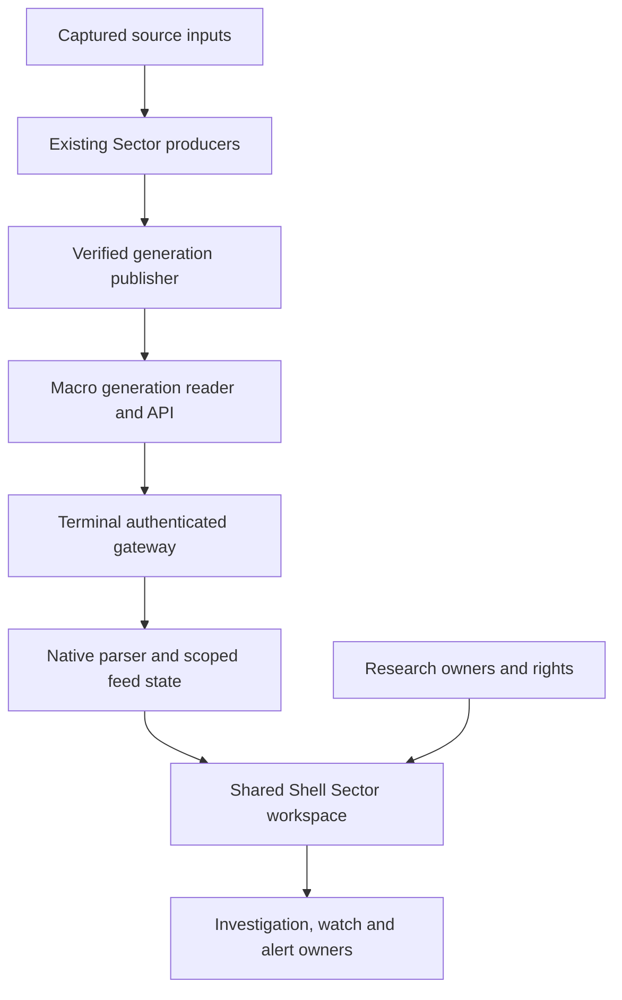

# Sector Intelligence — Round 3 architecture contract

## Round 4 current-use amendment — final version 1.0

This appendix is the retained Round 3 architecture record with narrow factual corrections. The final [masterplan](SHARED_SHELL_MASTERPLAN_2026-11-09.md) and [Fable/T3 packet](https://github.com/mastermindx-market-intelligence/macro/blob/dde2d9d411bf6236b5405f01fac3b8cef87ff98c/research/sector_completion_20261021/FINAL_FABLE_T3_PACKET_2026-11-09.md) now govern implementation. All four planning rounds are complete. Current source/contract decisions in that packet supersede historical Round 3 assumptions only where specified; no current application or installed schema is claimed implemented.

| Corrected or refined matter | Final controlling disposition |
|---|---|
| Source route | Terminal #1244 merged as 67e2d515e4e92d2d05ea399f5691b7860fa07bbf; /sectors/catalog exist at 57ab4281d87ccb9e01e3bafcd42350034de1b222. Reuse the route; old missing-route/unmerged statements below are historical. |
| Native generation | #10780/#1339 remain separate unmerged source candidates. #10839's sector_dated_context owner is a real dependency; preserve its bounded scope and exact CI-registration ACTION_BLOCKED_NO_REPLAY. |
| Current source / holds | Final Macro pin bf91cd8964c0fc3ea4ea2e987a21d7759b380032. #10777 needs current conflict/check reconciliation under its existing controller. #1339 retains integration/release HOLD. GMI/Nuclear, original unknown operations, PLNT R8 staging denial and PublicCarrierHold remain. |
| Evidence ledger | Actual P19 ledger: 80 CONFIRMED, 24 PARTIAL, 15 UNSUPPORTED, 13 NOT_DELIVERED, one CONFIRMED (contract gap), one BLOCK_CONFIRMED. All served proof PENDING_P22; blank original final fields were intentional pending P23. |
| Stable aliases | SC-066 = R3A-66, basket disclosure; SC-092 = R3A-92, correction/revision. Existing basket count fields and n_subsectors ?? n_listed repair are reused; truthful listed/scored copy and new consumer proof remain. |
| Exact Paper names | S08 IQ2-0 is Source reader; S10 L8B-0 is Sector map. R3 Watches are 3DN-0/47R-0/16X-0; 56C-0 is Authority/contents. The anchor table below is corrected accordingly. |
| State/design debt | 19 historically applicable missing states plus 23 historical N/A dispositions; 47 core Frames are preserved. Full calls/Bottoming Watch, four-universe confluence, phone flows, full Cycles depth and actual context states have bounded design assignments. |
| Subject/evidence admission | Proposed narrow v2 macro.sector and theme_graph owner references. Native xlf and Finance sector:financials remain separate owner identities; an actual versioned bridge is required when crossing. Keep new evidence pinned and thesis_refs empty. |
| Save/recovery | Proposed actor fence before I/O; owner_mismatch does not resolve an earlier uncertain save. Retain actor journal, Check save status, exact operation and rights retirement. No added Replay button. |
| Installed SQL | Compose a newly reserved migration over the actual installed validator; preserve 0028/0039/0040/0042/0047 and any installed 0043 behavior. Source says 0047 unapplied; no installed DB read occurred here. |
| Research v2 | Exact closed request union/profile grammar, native generation plus context_generation, paired expected fields and assertion-level evidence.v2. V1 remains unchanged; real owner inputs and current rights admit every available vertical. |
| Original delivery mapping | P04=B01–B04, P05=B05–B07, P06=B08–B11, P18=B12; P14 depth/lenses/flows/themes/four universes, P15 Cycles/history/Record/Methods, P16 actions, P17 compatibility/access/responsiveness. |
| Final handoff | Ten validated complete authoring briefs, all 134 IDs/old P/J/verdicts/final owners, ten industry witnesses, normal release/operational/rollback/retirement proof. No worker dispatch or START. |

The historical source and candidate snapshots below remain evidence of what Round 3 inspected. Use final packet §2 for the changed ten-carrier frontier and §7 for the refreshed remaining industry foundations. The unchanged Appendix A is the exact 24-anchor contract. A final planning join is not a replacement acceptance database.

## Original Round 3 architecture record

**Revision:** 0.3 planning amendment, 9 November 2026 (America/Vancouver).  
**Parent:** Macro #7646 / sector-central-redesign-20260921-sol-001 / WS:SECTOR-INTELLIGENCE-COMPLETION.  
**Owning plan:** [SHARED_SHELL_MASTERPLAN_2026-11-09.md](SHARED_SHELL_MASTERPLAN_2026-11-09.md).  
**Design input:** [Round 2 guide](ROUND2_PAPER_BUILD_GUIDE_2026-11-09.md), final 47 editable Frames.  
**Status:** proposed implementation contract. Source architecture was inspected; no code, Paper, release, deployed configuration or execution admission was changed in Round 3.

This appendix hardens the existing plan. It is not a new workstream, capability registry, lifecycle, backlog or accepted completion ledger. The incumbent 134-row matrix and B01–B12/P01–P23/J01–J15 remain authoritative. The final Fable-led T3 packet is Round 4. Current outer Chairman instruction authorizes this planning round, not inference from historical source prose.

## 1. Evidence baseline and decisions

### 1.1 Current source and exact candidate identities

| Source/carrier | Observed identity | Consequence |
|---|---|---|
| Procedure, reused pin | Mastermind 3652d8907df1738de551dd3032b42aa2a2acb482 | Same compatible skillpack v1.0.1; user AGENTS controls conflicts |
| Macro main | 9a13c64bf69f782332afa29efb09fe48ee30b857 | Current affected source/data inspection; does not imply every candidate landed |
| Terminal master | 1c0bf028cf72539a4d3fcb17fa137ee474d764f9 | Protected branch read; current native service and return owners inspected |
| Macro #10780 | 91add9613ad29dcfb82ff75036dd6519cfc6c06f; open, unmerged | Coherent generation API/reader/projector candidate; the three corresponding source files are absent from inspected main |
| Terminal #1339 | 7ded5375caf0aa595ca740bf0df36b175471192e; open, unmerged | Native generation parser and consumer candidate |
| Terminal #1244 | 43fa33c7423daca90237e5b34f26b08fe0b5c24d; open, non-Draft, unmerged | Dedicated /sectors entrance and revised generated catalog; native metadata supersedes old Draft prose |
| Macro #10777 | 99968fd0533b39410040b01caf51f3e5b050c5be; open, non-Draft, unmerged | In-shell Cycles/dossier/China wave donor; not a blanket supersession |
| Macro #10703 | 9fc460ff36345387c3a2c5435b079852e8488da0; Draft, unmerged | D05 composition/return and regional work; explicit holds retained |
| Macro #10707 | 74930f6931773b23072f91590319dc39fe5a7d07; Draft, unmerged | Separate dossier component with captureView/applyView; its JS is absent from #10777 and main |
| GMI #10676 | b3cb43f384c94d401977839d00e54d2c0689caed; Draft, unmerged | Updated native-link donor progress; no Ready/enqueue/relabel/release permission |
| Nuclear #9124 | e6fc0959d15804be00ec7c6e54e732f83a13cc70; Draft, unmerged | Preserve existing successor; do not revive #8002 |

Native mergeability was false for #1244, #1339 and #10777 at this read. Old PR descriptions containing another head or a previous mergeable verdict are historical. This round did not refresh all CI/reviews or adjudicate release eligibility; all actual holds and live writers remain. Exact implementation heads must be reconciled at the next modifying step.

### 1.2 Architectural rulings for final-packet preparation

| Decision | Concrete ruling | User capability unlocked |
|---|---|---|
| One product | One SectorIntelligenceWorkspace in Beta Shared Shell; retained entrances mount it or preserve their state through compatibility | A continuous investigation across Brief, Explore, Research and Watches |
| One data path | Integrate #10780's existing publisher/reader/API with #1339's gateway/parser, through #1244's route | A coherent source generation reaches the actual page |
| Distinct clocks | Core source session, older Brief baseline, publication time, received time and evidence publication time remain distinct | Accurate freshness and meaningful dated research |
| Descriptive order | Project the exact producer ordinal with horizon/basis/cohort; do not use Central array order or turn display order into a decision authority | Correct leadership comparisons |
| Durable research | Extend Investigation v2 admission and evidence resolvers | Immutable saved reasoning, comparison and reliable recovery |
| Real research registration | Evolve the existing closed registry to explicit theme/company_profile/sector_profile variants, each with real inputs and a renderer | Industry depth that actually opens and explains evidence |
| Account consistency | Add expected-actor equality fences to the new Sector consumer operations through incumbent APIs | Stale tabs cannot write under a different signed-in actor |
| Separate monitoring | Watch membership, note sync, investigation save and alert activation keep separate receipts | Honest saved/armed outcomes |
| Honest history | Reconstructed current-cohort history remains reconstructed until knowledge-time evidence exists | Useful historical context without fabricated replay |
| Cycles reuse | Retain rhythm/phase-age owners and selected candidate components; evolve turn-knowledge semantics explicitly | Full cycle investigation with clear qualification |
| Compatibility | Preserve the exact 24 legacy anchors and native query aliases; extend the existing codec | Old links and saved origins retain meaning |
| Acceptance | Reconcile all 134 rows by stable ID; frame count cannot close them | Complete delivery without silent feature loss |

## 2. Source-to-screen architecture

### 2.1 Integrate incumbents before adding features

The required chain is:



The publisher is the existing scripts/vps_live_orchestrator.py generation path. It captures/verifies member bytes and switches the current selection conditionally; the request reader resolves the selected bundle once. No new publisher, scheduler, generation allocator, cache service or polling daemon is required. [M2] [M4] [M6]

The source candidate mounts the route in app/main.py and binds MACRO_SECTOR_GENERATIONS_ROOT through configure_sector_generation_reader. Unset/invalid binding leaves a closed unavailable route; it must not choose checkout/static data as a fallback. An older API design note still says mounting is owed, but the inspected candidate app/main.py contains the mount. Source mounting and a verified deployed binding are distinct. [M1] [M2] [M5]

Current Terminal master still has eleven static source families. The candidate adds the generation source to the same fixed-origin gateway. The dedicated /sectors source page is absent from current master and present in #1244. The Round 1 live 404 observation remains historical; no fresh live-browser result is claimed in this round. [T1] [T3] [T4]

### 2.2 Preserve the existing wire and admission

Current proposed producer wire:

```text
GET /api/sector-generation?audience=preview|entitled
sector_generation.read/v1
  audience, source_session, published_at, qualification
  projection.data: sector_native_view.v1
    audience, core, history, brief, action_board
  projection.receipt: sector_native_view.receipt.v1
    source=macro.sector
    generation_id, source_session, published_at, qualification
    input_version, baseline_session, content_sha256
```

Only audience is currently accepted. Duplicate audience, unknown parameters and caller-chosen path/root/generation are refused. Do not append UI subject/window/region parameters to this endpoint and assume support. New bounded detail queries, if required, evolve the existing owner contract explicitly. The first 11-sector journey can consume the already bounded native projection. [M1]

Preview is a representation, not public access. The owner checks the five canonical Central/Cycles/baskets/Brief/action-board resources; entitled adds the premium Central resource. Keep current resource policies and the original cookie-based gate. A signed-in Shell route does not widen a source entitlement. The BFF retains fixed HTTPS origin, filtered session cookie, manual redirect refusal, finite JSON, 4 MiB limit, 6-second deadline, abort propagation and private/no-store caching. Finviz's separate internal-only gate remains intact. [M1] [T1] [T3]

The native reader currently admits preview only. It validates generation metadata, 1–100 unique sector rows, same-session history and mapped identities; measured groups are bounded to 128. Brief and action_board are transported with an explicit baseline but are not copied into the PSL-only evidence consumer. Exposing native calls or a fully source-backed Brief therefore needs a bounded reader for those existing projection members and audience semantics. Do not render opaque optional JSON merely because it arrived. [T2]

### 2.3 Generation, selection and refresh invariants

1. Native reset identity is generation_id + authorized content_sha256. The gateway's received-byte contentHash has a different scope and is not a substitute for the owner receipt.
2. Same-session replacement retires old history cursor, selected detail response and dependent comparison. It does not by itself prove a source correction.
3. A selection request is bound to actor/access generation, region/universe, subject kind/ID, metric/window/basis and native generation. Old responses cannot win after any of these change.
4. One selected source generation supplies comparable core/history/dossier values. Different evidence classes can have different clocks; the research owner declares the relationship rather than the UI guessing a tolerance.
5. Invalid/refused native generation has a typed local state. No silent fallback to the static Central artifact.
6. Existing visible refresh may request an update; it does not restamp source dates, advance the grader ledger, replace a pinned investigation or create a second producer.
7. Optional rotation, context, source or flow failure affects the dependent capability. Valid independent measurements stay visible.
8. Historical snapshot selection is explicit and read-only. If its bytes/rights are unavailable, show that outcome; do not substitute the latest generation.

Use the existing feed lifetime, useReadingScope and abort ownership. Shared UI state is not a new global data authority. [T2] [T5] [T8]

### 2.4 What the Brief may claim

The Paper Brief should derive its heading from qualified measured values at the displayed horizon. It may show observed leadership, participation, changes and disagreements. It must not infer a trade, lane assignment or confidence from text.

Current Central array order is conviction; momentum.lead primarily follows the 21-session rank. The Paper 63-session order must explicitly use the 63-session producer ordinal. Return values and descriptive order use the same generation/cohort/basis, while the independent one-month constituent heat metric retains its own window. The older baseline of Brief/action-board, if consumed, stays visible where material. [Q1] [Q2] [Q4]

## 3. Navigation and exact-return contract

### 3.1 Add jobs to the existing codec

Adopt proposed sectorJob=brief|explore|research|watches in parseSectorState/writeSectorState. This is an additive change in the existing owner, not a parallel router.

- A clean canonical /sectors entrance explicitly selects Brief.
- Old sector URLs with no sectorJob preserve their current Explore/discovery/detail interpretation. Never reset an old selected subject to the new default.
- Preserve sectorWorkspace=rotation|discover|breadth|detail and all current sectorView values.
- Add cycles and compare workspace values, plus a dossier cycles detail view, only through the same typed parser/writer and return codec.
- Legacy sectorView=dossier means signals; themes means drivers; sources means source disclosure. Do not repurpose those aliases.
- Preserve existing search, sort, matrix, theme, company, expansion, rotation and Finviz parameters with their current bounds.
- The Shell region/identity owner selects the applicable universe; a translated label cannot substitute US data for China.

The /discover?tab=sectors entrance initially mounts the same workspace with the old parsed state. Change its canonical navigation only after compatibility proof. The route wrapper supplies one Shell title/navigation/access lifetime; avoid duplicating the outer header around the new four-job composition. [T4] [T5] [T8]

The inspected protected catalog has no /sectors in nativePaths; #1244's catalog includes it. The candidate records the already-merged Macro inventory source e39ec45902c1a2bb28507beb851593be6e422167, while the protected catalog still records its older inventory. Regenerate through the incumbent exporter against the accepted inventory and integrated route set; do not hand-edit the generated JSON or infer admission from the presence of a page file alone. [T6] [T7]

### 3.2 Return is bounded and context-specific

Current public sectorReturn is at most 1024 characters; full same-tab mmxSectorDepthReturn is at most 8192 and is valid only when bound to the matching reduced public query. Unknown, duplicate, nested and noncanonical query encodings are rejected by exact re-encoding. Current capture is restricted to sectors, sourcesOpen=false and outer rotation/discover/breadth workspaces. Extend these exact checks for newly admitted jobs/detail destinations; do not introduce a second restoration store. [T9]

Current scroll/focus references are in-memory, not reload-durable. Proposed evolution: retain bounded logical anchor/focus IDs, selected window, disclosure and table page through the same history envelope, tied to route, actor and generation. Prefer an item/section anchor plus offset over a raw document scroll number. On changed layout/data, restore the nearest valid anchor and state that exact restoration was partial. A shared URL reduced by the public budget promises supported selection, not private draft or exact full view.

Back, Forward, reload, company return, research return and saved-revision reopen need separate cases. A browser history return and a durable Investigation snapshot are different owners.

### 3.3 Legacy anchor migration rule

Appendix A enumerates the exact 24 current anchors: 21 literal keys plus three runtime additions. Preserve the old destination until its replacement has equivalent source, controls, access, keyboard/focus and return evidence. #sc-cyclemap and #dossier are specially rehomed to Cycles by the candidate; the candidate's routeCycles precedence must survive composition. Theme and narrative identities are not arbitrary anchor aliases. [L1] [L2]


## 4. Research and industry integration

### 4.1 Extend the existing registry with a versioned union

The current shared registry/mounts contain only ai_semiconductors. Its loader reads public Company Intelligence workspaces but supplies empty assertion, identity, interpretation and native-reference inputs with private_assertions_unbound; it refuses system_replay. Finance and Technology are held adapters, not working mounted destinations. Robotics also lacks an admitted real witness cohort. [R1] [R2] [R3] [R4] [R9]

Proposed request evolution at the existing query/evidence routes:

| Discriminator | Required subject | Contract |
|---|---|---|
| theme | Exact admitted anchor and slice | Preserve v1 behavior; no fuzzy anchor, wildcard schema or default vertical |
| company_profile | Exact profile ID and owner-resolved company/security identity | Company-first query; no ticker-only identity or artificial theme |
| sector_profile | Exact profile ID and canonical sector reference | Sector-first query; no pretend theme anchor or empty slice to satisfy the old grammar |

Use an explicit proposed request_schema=theme_research.request/v2. Keep v1 accepted bodies/responses unchanged. Reject mixed versions/foreign fields before calling a loader. Each variant binds exact request/response schema, definition version, subject kinds, views, time modes, pagination rules, query constructor, loader, composer, evidence selector, renderer and EN/ZH copy. A module or constant is not a registration witness.

Evolve theme_research_registry.py, theme_research_mounts.py, theme_research_binding.py and app/theme_research.py through their current owners. The economic composers remain specialized. Technology's view-invariant dossier and replay limitations, Finance's latest-only contract and Mining's native comparability/generation semantics are preserved. [R1] [R3] [R4] [R5] [R6] [R10]

### 4.2 Admission is a complete consumer chain

The implementation must bind:

real source → identity/rights → owner bundle → typed registration → composer → bounded renderer → exact evidence → company/return.

Four separate seams require proof: request grammar, real loader, native evidence/identity grammar, and renderer projection. Technology currently also requires an actual theme_ref and sealed native context, while its as_known shape is proposed. Finance's adapter also needs its view_keys and query-constructor forwarding connected to the shared binding; its held loader currently raises finance_owner_loader_pending. Finance's old slug-only curation reference and the current canonical theme reference grammar must be reconciled. Do not clear a hold by copying fixture identity, inventing an anchor or accepting every schema.

The private-publication foundation behind #8245 is earnings-specific. Reuse its verified immutable object and pointer machinery where its owner admits the new role; it is not already a generic GMI assertion store. Company-theme exposure is a context-only membership projection, not proof of supplier/customer relations, revenue exposure, security identity or magnitude. [R3] [R4] [R8] [R12]

### 4.3 Vertical delivery order and witnesses

| Vertical | Required next witness | Preservation rule |
|---|---|---|
| Semiconductors | Real dated assertion + exact identity + rights-qualified source through the currently registered consumer | Public economics alone cannot pass the product/platform evidence chain |
| Technology ex-Semis | Actual company-profile owner bundle and sealed context; valid time semantics | Preserve #7891 source; no synthetic theme or placeholder as-known stamp |
| Finance | Real sector:financials loader, query constructor, renderer and consumed evidence | Preserve existing economic slices; do not reduce the task to removing a hold constant |
| Robotics | Real admitted cohort and owner inputs, then registered consumer | Empty current loader stays unavailable until populated proof exists |
| Mining | Native copper/rare-earth query/bundle and unit/perimeter/period-compatible evidence | Preserve economic definitions and counter-thesis |
| Nuclear/Energy | Reconcile #9124's existing successor with real ordered/capacity/output/economic evidence | Planned capacity is not realized production |
| Consumer Defensive | Exact P&G evidence, current rights and Company return | Reuse existing envelope/foundation; verify actual downstream consumer |
| Consumer Cyclical | Real PLNT case, entitlement, save and reopen | Deterministic composer correctness alone does not close delivery |
| Healthcare | Regulatory supply evidence plus the separate economic explanation | FDA status cannot become a revenue or market-share conclusion |
| Industrials | Exponent/Pentair source-to-cash mechanism, counterexample and return | Reconcile the inherited 56 obligations and actual current carrier before edits |

The first six rows received affected-source review in Round 3; remaining verticals preserve Round 1 findings and need their exact current carrier refresh in the final packet. Every directory entry remains an explicit implementation obligation. A truthful unavailable state is necessary interim behavior, not final completion of an admitted vertical.

### 4.4 Evidence, corrections, rights and source reading

Research generation binds definition version, rights revision, native revision tuple and explicit query dimensions. Deep pages require expected_generation; evidence readback must match. A rights change invalidates old query/evidence combinations. Preserve fresh rights filtering for both source assertions and interpretation derived from them. Unknown/inaccessible evidence must not become an existence oracle. [R5] [R6]

Source publication, source availability, system retention, interpretation review and identity mapping vintage differ. source_history may include later-retained archive material with retrospective labeling; system_replay requires actual availability and knowledge-time inputs. The current registered loader refuses replay. No UI toggle or current retrieval timestamp can supply missing history.

Native curation corrections create a new assertion with predecessor_revision. The original is retained. The shared lineage helper is not universally wired to all composers, so Sector/GMI revision views require a real adapter. Keep an old saved reference fixed, present the revised assertion separately, and use unknown when no correction/removal witness exists. [R7]

Source reading resolves the incumbent receipt/reference and allowed excerpt/body. Never generate a plausible issuer URL to fill a missing source link. Retention and third-party restrictions remain source-specific. Revocation removes derived protected prose as well as the raw excerpt. [R6] [R11]

## 5. Saved investigation, watches, notes and alerts

### 5.1 Investigation v2 is the durable research owner

Reuse investigations, investigation_revisions and investigation_mutation_receipts through /api/investigations. The service already has immutable revisions, expected_revision CAS, original-operation lookup, a detached pending command and recovery journal. Do not build separate Sector Saved Research tables. [P1] [P2] [P3] [P6]

Actual service admission is narrower than the general manifest grammar:

- Subjects: terminal.analysis_symbol/security and data_os.security_master/security|issuer.
- Evidence: earnings.workspace_generation/event_workspace and the existing terminal.options_exposure types.
- The Options sector_origin type is not admission for arbitrary Sector data.
- Nonempty thesis_refs are currently refused.

Add narrow Sector and GMI subject/evidence adapters to this existing admission boundary. Freeze exact owner names/object types with their owners in the implementation packet; accept only owner-resolved references to immutable observations/generations, not copied provider bodies or mutable display text. Keep TS/Python/installed SQL validation equivalent. INVESTIGATION_API_ADMISSION must actually be open in the deployed service before promising account save. [P1] [P5]

Proposed saved context comprises: exact subject reference; source observation/generation reference; metric/window/basis/cohort; original question/continuation; allowed authored note; renderer version; bounded view/layout reference; capture time. Source evidence time is not capture time. Historical bytes remain with their retention/rights owner.

### 5.2 Command and recovery state machine

The incumbent command remains:

```text
{id, operation_id, expected_revision,
 action: create|revise|remove|restore,
 manifest, layout_capture?}
```

The SQL transaction binds actor, command fingerprint, target, expected revision and retained layout. It resolves an exact prior operation receipt before reconsidering the current head, rejects changed reuse, applies CAS, and commits head/revision/layout/receipt together. Extend adapters around this transaction; do not create a Sector retry queue. [P6]

| Event | Required result |
|---|---|
| Save starts | Detach exact command, verify its actor-scoped recovery journal, then dispatch |
| User continues editing | Later draft remains separate from the pending payload; eventual receipt identifies what was saved |
| Timeout, malformed response, lost auth | Remain uncertain with original actor/operation/target/payload |
| Original lookup returns not_found | Remain uncertain; a missing receipt is not proof that no commit occurred |
| Exact committed receipt arrives | Confirm exact revision; later readback failure is a distinct outcome |
| Revision/idempotency conflict | Preserve draft and relevant versions; no automatic overwrite |
| Conflicting recovery journal entries | Preserve both and refuse a new save until resolved |
| Actor changes | Clear visible private state; retain old journal only in its original namespace |
| Historical revision is unavailable or denied | Show that state; do not substitute latest |

Paper's Check save status remains the primary recovery control. The incumbent owner also supports replay of the exact original operation. A Sector implementation may expose that narrower recovery only after original-status reconciliation and proof of the installed owner's replay contract, under the same actor/operation/fingerprint; it must never mint a replacement operation or generalize this into a new retry mechanism. Any such control is an explicit Round 4 design-contract delta for A01/A06/MS01, not a claim that the existing Paper button already executes it. [P2] [P3]

### 5.3 Actor and access generation fences

The annotation route already checks an expected-owner header against the authenticated UUID before I/O. Current non-scenario Investigation saves, browser watchlist mutations and generic alert activation do not apply an equivalent expected-actor equality fence. This is a source-level stale-tab race to prevent; no observed production leak is asserted. [P4] [P7] [P10] [P14]

Extend those incumbent boundaries for the new Sector consumer. The client carries the actor for whom the command/read was authored; the authenticated server remains the identity authority. A mismatch refuses before reads/writes. Use existing accountIdentity helpers, not email, display name or a second identity store. The same rule applies to original-operation lookup.

Client response ownership must include actor and access generation, not UUID alone. Same-account entitlement loss retires protected titles, charts, excerpts, drafts and thumbnails before recovery. Abort old requests and suppress late success notifications from the retired scope. Reuse the current Shell identity lifetime and Sector response ownership.

### 5.4 Separate membership, annotation and monitoring

- Watchlist membership names the actual security/ETF. A sector classification or theme is not silently converted into a proxy ticker.
- Existing symbol annotations support account sync, independent revision/CAS and pending/conflict handling; notes are limited to 500 characters. Show account-confirmed versus local pending truthfully. A source/thesis note is not automatically a symbol annotation. [P8]
- Research question, continuation and assessment stay in their admitted Investigation fields. A new freeform source annotation requires an explicit extension, not misuse of an unrelated field.
- Watch success plus note failure yields two outcomes and note-only recovery.
- Browser watchlist writes do not inherit the separate API-key importer's idempotency guarantees. Read the original membership through its owner before retry; do not claim immutable receipt semantics that route does not have.
- Existing condition builder offers price_touch and price_proximity. rotation_transition, exposure_change and event_time refuse no_evaluator. Keep those controls unavailable until their actual evaluator and source-generation contracts exist. [P9]
- Generic alert POST currently inserts a fresh row without operation idempotency. Add stable activation identity and receipt/readback to the existing alert owner before offering uncertain-activation retry. Investigation saved is not alert armed; alert armed is not trigger or delivered. Reuse alert_outbox/alert_runs and current notification channels. [P10]

### 5.5 Revisit and change review

Use investigationEvidenceDiff and add Sector/GMI resolvers. Separate membership, content version, qualification, availability, correction, exclusion and numeric interpretation. A numeric delta requires the same unit/basis/cohort. Removal requires a complete comparable census or explicit tombstone; a missing page is not removal. The current Earnings adapter explicitly lacks complete removal proof, so it cannot establish generic Sector history. [P11] [P12]

Comparison is read-only. Accepting a newer baseline creates an ordinary CAS revision while retaining the original. If source revision, membership and market movement cannot be independently attributed, show the changed dimensions that are known and do not invent a decomposition.

## 6. Analytical definitions and qualification

### 6.1 Descriptive ordering receipt

Use the existing producer's order, preserving tie rules and missing-value behavior:

```text
Proposed display-order projection, emitted inside the existing owner:
source_field, metric_definition, horizon_sessions,
cohort_id, benchmark, return_basis, generation_id,
ordered_subject_ids, source_ordinals,
authority: existing display-only flags unchanged
```

For the Paper's 63-session view use sector_cycles.now.rs_rank carried through Central momentum.rs_rank; 21-session uses rs_21d_rank. Central sectors[] order is conviction, and momentum.lead is not a 63-session label. The measured context's published descriptive rank is an observation, not permission for a new ranker. GroupMeasurement does not gain ranking authority. Keep may_rank/may_gate/may_size/may_trade/may_escalate false and prevent this display object from entering decision or sizing inputs. [Q1] [Q2] [Q3] [Q4]

### 6.2 Measurement contract

| Display | Definition | Required distinction |
|---|---|---|
| Relative wealth vs benchmark | 100 × ((1 + group return)/(1 + benchmark return) − 1) | Not arithmetic excess in percentage points |
| Positive sector breadth | Positive measured sectors / measured sectors | Coverage is measured / expected; missingness bounds are not confidence intervals |
| Constituents rising / priced | advances / priced observations | Priced includes unchanged |
| Constituent breadth percentage | advances / (advances + declines) | Unchanged excluded; all-flat breadth is null |
| Missing constituents | expected members − priced observations | Missing is neither declining nor zero |
| Weight coverage | priced weight / roster weight | Not the same as member-count coverage |
| Contribution | Existing owner's weight/return method for the same window | Individual return is not contribution |
| Overlap | Separate issuer overlap and exact listing/source-member overlap | Overlapping themes are not independent confirmation |
| Flow | Qualified actual flow source | Price/volume activity is not capital flow |
| Improvement | Level, metric change, ordinal change and persistence separately | Missing previous observation is not no change or deterioration |

Current Financials specimen is 75 members, 73 priced, 59 advancing, 14 declining and two missing. Test an additional unchanged population because these two breadth denominators happen to agree when unchanged is zero. All-flat priced observations must produce rising share zero and null breadth. [Q2] [Q3] [Q4]

Fixed 5/20/63-session native window measurements, 21/63-session dossier RS and one-month heat participation are separate contracts. Controls must name and change only the applicable metric; do not relabel 20 as 21 or 1M as a fixed session window.

### 6.3 Historical population and knowledge

Basket Cycles currently uses consolidated_candle(..., mode=equal, pit=False), and stamps current_membership / point_in_time=false / reconstructed_price_history. The membership owner distinguishes back-projected added from actual curated_added. All historical charts remain useful reconstructed context; they are not automatically as-known research. [Q1] [Q5]

Evolve the existing membership/input owners to supply effective interval, knowledge/curation time, source revision, and availability evidence. Reuse cohort_at(..., as_known=True) and admissible_as_known where supported. Date-only knowledge needs a conservative declared interval rule before intraday admission. Unknown availability stays unknown. An ETF's single-instrument membership flag does not prove historical adjusted-price-vintage availability. [Q3]

### 6.4 Cycles clocks, confirmation and forecasts

Reuse cycle_rhythm.rhythm_window: last non-provisional pivot, the same record's half-cycle spacing, P25/median/P75 and explicit before/inside/past-window states. Holding the turns fixed while today advances must not move the window edges. The range is descriptive historical timing, not a probability interval. [Q6]

Sector Cycles still uses legacy turns without confirmed_at or detector epoch. cycle_ontology.detect_turns contains timestamped detection, but is not integrated into that producer. Add a versioned turn-knowledge contract through the existing producer: pivot date, confirmation date, detector/version/threshold, structure basis and generation. Compare the legacy and proposed detector semantics; do not rename a pivot date to confirmation date or silently switch detectors. Until admitted, as-known turn/timing claims remain unavailable. [Q1] [Q8] [Q11]

Reuse cycle_phase_age's actual-session forward log. Measured contiguous age displays N sessions; lower-bound age displays at least N; insufficient, missing, unknown-phase and not-logged states remain distinct. Open-leg duration is a separate pivot-based clock. Weekend restamps do not add trading sessions. [Q7]

Current source retains LIVE_HAZARD_PARITY=PARITY_FAILS. No new experiment was run in Round 3. Current MODEL requires qualified cell, exact model/feature/direction/basis/epoch compatibility, parity_holds, coherent generation and correct horizon/leg. A separate emitted PRIOR can remain visible with its own population; it cannot be synthesized from a withheld MODEL value. An inverted probability curve is withheld as a whole, not sorted/clamped or cherry-picked. Reuse the strict candidate face guard and the existing scorer. [Q6] [Q9] [Q10] [Q11]

A finite negative or underpowered scientific result is a valid research disposition. It cannot enable the unavailable prediction. This does not prevent useful measured leadership, breadth, divergence, cycle-history and economic-evidence workflows.


## 7. Candidate integration and component boundaries

### 7.1 Preserve behavior across parallel candidates

| Intersection | Observed source | Integration rule |
|---|---|---|
| Terminal #1244 + #1339 | Both change terminal/app/api/sector-intelligence/route.ts | One integration writer composes the route and generation semantics; retain fixed-origin/access/deadline/failure classification |
| Macro #10780 + #10777 | Both touch existing Sector builders/consumers and related CI/source paths | Reconcile current owned blobs and dependencies; do not choose a whole file by PR recency |
| Macro #10703 + #10777 | Shared Central/Cycles/router/China/template paths, with different additional returns/regional work | Compare behavior and retain the unique D05 capabilities; no blanket supersession |
| Macro #10707 + #10777 | #10707's sector_dossier_cycle.js/css are not in #10777 or current main | Preserve captureView/applyView and source-bound component semantics; integrate or explicitly replace each behavior with equivalent proof |
| GMI #10676 | New context-preserving native topic links at the refreshed Draft head | Reuse link/return behavior; respect existing route admission and release holds |
| Incumbent capability CSV | #10780 itself changes the matrix | This planning appendix joins by stable row ID; it does not overwrite that active writer's evidence or accepted fields |

#10707 captureView/applyView binds publicationId, subject/family/asOf, range, values/source disclosure and pager state. It returns applied/partial/rejected outcomes and detects changed source/history availability. A React integration may extract/adapt its pure semantics or mount it behind one lifecycle wrapper with explicit disposal; it must not create two selected-subject controllers, duplicate global listeners or another history store. Preserve useful source rather than copying the old page chrome. [L3]

Use existing chart primitives and semantic tokens. The 47 Paper Frames are source for composition, not permission to introduce a second design-token registry. Native browser composition must validate density, focus, clipping and reading order after source adapters are connected.

### 7.2 Meaningful intelligence enhancements

| Capability | Smallest useful implementation | Additional qualification needed |
|---|---|---|
| Leadership with participation | Exact-horizon leader comparison beside priced/rising/missing coverage | Predictive wording remains separately qualified |
| Horizon disagreement | Show the source's 21- and 63-session readings side by side with a named next investigation | No invented composite score |
| What changed | Compare compatible numeric fields and source ordinals; identify membership/definition/version changes separately | Causal decomposition only with owner-supplied evidence |
| Concentration and contributors | Existing weight/contribution calculation for the same population/window; readable member drilldown | No substitute of highest return for largest contribution |
| Rotation investigation | Existing context/event identities, population, date and confirmed-state distinctions | Early context remains context; event timestamps must be source-defined |
| Industry explanation | Real economic mechanism, supporting source, counterevidence, exact company and missing magnitude | Association is not revenue exposure or causal proof |
| Revisit | Original saved revision beside current qualified observation and separately identified source correction | Missing historical owner data/rights remains unavailable |
| Monitoring | Supported predicate bound to its exact saved revision and source identity, with evaluator/run/delivery evidence | New Sector predicates require the incumbent alerts owner to implement them |

The product can be valuable at every stage through measured comparisons and economic evidence. Completion still requires implementing the admitted depth; polished unavailable placeholders do not close a vertical or capability row.

## 8. Implementation sequence inside the existing B/P/J contract

These are dependency groups for the final packet, not new Executive waves or parallel task IDs. Final packet authoring must bind each to the current owning carrier, permitted diff and exact integrated head.

| Order and existing linkage | Concrete output | Main owned paths/interfaces | Exit proof |
|---|---|---|---|
| 1 — P01/P02 reconciliation; B01 | Source/contract composition and retained-donor map | Existing #1244/#1339/#10780/#10777/#10703/#10707 carriers and active source custody | Unique behavior preserved; exact current head/path overlap recorded; no assumed supersession |
| 2 — P04/P06/P17; B01/B02/B10 | Route admission, generation API, gateway/parser and one authenticated sector read | Macro generation reader/projector/application mount; Terminal gateway, native parser, generated route exporter and /sectors mount | One real owner generation reaches Beta; audience/rights/baseline/cancellation/invalid-generation cases pass |
| 3 — P07–P10; B03/B04/B08/B11 | Four-job composition with Brief/Explore, source-backed ordering, comparison, coverage and exact return | Existing Sector workspace/components, serializer, return codec, incumbent semantic tokens | Sector → comparison → dossier → exact origin on desktop/mobile; all-flat/missing/horizon/tie cases pass |
| 4 — P08/P15/P18; B05–B07/B12 | Full Cycles/dossier integration and finite scientific disposition | Existing Cycles/phase-age/rhythm/turn producers plus retained candidate component contracts | Same anchor/cohort, phase-age/lower-bound, history, whole-curve, MODEL/PRIOR and current/refused states pass |
| 5 — P11/P12/P14; B09 | Actual research adapters, real source witnesses, evidence/company handoff | Existing research registry/binding/loaders/composers/app routes and Shell renderer | Each admitted vertical has an exact source→evidence→company→return witness; typed unavailable is interim |
| 6 — P12/P16; J10/J11 | Investigation adapter admission, actor binding, independent notes/watch/alert behavior | Existing Investigation/API/SQL, journal, annotation/watchlist/alert owners | Exact saved revision reopens; lost response, stale actor, CAS conflict and independent partial outcomes pass |
| 7 — P14/P17/P19/P20; J07/J08/J12/J13 | Remaining depth, regional/access/compatibility and all 134-row dispositions | Existing legacy bridges/aliases, native depth, regional owners and acceptance matrix | Every retained row has producer, design, consumer, failure case and disposition; no undocumented lost journey |
| 8 — P21–P23; J15 | Normal release, real served journey, next natural update/no-change, rollback and retirement | Existing release/publisher/telemetry owners | Exact source→build→deployed→served receipt chain; authenticated journey, update and justified archival proof |

Research input binding, scientific qualification and nonoverlapping UI work can proceed in parallel after interface freeze. One writer owns shared routing, generation, database migration and integration diffs. No duplicate alert writer/evaluator runs during parity testing.

### Final worker packet minimum

Each packet must include exact base and candidate heads; owned paths; retained donor behavior; B/P/J and stable row IDs; request/response examples; real dated and negative fixtures; source/rights/identity contracts; focused affected tests; live custody and holds; actual user-path proof; rollback; and a source-linked return. Fable owns product/integration/acceptance judgment; T3 is the implementation interface, and existing execution/capacity systems retain admission. No worker is dispatched by this document.

## 9. Responsive, performance and operational contract

### 9.1 Fixed implementation targets, not measured results

Use a reproducible reference profile pinned in the eventual test receipt: installed Chromium version, 390 CSS px / DPR 2, 4× CPU throttling, 10 Mbps down / 2 Mbps up / 80 ms RTT; repeat desktop at 1440 CSS px without CPU throttling. The fixture set must be a captured authorized owner projection, never invented live data. Run at least 30 warm and 30 cold navigations per principal tested profile; report raw observations, median and p95.

| Behavior | Target to prove |
|---|---|
| Local selection/disclosure acknowledgement | p95 ≤100 ms |
| First useful same-account in-memory view | p95 ≤1.5 s; source date/qualification visible |
| First useful cold authenticated view | p95 ≤3 s on the reference profile; slow-path deadline remains bounded by existing transport |
| Refresh | No selection/scroll jump, no draft replacement, no cross-generation comparison |
| Population | Full current 11-sector and 49-basket baseline; exercise every declared parser bound separately rather than claiming a 100-sector product |
| History | Exercise admitted maximum and the 256-turn owner bound; no hidden full-history work on Brief |
| Payload | Preserve 4 MiB hard ceiling and finite JSON; measure actual bytes and time before proposing a new projection |
| Concurrency | Cancel obsolete requests; one existing visible refresh owner; no hidden-tab polling multiplication |
| Layout | No whole-page overflow at 320/390/430/768/1440; wide exact-value regions scroll intentionally |
| Accessibility | Keyboard/touch complete journey; exact or declared-partial focus return; readable names/units; chart/table equivalent; reduced motion |

These budgets are implementation acceptance targets chosen in this planning round, not measured production performance. If the real captured maximum cannot meet them, the same owner must narrow projection, defer deep work or virtualize before changing the budget. Do not trade source correctness or rights for a faster display.

Round 2 supplies 320/390/768/1440 designs but does not close the old 430px defect set or all EN/ZH/theme/state combinations. Include 430px and long labels in implementation proof.

### 9.2 Telemetry through existing owners

Record only the needed identifiers and timing through incumbent telemetry: route/job/view, qualified generation ID, source session, capability state/reason, request/parse/render durations, cancellation, schema refusal, source mismatch and restore result. For saves/alerts use their opaque operation/receipt identity and outcome. Do not log raw notes, source bodies, cookies, private excerpts or full recovery payloads.

Separate uptime from data freshness. A healthy API carrying a stale source session is not a fresh feed. Producer update lag, capability-local unavailable rate, route failure, wrong-generation suppression and unresolved save age should be observable without creating a new monitoring service.

### 9.3 Release and rollback

Use normal protected source and installed owner paths. Terminal beta remains under ops/terminal-build.sh --target beta, with its existing source admission, runtime identity, pending-attempt and rollback rules. Do not deploy unmerged candidates, edit runtime overlays, clear pending evidence or run a parallel release script. [L4]

Source generation rollback uses the incumbent verified selection owner and expected-current fence. UI rollback uses the existing release owner; a UI rollback does not silently rewrite the selected data generation or Investigation revisions. Keep schema compatibility for retained saved references and old links.

P22/P23 require actual permitted account/access cases, exact deployed identities and the next normal producer update or qualified no-change. Do not force a nightly merely to manufacture acceptance, and do not advance the Track Record ledger from a UI refresh. Retire duplicate Terminal navigation/source only after the destination, aliases and retained saved context have passed.

## 10. Acceptance cases that distinguish a real implementation

Use existing test suites where the behavior belongs and add focused discriminating cases. These are required cases, not claims that tests ran in Round 3.

| Case | Falsifier |
|---|---|
| Route/export mismatch | /sectors page exists but current generated admission cannot resolve it |
| Reader binding absent | Source mount exists but deployed reader root is unset/corrupt; consumer must show unavailable, not static success |
| Generation replacement | Same session, different owner content hash arrives while a detail/history request is pending; old result cannot render |
| Preview/entitled mismatch | Entitled projection under preview or a failed underlying resource gate cannot pass |
| Unqualified optional member | Opaque transported data is rendered without its own reader |
| Independent rotation clocks | An October companion fails while November measurements/events remain useful |
| Wrong order/horizon | Conviction order or 21-session lead is presented as the 63-session ranking |
| Ties and missing values | Client recalculation invents ordinal differences or assigns ranks to null/boolean/NaN |
| Unchanged population | Rising/priced differs from unchanged-excluding breadth; all-flat breadth remains null |
| Membership knowledge | Back-projected effective membership appears before its actual knowledge cutoff |
| Historical correction | A later source revision silently changes an original as-known/saved reading |
| Timing advance | With fixed turns, advancing today moves the timing window instead of only its state |
| Turn knowledge | Pivot date is used as confirmed_at, or an unconfirmed tail becomes the anchor |
| Phase log gap | Missing sessions/basis change preserve an unjustified exact phase age |
| Current hazard | MODEL/PASS displays despite parity failure, or one qualified cell hides an inverted curve |
| False research registration | A held adapter becomes available without a real loader/schema/evidence/renderer witness |
| Rights revision | Revoked source or derived interpretation remains visible through an old generation |
| Ambiguous company | Same ticker resolves to an unintended issuer/listing |
| Lost save reply | New operation created despite unknown original, or lookup not_found falsely reports failure |
| Edited pending draft | Receipt for the original payload claims later edits were saved |
| Actor switch | A command authored by A executes with B's cookies; mismatch must refuse before I/O |
| Same-actor access loss | Private content survives because UUID stayed the same |
| Partial write | Watch success is repeated to recover only a failed note |
| Alert uncertainty | Lost activation reply creates a second alert or a false unarmed state |
| Change review | Missing row implies removal without complete census/tombstone |
| URL and history | Legacy alias meaning changes; nested/over-budget return bypasses codec; reload claims unretained scroll |
| Narrow/accessibility | Critical action or exact value is clipped, hover-only or unreachable by keyboard |
| Natural-time proof | Deployed source stays unchanged/stale after a real qualifying update without an honest qualified no-change receipt |

Map these into existing suites including sectorOwnerGateway/sectorNativeGeneration/sectorWorkspaceRefresh, return-codec and Investigation tests; Macro generation API/reader/projection, measured-read, cycles, phase-age/rhythm and research owner tests. Required GitHub/CI and native critical review remain as actually governed; this plan adds no ceremonial reviewer seat or release operator.

## 11. Capability reconciliation instructions

Appendix B routes **all 134 incumbent stable IDs exactly once** into this contract and the new/retained design. It is a planning join, not a replacement acceptance matrix. Round 4 recovered the actual P19 ledger; the original final *_to_record fields are intentionally pending P23 and do not imply absent earlier evidence. #10780 has an active change to that same CSV, so this appendix does not overwrite its custody. The final packet preserves exact original P/J assignments and P19 verdicts for all 134 IDs.

At implementation, integrate these planning mappings into the existing row evidence: actual producer revision, editable node/state, implemented control, accepted candidate head, test/served proof and final disposition. Keep each inherited row's original wording and row-specific acceptance. Proposed design references do not assert full detail parity. A07 is a navigation/depth atlas, not proof that every destination has a complete new screen.

New Shared Shell, registry-kind, actor-fence and Investigation adapter work attaches to the existing relevant B/P/J and U rows. If additional capability rows are needed in Round 4, check existing IDs first and amend the same contract; do not create a duplicate task registry.

## 12. Round 3 completion and Round 4 frontier

Round 3 completes when this contract, revision 0.3, the existing launch pointer and a continuity amendment are saved/read back. The bounded result is a source-grounded architecture and implementation contract. It does not claim code, scientific qualification, runtime admission, authenticated user proof or product completion.

Round 4 must:
1. Refresh only affected moving heads/custody and preserve this semantic evidence.
2. Freeze exact worker packets against the integration sequence, including held-carrier handling and the real owner adapter grammar.
3. Reconcile remaining design-detail obligations and the recovery-control delta; preserve the 47 reviewed frames.
4. Integrate the 134-row planning join with the incumbent matrix writer and identify every acceptance evidence owner without fabricating completed cells.
5. Finalize normal release, natural-update, rollback and retirement gates, then prepare the full GitHub source brief for Fable/T3. Delivery and actual pickup/START remain distinct.

No request for new spend, credentials, account change, release override or human debugging is needed to complete this planning round. Actual deployment/admission facts remain explicit future evidence requirements. The original unrelated uncertain Paper effect and held source carriers retain their fences.


## Appendix A — exact legacy anchors and dynamic identities

The 24 rows below are the existing anchor map: 21 literal entries and three runtime additions. They are migration obligations, not authorization to redirect every old URL to the Brief. Current source is si_workspace.js at the refreshed Macro pin. [L1]

| Existing anchor | Current view / scroll target | Canonical destination | Required preserved meaning |
|---|---|---|---|
| #actnow-section | overview / actnow-section | Explore / native calls | All lanes; source trace and gated names retained |
| #regime | overview / regime | Explore / native calls / regime | Keep rule/gate context separate from measured leadership |
| #grader | overview / grader | Explore / outcomes | Existing nightly grader and qualification |
| #si-map | map / si-map | Explore / sector map | Selected universe and subject |
| #rotmap-section | map / rotmap-section | Explore / rotation | Scatter plus accessible values |
| #sc-cyclemap | map / sc-cyclemap | Explore / Cycles | Candidate rehome takes precedence; retain exact cycle state |
| #board | map / board | Explore / native calls | Full sector call board; no conversion to descriptive order |
| #si-movement | moving / si-movement | Explore / rotation | Movement source and horizon |
| #rc-events-mount | moving / rc-events-mount | Explore / rotation / events | Exact event, date and population |
| #rotation-app | moving / rotation-app | Explore / rotation / groups | Whole-market group scope and accessible equivalent |
| #si-money | money / si-money | Explore / breadth and flows | Real flow and participation definitions |
| #internals-section | money / internals-section | Explore / breadth | Independent field coverage |
| #scc-leadership | money / scc-leadership | Explore / leadership evidence | Qualification and self-grader remain explicit |
| #explore-section | explore / explore-section | Explore / themes | Existing theme universe |
| #table-section | explore / table-section | Explore / themes / table | Search, sort and full population |
| #chart-section | explore / chart-section | Explore / compare | Window, basis and selected series |
| #forming-narratives | explore / forming-narratives | Research / forming narratives | Existing deterministic model and separate AI commentary |
| #tm-mount | explore / tm-mount | Explore / historical replay | Reconstructed/observed-then distinction; historical controls |
| #confluence | confluence / si-confluence | Explore / entry evidence | Original universe; anchor target si-confluence |
| #sc-app | confluence / sc-app | Explore / entry evidence / table | Existing selected group and filters |
| #sc-top | confluence / sc-top | Explore / entry evidence | Original top section and complete table |
| #accumulation-section | moving / accumulation-section | Explore / accumulation context | Preserve display-only accumulation evidence; not a user's saved Watch list |
| #si-heat-section | explore / theme-heat-section | Explore / theme heat | Old target theme-heat-section remains equivalent |
| #si-measured | map / si-measured | Explore / measured leadership | Generation/subject/horizon and source basis |

Keep all six legacy views readable. The candidate adds a seventh Cycles view with its own #cycles/f=&g=&m=&w=&s= state and #dossier routing; retain routeCycles precedence for both #sc-cyclemap and dossier paths. Resolve #theme-<id> with the original theme identity, #read-<id> only after its actual trace row is available, #ne-<signature> with its exact narrative identity, and ?g= with the measured-group codec. These dynamic forms are additional identity contracts, not aliases that can be collapsed into the 24 static keys. [L1] [L2]

The old accumulation anchor belongs to measured Explore context. Its historical use of the word watch does not turn it into the user's account watchlist. A retired source surface requires destination parity, access, keyboard/focus, URL and return evidence for its full supported state.

## Appendix B — all 134 inherited capabilities mapped by stable ID

This table joins the original CSV by row_id: 92 R3A rows, 28 C rows and 14 U rows, each once. Original wording, source_reference, paper_reference, B/P/J assignments and row-specific acceptance remain in the incumbent CSV. The join supplies proposed destination and the current design/contract direction. It neither fills accepted evidence nor changes an existing writer's candidate. [M0]

Frame names resolve through the exact 47-root manifest in the [Round 2 guide](ROUND2_PAPER_BUILD_GUIDE_2026-11-09.md). In particular, A07 is the depth/continuation map KJE-0; it does not establish a complete design for every destination. A retained-detail reference means that the earlier design lineage and source controls must be integrated and proved. It is an open implementation/design-detail obligation, not feature removal.

| Stable row | Proposed destination | Editable design or retained-depth reference | Required contract / remaining proof |
|---|---|---|---|
| R3A-01 | Explore / native calls | A07; retained detail | Keep six source lane keys and five rendered columns |
| R3A-02 | Explore / native calls | A07; retained detail | Preserve admitted bilingual labels; new chrome must not change rule meaning |
| R3A-03 | Explore / native calls | A07; retained detail | Counts from full qualified board; retain source access policy |
| R3A-04 | Explore / native calls | A07; retained detail | Preserve theme-before-sector source order |
| R3A-05 | Explore / native calls | A07; retained detail | Retain days-ascending buy_soon sub-list |
| R3A-06 | Explore / native calls | A07; retained detail | Keep native theme score and 20d relative field; no combined metric |
| R3A-07 | Explore / native calls | A07; retained detail | Keep sector qualitative stat; do not synthesize theme score |
| R3A-08 | Explore / sector call detail | S03; A07; retained detail | Conviction is a separate owned calculation, not the Brief's relative-wealth order |
| R3A-09 | Explore → sector dossier | S03; M03 | Resolve exact sector/ETF destination and return |
| R3A-10 | Explore → theme/basket detail | A07; retained detail | Preserve basket ID, universe and original detail |
| R3A-11 | Explore / Bottoming Watch | A07; retained detail | Validate and consume producer destination; no ticker-name guess |
| R3A-12 | Explore / all native calls | A07; retained detail | Show all source rows; compatibility anchor must not reset to Brief |
| R3A-13 | Explore / entry evidence | A07; retained detail | Keep exact universe and source-defined stock drill |
| R3A-14 | Source access / native calls | A03; A02; retained detail | Keep preview count and locked split under existing policy |
| R3A-15 | Source access / native calls | A03; A02; retained detail | Python/payload/native projection agree from same source list |
| R3A-16 | Source access / native calls | A03; A02; retained detail | Preserve tier_payload.v1 producer; add explicit native member reader |
| R3A-17 | Source access / native calls | A03; A02; retained detail | No shared-file overwrite or data-owner fusion |
| R3A-18 | Source access / native calls | A03; A02; retained detail | Retain early premium-resource enforcement |
| R3A-19 | Source access / native calls | A03; A02; retained detail | Validate audience/schema/page before hydration; actor-bound source refusal |
| R3A-20 | Brief + retained native-call summary | S01; M01; A07 | New measured headline does not change native call counts or lane placement |
| R3A-21 | Explore / Bottoming Watch | A07; retained detail | Display/watch-only; never render hidden signal/timing fields as actionable |
| R3A-22 | Explore / Bottoming Watch | A07; retained detail | Retain dual-read, gate-conflict, empty and null meanings in both languages |
| R3A-23 | Explore / Bottoming Watch | A07; retained detail | Keep separate strip/section; never a sixth lane |
| R3A-24 | Brief / context | S01; M01 | Separate source handoff/economic clocks from current measured heading |
| R3A-25 | Brief / unavailable context | A02; S01 | Generic subject remains useful when handoff is absent/corrupt |
| R3A-26 | Brief and native calls | S01; A07 | No path from editorial/display text to lane assignment |
| R3A-27 | Brief / source timing | A02; A04 | Preserve existing absolute-clock guard until owner replacement is qualified; no poll-time restamp |
| R3A-28 | All metric views | A02; A04 | Zero is measured; null/undefined is missing |
| R3A-29 | Native calls / no rows | A02; A07 | Empty requires successful qualified zero rows |
| R3A-30 | All optional capabilities | A02; A08 | Independent failure; useful unrelated content remains |
| R3A-31 | Read failure | A02 | Upgrade fixed generic error to bounded typed recovery without leaking source diagnostics |
| R3A-32 | Account/access/offline | A03; MS02 | Distinct access/offline outcomes; retire private content on scope change |
| R3A-33 | All entity labels | S02; M02; N02 | Full canonical name reachable; label shortening cannot change identity |
| R3A-34 | Native calls / more rows | A07; retained detail | Same threshold and source counts after hydration; preserve explicit show-more |
| R3A-35 | Explore / outcomes | A07; retained detail | Nightly-only grader; ledger never feeds live score |
| R3A-36 | Explore / rotation | A07; retained detail | Retain actual scatter geometry/basis; context cannot become a gated call |
| R3A-37 | Explore / rotation values | A04; A07; retained detail | Equivalent values and producer ordering reachable by keyboard/touch |
| R3A-38 | Explore / native calls | A07; retained detail | Preserve owned reco semantics separately from display-only measurement |
| R3A-39 | Explore / Cycles | S06; M06; MC01; N05 | Full original clock and controls retained; not generic RS rotation |
| R3A-40 | Explore / native call board | A07; retained detail | Eleven-sector conviction chain remains independently qualified |
| R3A-41 | Explore / map context | S10; A07 | Retain source-based summary; no recalc of a new authority |
| R3A-42 | Explore / explanation | A04; A07 | Explain separation between measured context and actual gated calls at point of need |
| R3A-43 | Explore / movement | A07; retained detail | Count rank-delta signs only; do not imply return magnitude |
| R3A-44 | Explore / events | A07; retained detail | Event clock/generation and flow-lane provenance stay distinct |
| R3A-45 | Explore / group rotation | A07; retained detail | Whole admitted population and text/table equivalents, with bounded render |
| R3A-46 | Explore / desk watch | A07; retained detail | Turn-desk and tape-onset remain display-only context |
| R3A-47 | Explore / movement inputs | A02; A07 | Keep five independent source artifacts; not substitute si_handoff |
| R3A-48 | Explore / breadth and flows | A07; retained detail | Preserve regime source; price/volume proxy cannot become actual flow |
| R3A-49 | Explore / breadth and flows | A07; retained detail | Server source and client chips disclose their own clocks and failure |
| R3A-50 | Explore / breadth | S02; S03; A04 | Count, weight, denominator and null coverage explicit |
| R3A-51 | Explore / ETF flows | A07; retained detail | Actual flow provider/period and display authority |
| R3A-52 | Explore / market heat | A07; retained detail | Reuse generation change detection; no duplicate polling owner |
| R3A-53 | Explore / leadership evidence | A07; retained detail | Validated/Measuring/Accruing retains grading definition and evidence |
| R3A-54 | Explore / controls | S02; S07; A07 | Scope controls to metrics; migrate preferences through incumbent codec |
| R3A-55 | Explore / theme table | A07; retained detail | All columns and benchmark row retain methods/windows |
| R3A-56 | Explore / theme table | A07; retained detail | 20d sort/top-bottom/full 49 remain explicit and reachable |
| R3A-57 | Explore / compare chart | S07; M07; A07 | Window-start rebase and visibility-aware mount; preserve precise price basis |
| R3A-58 | Explore / historical replay | A07; retained detail | Actual historical controls; reconstruction labeled; no predictive claim |
| R3A-59 | Research / forming narratives | A07; retained detail | Retain deterministic five-leg score and owner formula |
| R3A-60 | Research / forming narratives | A07; retained detail | AI commentary remains separate from score/rank/gate |
| R3A-61 | Research / explanation | A07; retained detail | Preserve material non-predictive/conditional meaning without customer bloat |
| R3A-62 | Research / falsifier | S04; S09; A07 | Readable watching-for label retains original falsifier |
| R3A-63 | Explore / entry evidence and members | A07; retained detail | Four independent universe artifacts, one engine; no client mixing |
| R3A-64 | Explore / entry evidence and members | A07; retained detail | Preserve universe order and selection semantics |
| R3A-65 | Explore / entry evidence and members | A07; retained detail | SP500 thin/gateable/expected counts stay explicit |
| R3A-66 | Explore / entry evidence and members | A07; retained detail | Round 4 correction: native count fields and n_subsectors ?? n_listed already exist; repair counted/listed/scored wording and prove new consumer; missing is not zero |
| R3A-67 | Explore / entry evidence and members | A07; retained detail | Nasdaq/Russell zero/thin wording retains population |
| R3A-68 | Explore / entry evidence and members | A07; retained detail | Nine source states preserve bilingual meaning |
| R3A-69 | Explore / entry evidence and members | A07; retained detail | Bucket/ribbon mapping remains source-defined; no invented Forming bucket |
| R3A-70 | Explore / entry evidence and members | A07; retained detail | Subsector identity and producer order remain distinct from presentation sort |
| R3A-71 | Explore / entry evidence and members | A07; retained detail | Allow local table sort with labeled basis; never overwrite source ordinal |
| R3A-72 | Explore / entry evidence and members | A07; retained detail | Preserve basket_id and b- namespace disambiguation |
| R3A-73 | Explore / entry evidence and members | A07; retained detail | Preserve amalg- IDs, kind and required members |
| R3A-74 | Explore / entry evidence and members | A07; retained detail | Exact per-universe detail destination and return |
| R3A-75 | Explore / entry evidence and members | A07; retained detail | Weight/relative tie-break member order and same cohort |
| R3A-76 | Explore / entry evidence and members | S11; M10; A07 | Exact listing/security handoff; uniform ticker route cannot resolve ambiguity |
| R3A-77 | Explore / entry evidence and members | A07; retained detail | Per-universe coverage noun and denominator correct |
| R3A-78 | Explore / entry evidence and members | A07; retained detail | Keep full foreign/theme-row identity rejection; no label-based joins |
| R3A-79 | Explore / entry evidence and members | A02; A07 | Add actual no-matches state after a successful query; errors are not empty |
| R3A-80 | Compatibility / exact return | A07; all journeys | Six legacy views remain readable; additive new jobs do not redefine old enums |
| R3A-81 | Compatibility / exact return | A07; all journeys | Preserve 21 literal plus 3 runtime anchors; Appendix A has all 24 |
| R3A-82 | Compatibility / exact return | A07; all journeys | theme-ID resolver retains exact identity and boot/return behavior |
| R3A-83 | Compatibility / exact return | A07; all journeys | read-ID waits for actual row and opens its trace without duplicate retry loops |
| R3A-84 | Compatibility / exact return | A07; all journeys | Unknown/empty legacy fallback remains supported; new canonical entrance explicitly Brief |
| R3A-85 | Compatibility / exact return | A07; all journeys | Restore logical target after layout; obey reduced motion |
| R3A-86 | Compatibility / exact return | A07; all journeys | Qualify every static/runtime destination with Back/Forward/reload and exact origin |
| R3A-87 | Access / native calls | A03; retained detail | Existing premium wall stays independently enforced; preview does not mean public |
| R3A-88 | Access / legacy views | A03; retained detail | Preserve existing ungated legacy policy; Beta membership cannot silently widen protected data |
| R3A-89 | Outcomes / producer lifecycle | A07; Build | Only existing nightly advancer changes ledger; UI/data refresh cannot duplicate writes |
| R3A-90 | Loading and recovery | A02; M01 | Meaningful shell/loading without old-subject content under new title |
| R3A-91 | Dense result handling | S02; M02; A07 | Count-labeled caps with full continuation, no silent truncation |
| R3A-92 | Research revisit / correction | S09; M09; A06 | Real source correction identity/tombstone; missing provenance stays unknown |
| C01 | Explore / Cycles / US sector identity | S06; M06 | All 11 sector records; exact family and metadata |
| C02 | Explore / Cycles / Family selection | A07; retained detail | Themes/Nasdaq/Russell remain registered families; no substitute US |
| C03 | Explore / Cycles / Price rebase | S06; MC01; N05 | Actual common-start metadata and price/TR distinction |
| C04 | Explore / Cycles / Position and phase | S06; A05 | Legacy/v2 values and methods remain distinguishable |
| C05 | Explore / Cycles / Log/linear scale | MC01; A07; retained detail | Preserve actual scale and re-anchor, not screenshot-only |
| C06 | Explore / Cycles / Window and zoom | MC01; A07; retained detail | Domain/range controls restore under exact generation |
| C07 | Explore / Cycles / Phase/group filter | A07; retained detail | Pinned focus remains valid when filter changes |
| C08 | Explore / Cycles / Multi-series comparison | S07; A07; retained detail | Full family/chips/search/select all/clear with same-basis refusal |
| C09 | Explore / Cycles / RS history | S06; A04 | 21/63 fixed horizons and reconstructed history labels |
| C10 | Explore / Cycles / Turn markers | S06; A05 | Versioned pivot/confirmation/epoch contract before as-known claim |
| C11 | Explore / Cycles / Leg timeline | S06; M06 | Dated actual legs and open-leg distinction |
| C12 | Explore / Cycles / Leg narratives | A07; retained detail | Epoch/TTL/stale quarantine; analyst text is secondary |
| C13 | Explore / Cycles / Cycle DNA | A07; retained detail | Lazy historical mechanisms and exact source |
| C14 | Explore / Cycles / Engine read | S06; A05 | Bilingual factual owner output primary to analyst prose |
| C15 | Explore / Cycles / Stance/clocks | S06; A05 | Resolved stance and disagreements; missing doctrine unavailable |
| C16 | Explore / Cycles / Timing detail | A05; retained detail | Reuse anchored timing/phase-age machinery; build full retained detail |
| C17 | Explore / Cycles / Gate trace | S03; A07; retained detail | Existing 12-month gate/macro/conviction trace; no new sizing |
| C18 | Explore / Cycles / Rhythm past-window | A05 | Fixed same-cohort dates; status changes without moving edges |
| C19 | Explore / Cycles / Hazard/current/prior | A05 | PARITY gate, exact model horizon and whole-curve refusal |
| C20 | Explore / Cycles / Rotation events | A02; A07 | Capability-local generation and event identity |
| C21 | Explore / Cycles / Fragmentation | A02; A07 | Unavailable differs from no fragmentation |
| C22 | Explore / Cycles / Research/detail transitions | S03; S04; A07 | Exact sector/theme source and restored origin |
| C23 | Explore / Cycles / Outcome grader | A07; retained detail | Interpretable outcomes, abstention and denominator; not win-rate fiction |
| C24 | Explore / Cycles / Source/date/generation | A04; A02 | Immediate source date and coherent split payloads; no ellipsis as acceptance |
| C25 | Explore / Cycles / Mobile chart/picker | M06; MC01; N05; retained detail | Full picker/detents/fullscreen/touch at required widths |
| C26 | Explore / Cycles / Keyboard/accessibility | A07; MC01 | Focus/status/live-region/equivalent values with real browser proof |
| C27 | Explore / Cycles / Language/theme | L01-L04; R01-R02; A05 | EN/ZH and both themes preserve signs, dates and semantic tone |
| C28 | Explore / Cycles / Lazy data/error isolation | A02; A08; Build | Core useful while optional series/narratives/DNA/context are absent |
| U01 | Canonical destination | Build | Current Chairman destination Beta Shared Shell; keep Macro producer ownership |
| U02 | Generation and errors | A02; A04 | Actual source → reader → gateway → consumer, no static fallback |
| U03 | Phase age | S06; A05 | Measured/lower-bound/unavailable; separate from open leg |
| U04 | Outcome interpretation | A07; retained detail | Conditional grade/abstention/coverage, separate scientific disposition |
| U05 | Coverage/corrections | A04; A06 | Native denominator, knowledge time and correction identity |
| U06 | Editable Cycles design | S06; M06; MC01; N05; A05 | Retain complete prior controls; new frames are not full-row acceptance |
| U07 | Native dossier | S03; M03; S11; M10; A07 | Integrate unique candidate capture/apply behavior and actual source-qualified depth |
| U08 | Grounded Research | S04; M04; S08; S11; A08 | Real registry/loaders/evidence/rights/company/return |
| U09 | Cross-tool continuation | A07; retained detail | Actual Prophet/Screener/company receiver consumes intended identity/context |
| U10 | Saved investigation | S05; S09; M05; M09; A01; A06; MS01 | Investigation v2 adapter/actor/CAS/operation/readback; distinct watch/note/alert |
| U11 | Full state package | A01-A08; MS01-MS02; R01-R02 | Map old missing states and 430px defects; 47 frames alone cannot pass |
| U12 | Reference and review | Build; retained design ledger | Exact editable references; actual source controls only; no extra invented reviewer |
| U13 | Served and natural update | Build | P22/P23 real deployed identity, authorized journeys and update/no-change |
| U14 | Scientific disposition | A05; Build | Finite qualification or explicit negative/underpowered result; no unsupported claim |

### Exact new design anchors used by this join

| Workflow | Exact primary Frame roots | Meaning |
|---|---|---|
| Brief / Explore / dossier | S01 HDT-0; S02 HLG-0; S03 HTT-0 | Measured opening, exploration and selected depth |
| Research / Watches / Cycles | S04 HZR-0; S05 I5T-0; S06 IC8-0 | Research, separate saved/monitoring outcomes and cycle depth |
| Compare / Source reader / revisit | S07 IK4-0; S08 IQ2-0; S09 JSF-0 | Basis-aware comparison, source interpretation and immutable-original revisit |
| Sector map / company continuation | S10 L8B-0; S11 LZM-0; M10 M54-0 | Sector map and identity-preserving company transition |
| Save and recovery | A01 K4E-0; A06 KFZ-0; MS01 LP1-0 | Pending, uncertain, version and partial outcomes |
| Availability / account / methods | A02 K6Q-0; A03 K8V-0; A04 KAP-0 | Capability-local failures, privacy retirement and formulas |
| Cycles qualification / deep navigation | A05 KDO-0; A07 KJE-0; A08 M9O-0 | Clock/model limits, retained destinations and local loading |
| Narrow and mobile Cycles | M06 JGM-0; MC01 LT3-0; N05 N1T-0 | 390px, exact-value and 320px compositions |
| Build / extraction | B01 MBQ-0; B02 MHA-0; B03 MIV-0 | Source map, interaction and extraction references |

The rest of the mobile, 320px, bilingual, theme and regional specimens remain in that same manifest and are not duplicated here.

### Preserved depth and unresolved proof

The final packet must explicitly assign full native calls/Bottoming Watch; confluence and the four universes; source-qualified flows; full Cycles selection, scale, timeline, DNA, narrative, timing and outcome controls; all real industry witnesses; and the historical missing-state and 430px defect set. Existing detailed Paper/source is the donor. The new overview and state frames do not prove that this depth has been implemented.

Round 4 resolved the aliases through the actual P19 CSV: SC-066 = R3A-66 (basket thin/gateable disclosure), SC-092 = R3A-92 (correction/revision). Reuse the already implemented R3A-66 count fields and finish accurate copy/new consumer proof; retain the actual correction witness for R3A-92. No defect is closed by the 47-frame count.

## Source index

All definitions below are immutable GitHub source links inspected directly or by the bounded architecture specialists, with material decisions spot-checked by the principal. Candidate links are source evidence, not release or accepted-production evidence. Source status in §1 is point-in-time native metadata. The exact Round 2 design baseline is [fd551b4b7dc2c0ca88b99ad47ea36bbd0c6d57a3](https://github.com/mastermindx-market-intelligence/macro/blob/fd551b4b7dc2c0ca88b99ad47ea36bbd0c6d57a3/research/sector_completion_20261021/ROUND2_PAPER_BUILD_GUIDE_2026-11-09.md).

[M0]: https://github.com/mastermindx-market-intelligence/macro/blob/9a13c64bf69f782332afa29efb09fe48ee30b857/research/sector_completion_20261021/CAPABILITY_MATRIX_2026-10-21.csv
[M1]: https://github.com/mastermindx-market-intelligence/macro/blob/91add9613ad29dcfb82ff75036dd6519cfc6c06f/app/sector_generation.py
[M2]: https://github.com/mastermindx-market-intelligence/macro/blob/91add9613ad29dcfb82ff75036dd6519cfc6c06f/app/sector_generation_reader.py
[M3]: https://github.com/mastermindx-market-intelligence/macro/blob/91add9613ad29dcfb82ff75036dd6519cfc6c06f/engine/sector_native_view.py
[M4]: https://github.com/mastermindx-market-intelligence/macro/blob/91add9613ad29dcfb82ff75036dd6519cfc6c06f/lib/sector_generation_contract.py
[M5]: https://github.com/mastermindx-market-intelligence/macro/blob/91add9613ad29dcfb82ff75036dd6519cfc6c06f/app/main.py
[M6]: https://github.com/mastermindx-market-intelligence/macro/blob/91add9613ad29dcfb82ff75036dd6519cfc6c06f/research/market_os/SECTOR_GENERATION_PUBLICATION_2026-11-06.md
[T1]: https://github.com/mastermindx-market-intelligence/mastermind-terminal/blob/1c0bf028cf72539a4d3fcb17fa137ee474d764f9/terminal/app/api/sector-intelligence/route.ts
[T2]: https://github.com/mastermindx-market-intelligence/mastermind-terminal/blob/7ded5375caf0aa595ca740bf0df36b175471192e/terminal/lib/sectorNativeGeneration.ts
[T3]: https://github.com/mastermindx-market-intelligence/mastermind-terminal/blob/7ded5375caf0aa595ca740bf0df36b175471192e/terminal/app/api/sector-intelligence/route.ts
[T4]: https://github.com/mastermindx-market-intelligence/mastermind-terminal/blob/43fa33c7423daca90237e5b34f26b08fe0b5c24d/terminal/app/(shell)/sectors/page.tsx
[T5]: https://github.com/mastermindx-market-intelligence/mastermind-terminal/blob/43fa33c7423daca90237e5b34f26b08fe0b5c24d/terminal/components/intelligence/IntelligenceToolWorkspace.tsx
[T6]: https://github.com/mastermindx-market-intelligence/mastermind-terminal/blob/1c0bf028cf72539a4d3fcb17fa137ee474d764f9/terminal/lib/sharedShellRoutes.generated.json
[T7]: https://github.com/mastermindx-market-intelligence/mastermind-terminal/blob/43fa33c7423daca90237e5b34f26b08fe0b5c24d/terminal/lib/sharedShellRoutes.generated.json
[T8]: https://github.com/mastermindx-market-intelligence/mastermind-terminal/blob/1c0bf028cf72539a4d3fcb17fa137ee474d764f9/terminal/lib/sectorIntelligence.ts
[T9]: https://github.com/mastermindx-market-intelligence/mastermind-terminal/blob/1c0bf028cf72539a4d3fcb17fa137ee474d764f9/terminal/lib/sectorDepthReturn.ts
[R1]: https://github.com/mastermindx-market-intelligence/macro/blob/9a13c64bf69f782332afa29efb09fe48ee30b857/engine/market_ontology/theme_research_registry.py
[R2]: https://github.com/mastermindx-market-intelligence/macro/blob/9a13c64bf69f782332afa29efb09fe48ee30b857/engine/market_ontology/semiconductor_owner_bundle.py
[R3]: https://github.com/mastermindx-market-intelligence/macro/blob/9a13c64bf69f782332afa29efb09fe48ee30b857/engine/market_ontology/technology_research_registration.py
[R4]: https://github.com/mastermindx-market-intelligence/macro/blob/9a13c64bf69f782332afa29efb09fe48ee30b857/engine/sector_intelligence/finance_research_registration.py
[R5]: https://github.com/mastermindx-market-intelligence/macro/blob/9a13c64bf69f782332afa29efb09fe48ee30b857/engine/market_ontology/theme_research_binding.py
[R6]: https://github.com/mastermindx-market-intelligence/macro/blob/9a13c64bf69f782332afa29efb09fe48ee30b857/app/theme_research.py
[R7]: https://github.com/mastermindx-market-intelligence/macro/blob/9a13c64bf69f782332afa29efb09fe48ee30b857/engine/theme_graph/curation_assertion.py
[R8]: https://github.com/mastermindx-market-intelligence/macro/blob/9a13c64bf69f782332afa29efb09fe48ee30b857/engine/company_theme_exposure/contracts.py
[R9]: https://github.com/mastermindx-market-intelligence/macro/blob/9a13c64bf69f782332afa29efb09fe48ee30b857/engine/market_ontology/robotics_owner_bundle.py
[R10]: https://github.com/mastermindx-market-intelligence/macro/blob/9a13c64bf69f782332afa29efb09fe48ee30b857/engine/market_ontology/mining_theme_research.py
[R11]: https://github.com/mastermindx-market-intelligence/macro/blob/9a13c64bf69f782332afa29efb09fe48ee30b857/config/theme_sources.yml
[R12]: https://github.com/mastermindx-market-intelligence/macro/blob/9a13c64bf69f782332afa29efb09fe48ee30b857/engine/earnings_narrative/private_publication.py
[P1]: https://github.com/mastermindx-market-intelligence/mastermind-terminal/blob/1c0bf028cf72539a4d3fcb17fa137ee474d764f9/terminal/lib/investigations.ts
[P2]: https://github.com/mastermindx-market-intelligence/mastermind-terminal/blob/1c0bf028cf72539a4d3fcb17fa137ee474d764f9/terminal/lib/investigationSave.ts
[P3]: https://github.com/mastermindx-market-intelligence/mastermind-terminal/blob/1c0bf028cf72539a4d3fcb17fa137ee474d764f9/terminal/lib/investigationJournal.ts
[P4]: https://github.com/mastermindx-market-intelligence/mastermind-terminal/blob/1c0bf028cf72539a4d3fcb17fa137ee474d764f9/terminal/app/api/investigations/route.ts
[P5]: https://github.com/mastermindx-market-intelligence/mastermind-terminal/blob/1c0bf028cf72539a4d3fcb17fa137ee474d764f9/terminal/lib/investigationApiAdmission.ts
[P6]: https://github.com/mastermindx-market-intelligence/mastermind-terminal/blob/1c0bf028cf72539a4d3fcb17fa137ee474d764f9/supabase/migrations/0028_investigations.sql
[P7]: https://github.com/mastermindx-market-intelligence/mastermind-terminal/blob/1c0bf028cf72539a4d3fcb17fa137ee474d764f9/terminal/app/api/watchlist/annotations/route.ts
[P8]: https://github.com/mastermindx-market-intelligence/mastermind-terminal/blob/1c0bf028cf72539a4d3fcb17fa137ee474d764f9/terminal/lib/watchlistAnnotationsStore.ts
[P9]: https://github.com/mastermindx-market-intelligence/mastermind-terminal/blob/1c0bf028cf72539a4d3fcb17fa137ee474d764f9/terminal/lib/investigationWatch.ts
[P10]: https://github.com/mastermindx-market-intelligence/mastermind-terminal/blob/1c0bf028cf72539a4d3fcb17fa137ee474d764f9/terminal/app/api/alerts/route.ts
[P11]: https://github.com/mastermindx-market-intelligence/mastermind-terminal/blob/1c0bf028cf72539a4d3fcb17fa137ee474d764f9/terminal/lib/investigationEvidenceDiff.ts
[P12]: https://github.com/mastermindx-market-intelligence/mastermind-terminal/blob/1c0bf028cf72539a4d3fcb17fa137ee474d764f9/docs/INVESTIGATION_EVIDENCE_REVIEW.md
[P13]: https://github.com/mastermindx-market-intelligence/mastermind-terminal/blob/1c0bf028cf72539a4d3fcb17fa137ee474d764f9/terminal/lib/accountIdentity.ts
[P14]: https://github.com/mastermindx-market-intelligence/mastermind-terminal/blob/1c0bf028cf72539a4d3fcb17fa137ee474d764f9/terminal/app/api/watchlist/route.ts
[Q1]: https://github.com/mastermindx-market-intelligence/macro/blob/9a13c64bf69f782332afa29efb09fe48ee30b857/engine/sector_cycles.py
[Q2]: https://github.com/mastermindx-market-intelligence/macro/blob/9a13c64bf69f782332afa29efb09fe48ee30b857/engine/sector_central.py
[Q3]: https://github.com/mastermindx-market-intelligence/macro/blob/9a13c64bf69f782332afa29efb09fe48ee30b857/engine/leadership_rotation_context.py
[Q4]: https://github.com/mastermindx-market-intelligence/macro/blob/9a13c64bf69f782332afa29efb09fe48ee30b857/site/sectordata/sector_central.json
[Q5]: https://github.com/mastermindx-market-intelligence/macro/blob/9a13c64bf69f782332afa29efb09fe48ee30b857/data/baskets/membership.json
[Q6]: https://github.com/mastermindx-market-intelligence/macro/blob/9a13c64bf69f782332afa29efb09fe48ee30b857/engine/cycle_rhythm.py
[Q7]: https://github.com/mastermindx-market-intelligence/macro/blob/9a13c64bf69f782332afa29efb09fe48ee30b857/engine/cycle_phase_age.py
[Q8]: https://github.com/mastermindx-market-intelligence/macro/blob/9a13c64bf69f782332afa29efb09fe48ee30b857/engine/cycle_ontology.py
[Q9]: https://github.com/mastermindx-market-intelligence/macro/blob/9a13c64bf69f782332afa29efb09fe48ee30b857/engine/hazard_parity.py
[Q10]: https://github.com/mastermindx-market-intelligence/macro/blob/9a13c64bf69f782332afa29efb09fe48ee30b857/engine/hazard_score.py
[Q11]: https://github.com/mastermindx-market-intelligence/macro/blob/99968fd0533b39410040b01caf51f3e5b050c5be/templates/sector_cycles_face.js
[L1]: https://github.com/mastermindx-market-intelligence/macro/blob/9a13c64bf69f782332afa29efb09fe48ee30b857/templates/si_workspace.js
[L2]: https://github.com/mastermindx-market-intelligence/macro/blob/99968fd0533b39410040b01caf51f3e5b050c5be/research/sector_completion_20261021/INTEGRATION_CONTRACT.md
[L3]: https://github.com/mastermindx-market-intelligence/macro/blob/74930f6931773b23072f91590319dc39fe5a7d07/templates/sector_dossier_cycle.js
[L4]: https://github.com/mastermindx-market-intelligence/mastermind-terminal/blob/1c0bf028cf72539a4d3fcb17fa137ee474d764f9/ops/SHARED_SHELL_BETA_DEPLOYMENT.md
